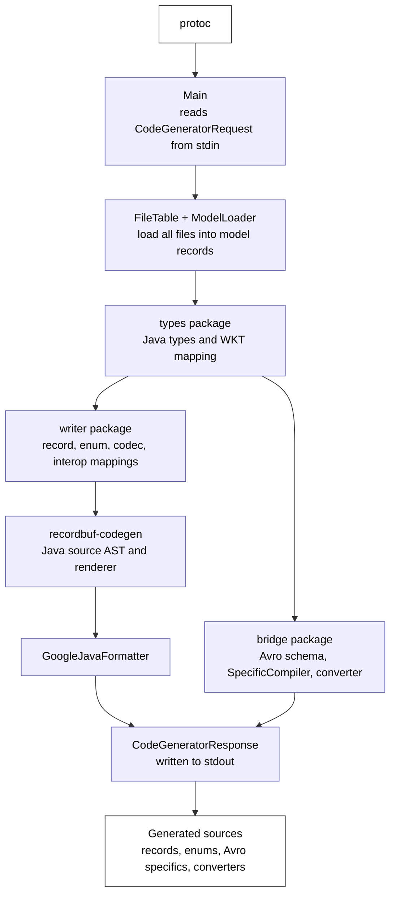

# recordbuf

> A `protoc` plugin that turns `.proto` files into idiomatic Java records that act as
> your domain model, with deterministic, generated bindings to the protobuf wire format,
> protobuf-java, Avro, and JSON, so there is no hand-written adapter left to drift.

`recordbuf` builds **`protoc-gen-recordbuf`**, a [protoc plugin](https://protobuf.dev/develop/plugins/)
written in Java. Point `protoc` at it with `--recordbuf_out=…`. For every message and enum
it emits a Java `record` / `enum` that carries:

- its own protobuf **codec**, byte-compatible with protobuf-java,
- an **unknown-field carrier**, so fields from a newer schema survive a decode → encode round-trip,
- a **builder**, **sealed-interface oneofs**, and **native well-known types** (`Instant`, `Duration`, …),
- optional bindings: **Jackson JSON** annotations, an **Avro** specific record + converter, and a
  **protobuf-java interop** converter.

The `.proto` is the single source of truth. Why and for whom is covered in [STRATEGY.md](./STRATEGY.md),
and the project vocabulary (codec, unknown-field carrier, structural twin, …) is in
[CONCEPTS.md](./CONCEPTS.md).

## Quick start

Everything uses the Gradle wrapper, not a global `gradle`. The project builds on a JDK 25 toolchain.

```bash
# 1. Build the generator and its self-contained launcher.
./gradlew :recordbuf-generator:installDist

# 2. Run it through protoc. Add options/src/main/proto to -I if your .proto imports
#    recordbuf_options.proto.
protoc --plugin=protoc-gen-recordbuf="$PWD/generator/build/install/protoc-gen-recordbuf/bin/protoc-gen-recordbuf" \
       -I options/src/main/proto -I path/to/protos \
       --recordbuf_out=src/main/java \
       path/to/protos/your.proto

# 3. Build and test the project itself (compile, tests, Spotless, Checkstyle, Error Prone/NullAway).
./gradlew build
```

Use the launcher under `generator/build/install/protoc-gen-recordbuf/bin/`. `installDist` also
writes a staging script to `generator/build/scripts/`, but that one cannot find its `lib/`
when run in place.

For a Gradle build, [`fixtures/build.gradle`](./fixtures/build.gradle) shows the full wiring
with `com.google.protobuf` (protobuf-gradle-plugin): a managed `protoc`, the recordbuf plugin,
and the options include path.

## Usage

### What gets generated

Given:

```proto
syntax = "proto3";
package example;
option java_package = "com.example";

message Sub {
  string text = 1;
}
```

recordbuf emits `com/example/Sub.java` (one file per top-level type, plus a `@NullMarked`
`package-info.java` per package):

```java
Sub s = Sub.builder().text("hi").build();

byte[] wire = s.toByteArray();            // protobuf wire format (codec: Sub.SubCodec)
Sub back = Sub.fromBytes(wire);           // unknown fields kept in back.unknownFields()

String json = new ObjectMapper().writeValueAsString(s);   // Jackson surface (default on)
SubAvro avro = SubAvroConverter.fromRecord(s);            // Avro bridge (default on)
```

| Proto shape | Generated Java |
|---|---|
| message | `record` implementing `bijnagte.recordbuf.runtime.ProtobufMessage`, with a compact constructor that normalizes defaults, a nested `Builder`, and a nested `<Name>Codec` |
| `optional` / message-typed field | `@Nullable` component (JSpecify) |
| `repeated` / `map` | `List` / `Map`, never null |
| `oneof` | nested `sealed interface` with one `<Member>Value` record per case |
| enum | Java `enum` with `getNumber()` / `forNumber(int)` |
| `bytes` | `bijnagte.recordbuf.runtime.Bytes` (immutable, content-equal) |
| `Timestamp` / `Duration` | `java.time.Instant` / `java.time.Duration` |
| scalar wrappers | boxed primitives (`BytesValue` → `Bytes`) |
| `FieldMask` / `Empty` | `runtime.FieldMask` / `runtime.Empty` |
| `Struct` / `Value` / `ListValue` / `Any` | Jackson nodes (`ObjectNode` / `JsonNode` / `ArrayNode`). Requires the Jackson surface; generation fails loudly without it. |

Generated files are marked `Generated by recordbuf -- DO NOT EDIT.`, so fix the generator or the
`.proto` instead of the output. The output is Google-Java-Format clean and NullAway clean.

The plugin speaks the standard protoc plugin protocol: it reads a `CodeGeneratorRequest` from
stdin and writes a `CodeGeneratorResponse` to stdout. Generation errors go in the response's
`error` field. Only fatal plugin failures, such as a malformed request, log to stderr (SLF4J)
and exit non-zero. Supported features: `FEATURE_PROTO3_OPTIONAL_VALUE`.

### Plugin parameters

Pass these as comma-separated `key=value` pairs, e.g. `--recordbuf_out=package_suffix=.rec,avro=off:src/main/java`.

| Parameter | Effect |
|---|---|
| `package_suffix=.rec` | Appends a suffix to every file's Java package, so records can live next to protobuf-java classes generated from the same `.proto`. |
| `avro=on\|off` | Global default for the Avro bridge (built-in default: **on**). A per-file `recordbuf.avro` option overrides it. |

### Options (`recordbuf_options.proto`)

Import `recordbuf_options.proto` (from `options/src/main/proto`, on your `-I` path) to use these.
Inside a `recordbuf.*` package, reference them with a leading dot, e.g. `(.recordbuf.java_interface)`.

| Option | Scope | Effect |
|---|---|---|
| `java_interface` (repeated) | message | Adds `implements <fqn>` to the record |
| `java_enum_interface` (repeated) | enum | Adds `implements <fqn>` to the enum |
| `protobuf_java = "<java_package>"` | message | Generates a nested `Interop` with `from(X)` / `to(R)` to the protobuf-java class `X` in that package |
| `avro = RECORDBUF_AVRO_ON\|OFF\|NONE` | file | Per-file Avro override (`NONE` falls through to the plugin parameter) |
| `jackson = false` | file | Opts out of the Jackson JSON surface (default **on**) |
| `jackson_format = "json"\|"canonical"` | field | Renders a `Timestamp` / `Duration` as ISO-8601 (default) or in the proto3 JSON mapping |
| `json_oneof = "<name>"` | oneof | Renames the oneof discriminator property (default `<oneofName>Type`) |

`json_name`, `json_ignored`, and `json_oneof_values` are reserved: they are declared but not yet read.

#### Implementing your interfaces

```proto
message Sample {
  int32 id = 1;
  option (recordbuf.java_interface) = "com.example.ComparableThing";
}
enum Color {
  option (recordbuf.java_enum_interface) = "com.example.Named";
  UNKNOWN = 0;
}
```

recordbuf writes only the `implements` clause, using the fully-qualified name as plain text in
declaration order. It never loads or checks your interface, so `javac` decides whether the type
satisfies it, just as if you had written the clause by hand. Marker interfaces need nothing else.
Types without the option generate unchanged. [docs/protobuf.dev-index.md](./docs/protobuf.dev-index.md)
explains why these options live outside protobuf's namespace.

### Bindings

- **Protobuf wire.** Always on. The codec is byte-identical to protobuf-java 4.36.2, and
  `runtime.ProtobufMarshaller` adapts any record to a gRPC-style marshaller.
- **protobuf-java interop.** Turned on per message with `protobuf_java`. `Sub.Interop.from(x)` / `Sub.Interop.to(r)`
  convert field by field, including oneofs.
- **Avro.** Default on. For each message it emits a `.avsc` schema, an Avro `SpecificRecord`
  (`SubAvro`, generated in-process by Avro's own `SpecificCompiler`) in the natural package, and a
  `SubAvroConverter` (`toRecord` / `fromRecord`) next to the record. The Avro output is a
  *structural twin*: maps, oneofs (unions), nested messages, enums and `uint64` map structurally.
  The unknown-field carrier has an (empty) slot in the Avro record but its entries are not copied
  across yet, so unknown fields do not survive an Avro round trip.
- **JSON (Jackson 3).** Default on. Adds `@JsonProperty` wire names, keeps unknown JSON properties
  in a `jsonExtras` map, flattens oneofs with a `<oneofName>Type` discriminator, and
  (de)serializes temporal fields per `jackson_format`. Generated records need no module
  registration (each field carries its own (de)serializer annotations): use a plain `JsonMapper`.
  Your own classes holding `Bytes`, `FieldMask` or `Empty` need
  `JsonMapper.builder().findAndAddModules()` (Jackson 3 discovery is opt-in) or `addModule(new
  RecordbufJsonModule())`. A `FieldMask` is a JSON array of lowerCamel paths, and
  `JsonFieldMaskFilter` projects a JSON tree onto a mask.

### Consumer dependencies

Generated code never depends on the generator. What it needs on the classpath depends on
which bindings are enabled:

| Needed for | Coordinate |
|---|---|
| always | `bijnagte.recordbuf:recordbuf-runtime` (brings `com.google.protobuf:protobuf-java` 4.36.2) and `org.jspecify:jspecify` |
| JSON surface (default on) | `bijnagte.recordbuf:recordbuf-json` (brings Jackson 3 databind and the annotations) |
| Avro bridge (default on) | `bijnagte.recordbuf:recordbuf-avro` (brings `org.apache.avro:avro`) |
| `protobuf_java` interop | protobuf-java classes generated from the same `.proto` (`protoc --java_out`) |

To get output that depends only on the runtime, turn off both default-on bindings
(`jackson = false` and `avro=off`).

## How it works

The diagram shows one `protoc` invocation, from request to generated files.



## Project layout

Seven co-versioned subprojects (`bijnagte.recordbuf:0.0.1`) live in role-named directories under the
repo root. The root `build.gradle.kts` is an aggregator that also applies the shared quality gates.

| Dir | Project | Role |
|---|---|---|
| `generator/` | `:recordbuf-generator` | The plugin (`bijnagte.recordbuf.plugin.Main`). `model/` (proto model records), `types/` (type and WKT mapping), `writer/` (source mappings), `bridge/` (Avro bridge). `com/google/protobuf/compiler/` holds the protoc plugin-protocol shim, which is protocol glue and should not be refactored. |
| `codegen/` | `:recordbuf-codegen` | Generator-only, dependency-free Java source AST + `SourceRenderer` (import collection, Javadoc, formatting SPI). |
| `runtime/` | `:recordbuf-runtime` | What generated code calls: `Encoder`/`Decoder`/`Wire` framing, `UnknownFields`, `ProtobufMessage`, `ProtobufMarshaller`, `Bytes`, `FieldMask`, `Empty`, `wkt.Wkt`. |
| `json/` | `:recordbuf-json` | Jackson support: temporal (de)serializers, `JsonExtras`, dynamic WKT bridging, the JSON envelope. |
| `recordbuf-avro/` | `:recordbuf-avro` | Avro runtime support: WKT ↔ Avro conversions (`WktAvroBridge`). |
| `options/` | `:recordbuf-options` | `recordbuf_options.proto`, consumed as a protoc `-I` include, not as a Gradle dependency. |
| `fixtures/` | `:recordbuf-fixtures` | Per-feature `.proto` fixtures generated through the real launcher, plus byte-compatibility, interop, Avro, JSON, and unknown-field round-trip tests against protobuf-java 4.36.2. Its Gradle script is Groovy because of the protobuf-gradle-plugin's DSL. |

Other files: `gradle/libs.versions.toml` (the version catalog, where versions are bumped),
`config/checkstyle/checkstyle.xml` (shared Checkstyle config), `docs/plans/` (implementation plans),
and `docs/solutions/` (documented learnings; see [docs/README.md](./docs/README.md)).

## Development

`./gradlew build` runs every gate. Each applies to every Java subproject, and they also cover
the generated fixture output:

- **Spotless + Google Java Format.** Run `./gradlew spotlessApply` before committing.
- **Checkstyle.** A curated, non-formatting rule set.
- **Error Prone + NullAway.** NullAway runs at error severity on `@NullMarked` packages.
- **`-Werror`.** Every javac warning, including deprecation, fails the build.

Generation is cached. Changing the generator re-runs fixture generation automatically, because
`installDist` is a tracked input. Use `--rerun-tasks` only to bypass the cache. To see the
plugin's debug logs, set `-Dorg.slf4j.simpleLogger.defaultLogLevel=debug` (they go to stderr only).

## License

MIT. See [LICENSE](./LICENSE).
