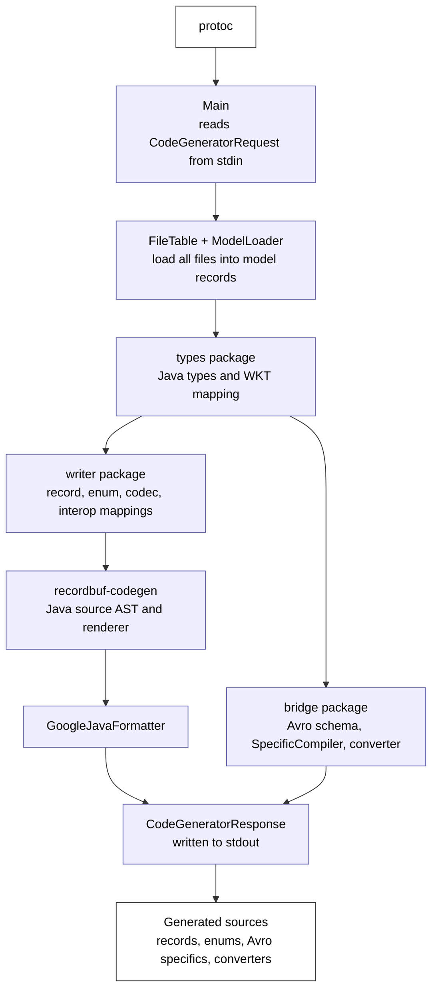
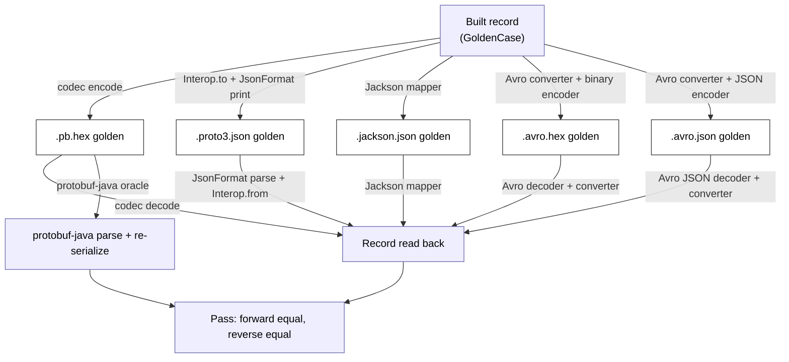

# recordbuf

> A `protoc` plugin that turns `.proto` files into idiomatic Java records that act as
> your domain model, with deterministic, generated bindings to the protobuf wire format,
> protobuf-java, Avro, and JSON, so there is no hand-written adapter left to drift.

`recordbuf` builds **`protoc-gen-recordbuf`**, a [protoc plugin](https://protobuf.dev/develop/plugins/)
written in Java. Point `protoc` at it with `--recordbuf_out=…`. For every message and enum
it emits a Java `record` / `enum` that carries:

- its own protobuf **codec**, byte-compatible with protobuf-java,
- an **unknown-field carrier**, so fields from a newer schema survive a decode → encode round-trip,
- a **builder**, **sealed-interface oneofs**, and **native well-known types** (`Instant`, `Duration`, …),
- optional bindings: **Jackson JSON** annotations, an **Avro** specific record + converter, and a
  **protobuf-java interop** converter.

The `.proto` is the single source of truth. Why and for whom is covered in [STRATEGY.md](./STRATEGY.md),
and the project vocabulary (codec, unknown-field carrier, structural twin, …) is in
[CONCEPTS.md](./CONCEPTS.md).

## Quick start

Everything uses the Gradle wrapper, not a global `gradle`. The project builds on a JDK 25 toolchain.

```bash
# 1. Build the generator and its self-contained launcher.
./gradlew :recordbuf-generator:installDist

# 2. Run it through protoc. Add options/src/main/proto to -I if your .proto imports
#    recordbuf_options.proto.
protoc --plugin=protoc-gen-recordbuf="$PWD/generator/build/install/protoc-gen-recordbuf/bin/protoc-gen-recordbuf" \
       -I options/src/main/proto -I path/to/protos \
       --recordbuf_out=src/main/java \
       path/to/protos/your.proto

# 3. Build and test the project itself (compile, tests, Spotless, Checkstyle, Error Prone/NullAway).
./gradlew build
```

Use the launcher under `generator/build/install/protoc-gen-recordbuf/bin/`. `installDist` also
writes a staging script to `generator/build/scripts/`, but that one cannot find its `lib/`
when run in place.

### Executable jar

`./gradlew :recordbuf-generator:shadowJar` builds a single jar with every dependency inside,
`generator/build/libs/recordbuf-generator-<version>-all.jar`. It runs with `java -jar` and has
the same output as the launcher above. `protoc` plugins must be executable files, so point it at a
small wrapper script:

```bash
printf '#!/bin/sh\nexec java -jar %s "$@"\n' "$PWD/generator/build/libs/recordbuf-generator-<version>-all.jar" > protoc-gen-recordbuf
chmod +x protoc-gen-recordbuf
protoc --plugin=protoc-gen-recordbuf=./protoc-gen-recordbuf --recordbuf_out=src/main/java your.proto
```

The jar's manifest carries the `Add-Exports` entries that google-java-format needs on a modern JDK,
so no JVM flags are required. `build` creates this jar, and each release also publishes it to Maven Central as
`io.github.bijnagte.recordbuf:recordbuf-generator:<version>:all` (a signed `-all.jar`). The default
`recordbuf-generator` artifact stays the plain library jar with its dependencies in the POM, so existing
consumers are unaffected.

### Download a release

Each [GitHub release](https://github.com/Bijnagte/recordbuf/releases) has a zip per platform with a
bundled Java runtime, so it runs without a JDK installed:

| Zip | Platform |
|---|---|
| `protoc-gen-recordbuf-<version>-linux-x86_64.zip` | Linux, Intel/AMD |
| `protoc-gen-recordbuf-<version>-linux-aarch_64.zip` | Linux, ARM |
| `protoc-gen-recordbuf-<version>-osx-x86_64.zip` | macOS, Intel |
| `protoc-gen-recordbuf-<version>-osx-aarch_64.zip` | macOS, Apple Silicon |

Unzip it and point `protoc` at the launcher inside:

```bash
unzip protoc-gen-recordbuf-<version>-osx-aarch_64.zip
protoc --plugin=protoc-gen-recordbuf="$PWD/protoc-gen-recordbuf-<version>-osx-aarch_64/bin/protoc-gen-recordbuf" \
       --recordbuf_out=src/main/java your.proto
```

`checksums_sha256.txt` on the release lists the SHA-256 of every zip. macOS may quarantine a downloaded
zip; if it refuses to run the launcher, clear the flag with `xattr -dr com.apple.quarantine <dir>`.
There is no Windows build.

For a Gradle build, [`fixtures/build.gradle`](./fixtures/build.gradle) shows the full wiring
with `com.google.protobuf` (protobuf-gradle-plugin): a managed `protoc`, the recordbuf plugin,
and the options include path.

## Usage

### What gets generated

Given:

```proto
syntax = "proto3";
package example;
option java_package = "com.example";

message Sub {
  string text = 1;
}
```

recordbuf emits `com/example/Sub.java` (one file per top-level type, plus a `@NullMarked`
`package-info.java` per package):

```java
Sub s = Sub.builder().text("hi").build();

byte[] wire = s.toByteArray();            // protobuf wire format (codec: Sub.SubCodec)
Sub back = Sub.fromBytes(wire);           // unknown fields kept in back.unknownFields()

String json = new ObjectMapper().writeValueAsString(s);   // Jackson surface (default on)
SubAvro avro = SubAvroConverter.fromRecord(s);            // Avro bridge (default on)
```

| Proto shape | Generated Java |
|---|---|
| message | `record` implementing `bijnagte.recordbuf.runtime.ProtobufMessage`, with a compact constructor that normalizes defaults, a nested `Builder`, and a nested `<Name>Codec` |
| `optional` / message-typed field | `@Nullable` component (JSpecify) |
| `repeated` / `map` | `List` / `Map`, never null; a map value may be a scalar, `bytes`, a message or an enum |
| `oneof` | nested `sealed interface` with one `<Member>Value` record per case, named in UpperCamelCase (`oneof_uint32` → `OneofUint32Value`) |
| field name | lowerCamelCase record component; a name that camel-cases to an upper-case start lowers only its first letter (`FIELD_NAME11` → `fIELDNAME11`), while its JSON name stays protoc's |
| enum | Java `enum` with `getNumber()` / `forNumber(int)` |
| `bytes` | `bijnagte.recordbuf.runtime.Bytes` (immutable, content-equal) |
| `Timestamp` / `Duration` | `java.time.Instant` / `java.time.Duration` |
| scalar wrappers | boxed primitives (`BytesValue` → `Bytes`) |
| `FieldMask` / `Empty` | `runtime.FieldMask` / `runtime.Empty` |
| `Struct` / `Value` / `ListValue` / `Any` | Jackson nodes (`ObjectNode` / `JsonNode` / `ArrayNode`). Requires the Jackson surface; generation fails loudly without it. |

Generated files are marked `Generated by recordbuf -- DO NOT EDIT.`, so fix the generator or the
`.proto` instead of the output. The output is Google-Java-Format clean and NullAway clean.

The plugin speaks the standard protoc plugin protocol: it reads a `CodeGeneratorRequest` from
stdin and writes a `CodeGeneratorResponse` to stdout. Generation errors go in the response's
`error` field. Only fatal plugin failures, such as a malformed request, log to stderr (SLF4J)
and exit non-zero. Supported features: `FEATURE_PROTO3_OPTIONAL_VALUE`.

### Plugin parameters

Pass these as comma-separated `key=value` pairs, e.g. `--recordbuf_out=package_suffix=.rec,avro=off:src/main/java`.

| Parameter | Effect |
|---|---|
| `package_suffix=.rec` | Appends a suffix to every file's Java package, so records can live next to protobuf-java classes generated from the same `.proto`. |
| `avro=on\|off` | Global default for the Avro bridge (built-in default: **on**). A per-file `recordbuf.avro` option overrides it. |

### Options (`recordbuf_options.proto`)

Import `recordbuf_options.proto` (from `options/src/main/proto`, on your `-I` path) to use these.
Inside a `recordbuf.*` package, reference them with a leading dot, e.g. `(.recordbuf.java_interface)`.

| Option | Scope | Effect |
|---|---|---|
| `java_interface` (repeated) | message | Adds `implements <fqn>` to the record |
| `java_enum_interface` (repeated) | enum | Adds `implements <fqn>` to the enum |
| `protobuf_java = "<java_package>"` | message | Generates a nested `Interop` with `from(X)` / `to(R)` to the protobuf-java class `X` in that package |
| `avro = RECORDBUF_AVRO_ON\|OFF\|NONE` | file | Per-file Avro override (`NONE` falls through to the plugin parameter) |
| `jackson = false` | file | Opts out of the Jackson JSON surface (default **on**) |
| `jackson_format = "json"\|"canonical"` | field | Renders a `Timestamp` / `Duration` as ISO-8601 (default) or in the proto3 JSON mapping |
| `json_oneof = "<name>"` | oneof | Renames the oneof discriminator property (default `<oneofName>`) |
| `json_name = "<name>"` | field | Renames the field's JSON property on a jackson-enabled file, replacing the proto3 camelCase name |
| `json_ignored = true` | field | Keeps the field out of the JSON output on a jackson-enabled file; it stays on the wire. Not enforced on read: see [known findings](docs/known-findings.md) |

`json_oneof_values` is reserved: it is declared but not yet read.

#### Implementing your interfaces

```proto
message Sample {
  int32 id = 1;
  option (recordbuf.java_interface) = "com.example.ComparableThing";
}
enum Color {
  option (recordbuf.java_enum_interface) = "com.example.Named";
  UNKNOWN = 0;
}
```

recordbuf writes only the `implements` clause, using the fully-qualified name as plain text in
declaration order. It never loads or checks your interface, so `javac` decides whether the type
satisfies it, just as if you had written the clause by hand. Marker interfaces need nothing else.
Types without the option generate unchanged. [docs/protobuf.dev-index.md](./docs/protobuf.dev-index.md)
explains why these options live outside protobuf's namespace.

### Bindings

- **Protobuf wire.** Always on. The codec is byte-identical to protobuf-java 4.36.2, and
  `runtime.ProtobufMarshaller` adapts any record to a gRPC-style marshaller.
- **protobuf-java interop.** Turned on per message with `protobuf_java`. `Sub.Interop.from(x)` / `Sub.Interop.to(r)`
  convert field by field, including oneofs.
- **Avro.** Default on. For each message it emits a `.avsc` schema, an Avro `SpecificRecord`
  (`SubAvro`, generated in-process by Avro's own `SpecificCompiler`) in the natural package, and a
  `SubAvroConverter` (`toRecord` / `fromRecord`) next to the record. The Avro output is a
  *structural twin*: maps, oneofs (unions), nested messages, enums and `uint64` map structurally.
  The unknown-field carrier has an (empty) slot in the Avro record but its entries are not copied
  across yet, so unknown fields do not survive an Avro round trip.
- **JSON (Jackson 3).** Default on. Adds `@JsonProperty` wire names, keeps unknown JSON properties
  in a `jsonExtras` map (JSON only: never written to the wire), flattens oneofs with a `<oneofName>` discriminator, and
  (de)serializes temporal fields per `jackson_format`. Generated records need no module
  registration (each field carries its own (de)serializer annotations): use a plain `JsonMapper`.
  Your own classes holding `Bytes`, `FieldMask` or `Empty` need
  `JsonMapper.builder().findAndAddModules()` (Jackson 3 discovery is opt-in) or `addModule(new
  RecordbufJsonModule())`. A `FieldMask` is a JSON array of lowerCamel paths, and
  `JsonFieldMaskFilter` projects a JSON tree onto a mask.

### Decode limits

A binary decode is bounded. A generated `decode(byte[])` and `fromBytes` reject a payload that nests more than 100 message levels below the top-level message (protobuf-java's default depth) or hands more than 64 MiB of cumulative nested-message bytes to nested decodes; the top-level input is not charged. A rejection throws `InvalidProtocolBufferException`, an `IOException`, and never `StackOverflowError` at the default depth or at any depth the thread stack can hold. To change the limits for one decode, bind `DecodeLimits.CURRENT`:

```java
// depth 200 and 16 MiB of nested bytes; in a method that throws IOException (Sub is a generated record)
Sub back = ScopedValue.where(DecodeLimits.CURRENT, new DecodeLimits(200, 16L * 1024 * 1024))
    .call(() -> Sub.fromBytes(wire));
```

`ScopedValue.Carrier.call` rethrows the body's checked exception: `fromBytes` throws `IOException`, so the enclosing method must declare or handle it. With no binding, `DecodeLimits.defaults()` applies.

### Consumer dependencies

Generated code never depends on the generator. What it needs on the classpath depends on
which bindings are enabled:

| Needed for | Coordinate |
|---|---|
| always | `io.github.bijnagte.recordbuf:recordbuf-runtime` (brings `com.google.protobuf:protobuf-java` 4.36.2) and `org.jspecify:jspecify` |
| JSON surface (default on) | `io.github.bijnagte.recordbuf:recordbuf-json` (brings Jackson 3 databind and the annotations) |
| Avro bridge (default on) | `io.github.bijnagte.recordbuf:recordbuf-avro` (brings `org.apache.avro:avro`) |
| `protobuf_java` interop | protobuf-java classes generated from the same `.proto` (`protoc --java_out`) |

To get output that depends only on the runtime, turn off both default-on bindings
(`jackson = false` and `avro=off`).

## How it works

The diagram shows one `protoc` invocation, from request to generated files.



## Compatibility suite

`:recordbuf-fixtures` checks that generated records stay compatible with frozen copies of their data
in five formats, and it measures protobuf compatibility against the official conformance suite. Each
case is one built record. Each format the case applies to has a golden: a committed file, seeded once
from the library that produced it, and never rewritten by the suite.

### Formats

| Golden | Format | Seeded from | Applies when |
|---|---|---|---|
| `.pb.hex` | protobuf binary | protobuf-java: the record's bytes, parsed and re-serialized | the record has a protobuf-java reference class |
| `.proto3.json` | proto3 JSON, through the generated `Interop` converter | protobuf-java `JsonFormat` | the message carries `(recordbuf.protobuf_java)` |
| `.jackson.json` | Jackson JSON | recordbuf's own mapper; **review by hand**, there is no independent source | the Jackson surface is on |
| `.avro.hex` | Avro binary, single-object encoding | Avro's encoder | the record has a generated Avro converter |
| `.avro.json` | canonical Avro JSON | Avro's JSON encoder | the record has a generated Avro converter |

An `.avro.hex` golden starts with the single-object marker `C3 01`, then the 8-byte CRC-64-AVRO
fingerprint of the writer schema, then the datum. A schema change rewrites that header in every Avro
binary golden. `.avro.json` has no fingerprint, so it changes only when the record's data or shape
changes.

Goldens live at `fixtures/src/test/resources/golden/<family>/<case>.<ext>`. Binary goldens are
lowercase hex, 32 bytes per line.

### How a case is checked

A case declares one outcome per format: lossless, expected-after-trip, or not applicable. Each
applicable pair gets two tests.

- **forward**: serialize the built record and compare with the golden. JSON is compared after both
  sides are parsed to a tree and pretty-printed, so member order and value types count and whitespace
  does not. Binary is compared byte for byte.
- **reverse**: deserialize the golden and compare with the built record. A format that drops
  information by design compares with the case's *expected-after-trip* record instead, for example a
  `json_ignored` field, or the unknown-field carrier under proto3 JSON.

The protobuf binary reverse check also parses the golden with protobuf-java and requires it to
re-serialize to the same bytes. A pair the format does not apply to shows as **not applicable**, with
its reason. It is skipped, never passed.



The forward check compares each golden with the output of the arrow leaving the built record.

### Adding a case

1. Add the case to its family's `*Cases` source, a `GoldenCaseSource` (usually extending
   `JacksonGoldenCases`, which fixes the five formats). Declare an outcome for each format, then build
   the case against `formats()`.
2. Register a new source in `GoldenCaseRegistry.sources()`. The seeder walks only registered sources.
3. Make sure a `@TestFactory` runs it: `GoldenMatrix.of(GoldenStore.classpath(), source.formats()).tests(source.cases())`.
4. Seed the missing goldens (below), review them, and commit them with the case.

### Seeding goldens

```bash
./gradlew :recordbuf-fixtures:seedGoldens
```

The task writes each missing golden and lists the existing ones as skipped. It never overwrites, and
`check` does not run it. Review the report before committing: each Jackson golden it creates is
flagged `REVIEW`.

A `.pb.hex` golden is protobuf-java's encoding of the record's own bytes. An encoder that drops a field
therefore seeds the same dropped bytes. Only the reverse check catches that, when the golden no longer
decodes to the built record.

### Gaps

Constructs and conformance scenarios that recordbuf does not satisfy yet are tracked in the
[gap ledger](fixtures/src/test/resources/golden/gap-ledger.md). A construct gap has a `GAP(<id>)`
marker in a vendored proto under `fixtures/src/main/proto`. The construct is commented out there when
it does not generate, or left active with the marker above it when it generates but is wrong in one
format. `GapLedgerTest` fails when a marker has no row, a construct row has no marker, or an id
repeats.

Each gap closes in its own change: uncomment or fix the construct, fix the generator, seed its goldens
in every applicable format, and remove the row and its marker. A conformance entry that is listed as a
known gap fails once its case starts passing, so its entry goes in the same change.

Generator findings that are not proto constructs are in [docs/known-findings.md](docs/known-findings.md).

### Conformance mirror

[`conformance-manifest.md`](fixtures/src/test/resources/golden/conformance-manifest.md) inventories the
proto3 scenario groups of the official protobuf conformance suite at tag `v36.2`. Each group is
covered, a gap, or not applicable, and `GapLedgerTest` cross-checks the manifest against the ledger.
The scenarios are mirrored as Java tests in `fixtures/src/test/java/bijnagte/recordbuf/fixture/conformance/`.
Google's C++ runner is not used.

- **Binary** scenarios decode with recordbuf and compare with protobuf-java. Inputs the suite rejects
  must throw in recordbuf. Where protobuf-java accepts an input the suite rejects (the `BadTag` cases),
  the mirror asserts the reference's acceptance and records recordbuf's acceptance as a gap.
- **JSON** scenarios run `JsonFormat` → protobuf-java message → `Interop.from` → record → `Interop.to` →
  `JsonFormat`, for both halves. A scenario that names a commented-out construct aborts its recordbuf
  half with that construct's gap id. A scenario the record path still gets wrong runs and aborts with
  its gap id, listed in `KNOWN_GAPS` in `JsonConformance`.
- Groups that only exercise `JsonFormat`'s own parse rejection are not applicable: they belong to Google.

### Coverage gate

`fixtures/build.gradle` measures the fixtures test run with JaCoCo over the runtime, json and avro
classes and the module's `.rec` output. The vendored corpus package is excluded as new scope. `check`
runs `jacocoTestCoverageVerification`, whose minimums are line 0.8 and
branch 0.7 (raised from the pre-restructure baseline). Those minimums do not go down. Report: `./gradlew :recordbuf-fixtures:jacocoTestReport`.

## Project layout

Seven co-versioned subprojects (`io.github.bijnagte.recordbuf:<version>`) live in role-named directories under the
repo root. The root `build.gradle.kts` is an aggregator that also applies the shared quality gates.

| Dir | Project | Role |
|---|---|---|
| `generator/` | `:recordbuf-generator` | The plugin (`bijnagte.recordbuf.plugin.Main`). `model/` (proto model records), `types/` (type and WKT mapping), `writer/` (source mappings), `bridge/` (Avro bridge). `com/google/protobuf/compiler/` holds the protoc plugin-protocol shim, which is protocol glue and should not be refactored. |
| `codegen/` | `:recordbuf-codegen` | Generator-only, dependency-free Java source AST + `SourceRenderer` (import collection, Javadoc, formatting SPI). |
| `runtime/` | `:recordbuf-runtime` | What generated code calls: `Encoder`/`Decoder`/`Wire` framing, `UnknownFields`, `ProtobufMessage`, `ProtobufMarshaller`, `Bytes`, `FieldMask`, `Empty`, `wkt.Wkt`. |
| `json/` | `:recordbuf-json` | Jackson support: temporal / bytes / `FieldMask` / `Empty` (de)serializers, oneof reading, dynamic WKT bridging, the JSON envelope. |
| `avro/` | `:recordbuf-avro` | Avro runtime support: WKT ↔ Avro conversions (`WktAvroBridge`). |
| `options/` | `:recordbuf-options` | `recordbuf_options.proto`, consumed as a protoc `-I` include, not as a Gradle dependency. |
| `fixtures/` | `:recordbuf-fixtures` | Per-feature `.proto` fixtures generated through the real launcher, and the [compatibility suite](#compatibility-suite): a golden matrix over five formats, checked against protobuf-java 4.36.2 and Avro, plus a protobuf conformance mirror. Its Gradle script is Groovy because of the protobuf-gradle-plugin's DSL. |

Other files: `gradle/libs.versions.toml` (the version catalog, where versions are bumped),
`config/checkstyle/checkstyle.xml` (shared Checkstyle config), `docs/plans/` (implementation plans),
and `docs/solutions/` (documented learnings; see [docs/README.md](./docs/README.md)).

## Development

`./gradlew build` runs every gate. Each applies to every Java subproject, and they also cover
the generated fixture output:

- **Spotless + Google Java Format.** Run `./gradlew spotlessApply` before committing.
- **Checkstyle.** A curated, non-formatting rule set.
- **Error Prone + NullAway.** NullAway runs at error severity on `@NullMarked` packages.
- **`-Werror`.** Every javac warning, including deprecation, fails the build.
- **JaCoCo (fixtures only).** The coverage minimums in `fixtures/build.gradle` are part of `check`. See [Compatibility suite](#compatibility-suite).

Generation is cached. Changing the generator re-runs fixture generation automatically, because
`installDist` is a tracked input. Use `--rerun-tasks` only to bypass the cache. To see the
plugin's debug logs, set `-Dorg.slf4j.simpleLogger.defaultLogLevel=debug` (they go to stderr only).

## Publishing

The consumer modules publish to Maven Central through the Central Portal under `io.github.bijnagte.recordbuf`:
`recordbuf-runtime`, `recordbuf-json`, `recordbuf-avro`, `recordbuf-codegen`, `recordbuf-generator` and `recordbuf-options`.
`fixtures/` is never published.
`recordbuf-options` is a jar whose only content is `recordbuf_options.proto` at its root. Consumers who import
`recordbuf_options.proto` get it by adding the jar's contents to their `protoc -I` path (for example, unzip it into
a directory and pass that directory with `-I`). It imports `google/protobuf/descriptor.proto`, which protoc provides itself.
Publishing uses Gradle's built-in `maven-publish` to stage every module into one directory (wiring in the root
`build.gradle.kts`), and [JReleaser](https://jreleaser.org/guide/latest/reference/deploy/maven/maven-central.html) to sign
the staged files and upload them to the Central Portal (wiring at the end of `generator/build.gradle.kts`). There is no other
publishing plugin.

To release, push a version tag. The tag is the version, so `v0.0.2` publishes `0.0.2`:

```bash
git tag v0.0.2
git push origin v0.0.2
```

The `publish` workflow (`.github/workflows/publish.yml`) runs on every `v*` tag. It rejects tags that are not
`v<major>.<minor>.<patch>[-qualifier]`, builds the project, and uploads all six modules to the Central Portal as one
deployment. Then, in the [Central Portal](https://central.sonatype.com/publishing/deployments), open the new deployment,
check it, and click **Publish**. Nothing reaches Central until you do (the deployer runs with `stage = UPLOAD`).
Central never overwrites a version, so a tag that published something wrong needs a new version, not a re-push of the
same tag.

The same tag also triggers `.github/workflows/release.yml`, which creates the GitHub release and attaches the
platform zips described under [Download a release](#download-a-release). The two workflows are independent: a failure
in one does not stop the other. The release workflow needs no secrets beyond the built-in `GITHUB_TOKEN`.

The zips are built by [JReleaser](https://jreleaser.org/guide/latest/reference/assemble/jlink.html) (its jlink
assembler), configured at the end of `generator/build.gradle.kts`. One Linux runner builds all four platforms: jlink
takes a JDK per target platform, which `scripts/fetch-target-jdks.sh` downloads (Amazon Corretto, checksum-verified;
Temurin 25 no longer ships the `jmods` that cross-platform jlink needs). To build zips locally, run that script, then
`./gradlew :recordbuf-generator:jreleaserAssemble`. Without target JDKs it builds only for your own platform.

Local builds use `0.0.1-SNAPSHOT` unless you pass `-PreleaseVersion=x.y.z`.

One-time setup (repository secrets, used by `.github/workflows/publish.yml`):

| Secret | Value |
|---|---|
| `MAVEN_CENTRAL_USERNAME` / `MAVEN_CENTRAL_PASSWORD` | A user token from the Central Portal (Account → Generate User Token). Not your login password. |
| `GPG_PRIVATE_KEY` | `gpg --armor --export-secret-keys <KEY_ID>` (ASCII-armored secret key). |
| `GPG_PASSPHRASE` | The key's passphrase. Leave empty if the key has none. |

The namespace `io.github.bijnagte` must be verified in the Central Portal before the first upload. Create a key with
`gpg --full-generate-key`, and publish its public part to a keyserver such as `keys.openpgp.org`, or Central cannot
verify the signatures. (JReleaser reads the key ID from the key itself, so there is no key-ID secret.)

The workflow maps those secrets onto the variables JReleaser reads: `JRELEASER_MAVENCENTRAL_SONATYPE_USERNAME` and
`_PASSWORD`, and `JRELEASER_GPG_SECRET_KEY` and `JRELEASER_GPG_PASSPHRASE`. Signing is on only when
`JRELEASER_GPG_SECRET_KEY` is set, so the GitHub release workflow and local runs need no key.

Local checks, which need no key and no credentials:
- `./gradlew publishToMavenLocal` installs every module into `~/.m2`.
- `./gradlew publishAllPublicationsToStagingRepository` stages them into `build/staging-deploy`, which is what the
  deployment uploads.


## License

MIT. See [LICENSE](./LICENSE).
