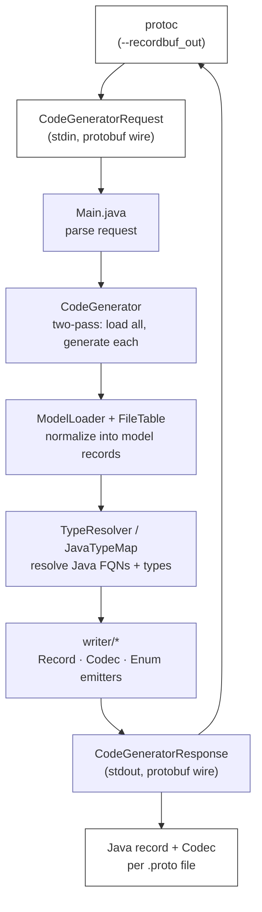

# recordbuf

> A `protoc` code-generation plugin that turns `.proto` files into Java records
> with built-in protobuf codecs — no separate build step, no generated
> dependency surface beyond the protobuf runtime.

`recordbuf` builds **`protoc-gen-recordbuf`**, a [protoc plugin](https://protobuf.dev/develop/plugins/)
written in Java. You point `protoc` at it with a custom output flag
(`--recordbuf_out=…`) and it emits one Java source file per `.proto`, each
containing `record` types plus a `Codec` member that reads/writes the protobuf
wire format.

## Quick start

Everything below uses the Gradle wrapper — not a global `gradle`.

```bash
# 1. Build the generator and produce its launcher script.
./gradlew :recordbuf-generator:installDist

# 2. Run it through protoc, generating into your source tree.
protoc --plugin=protoc-gen-recordbuf="$PWD/generator/build/install/protoc-gen-recordbuf/bin/protoc-gen-recordbuf" \
       --recordbuf_out=src/main/java \
       path/to/your.proto

# 3. Build/test the project itself.
./gradlew build
```

`./gradlew :recordbuf-generator:installDist` produces a self-contained launcher
at `generator/build/install/protoc-gen-recordbuf/bin/protoc-gen-recordbuf`, with a
sibling `lib/` of jars: it puts the generator classpath on `$CLASSPATH` and
execs `java -cp … bijnagte.recordbuf.plugin.Main`.

## Usage

The plugin speaks the standard protoc plugin wire protocol: it reads a single
serialized `CodeGeneratorRequest` from **stdin** and writes a single serialized
`CodeGeneratorResponse` to **stdout**. Generation errors are reported through the
response `error` field (so `protoc --fail-fast=false` works); only fatal
plugin-level failures — e.g. a malformed request — write to stderr and exit
non-zero.

For each file in the request's `file_to_generate` list, recordbuf emits one Java
source file holding:

- the message `record`(s), with nested messages/enums inlined,
- a compact constructor that null-guards `Optional`/`List`/`Map` fields,
- a `Codec` that provides `CodedInputStream`/`CodedOutputStream` (de)serialization,
- an `implements` clause when the type declares the `java_interface` / `java_enum_interface`
  option (see [Implementing user interfaces](#implementing-user-interfaces-via-custom-options)),
- top-level `enum`s (declared before the records that reference them).

Supported features: `FEATURE_PROTO3_OPTIONAL_VALUE`.

### Generated types are generator-free

The generated output is independent of `:recordbuf-generator`: it does not pull
in the plugin's internals. It depends on two small, published coordinates:

- the protobuf runtime (`com.google.protobuf.{CodedInputStream,CodedOutputStream}`), and
- `bijnagte.recordbuf:recordbuf-runtime` — the small codec-helper surface the
generated `Codec` calls into (encode/decode scaffolding, packed buffer/drain,
tag/`skipField` primitives, the per-wire default-value table). The per-message
field dispatch stays in the generated codec; only the mechanical framing lives
in the runtime.

Keep both `com.google.protobuf:protobuf-java` and `recordbuf-runtime` on your
consumer classpath. The generator's own extra libraries (JSpecify nullability
annotations, the record-builder annotation processor) do **not** leak into
generated output.

> **Do not edit generated files by hand.** Each carries a
> `Generated by recordbuf -- DO NOT EDIT.` header. Fix the generator or the
> `.proto` instead.

### Implementing user interfaces via custom options

A generated record or enum can implement one or more of *your* Java interfaces.
Declare them with two custom options — a `repeated string` extension on
`MessageOptions` / `EnumOptions`, defined in recordbuf's
`recordbuf_options.proto`:

```proto
import "recordbuf_options.proto";   // defines the two extensions; keep on your `-I` path

message Sample {
  int32 id = 1;
  option (recordbuf.java_interface) = "com.example.ComparableThing";
  option (recordbuf.java_interface) = "com.example.Sourced";
}

enum Color {
  option (recordbuf.java_enum_interface) = "com.example.Named";
  UNKNOWN = 0;
  RED = 1;
}
```

The generated output is:

```java
public record Sample(int id)
        implements com.example.ComparableThing, com.example.Sourced { … }

public enum Color implements com.example.Named { … }
```

**No verification burden.** recordbuf emits the `implements` clause *only* —
never a body, and it never loads or type-checks your interface against its own
classpath. The fully-qualified names are written as plain text (no import is
added), so the Java compiler owns satisfaction, exactly as if you'd hand-written
the clause. Three consequences:

- **Marker interfaces are free.** A type that declares only marker interfaces
  needs no further action — it already satisfies them.
- **Declaration order is preserved.** Interfaces are emitted in the order the
  options are written.
- **No option ⇒ no clause.** Types that don't declare an option are generated
  byte-for-byte as before, so this is a no-op for existing code.

One option is declared per type, and because protobuf forbids naming the same
extension symbol on both `MessageOptions` and `EnumOptions`, the two use distinct
names — `java_interface` on messages and `java_enum_interface` on enums
(field numbers 50000 / 50001). Because the extension names live in recordbuf's
own package (not protobuf's public namespace), a consumer `.proto` nested under
the `recordbuf` package must reference them with a leading dot, e.g.
`(.recordbuf.java_interface)`. See
[docs/protobuf.dev-index.md](./docs/protobuf.dev-index.md) for the full note on
why these extensions are not part of protobuf itself.

## Project layout

Four role-named subprojects live flat under the repo root; the root
`build.gradle.kts` is a pure aggregator that co-versions them all as
`bijnagte.recordbuf:0.0.1` via a `subprojects {…}` block.

```
build.gradle.kts              Root aggregator: no java/application plugin, just
                              subprojects{ group; version } (KTD3) and the KTD7
                              version-skip note.
settings.gradle.kts           Includes the four subprojects; maps role -> dir.
gradle/libs.versions.toml     Centralized version catalog (bump here, not in the build)
runtime/                      :recordbuf-runtime — the I/O-framing codec-helper
                              surface the generated Codec calls into by FQN.
                              (Encoder/Decoder/Wire/CodecDefaults + package-info).
options/                      :recordbuf-options — recordbuf_options.proto, the
                              java_interface (MessageOptions, 50000) /
                              java_enum_interface (EnumOptions, 50001) extension
                              definitions. A protoc -I include path, not a
                              Gradle dependency of the generator (KTD5).
fixtures/                     :recordbuf-fixtures — per-family .proto + the
                              interop/byte-equality and interface tests. Generates
                              record + protobuf-java references into its own source
                              set; the interop suite runs against the compiled
                              fixtures artifact (KTD6).
generator/                    :recordbuf-generator — the plugin itself.
  src/main/java/bijnagte/recordbuf/plugin/
    Main.java                 protoc entry point: stdin → generate → stdout
    CodeGenerator.java        Drives generation for one CodeGeneratorRequest
    model/                    Loaded/normalized proto model (records w/
                              @RecordBuilder + JSpecify @NullMarked packages)
    types/                    Type resolution (javaPackage, cross-file FQNs,
                              Java type mapping)
    writer/                   Emitters: records, codecs (emits runtime FQNs),
                              enums, and the JavaWriter buffer
  src/main/java/com/google/protobuf/compiler/
    PluginProtos.java         protoc plugin-protocol shim. Generated/protocol
                              glue — do not hand-rename or refactor.
  src/test/java/bijnagte/recordbuf/plugin/
    ImplementsClauseEmissionTest / model/   Plugin + model tests
  build/install/           installDist output: the self-contained launcher
                              at build/install/protoc-gen-recordbuf/bin/
docs/                         plans (docs/plans), durable notes
                              (docs/protobuf.dev-index.md and the ce-compound
                              solutions under docs/solutions)
```

Versioning: every subproject inherits `bijnagte.recordbuf:0.0.1` from the root;
the KTD7 build-time guardrail is intentionally deferred at 0.0.1 (see the
root build for the recorded future options). `recordbuf_options.proto` lives in
`:recordbuf-options` (`options/src/main/proto/`), not in any module's `src/main`.

The `com.google.protobuf.compiler.PluginProtos` shim holds the `CodeGeneratorRequest`
/ `CodeGeneratorResponse` classes; it is regenerated from `protoc`'s `plugin.proto`
and is treated as out-of-scope glue.

## How it works



## License

MIT — see [LICENSE](./LICENSE).
