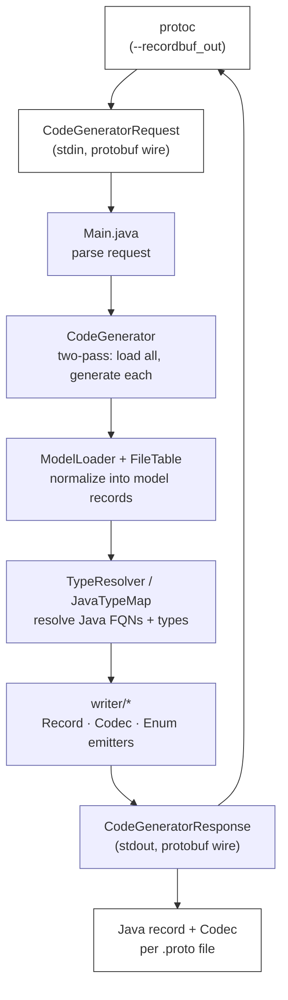

# recordbuf

> A `protoc` code-generation plugin that turns `.proto` files into Java records
> with built-in protobuf codecs — no separate build step, no generated
> dependency surface beyond the protobuf runtime.

`recordbuf` builds **`protoc-gen-recordbuf`**, a [protoc plugin](https://protobuf.dev/develop/plugins/)
written in Java. You point `protoc` at it with a custom output flag
(`--recordbuf_out=…`) and it emits one Java source file per `.proto`, each
containing `record` types plus a `Codec` member that reads/writes the protobuf
wire format.

## Quick start

Everything below uses the Gradle wrapper — not a global `gradle`.

```bash
# 1. Build the plugin and produce its launcher script.
./gradlew installDist

# 2. Run it through protoc, generating into your source tree.
protoc --plugin=protoc-gen-recordbuf="$PWD/build/scripts/protoc-gen-recordbuf" \
       --recordbuf_out=src/main/java \
       path/to/your.proto

# 3. Build/test the project itself.
./gradlew build
```

`./gradlew installDist` produces a self-contained launcher at
`build/scripts/protoc-gen-recordbuf`: it puts the project classpath on
`$CLASSPATH` and execs `java -cp … bijnagte.recordbuf.plugin.Main`.

## Usage

The plugin speaks the standard protoc plugin wire protocol: it reads a single
serialized `CodeGeneratorRequest` from **stdin** and writes a single serialized
`CodeGeneratorResponse` to **stdout**. Generation errors are reported through the
response `error` field (so `protoc --fail-fast=false` works); only fatal
plugin-level failures — e.g. a malformed request — write to stderr and exit
non-zero.

For each file in the request's `file_to_generate` list, recordbuf emits one Java
source file holding:

- the message `record`(s), with nested messages/enums inlined,
- a compact constructor that null-guards `Optional`/`List`/`Map` fields,
- a `Codec` that provides `CodedInputStream`/`CodedOutputStream` (de)serialization,
- top-level `enum`s (declared before the records that reference them).

Supported features: `FEATURE_PROTO3_OPTIONAL_VALUE`.

### Generated types are dependency-free

The **generated** code only depends on the protobuf runtime
(`com.google.protobuf.{CodedInputStream,CodedOutputStream}`) — keep
`com.google.protobuf:protobuf-java` on your consumer classpath. The plugin's own
internals use a few extra libraries (JSpecify nullability annotations, the
record-builder annotation processor) but those do **not** leak into generated
output.

> **Do not edit generated files by hand.** Each carries a
> `Generated by recordbuf -- DO NOT EDIT.` header. Fix the generator or the
> `.proto` instead.

## Project layout

```
build.gradle.kts              Gradle (Kotlin DSL) — java + application plugins
gradle/libs.versions.toml     Centralized version catalog (bump here, not in the build)
src/main/java/bijnagte/recordbuf/plugin/
  Main.java                   protoc entry point: stdin → generate → stdout
  CodeGenerator.java          Drives generation for one CodeGeneratorRequest
  model/                      Loaded/normalized proto model (records w/ @RecordBuilder
                              + JSpecify @NullMarked packages)
  types/                      Type resolution (javaPackage, cross-file FQNs, Java type mapping)
  writer/                     Emitters: records, codecs, enums, and the JavaWriter buffer
src/main/java/com/google/protobuf/compiler/
  PluginProtos.java           protoc plugin-protocol shim. Generated/protocol glue —
                              do not hand-rename or refactor.
```

The `com.google.protobuf.compiler.PluginProtos` shim holds the `CodeGeneratorRequest`
/ `CodeGeneratorResponse` classes; it is regenerated from `protoc`'s `plugin.proto`
and is treated as out-of-scope glue.

## How it works



## License

MIT — see [LICENSE](./LICENSE).
