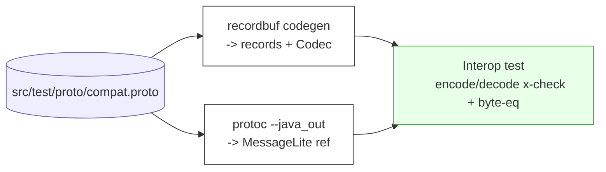

# Wire Compatibility and Codec Coverage - Plan

## Goal Capsule

**Objective:** Make the recordbuf-generated `Codec` byte-and-semantic compatible
with protobuf-java's generated `MessageLite` classes for proto3, and lock that in
with a repeating test harness so regressions surface automatically.

**Authority hierarchy:** The single source of truth for "correct wire format" is
protobuf-java / the .proto spec — not recordbuf's current output. Where recordbuf
and protobuf-java disagree, protobuf-java wins.

**Stop conditions:**
- `./gradlew build` is green (compile + test).
- The compat test class cross-checks every added field family in both directions
  (our `Codec` ↔ protobuf-java `toByteArray`/`parseFrom`) and passes.
- No `// TODO(v1)` remains in `CodecGenerator` for a field kind covered by the
  compat proto.

**Execution profile:** test-first, one field type per unit. Each unit extends
`compat.proto` with a single family, adds its interop assertion, and turns it green
before the next family lands.

---

## Product Contract

### Summary

The generated codec is hand-rolled on `CodedInputStream`/`CodedOutputStream` and is
independent of protobuf's reflection layer — by design. Independence came at the
cost of wire fidelity, and today the generated output does not even *compile*: two
proto3-support gaps block it. This plan closes them and, family by family, makes the
codec agree with protobuf-java, locked in by a MessageLite cross-check harness.

### Problem Frame

Two blocking gaps surface on the first attempt to compile generated output:

1. **Illegal `Optional<primitive>`.** The codec wraps *every* singular field in
   `Optional`, but `java.util.Optional<int>` is illegal (primitives are not valid
   type arguments). The root cause is a proto3 presence bug: `label == OPTIONAL`
   is treated as "with presence", when in proto3 a singular field's `LABEL_OPTIONAL`
   just means "singular, default present" — only the `optional` *keyword* (and a
   singular *message* field) add true presence.
2. **One public type per file.** A multi-top-level-type proto expands into one
   `.proto` file, which recordbuf emits into a single `.java` with several `public`
   top-level types — illegal Java. (The first units sidestep this by keeping
   `compat.proto` a single top-level message with *nested* subtypes; true
   multi-file output is a separate, deferred item.)

On top of the substrate, the known wire gaps: `fixed32`/`fixed64`/`sfixed*` use the
wrong primitive, repeated scalars/enums are unpacked, and map encode/decode are
`// TODO(v1)` no-ops. With no test exercising a real `MessageLite`, none of this is
caught.

### Requirements

**Wire correctness**

R1. `Codec.encode(x)` produces bytes identical to protobuf-java's
`<Message>.toByteArray()` for the fields in `compat.proto`.

R2. `Codec.decode(bytes)` parses bytes produced by protobuf-java's `<Message>` and
yields a record equal to `x`.

R3. Round-trip holds: `Codec.decode(Codec.encode(x))` equals `x` for every added
family.

**Nullability / presence**

R4. Presence is modeled with `@org.jspecify.annotations.Nullable` on record
components (not `Optional`): a nullable *primitive* is boxed (`@Nullable Integer`,
`@Nullable Long`, `@Nullable Double`, `@Nullable Float`, `@Nullable Boolean`,
`@Nullable byte[]`, `@Nullable <Enum>`/`<Message>`); a non-nullable singular scalar
stays a primitive. `proto3` presence is correct: singular scalar/enum present only
via the `optional` keyword; singular message always present.

**Coverage**

R5. A reproducible harness derives the recordbuf records and the protobuf-java
reference classes from one shared `compat.proto` and runs the cross-checks, so
R1–R4 are proven on every `./gradlew test`.

### Scope Boundaries

**Deferred to follow-up work** (explicitly, not silently dropped)

- Oneof modeling (multi-member; `JavaTypeMap` notes the "mutually-exclusive vs
  sealed-hierarchy" decision as TODO v1).
- `proto2` groups (`TYPE_GROUP` throws) and `proto2` semantics (REQUIRED, packed
  opt-in).
- True **multi-file / multi-top-level-type output** (one public type per `.proto`);
  the compat proto stays a single top-level message with nested subtypes.
- The `UnsafeUtil.checkAccess()` no-op stub (kept only to keep an import alive).

**Outside this product's identity**

- Runtime features protobuf-java has and the codec intentionally omits (reflection,
  JSON/text format, per-record `MessageLite` impl).

---

## Planning Contract

### Key Technical Decisions

KTD1. **Reference side via `protoc --java_out`, not a new Gradle plugin.**
`protoc --java_out` is built into the installed libprotoc 36.2 (matches
`protobuf-java 4.36.2`); the `com.google.protobuf` Gradle plugin is an alternative
but adds a dependency that may be unreachable in this environment (per prior
NullAway/Error Prone reachability notes). Decision: shell the existing `protoc`
binary.

KTD2. **One proto per family, two codegens each — shelling `protoc --java_out`.**
Each field family gets its *own* `src/test/proto/<family>.proto` (a single
top-level `message`), named by the type it exercises (`int`, `fixed`, `string`,
`bytes`, `message`, `packed`, `optional`, `map`) and living in its own `java_package`
`bijnagte.recordbuf.comgen.<family>` so the recordbuf top-level record/enum and the
protobuf-java reference *outer class* generated from the same file can never
collide even when both land in one test source set. For each proto a single
`protoc` invocation emits BOTH outputs: `--recordbuf_out=<build/generated/recordbuf>`
(via the `protoc-gen-recordbuf` launcher from `installDist`) and
`--java_out=<build/generated/reference>`. Both directories join the test source set;
the two encoders stay in lock-step on the exact same descriptor. The final unit adds
a single *combined* `compat.proto` (one message exercising **every** family) as an
integration check. All families are **proto3** (proto2 stays deferred, per Scope
Boundaries). `protoc --java_out` is built into libprotoc 36.2 (matches
`protobuf-java 4.36.2`); the `com.google.protobuf` Gradle plugin is an alternative
but adds a dependency that may be unreachable in this environment (per prior
NullAway/Error Prone reachability notes).

KTD3. **Two interop assertions.** The safety-net gate is *semantic interop*:
`Codec.decode(MessageLite.toByteArray(x))` equals `x` and
`MessageLite.parseFrom(Codec.encode(x))` equals `x` — this holds even if two correct
encoders differ in field ordering. The stronger check is *byte equality*:
`Arrays.equals(Codec.encode(x), MessageLite.toByteArray(x))`, asserted where the
output is deterministic (fields written in declaration/tag order, default values
omitted). Both are expressed.

KTD4. **Fixed-width integer families are a primary bug.** `fixed32`/`fixed64`
(and their signed forms `sfixed32`/`sfixed64`) must encode with
`writeFixed32`/`writeFixed64` (4/8-byte little-endian), *not* the varint
`writeInt32`/`writeInt64` the codec currently emits — and `sfixed32`/`sfixed64`
must route to the fixed encoding, not zigzag (`SINT32`/`SINT64`), per
`TypeResolver.wireScalar`. `uint32`/`uint64` *are* varint on the wire and
protobuf-java represents them as `int`/`long`; the existing int/long mapping is
byte-correct, so no change is needed beyond what the compat tests confirm.

KTD5. **Packed encode, tolerant decode.** proto3 packs `repeated` scalars and
`repeated` enums by default. `encode` emits the packed (length-delimited) form.
A single packed field tag delimits a sub-message: `decode` must read the sub-length
then loop the element reader until consumed. `decode` tolerates the *unpacked* form
too (per-value varint tag). `repeated` messages are never packed — each is
independently length-delimited.

KTD6. **Generation tasks, not committed generated code.** The compat reference and
record classes are generated into `build/generated/**` and added to the test source
set — never checked in. A Gradle `Exec`/`JavaExec` task drives `protoc`; it depends
on `installDist` (the recordbuf launcher) and runs before `compileTestJava`.

KTD7. **Nullability via `@org.jspecify.annotations.Nullable`, not `Optional<T>`.**
User decision: represent proto3/2 *presence* (an absent-capable singular field) with
a `@Nullable` record component rather than wrapping in `Optional`. Consequences:

- the generated record/codec file uses JSPECIFY `@Nullable` on those components,
  emitted fully-qualified (`@org.jspecify.annotations.Nullable …`) to match the
  existing "no imports, fully-qualified names" codegen style;
- a nullable *primitive* is **boxed** (`@Nullable Integer`/`Long`/`Double`/`Float`/
  `Boolean`/`byte[]`/`<Enum>`/`<Message>`); a non-nullable singular scalar stays a
  primitive;
- the user accepts JSpecify as a generated-code dependency: add
  `testImplementation(libs.jspecify)` for the compat source set (recordbuf already
  pulls it transitively for its own model records).

This also fixes the blocking `Optional<primitive>` compile error (primitives cannot
be type arguments). The `Field`/`ModelLoader`/`TypeResolver`/`CodecGenerator`
optional path is reworked so "nullable / present-tracked" drives the `@Nullable`
annotation + boxing, and the codec uses `!= null` / null instead of
`isPresent()`/`get()`; `Optional` disappears from generated code.

KTD8. **One family per unit, one file per family, proto3.** Each unit adds a
single new `src/test/proto/<family>.proto` (named by the type) with its own JUnit
test class `<Family>Test`, makes its interop assertions byte-and-semantic green, and
commits before the next family lands. This keeps every step independently verifiable
and avoids a monolithic change. Protos are proto3. The `@Nullable`/boxed/presence
substrate (KTD7) is unit **U1** — it must land first because no family compiles until
presence/nullability is correct. U1 also fixes the whole-codec substrate (field-tag
inclusion in encode, `writeByteArray`/`readByteArray` for `bytes`) so the generated
codec compiles; only `int32` is exercised yet.

### High-Level Technical Design

One proto feeds two independent encoders; the test cross-checks them. This is the
topology the whole plan exists to make true:

The wire-level fix surface lives entirely in two collaborators: `TypeResolver` maps
a proto scalar name to a `WireScalar`, and `CodecGenerator.encodeCall`/`decodeCall`
map a `WireScalar` to the `CodedOutputStream`/`CodedInputStream` primitive. Every
wire bug is a broken edge on that two-hop path — so per-unit work is localized to
those two files plus the relevant `CodecGenerator` emitter (map/packed/etc.).

### Assumptions

- Homebrew `protoc` (libprotoc 36.2) stays installed during the work; if absent,
  `protoc --java_out` is unavailable and KTD1's fallback (the Gradle protobuf
  plugin) is reassessed.
- Each **family** proto is proto3 and a **single top-level message** with nested
  subtypes (until multi-file / multi-top-level-type output exists — deferred). The
  final `compat.proto` combines every family into one message. Protos live under
  `src/test/proto/`, one file per family; generated outputs (record + reference)
  land under `build/generated/**` and are **untracked**.
- Each newly added family is exercised at least once in its proto with a
  non-default value (incl. a sign-bit-set 64-bit value where relevant).

### Structure Revision (user-confirmed)

Per the user's steer, this plan adopts the **per-family-file** structure (a
refinement of the original "one growing `compat.proto`" idea):

- **One file per family**, named by the type it exercises: `src/test/proto/
  {int,fixed,string,bytes,message,packed,optional,map}.proto`, each a single
  top-level `message`, each in its own `java_package`
  `bijnagte.recordbuf.comgen.<family>`. One `protoc` invocation per proto emits
  both `--recordbuf_out` and `--java_out` (see KTD2).
- **Per-family JUnit test class** `<Family>Test` under
  `src/test/java/bijnagte/recordbuf/codec/` doing the two interop assertions
  (KTD3) plus a byte-equality check where applicable; one commit per family.
- A shared `bijnagte.recordbuf.codec.Interop` helper carries the cross-check
  glue (byte compare + the two semantic directions).
- **Final combined unit**: `src/test/proto/compat.proto` — one `Compat` message
  exercising every family together, with its own `CompatTest`, as the
  integration gate.
- All families are **proto3** (proto2 stays deferred). Each family proto is
  independently generated and tested; no family's proto block is a precondition
  for the next family *except* `U1`, whose presence/nullability/compile substrate
  must land first (KTD8/KTD7).
- Work proceeds directly on `main` (local-only repo, no remote merge).

### Sequencing

Each unit adds **one family file** + its `<Family>Test` interop assertion and
leaves the build green:

`U1` substrate (`@Nullable`/boxed primitives/`proto3` presence; two-encoder
harness; `int.proto` with `int32 a`) → `U2` `fixed.proto` (`fixed32/64`,
`sfixed32/64`, `uint32/64`) → `U3` `string.proto` + `bytes.proto` →
`U4` `message.proto` (nested + `repeated` messages) → `U5` `packed.proto`
(packed `repeated` scalars + enums) → `U6` `optional.proto` (proto3 `optional`
present-tracked scalar/enum) → `U7` `map.proto` (scalar key + scalar/enum/message
value) → `U8` `compat.proto` (single message combining every family; the
integration gate). Oneof / proto2 / true multi-top-level-type output remain
deferred.

---

## Implementation Units

**Per-family file map (the structure every unit follows — see Structure
Revision + KTD2/KTD8):**

| Unit | Proto file (single top-level `message`)   | `java_package` (`java_package` option)            | Test class |
|------|-------------------------------------------|---------------------------------------------------|------------|
| U1   | `int.proto` — `Sample { int32 a = 1; }`             | `bijnagte.recordbuf.comgen.i32`                     | `IntTest`    |
| U2   | `fixed.proto` — `Sample { fixed32 f32; sfixed32 s32; fixed64 f64; sfixed64 s64; uint32 u32; uint64 u64; }`   | `bijnagte.recordbuf.comgen.fixed`               | `FixedTest`  |
| U3   | `string.proto` / `bytes.proto` — `Sample { string s; }` / `Sample { bytes b; }` | `bijnagte.recordbuf.comgen.string` / `.bytes` | `StringTest` / `BytesTest` |
| U4   | `message.proto` — `Sample { Point p; repeated Point points; }` (+ nested `Point`) | `bijnagte.recordbuf.comgen.message` | `MessageTest` |
| U5   | `packed.proto` — `Sample { repeated int32 ints; repeated double doubles; repeated bool flags; repeated string strings; repeated bytes blobs; repeated Color colors; }` (+ nested `Color`) | `bijnagte.recordbuf.comgen.packed` | `PackedTest`  |
| U6   | `optional.proto` — `Sample { optional int32 a; optional Color c; }` (+ nested `Color`)  | `bijnagte.recordbuf.comgen.optional` | `OptionalTest` |
| U7   | `map.proto` — `Sample { map<int32,string> strMap; map<string,Color> colorMap; map<int32,Point> pointMap; }` (+ nested `Color`/`Point`) | `bijnagte.recordbuf.comgen.map` | `MapTest`     |
| U8   | `compat.proto` — one `Compat` message exercising every family | `bijnagte.recordbuf.comgen`   | `CompatTest`  |

Each proto is proto3, has exactly one top-level `message`, carries
`option java_package = ...`; one `protoc` invocation per proto emits
`--recordbuf_out` and `--java_out` (KTD2). Tests live in
`src/test/java/bijnagte/recordbuf/codec/`; a shared `Interop` helper carries the
byte-compare + two-direction glue.

### U1. Substrate: `@Nullable` nullability + boxed primitives + `proto3` presence,
plus the two-encoder test scaffold (test-first)

**Goal:** Establish the cross-check harness *and* the nullability/presence model so
the very first generated output compiles and interoperates for a single `int32`
field, before any wire-specific fix.

**Requirements:** R4 (presence/nullability), R5 (harness). Sets up the assertions
that prove R1–R3.

**Dependencies:** none.

**Files:**
- `src/test/proto/compat.proto` (create) — single top-level `Compat` message with
  nested `Color` enum; for U1, field 1 is a non-nullable `int32 a`.
- `build/generated/recordbuf/**`, `build/generated/reference/**` (generated,
  untracked — joined to the test source set).
- `build.gradle.kts` (modify) — a `protoc`-driven generation task (one invocation,
  both `--recordbuf_out` and `--java_out` via the `installDist` launcher), wired to
  `sourceSets.test.java`; add `testImplementation(libs.jspecify)` +
  `testImplementation(libs.protobuf.util)` as needed for the reference/codec.
- `src/test/java/bijnagte/recordbuf/codec/CompatTest.java` (create) — the interop
  test (byte-equality + both-direction semantic interop for the added family).
- `…/model/Field.java` (modify) — `isOptionalWrapped()` → presence-aware
  (`isNullable()`), used by the emitters.
- `…/model/ModelLoader.java` (modify) — thread the file `syntax` down; compute
  presence: scalar/enum present only via the `optional` keyword; singular message
  always present (proto3).
- `…/types/TypeResolver.java` (modify) — nullable singulars box scalars; `resolve`
  returns the (boxed) type and the emitter prepends `@Nullable`.
- `…/CodeGenerator.java` (modify) — emit `@org.jspecify.annotations.Nullable` on
  present-tracked components; compact constructor normalizes only `repeated`/`map`
  to empty (null is a valid `@Nullable` value, no `Optional.empty` normalization).
- `…/writer/CodecGenerator.java` (modify) — optional encode/decode path uses
  `!= null` / null instead of `isPresent()`/`get()`; `initialValue` for nullable is
  `null`.

**Approach:** Land KTD7 + KTD8's substrate. Rework presence and the optional path,
then generate + compile + cross-check a single `int32 a` field end-to-end. The
first `CompatTest` case (a plain `int32`, non-default value, sign-bit-set) is green
at the end of U1 — proving both the presence/nullability model and the harness.

Execution note: this is the substrate unit — do it before any wire family. If
`int32` interop is not green, no later unit can start.

**Patterns to follow:** existing `useJUnitPlatform()` + JUnit Jupiter 5.11.3 + plain
assertions (no AssertJ); the generated-code "fully-qualified names, no imports"
style; the `Field`/`@RecordBuilder` model records + their `package-info` `@NullMarked`.

**Test scenarios:**
- `int32 a` non-default, incl. sign-bit (`0x8000_0000`); byte-equality + both
  interop directions.
- Default-omission: a zero `int32` is omitted from the output (matches protobuf-java).
- Round-trip: `decode(encode(x)) == x`.

**Verification:** `./gradlew build` is green; `CompatTest`'s `int32` case passes;
the generated `compat.java` compiles (no `Optional<primitive>`, `@Nullable`
present where expected). Generated dirs are untracked.

---

### U2. Fixed-width integer families (`fixed32`/`fixed64`/`sfixed32`/`sfixed64`,
`uint32`/`uint64`)

**Goal:** Encode/decode 32/64-bit fixed (and unsigned) ints with the correct
4/8-byte primitive.

**Requirements:** R1–R3 for these families. **Dependencies:** U1.

**Files:** `…/types/TypeResolver.java`, `…/writer/CodecGenerator.java`.

**Approach:** `wireScalar` routes `sfixed32→SINT32`, `sfixed64→SINT64` (zigzag) and
`fixed→FIXED32/64`, but `encodeCall/decodeCall` map `FIXED*→writeInt32/writtenInt64`
(varint) and never call the fixed-width ops. Route all of `fixed32/64`,
`sfixed32/64` to `writeFixed32/64` + `in.readFixed32()/readFixed64()`. `uint32/64`
stay varint (`int`/`long`), confirmed by the test.

**Test scenarios:** zero + sign-bit-set for each of `fixed32/64`, `sfixed32/64`
(the zigzag-misroute case); `uint32/64` sign-bit-set (regression guard).

**Verification:** `./gradlew build` green; these families byte-match `toByteArray`
and parse equal in both directions; no `TODO(v1)` for any fixed family.

---

### U3. `string` / `bytes`

**Goal:** Encode/decode `string` and `bytes` to byte-match protobuf-java.

**Requirements:** R1–R3. **Dependencies:** U1.

**Files:** `…/writer/CodecGenerator.java`, `…/types/TypeResolver.java` (if needed).

**Test scenarios:** empty (omitted), non-empty, UTF-16 string, raw `byte[]`,
sign-bit / leading-zero byte edge.

**Verification:** `./gradlew build` green; both families byte-match and interop.

---

### U4. Nested messages and `repeated` messages

**Goal:** Encode/decode a singular nested message (nullable) and `repeated` nested
messages (each length-delimited, never packed).

**Requirements:** R1–R3. **Dependencies:** U1.

**Files:** `…/writer/CodecGenerator.java` (message + repeated-message emitters;
`codecFor`/`nested codec` reference resolution), `…/CodeGenerator.java` (nested
record + its own `Codec`).

**Test scenarios:** nested `Point`/`Money` set + unset (present/absent); repeated
`Point` incl. empty; nested message whose own fields carry sign-bit values.

**Verification:** `./gradlew build` green; nested/repeated-message families byte-
match and interop.

---

### U5. Packed `repeated` scalars and enums

**Goal:** Encode packed `repeated` scalars/enums and decode packed *and* the
unpacked form.

**Requirements:** R1–R3. **Dependencies:** U1 (and U4 for repeated-message non-packing
to stay intact).

**Files:** `…/writer/CodecGenerator.java` (repeated scalar/enum encoders + a
packed/unpacked-tolerant decode helper), `…/types/TypeResolver.java` (a
packed-marker if needed; repeated-list elements boxed).

**Technical design (directional):** on decode, key each packed family on the
observed wire type — length-delimited ⇒ packed (read sub-length, loop), varint/32/64
⇒ unpacked (single read).

**Test scenarios:** `repeated int32/double/bool/string/bytes` and `repeated enum`
packed byte-match; repeated-message unchanged (not packed); unpacked decode of a
packed-declared field still decodes.

**Verification:** `./gradlew build` green; repeated-family interop + byte-equality
green; unpacked-decode tolerance confirmed.

---

### U6. `proto3 optional` present-tracked scalar / enum

**Goal:** Confirm the `@Nullable` model handles the `optional` keyword on scalars
and enums — present only when the value is set, box the absent-able primitive.

**Requirements:** R4 + R1–R3. **Dependencies:** U1 (presence model already landed;
this proves the `optional`-keyword path).

**Files:** `…/writer/CodecGenerator.java`, `…/model/ModelLoader.java` (if the
keyword presence edge needs tightening), `…/types/TypeResolver.java`.

**Test scenarios:** `optional int32` present vs absent (omitted on the wire →
`null`); `optional` enum present vs absent; interop against protobuf-java's
`hasX()`/`setX()` semantics.

**Verification:** `./gradlew build` green; optional scalar/enum interop incl.
absent-omission.

---

### U7. `map<K,V>` encoding and decoding

**Goal:** Encode/decode `map<K,V>` as its repeated `MapEntry { key=1; value=2; }`
wire form.

**Requirements:** R1–R3, R4 (value presence for message/enum values). **Dependencies:**
U1; builds on U4 (message-value handling) where used.

**Files:** `…/writer/CodecGenerator.java` (map encode/decode emitters; a mutable
accumulator since the `@Nullable`/record default is an empty map), `…/model/Field.java`
(value/key type helpers as needed — `mapKey`/`mapValue` already carry the proto
names).

**Approach:** Replace the `// TODO(v1)` map encode/decode stubs. Encode: per entry,
a nested length-delimited sub-message carrying the two fields (key/value resolved
from `mapKey`/`mapValue` via the same scalar/enum/message emitters). Decode: on the
map field number read each sub-message, split into key/value, accumulate into a
`LinkedHashMap` (or similar); the record's compact constructor wraps it
unmodifiable for the `Map` component.

**Test scenarios:** `map<int32,string>`, `map<string,Color>` (enum value),
`map<int32,Point>` (message value); empty map omitted; multi-entry; decode
order-independence.

**Verification:** `./gradlew build` green; map interop + byte-equality for the
covered value types; no `TODO(v1)` in `CodecGenerator` for any kind in `compat.proto`.

---

### U8. Combined `compat.proto` — integration gate (all families in one message)

**Goal:** One `Compat` message exercising **every** family together (the shape of
`scratch/gen/compat.proto`), proving the families coexist and a whole-message
`toByteArray`/`parseFrom` is wire-compatible across all of them.

**Requirements:** R1–R4 across all families. **Dependencies:** U1–U7.

**Files:**
- `src/test/proto/compat.proto` (create) — one top-level `Compat` message with
  `java_package = bijnagte.recordbuf.comgen`, containing nested
  `Color`/`Point`/`Money` subtypes and one field of each family: singular
  `fixed32/64/sfixed*`, `uint*`, `string`, `bytes`, singular + `repeated`
  message, packed `repeated int32/double/bool/string/bytes`, `repeated enum`,
  `proto3 optional int32`/`optional enum`, `map<int32,string>`/
  `map<string,Color>`/`map<int32,Point>`.
- `src/test/java/bijnagte/recordbuf/codec/CompatTest.java` (create) — the
  integration test: build a fully-populated `Compat` (record) and its protobuf-java
  reference, assert byte-equality + both-direction semantic interop; plus
  round-trip of a partial message.
- `…/writer/CodecGenerator.java`, `…/types/TypeResolver.java` (any last-mile
  per-family fix the integration surfaces).

**Test scenarios:** fully-populated message byte-match + both-direction interop;
partial (many fields absent/default) round-trip; a multi-entry map + a
sign-bit-set `sfixed64`/`fixed64` and a `uint64` sign-bit value in one message.

**Verification:** `./gradlew build` green; `CompatTest` passes; no `TODO(v1)` in
`CodecGenerator` for any kind `compat.proto` declares; generated dirs untracked.

---

## Verification Contract

- `./gradlew build` green is the gate for every unit; a unit is done only when its
  `<Family>Test` (or, for U8, `CompatTest`) slice is green and `./gradlew build`
  passes.
- Each family's `<Family>Test` (plus the final `CompatTest`) is the behavioral
  proof of R1–R4: it exercises the family, both interop directions *and*
  byte-equality, with a sign-bit-set 64-bit value where relevant. A new family
  requires a new `src/test/proto/<family>.proto` + a new `<Family>Test` before it
  counts as supported.
- Per the project's own verification rule (`AGENTS.md`): after any codegen change,
  `installDist` + regenerate `compat.proto` must compile and round-trip — the U1
  Gradle task makes this happen under `./gradlew build`.
- No new third-party *test* dependency: JUnit Jupiter + plain assertions only
  (JSpecify is generated-code infra, not a test lib).

## Definition of Done

**Global:**
- `./gradlew build` is green and `CompatTest` passes for every family in scope.
- No `// TODO(v1)` remains in `CodecGenerator` for any field kind `compat.proto`
  declares.
- Generated sources live under `build/generated/**` and are not committed.

**Per-unit:** each `U<n>` above is independently green on its own `<Family>Test`
(integration `CompatTest` for U8) slice and `./gradlew build`.

**Cleanup:** the `UnsafeUtil.checkAccess()` no-op and any scaffolding left by a
failed approach are removed or explicitly deferred (not left in the diff);
deferred items (oneof, proto2 groups, true multi-file output) are recorded in
Scope Boundaries, not silently dropped.

---

## Open Questions

- (Deferred, non-blocking) Oneof representation — mutually-exclusive `@Nullable`
  components vs a sealed hierarchy.
- (Deferred) `proto2` semantics (REQUIRED, packed/unpacked opt-in).
- (Deferred) True multi-file / multi-top-level-type output; `compat.proto` stays a
  single top-level message with nested subtypes for now.
