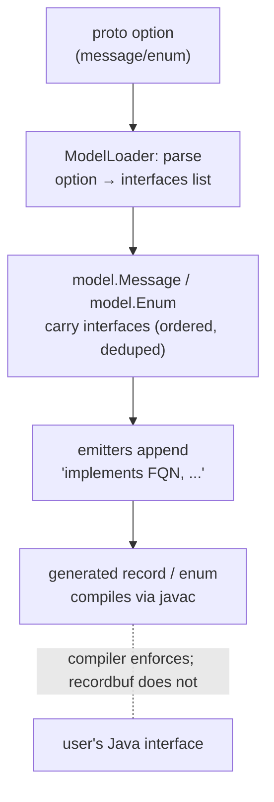

## Goal Capsule

- **Objective:** Let recordbuf-generated Java records and enums implement user-declared Java interfaces, driven by a `.proto` custom option, with marker interfaces for free and no verification burden on the generator — plus a docs track that documents the option and adds an agent-usable index of the relevant `protobuf.dev` pages.
- **Product authority:** User. recordbuf emits `implements <FQN>`; the Java compiler and the user own whether the interface is satisfied. The generator never loads or checks the interface.
- **Stop conditions:** Generated records/enums carry an `implements` clause for every declared interface and compile; the marker and accessor-compatible cases are proven by a dedicated fixture and a generator-level assertion; docs describe the option and link to `protobuf.dev`; existing field families and `./gradlew build` are unregressed.
- **Execution profile:** Standard. 5 dependency-ordered units.
- **Tail ownership:** The implementing agent; `ce-work`/`/goal` are both acceptable executors.

---

## Product Contract

### Summary

This plan adds a `.proto` custom option that declares which Java interfaces a generated record or enum implements. The option value(s) flow from the message/enum `options` into the model and out into the generated `implements` clause, with no body generation and no classpath coupling to the user's interface types. A dedicated test fixture (a hand-written marker interface the generated type implements and compiles against) plus a fast generator-level source assertion prove it; user-facing docs and an agent-usable `protobuf.dev` pointer index ship alongside.

### Problem Frame

Generated records currently carry no `implements` clause, so a generated type's shape is fixed by its proto fields and it can't be a member of a Java type the user already owns (a marker tag, an accessor-shaped contract). The protobuf-native channel for this is a custom option, but recordbuf parses almost none of a type's options today — it reads only `deprecated` and `map_entry`. So the feature also introduces option parsing for the first time.

### Requirements

**Declaration and parsing**

- R1. A `.proto` option declares one or more fully-qualified Java interface names to be implemented, on generated records and on generated enums.
- R2. recordbuf parses that option from the type's options and emits `implements <FQN>` for each declared interface on the generated type.
- R3. A type may declare several interfaces; all of them appear in the generated `implements` clause.
- R4. recordbuf does not resolve, validate, load, or type-check the declared interfaces; it emits the FQNs opaquely. Whether the code compiles is decided by the Java compiler and the user.

**Type scope**

- R5. The option works on top-level and nested records and top-level and nested enums. The internal per-message `Codec` type is out of scope.

**Usage contract**

- R6. The extension that defines the option must be compilable and present on protoc's import path when generating. This is a documented usage requirement, not something recordbuf auto-provides.

**Documentation track**

- R7. User-facing docs add an explanation of how to declare and generate interface implementations, integrated into the existing `README.md`.
- R8. The project docs carry a curated index of the relevant `protobuf.dev` pages, each annotated with when it is relevant, structured so an agent browsing the project docs can use it to build context on the proto3 and custom-option model.

### Scope Boundaries

- **Deferred for later:** reflective/introspected codegen that loads the target interface onto the generator's classpath and generates method bodies; field-alias / name-mapping for interfaces whose method names differ from field names.
- **Outside this product's identity:** validating that declared interfaces exist or are loadable; any change to wire encoding or presence/`Optional` handling; making the internal `Codec` type implement interfaces.

### Acceptance Examples

- AE1. **Marker record.** A message carries the option with one interface FQN. Then the generated record declares `implements <FQN>` and compiles with the interface on the consumer classpath, with no generated method support required. `(see origin R1, R2, R4)`
- AE2. **Accessor-compatible interface.** An interface declares `name()` and the proto has a `name` field. Then the generated record compiles via its auto-generated `name()` accessor. `(see origin R4)`
- AE3. **Enum marker.** An enum carries the option. Then the generated enum declares `implements <markerFQN>`. `(see origin R5)`
- AE4. **Enforcement is external.** An interface requires a non-accessor method. Then recordbuf still emits `implements <FQN>` unchanged; the resulting compile failure is the user's/compiler's concern, not recordbuf's. `(see origin R4)`

---

## Planning Contract

### Key Technical Decisions

- **KTD1 — Option-parsing channel: compiled unknown-field extraction with an `uninterpreted_option` fallback.** Read the option off the message/enum `options` as an unknown field by tag number — protobuf-java preserves unknown fields, so recordbuf does **not** need the extension `.proto` on its own classpath — and fall back to parsing `MessageOptions.getUninterpretedOptionList()` / `EnumOptions.getUninterpretedOptionList()` when the option arrives uninterpreted (the case where the extension `.proto` is not on protoc's import path). Rationale: the compiled path is type-safe and needs no extra dependency; the fallback keeps generation working when the extension isn't resolvable. This implements the brainstorm's "extensions" choice at the mechanism level.

- **KTD2 — Model carrier: add an ordered, de-duped `interfaces` list to `Message` and `Enum`.** Both model records already carry `@RecordBuilder`; add an ordered, de-duplicated interface-FQN list as a new trailing component and have `ModelLoader` populate it through the generated record builders rather than positional constructors, so future fields don't break call sites. Rationale: ordered + de-duplicated gives deterministic `implements` output (R3) and absorbs duplicate declarations.

- **KTD3 — Reserve and document the extension tag.** Pick a reserved extension number/range for the interface option and record it in the shipped extension `.proto` so it does not collide with other ecosystems' option numbers, per protobuf's "reserve the next available number" guidance. Rationale: extension numbers are a shared, collision-prone contract.

- **KTD4 — Test strategy: dedicated fixture + generator-level assertion, not the byte-interop harness.** The existing `genInterop` task globs every `src/test/proto/*.proto` and generates both a recordbuf record and a protobuf-java reference for it; a protobuf-java reference can't produce a Java interface, and an `implements <absent-FQN>` would fail its compile. So prove the feature two ways: (a) a fast, protoc-free generator-level test that feeds a synthetic type carrying the option and asserts the emitted source contains the `implements` clause; and (b) an integration fixture — a hand-written marker interface on the test classpath that a generated record/enum implements and compiles against — generated by a dedicated invocation separate from the `genInterop` glob. Rationale: this is the only faithful way to assert the behavior without poisoning the interop suite.

### High-Level Technical Design

The option flows through three stages; no component generates interface method bodies.

### Assumptions

- Interface declarations arrive as fully-qualified name strings and are not resolved.
- The specific option name and reserved extension tag value are plan details the implementer fixes at U2/U5 (KTD3); a sensible default (a high, reserved number such as 50000) is used.
- `README.md` remains the user entry point; the `protobuf.dev` pointer index lives under `docs/`.

### Open Questions

- **Deferred (non-blocking):** the exact option name and reserved tag number; whether the shipped extension `.proto` and the agent-doc index get a dedicated `docs/` location or fold into the root; whether the first release ships records-only or records + enums together (records + enums is the plan's assumption).

---

## Implementation Units

### U1. Carry interfaces through the model

- **Goal:** Propagate declared interface FQNs into the model so emitters can read them.
- **Requirements:** R1, R3.
- **Dependencies:** none.
- **Files:** `src/main/java/bijnagte/recordbuf/plugin/model/Message.java`, `src/main/java/bijnagte/recordbuf/plugin/model/Enum.java`, `src/main/java/bijnagte/recordbuf/plugin/model/ModelLoader.java`.
- **Approach:** Per KTD2, add an ordered, de-duplicated interface-list component to `Message` and `Enum` and update their `@RecordBuilder` builders. Populate it in `ModelLoader.loadMessage` / `loadEnum` (initially empty), building on the generated record builders so positional call sites don't break.
- **Patterns to follow:** the existing `@Nullable String comment` trailing component on `Message`/`Enum` and its `@RecordBuilder` generation.
- **Test scenarios:**
  - A `Message`/`Enum` built with a populated interface list exposes it; the builder de-duplicates and preserves declaration order.
  - Existing construction paths still build (empty interface list is the default).
- **Verification:** the model compiles; the builder yields deterministic, order-preserved, de-duplicated interface lists.

### U2. Parse the interface option off message/enum `options`

- **Goal:** Read the declared interface FQNs from a message/enum's options and write them into the model.
- **Requirements:** R1, R2, R6.
- **Dependencies:** U1.
- **Files:** `src/main/java/bijnagte/recordbuf/plugin/model/ModelLoader.java`, a small options-parsing helper (a new `model`-local type or method), and the shipped extension-definition `.proto` (the single source for the option name and reserved tag).
- **Approach:** Per KTD3, create and ship the extension-definition `.proto` that names the option and its reserved tag — a single artifact that U4's fixture generation and users both import. Per KTD1, extract the option from the type's `options` as an unknown field by the reserved tag number, falling back to the `uninterpreted_option` list when present. Handle both the message `options` target and the enum `options` target — this is the two-target consequence of "records + enums."
- **Patterns to follow:** the existing `getOptions().getDeprecated()` / `getOptions().getMapEntry()` reads already in `ModelLoader` as the option-access idiom.
- **Test scenarios:**
  - An option carried as a compiled unknown field is extracted by its tag and written to the model's interface list.
  - The same option carried as an `uninterpreted_option` is extracted and written (fallback path).
  - Multiple declarations accumulate; duplicate declarations de-duplicate.
  - A message and an enum each surface their own option (two-target coverage).
- **Execution note:** Start with a failing test that feeds the option both ways (compiled and uninterpreted) and asserts the model sees it — the extraction channel is the risky seam.

### U3. Emit the `implements` clause

- **Goal:** Append `implements <FQN>, ...` to each generated record and enum declaration.
- **Requirements:** R2, R3, R5.
- **Dependencies:** U1, U2.
- **Files:** `src/main/java/bijnagte/recordbuf/plugin/writer/RecordGenerator.java`, `src/main/java/bijnagte/recordbuf/plugin/CodeGenerator.java` (the `recordAndCodec` record declaration), `src/main/java/bijnagte/recordbuf/plugin/writer/EnumGenerator.java`.
- **Approach:** When the type's interface list is non-empty, emit `implements A, B, ...` on the record header (`public record Name(...) implements ...`) and the enum header (`public enum Name implements ...`). Apply to nested records/enums. Emit nothing for an empty list (no spurious `implements {}`). No method bodies are generated — marker/accessor satisfaction is left to the compiler (R4). The `Codec` member is never given `implements`.
- **Patterns to follow:** the existing header-emitting structure in `recordAndCodec` and `EnumGenerator.write` (which already conditionally emit `@Deprecated`).
- **Test scenarios:**
  - A record with one interface emits a single valid `implements` clause; the file compiles.
  - A record with several interfaces emits all of them, in declaration order.
  - An enum with a marker interface emits `implements <markerFQN>`.
  - A type with no options emits no `implements` clause (byte-for-byte unchanged from today).
  - Nested records/enums carry their own interfaces.
  - The `Codec` member never carries `implements`.
- **Verification:** generated source contains the correct `implements` clause and compiles; the no-option case is unchanged.

### U4. Prove it: dedicated fixture + generator-level assertion

- **Goal:** Establish that generated types implement declared interfaces, without poisoning the interop suite.
- **Requirements:** R2, R4, R5.
- **Dependencies:** U3.
- **Files:** a hand-written marker interface under the test source set; a small interface-driving `.proto` that imports the extension-definition `.proto` created in U2; a dedicated generation invocation/task separate from `genInterop`; a protoc-free generator test under a new `src/test/java/bijnagte/recordbuf/comgen/interface/` package.
- **Approach:** Per KTD4, add two proofs. (a) A fast generator-level test that builds a synthetic request/type carrying the option and asserts the emitted source contains `implements <FQN>` (no protoc, so it can't be broken by the interop glob). (b) An integration fixture: a real marker interface on the test classpath, with a generated record and a generated enum that implement it, produced by a dedicated generation step and compiled into the test source set. Keep the interface fixtures out of the `genInterop` all-proto glob so the reference generation can't choke on an unimplemented interface.
- **Patterns to follow:** the existing per-family `src/test/proto/*.proto` + `comgen/<family>/*Test.java` structure and the `genInterop` task wiring in `build.gradle.kts`, adapted to a separate invocation.
- **Test scenarios:**
  - **Covers AE1.** A generated record implementing a hand-written marker interface compiles and `instanceof` checks pass.
  - **Covers AE2.** A generated record implementing an accessor-shaped interface compiles via the matching accessor.
  - **Covers AE3.** A generated enum implementing a marker interface compiles.
  - The no-option generated types remain byte-for-byte as before (regression guard against U3).
  - The interface-driving protos are not picked up by `genInterop` (`genInterop`-style glob excludes them).
- **Execution note:** Add a failing integration test before the generation wiring exists; confirm `genInterop` does not try to reference the marker interface.

### U5. Ship the docs

- **Goal:** Give users the documentation, including an agent-usable `protobuf.dev` pointer index for the option U2 ships.
- **Requirements:** R6, R7, R8.
- **Dependencies:** U3 (so usage examples are accurate);
  consumes the extension-definition `.proto` from U2.
- **Files:** `README.md`; a `docs/` index of the relevant `protobuf.dev` pages.
- **Approach:** Extend `README.md` with how to declare the option, the exact `protoc` invocation that puts the U2 extension `.proto` on the import path, and how markers vs accessor-compatible interfaces behave. Add a `docs/` index of the `protobuf.dev` pages most relevant to this feature (proto3 guide, custom-options/extensions material), each annotated with when an agent should reach for it.
- **Patterns to follow:** the existing `README.md` structure and its `https://protobuf.dev/develop/plugins/` link style; the Mermaid + reference-link conventions already in use.
- **Test scenarios:** `Test expectation: none — this unit is packaging/docs; verified by reading the docs and compiling the shipped extension `.proto` with `protoc` (a smoke check that it parses).`
- **Verification:** the extension `.proto` compiles under `protoc`; the README and docs index describe the option, the import-path requirement, and the marker/accessor distinction, and link to `protobuf.dev`.

---

## Verification Contract

- **Full build:** `./gradlew build` (compile + `./gradlew test`) stays green; existing interop families are unregressed.
- **Codegen:** after adding the units, `./gradlew installDist`, then generate the interface-driving fixture and confirm the generated record/enum compiles against the hand-written interface.
- **Generator-level proof:** the protoc-free source-assertion test passes, proving the emitted `implements` clause without depending on `protoc`.
- **Extension smoke check:** the shipped extension `.proto` parses under `protoc`.

---

## Definition of Done

- Global: `./gradlew build` is green; the feature is proven by the dedicated fixture and the generator-level assertion; docs are shipped; existing behavior is unregressed.
- Per-unit:
  - U1: model carries an ordered, de-duplicated interface list; existing construction still builds.
  - U2: the option is parsed from both compiled and uninterpreted forms into the model, for messages and enums.
  - U3: the `implements` clause is emitted for records and enums, nested included, `Codec` excluded, empty-list unchanged.
  - U4: the marker/accessor/enum examples compile and the interop glob excludes the fixtures.
  - U5: README + `docs/` index describe the option, its import-path requirement, and the marker/accessor distinction, and link to `protobuf.dev`.
- **cleanup:** no scaffolding, dead test protos, or experimental parse branches left in the diff.
