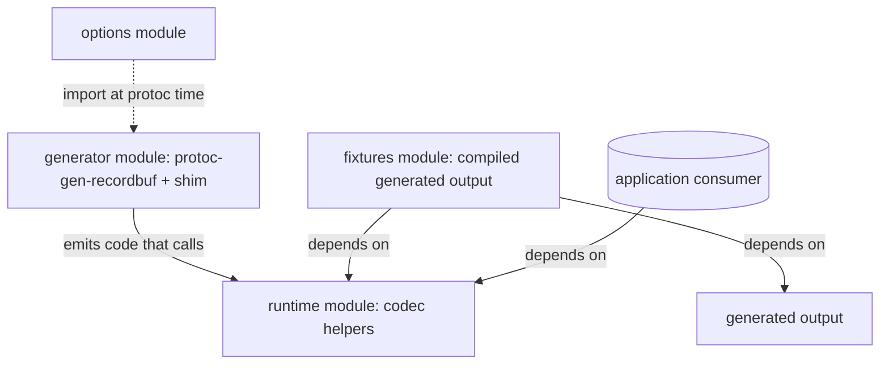
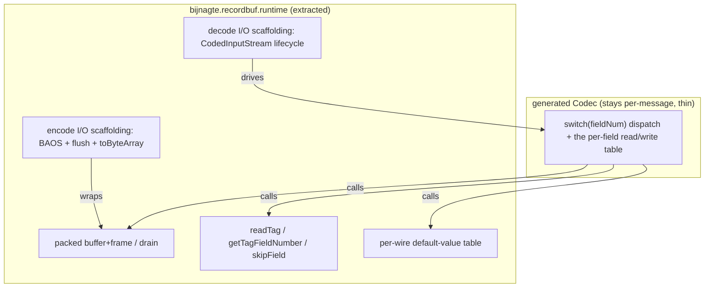

## Goal Capsule

- **Objective:** Split the single-module `recordbuf` into a co-versioned, multi-module Gradle build that cleanly separates three roles — the protoc generator, the authored options a proto author imports, and a runtime the generated code and its consumers rely on — plus one internal fixtures module that lets the plugin's own verification consume already-compiled generated output instead of regenerating inside the compiling module.
- **Product authority:** User. The module roles, the dependency direction, co-versioning from the root, and the "extract the codec I/O-framing layer, no generic serializer" boundary are the user's framing choices. Generated output's public shape and wire format are unchanged.
- **Open blockers:** None. The recorded version-skip risk (generated code calls the runtime by name; the generator does not link it at build time) is **accepted at 0.0.1** and the optional build-time guardrail is **deferred** (KTD5 / KTD7) — a co-versioned, single-author release cannot drift within one version.
- **Execution profile:** Standard, cross-cutting. A whole-build reorganization (four subprojects) plus a bounded, behavior-preserving runtime extraction. Six dependency-ordered units; `./gradlew build` is green at the end of each.
- **Tail ownership:** The implementing agent; `ce-work` or `/goal` are both acceptable executors.

**Product Contract preservation:** Product Contract unchanged — no R/A/F/AE text was rewritten. The four "deferred to planning" Open Questions are resolved as KTD1–KTD8 below (module names/layout, extraction scope + first-pass helpers, the plugin↔runtime guardrail decision, and where `genInterop`/`genInterface` re-home). Where this enrichment resolves a recorded question it points to the KTD rather than changing a requirement.

---

## Product Contract

### Summary

This plan splits the build into a small set of co-versioned modules: a generator module (the `protoc` plugin plus its protoc-protocol shim), an options module that distributes the custom-option `.proto` a proto author imports, a runtime module that carries the codec helpers generated code leans on, and one internal fixtures module that compiles generated output once so the test suite consumes it as a jar. The build stays pure CLI plus artifacts — no Gradle plugin or CLI wrapper — and co-versions everything from the root. Nothing the user already consumes changes.

### Problem Frame

One module today holds three things that have different consumers and lifecycles. The generator (a tool a build runs), the options definition (a `.proto` a human imports into their own build), and the things generated code needs at runtime (a library an application depends on) are all crammed into `bijnagte.recordbuf`, so anyone pulling the artifact takes everything. Separately, the plugin's own verification regenerates into the *same* module's test source set and papers over the classic "codegen must run after the tool is built" circularity with `genInterop`/`genInterface` tasks that depend on `:jar`; that coupling is fragile and would get worse the moment the pieces move to separate modules. Lastly, every generated message inlines the same codec scaffolding — stream setup and teardown, packed-sequence buffering, the tag/`skipField` decode loop, and the per-wire default-value table — so a shared runtime that owns that mechanical surface is the obvious home for the duplication, and it is a runtime the generator and its consumers can both lean on.

### Actors

- A1. **Proto author** — owns a `.proto`, pulls the options module, and runs `protoc` against the generator to produce Java records + codecs.
- A2. **Application consumer (end user)** — depends on the runtime module so generated records and their codecs link; consumes generated output, not the generator.
- A3. **Build maintainer** — owns this repo; runs `./gradlew build` to verify every module and the internal fixtures together.

### Requirements

**Module structure**

- R1. The build becomes a co-versioned multi-module Gradle build rooted at the existing `bijnagte.recordbuf` coordinates; the root becomes an aggregator over the module projects.
- R2. A **generator module** holds the plugin (`protoc-gen-recordbuf`) and its `com.google.protobuf.compiler` protocol shim, depends only on the protobuf runtime, and still produces the runnable `protoc-gen-recordbuf` launcher.
- R3. An **options module** distributes the custom-option `.proto` (`recordbuf_options.proto`, defining `java_interface` / `java_enum_interface`) as an import target proto authors add to their include path. It is a dependency of a proto author's build, not a Gradle dependency of the generator module.
- R4. A **runtime module** carries the pulled-up codec helper surface and depends on the protobuf runtime; it is the module generated code and application consumers depend on.
- R5. An **internal fixtures module** compiles already-generated output (plus the matching protobuf-java reference) into a consumable artifact; it is used by the test suite and is not published as a user deliverable.

**Dependency direction and versioning**

- R6. Dependency direction is fixed and cycle-free: application consumers and generated code depend on the runtime; the fixtures module depends on the runtime and on the generated output; proto authors consume the options module at protoc import time; the generator module does not depend on the runtime or the options module at build time.
- R7. All modules co-version from the root (`0.0.1`) and are released together, so generated code and the runtime it calls never drift within a release. No per-module independent versioning.

**Codec extraction boundary**

- R8. The runtime owns the codec **I/O-framing layer** — stream setup and teardown, packed-sequence buffering, the tag/`skipField` decode loop, and the per-wire default-value table — so generated code stops re-spelling that scaffolding and stays thin. The per-field tables (which field, which type, how to read/write it) remain generated.
- R9. A reflection- or metadata-driven generic serializer that eliminates per-field code generation is explicitly **not** built in this pass.
- R10. Generated output keeps its existing public shape and byte-for-byte wire behavior; extraction moves shared helpers location only, changing neither the record API nor the encoded bytes.

**Verification and fixtures**

- R11. The plugin's interop, byte-equality, and interface tests consume the compiled fixtures artifact rather than regenerating inside the compiling module, removing the in-source-set codegen circularity the current build papers over.
- R12. The co-versioned build is the unit of verification: `./gradlew build` green across the generator, options, runtime, and fixtures modules is the acceptance gate.
- R13. Existing field-family coverage (bytes, fixed, int32, map, message, optional, order, packed, string, plus the interface-implementation fixture) is preserved and still passes against the new fixtures wiring.

### Actors / Key Flows

- F1. **Author generates.** A1 imports the options module's `.proto`, runs `protoc` against the generator module's launcher, and emits a Java record with a codec that calls into the runtime module; A2 then adds the runtime module to their classpath so the generated code links.
- F2. **Verify against compiled output.** Build generates a representative message, compiles it and its protobuf-java reference into the fixtures module once, then the test module byte-equality-checks the record against the reference using the already-compiled fixture instead of regenerating during the compile.



### Key Decisions

- **Co-version everything from the root.** Simplest at 0.0.1 for a single author and means generated code and the runtime it emits calls into are always the same release; per-module versioning is a moving part this pass does not need.
- **Options stay a standalone distribution, not folded into the runtime.** `protoc` resolves an `import` from a file on its include path; a `.proto` shipped as a resource inside the runtime jar is not reachable that way, so a thin standalone options module is the low-friction fit.
- **Modest I/O-framing extraction now; the fully-generic runtime-driven serializer is deferred.** Extracting only the mechanical framing bounds the runtime and defers the larger vision until a repeated helper pattern actually earns it (YAGNI on carrying cost, not on effort).
- **Pure CLI plus artifacts, no build-tool glue.** The user's choice: authoring stays "point `protoc` at the launcher and add the runtime to your classpath"; a Gradle plugin or CLI wrapper is out of scope.

### Acceptance Examples

- AE1. **Round-trip is stable.** A generated type that round-trips today still round-trips byte-identically after the codec I/O-framing is pulled into the runtime. *(see R8, R10)*
- AE2. **Tests use compiled fixtures.** An interop/byte-equality test compiles against the compiled fixtures artifact and does not regenerate into the compiling source set. *(see R11)*
- AE3. **Version-skip risk is a known, accepted 0.0.1 gap.** Within one co-versioned release generated code and its runtime always match; mismatch is only possible across a future split-release, which this pass does not support. *(see R7, Goal Capsule blockers)*
- AE4. **Quick-start still works.** The `README.md` quick-start — `installDist` then `protoc --plugin=… --recordbuf_out=…` — still produces working generated code end to end. *(see F1, R2)*

### Scope Boundaries

- **Deferred for later:** a Gradle plugin or CLI wrapper that wires `protoc` + the generator + options import + runtime onto a consumer's build; a published, user-facing conformance/testkit derived from the fixtures module; the fully-generic reflection/metadata-driven serializer; per-module independent versioning; a build-time plugin↔runtime version guardrail (KTD7).
- **Outside this product's identity:** any change to the protobuf wire format or to the generated record's public API shape; validating or loading user-declared interfaces (the generator emits `implements`/codec calls opaquely and trusts the compiler).

### Dependencies / Assumptions

- The protobuf runtime is already on a consumer's classpath (true today, per the codec's `CodedInputStream`/`CodedOutputStream` usage); the runtime module continues to depend on the same runtime.
- The option tags (`50000`/`50001`) are hardcoded constants inside the generator's model loader; the options module is their source of truth, so a future tag change must update both — kept in sync by construction at 0.0.1.
- The `com.google.protobuf.compiler` shim is treated as out-of-scope protocol glue and travels with the generator module unchanged.

### Outstanding Questions

- **Resolve before planning:** none blocking.
- **Deferred to planning — now resolved in the Planning Contract:**
  - Final module project names and directory layout → **KTD1** (four `recordbuf-*` subprojects, flat dirs under root).
  - The exact public API surface of the runtime helpers and which codec helpers to extract first → **KTD2** (first-pass scope + the "per-field dispatch stays generated" boundary; exact signatures deferred to implementation per 3.6).
  - Whether to add a build-time plugin↔runtime guardrail → **KTD7** (decision: skip at 0.0.1; record the cheap future option).
  - How `genInterop`/`genInterface` re-home onto the fixtures module → **KTD6** (the fixtures module owns a generation task and the interop suite; generation invokes the generator's launcher, not `:jar` of the module under test).

---

## Planning Contract

### Key Technical Decisions

- **KTD1 — Module layout and naming.** Root `recordbuf` becomes a pure aggregator (`settings.gradle.kts` `include`s the subprojects and holds only versioning + wiring; no source of its own). Four subprojects, flat dirs under root, role in the name:
  - `:recordbuf-runtime` — dir `runtime/`, package `bijnagte.recordbuf.runtime` — the extracted I/O-framing helpers; `api`-exposes protobuf so generated code that calls it links. (R4)
  - `:recordbuf-generator` — dir `generator/`, package `bijnagte.recordbuf.plugin` **plus** the `com.google.protobuf.compiler` shim — the plugin + the `application`/launcher. (R2)
  - `:recordbuf-options` — dir `options/` — distributes `recordbuf_options.proto` as a protoc import target. (R3)
  - `:recordbuf-fixtures` — dir `fixtures/` — generates + compiles generated output and the protobuf-java reference into a consumable jar and hosts the interop/byte-equality/interface tests. Internal, not published. (R5, R11)

  Rationale: coordinates stay a `recordbuf-*` prefix so co-versioning and classpath references are unambiguous; flat dirs keep the tree shallow; the role-in-the-name makes the dependency graph readable in `settings.gradle.kts`. The `com.google.protobuf.compiler` shim travels with the generator unchanged (Assumption), so no rename/protocol work happens here.

- **KTD2 — Extraction boundary and first-pass scope.** Extract the mechanical framing surface of R8 into `bijnagte.recordbuf.runtime`, but **do not** restructure the per-message field-dispatch. First-pass, behavior-preserving helpers:
  - encode/decode **I/O scaffolding** — the `ByteArrayOutputStream`/`CodedOutputStream` lifecycle (set up, `flush()`, `toByteArray()`) and the `CodedInputStream.newInstance`/`isAtEnd` lifecycle;
  - **packed-sequence buffering** — buffer a tight NoTag value sequence into a fresh stream then frame it as one length-delimited group; and the decode-side `pushLimit`/`getBytesUntilLimit`/`popLimit` drain;
  - **tag / `skipField` decode primitives** — `readTag`/`getTagFieldNumber`/`skipField` (the skeleton of the decode loop);
  - the **per-wire default-value table** (which today lives as `CodecGenerator.defaultValueFor`/`initialValue`/`entryDefault` `switch`es).

  The per-message `switch (fieldNum) { case N -> … ; default -> skipField }` and "which field / which type / how to read-write it" **remain generated** — that *is* the per-field table R8 keeps generated. The fully-generic callback driver / reflection serializer stays deferred (R9). Rationale: bounding the runtime to genuinely mechanical helpers keeps each extraction byte-identical, so the existing interop byte-equality suite is a ready-made regression oracle (AE1); deferring the driver avoids the generic-serializer drift the user explicitly deferred. Exact helper/method signatures are an implementation-time detail (3.6); this KTD fixes the *boundary*, not the API.

- **KTD3 — Co-version everything from the root; the build is the release unit.** All subprojects inherit `group = "bijnagte.recordbuf"` and `version = "0.0.1"` from the root via a `subprojects { }` block; root holds the single version. No per-module versioning (R7). A cheap co-release sanity check (a `checkVersionAlignment` task asserting every subproject's `project.version == "0.0.1"`, or simply relying on inheritance) is optional and non-blocking. Rationale: KTD1's single-author/0.0.1 framing; a moving part this pass does not need.

- **KTD4 — The generator emits runtime FQNs as text and never links the runtime at build time.** Emitted codec source references `bijnagte.recordbuf.runtime.*` by fully-qualified name in the source string it writes — exactly the pattern the plugin already uses for `com.google.protobuf.CodedOutputStream`/`CodedInputStream` (fully-qualified, in generated text) and for `implements <FQN>` (it writes the user's interface FQN as text without resolving it). The generator carries a single runtime-package prefix constant; it adds **no Gradle dependency** on `:recordbuf-runtime` (R6). The runtime's classes reach the compiled code through the **fixtures' classpath**, not the generator's. Rationale: preserves the plugin's existing "decoupled from the types it names" design and keeps the generator's dependency set minimal (only protobuf, R2); it also means the plugin's own `Main`/`CodeGenerator`/model/`types`/`writer` move to `:recordbuf-generator` without dragging the runtime in.

- **KTD5 — Options module is a protoc distribution, not a Gradle dependency.** `recordbuf_options.proto` moves into `:recordbuf-options` and is shipped so a proto author can add it to `protoc -I`. It is **not** declared as an `implementation`/`api` dependency of `:recordbuf-generator` (R3/R6). The internal generation step that exercises the `java_interface`/`java_enum_interface` options (today `genInterface`) resolves the `.proto` from the options module's path via a protoc **include path**, not a project dependency. Rationale: matches how `protoc` consumes an import (a file on the include path — KTD, "Options stay a standalone distribution"); keeps the generator dependency-free of both runtime and options.

- **KTD6 — Fixtures module breaks the codegen circularity and owns the interop suite.** `:recordbuf-fixtures` runs the generator to produce its generated output into the fixtures project's own generated source dir, joins it to the fixtures module's `main`, compiles it together with the protobuf-java `--java_out` reference, and exposes a consumable jar. The interop / byte-equality / interface family tests live in the fixtures `test` source set and depend on the already-compiled fixtures `main` + runtime + protobuf; they **no longer generate into the module being compiled** (R11). Generation invokes `:recordbuf-generator:installDist`'s launcher, not the `:jar` of the module under test. The per-family `*-ref.proto` split (sibling `.ref` package) is preserved. Rationale: this removes the "codegen into the compiling module's own test source set" coupling the single module papers over, so the split is stable as the pieces separate. Note `genInterop`'s all-proto glob and `genInterface`'s options include-path each re-home into the fixtures build with their exclusions intact (`iface_marker` still excluded from the interop glob).

- **KTD7 — No build-time plugin↔runtime guardrail at 0.0.1 (accepted).** Accept the version-skip risk of AE3: within a co-versioned release the generator and the runtime it emits calls into are the same `0.0.1` (KTD3), so mismatch is only possible across a future split-release — which this pass explicitly does not support. The cheap future options are recorded but deferred: (a) a co-release assertion that all module versions are equal (a thin form), or (b) a generator-emitted runtime version stamp the fixtures assert at compile time (a stronger form). Rationale: YAGNI — for a single author co-releasing one version, a cross-module version assertion is carrying cost with no current payoff; it earns its place only once an independent runtime release becomes possible.

- **KTD8 — Work on `main`; one unit per green step (local-only repo).** Per `git-workflow`, this repo has no remote → it is a single-developer, no-CI repo: work directly on `main`, no feature branches or PRs. Each unit ends with `./gradlew build` green (R12); a unit that moves source trees does so atomically within the unit so no mid-scan half-move is committed. Rationale: fast-forward-safe local workflow; the "green at each step" invariant the task requires is enforced at the unit boundary, not inside a move.

### High-Level Technical Design

The split is a fixed, cycle-free dependency direction; extraction is a location move with an identical wire contract.

**Module dependency graph (post-split).** Arrows are *build-time* Gradle dependencies; dotted arrows are the protoc-time / runtime classpath relationships that are deliberately **not** Gradle dependencies (KTD4, KTD5, R6).

```mermaid
flowchart LR
  classDef module fill:#eef,stroke:#66a
  classDef ext fill:#fff,stroke:#333
  GEN["recordbuf-generator<br/>(plugin + shim)<br/>deps: protobuf only"]:::module
  RT["recordbuf-runtime<br/>(framing helpers)<br/>deps: protobuf (api)"]:::module
  OPT["recordbuf-options<br/>(recordbuf_options.proto)"]:::module
  FIX["recordbuf-fixtures<br/>(compiles generated + ref)<br/>deps: runtime + protobuf"]:::module
  GENJAR[":recordbuf-generator:installDist<br/>(protoc launcher)"]:::ext
  PB[("com.google.protobuf:protobuf-java")]:::ext

  FIX -- dependsOn --> RT
  FIX -- dependsOn --> PB
  FIX -- generates via --> GENJAR
  GEN -- emits FQN text (no link) .-> RT
  OPT -. protoc -I (no gradle dep) .-> FIX
  GENJAR -- launched by --> FIX
  GEN -- dependsOn --> PB
  RT -- dependsOn --> PB
```

**Extraction boundary (KTD2).** The runtime owns the *framing machinery*; the generated codec owns the *per-field table*.



### Assumptions

- `protoc`/libprotoc is installed for the generation tasks (unchanged from today's build; the fixtures generation shells `protoc` just as `genInterop` does). `protobuf-java` `4.36.2` stays the pinned runtime in the catalog.
- Generated code keeps its "fully-qualified names, no imports" style; extracted runtime helpers are called as FQN text, matching that style.
- Each unit is an atomic, buildable increment; the four module moves (U2–U4) are grouped so a partial move is never left in the tree between `./gradlew build` runs (KTD8).
- The generated output's public shape and wire bytes are unchanged; the interop byte-equality suite is the standing oracle (AE1).

### Open Questions

- **Deferred to implementation (non-blocking, per 3.6):** the exact public names/signatures of the `bijnagte.recordbuf.runtime` helpers (KTD2 fixes the boundary and scope, not the API); whether the fixtures module is a jar-only consumer artifact or also publishes a `-testkit` (deferred, R5/R9); final placement of the per-family `src/test/proto/**` (fixtures `main` vs `test` source dir) — the implementer picks whichever keeps the `*-ref` glob mechanics intact.
- **None blocking.** All recorded "deferred to planning" questions are resolved in KTD1/KTD2/KTD6/KTD7.

---

## Implementation Units

### U1. Stand up `:recordbuf-runtime` and extract the I/O-framing helpers (behavior-preserving)

- **Goal:** Create the runtime subproject and pull the mechanical framing surface out of `CodecGenerator` so generated codecs call into `bijnagte.recordbuf.runtime`; the generated bytes stay identical.
- **Requirements:** R8, R10, R12 (AE1).
- **Dependencies:** none.
- **Files:**
  - `settings.gradle.kts` (modify — `include(":recordbuf-runtime")`; root keeps its own `java` + `application` build as the transient parent).
  - `runtime/build.gradle.kts` (create — `java` + toolchain; `api(libs.protobuf)` so generated code that calls the runtime links).
  - `runtime/src/main/java/bijnagte/recordbuf/runtime/*` (create — the KTD2 first-pass helpers: encode/decode I/O scaffolding, packed buffer/drain, tag/skipField primitives, the per-wire default-value table).
  - `src/main/java/bijnagte/recordbuf/plugin/writer/CodecGenerator.java` (modify — emit runtime FQNs per KTD4; add a single runtime-package prefix constant; keep the per-message `switch`/per-field table generated).
  - `build.gradle.kts` (modify — add `testImplementation(project(":recordbuf-runtime"))` so the still-root test source set can compile the generated code that now calls the runtime).
- **Approach:** Per KTD2/KTD4, extract each mechanical helper and have the generator emit calls to it as FQN text; the per-message field dispatch stays in `CodecGenerator`. Root remains the parent that still hosts the generator + tests; the runtime is a new sibling. Because the wire contract is unchanged, the interop byte-equality suite stays green with no test changes.
- **Patterns to follow:** `CodecGenerator`'s existing fully-qualified FQN emission (`com.google.protobuf.CodedOutputStream …`); the `TypeResolver.WireScalar` switch shape for the default-value table; the catalog `libs.protobuf` wiring.
- **Test scenarios:**
  - **Covers AE1.** Every existing family (`bytes`, `fixed`, `i32`, `map`, `message`, `optional`, `order`, `packed`, `string`, `combined`) still byte-matches the protobuf-java reference and round-trips after extraction — the interop suite is the regression oracle for byte-identical output.
  - Each extracted runtime helper has one direct unit for its mechanical contract: encode/decode scaffolding round-trips a representative value; packed buffer/drain yields the same bytes for a populated and an empty sequence; the default-value table returns the same literal the inline `switch` did for each wire scalar.
  - The generated codec no longer inlines the extracted framing (source is thinner; the extracted call sites are present).
- **Execution note:** The interop byte-equality tests are the oracle — if any byte differs, the extraction drifted from R10; keep the per-message dispatch in the generated codec and pull only framing. Land the runtime helpers and the generator emission change together so the generated code always compiles against a matching runtime symbol set.
- **Verification:** `./gradlew build` green with the generated code calling the runtime; interop byte-equality holds; generated source is measurably thinner on the framing surface.

### U2. Split `:recordbuf-options` (the custom-options `.proto` distribution)

- **Goal:** Move `recordbuf_options.proto` into a distribution module that a proto author adds to `protoc -I`; the generator does not link it.
- **Requirements:** R3, R12.
- **Dependencies:** U1.
- **Files:**
  - `settings.gradle.kts` (modify — `include(":recordbuf-options")`).
  - `options/build.gradle.kts` + `options/src/main/proto/recordbuf_options.proto` (create/move — the `java_interface`/`java_enum_interface` extension definitions and their `50000`/`50001` tags).
  - `src/main/proto/recordbuf_options.proto` (remove from root).
  - The generation step that exercises the options (today `genInterface`, in root `build.gradle.kts`) — re-point its `-I` include path at the options module's proto (a file path, **not** a Gradle dependency), per KTD5.
  - `README.md` (modify in U6; a note here records the new import path).
- **Approach:** Per KTD5, move the `.proto` into `options/` and resolve it from the options module's path via a protoc include path inside the generation task — no `implementation`/`api` of `options` on the generator. Keep the `iface_marker` exclusion from the interop glob intact.
- **Patterns to follow:** the `genInterface` task's `val mainProtoDir = File(project.projectDir, "src/main/proto")` include-path wiring, re-pointed at the options module.
- **Test scenarios:**
  - The `iface_marker` record/enum still emit `implements bijnagte.recordbuf.comgen.iface.Marker` / `implements …Named` after the move (interface fixture still passes).
  - `recordbuf_options.proto` parses standalone under `protoc -I <options/src/main/proto> recordbuf_options.proto`.
  - The generator's dependency set contains no `:recordbuf-options` entry (inspect the generator build).
- **Verification:** `./gradlew build` green; the interface implementation test passes against the re-pointed include path; the options `.proto` compiles on its own.

### U3. Split `:recordbuf-fixtures` and re-home the interop suite (break the circularity)

- **Goal:** The fixtures module generates + compiles generated output and the protobuf-java reference into a consumable jar; the interop/byte-equality/interface tests live there and depend on the compiled fixtures — the compiling module no longer generates its own sources.
- **Requirements:** R5, R11, R12, R13 (AE2).
- **Dependencies:** U1, U2 (needs runtime for generated code; needs the options module's proto path for the interface family).
- **Files:**
  - `settings.gradle.kts` (modify — `include(":recordbuf-fixtures")`).
  - `fixtures/build.gradle.kts` (create — a generation task adapted from `genInterop` + `genInterface` that generates into the fixtures project's own generated dir joined to fixtures `main`; `testImplementation(project(":recordbuf-runtime"))`, `implementation(libs.protobuf)` + JUnit; the generation task depends on the current launcher, still `:installDist` of the root at this step, re-pointed to `:recordbuf-generator:installDist` in U4).
  - Move `src/test/java/bijnagte/recordbuf/comgen/**` (all family tests + `iface`/`Marker`/`Named`) and `src/test/proto/**` into `fixtures/` (the implementer places the `.proto`s where the `*-ref` glob mechanics stay intact — deferred impl detail).
  - `build.gradle.kts` (modify — delete the `genInterop`/`genInterface` tasks, the generated `srcDir` join, and the `compileTestJava dependsOn(gen…)` wiring; root no longer compiles generated code).
- **Approach:** Per KTD6, the fixtures module *is* where the generated output now lives and compiles; the interop tests become its `test` source set and consume the compiled fixtures `main` (R11). The per-family `*-ref` sibling-package structure and the `iface_marker` exclusion are preserved. This removes the "codegen into the compiling module's own test source set" coupling.
- **Patterns to follow:** `genInterop`/`genInterface` task bodies (the `protoc`-shelling, the per-family glob, the `-ref` split) lifted verbatim into the fixtures build; `src/test/java/bijnagte/recordbuf/comgen/*/*Test.java` moved as-is.
- **Test scenarios:**
  - **Covers AE2 + R13.** Every family test (`bytes`, `fixed`, `i32`, `map`, `message`, `optional`, `order`, `packed`, `string`, `combined`) and the interface fixture pass *from the fixtures `test` source set*, compiled against the fixtures artifact — not regenerated into the compiling source set.
  - No test in the tree generates into the module it compiles (the root build has no `genInterop`/`genInterface` and no generated `srcDir` on either root source set).
- **Execution note:** Move the test tree generation-into-fixtures before deleting the root tasks, so a green build exists continuously; the generation task invokes the still-present root launcher until U4 moves it.
- **Verification:** `./gradlew build` green with `:recordbuf-fixtures:test` passing; root compiles no generated code; per-family coverage intact.

### U4. Split `:recordbuf-generator`; root becomes a pure aggregator

- **Goal:** Move the plugin (`Main`, `CodeGenerator`, `model/`, `types/`, `writer/`) + the `com.google.protobuf.compiler` shim + the `application`/launcher into `:recordbuf-generator`; root holds only versioning and `include`.
- **Requirements:** R1, R2, R12 (AE4).
- **Dependencies:** U1, U2, U3 (fixtures' generation task gets re-pointed from the root launcher to `:recordbuf-generator:installDist` inside this unit).
- **Files:**
  - `settings.gradle.kts` (modify — `include(":recordbuf-generator")`; root already an aggregator after U2/U3 moves).
  - `generator/build.gradle.kts` (create — `java` + `application`, `applicationName = "protoc-gen-recordbuf"`, `mainClass = "bijnagte.recordbuf.plugin.Main"`, `implementation(libs.protobuf)`; `compileOnly(libs.jspecify)`, `annotationProcessor(libs.record.builder.processor)` for the model records' `@RecordBuilder`; the `jar` manifest `Main-Class`/`Implementation-*`; the `installDist` launcher).
  - Move `src/main/java/bijnagte/recordbuf/plugin/**` and `src/main/java/com/google/protobuf/compiler/**` into `generator/` (the shim travels unchanged — Assumption).
  - `build.gradle.kts` (trim — root loses `java`/`application`/`dependencies`; keeps `subprojects { group/version }` from KTD3 + any cross-project wiring).
  - `fixtures/build.gradle.kts` (modify — re-point the generation task's launcher at `:recordbuf-generator:installDist`).
- **Approach:** Per KTD1/KTD4/KTD8, move the source tree atomically (no half-move committed) and re-point the one cross-project edge (fixtures → generator launcher). The generator still links only protobuf; it emits runtime + user-interface FQNs as text and links neither (R6).
- **Patterns to follow:** the existing root `build.gradle.kts` (`java` + `application` + `jar` manifest + `installDist` + Error Prone/NullAway *deferred* note, which moves with the generator and stays commented out per AGENTS.md).
- **Test scenarios:**
  - **Covers AE4.** `./gradlew :recordbuf-generator:installDist` produces `generator/build/scripts/protoc-gen-recordbuf`; pointing `protoc` at it still generates a record+codec that compiles and round-trips with the runtime on the classpath.
  - `./gradlew build` builds all four modules green; fixtures' generation succeeds via the re-pointed `:recordbuf-generator:installDist`; the generator's dependency set contains protobuf only (no runtime, no options).
- **Execution note:** Do the source-tree move and the fixtures re-point in the same unit; run `./gradlew build` immediately after so no broken launcher path is left.
- **Verification:** `./gradlew :recordbuf-generator:installDist` + a manual `protoc --recordbuf_out` smoke compile+round-trip; full `./gradlew build` green; launcher at the generator module.

### U5. Co-version everything from the root (release unit of the build)

- **Goal:** Root sets `group`/`version` for every subproject (single version of truth) and, optionally, a co-release alignment check.
- **Requirements:** R7, R12.
- **Dependencies:** U4 (all four subprojects exist).
- **Files:**
  - `build.gradle.kts` (root — `subprojects { group = "bijnagte.recordbuf"; version = "0.0.1" }`; a non-blocking `checkVersionAlignment` task that fails if any subproject's version ≠ the root's, or rely on inheritance and note the skip per KTD3).
  - `README.md` (a one-line versioning note; full rewrite lands in U6).
- **Approach:** Per KTD3/KTD7, inherit one version from the root; record that the version-skip risk is accepted at 0.0.1 with a deferred guardrail (KTD7), not wired now.
- **Patterns to follow:** the current root `group`/`version` (lifted into a `subprojects {}` inheritance block).
- **Test scenarios:**
  - `Test expectation: light — a co-release alignment check (if wired per KTD3) asserts all four subprojects report `bijnagte.recordbuf:0.0.1`; otherwise a manual read of `./gradlew :…:properties` confirms each module's group/version. No per-module independent versioning appears in any build file.`
  - `./gradlew build` green.
- **Verification:** every module co-versions `0.0.1`; build green; the KTD7 skip is documented.

### U6. README + docs; quick-start end-to-end smoke

- **Goal:** Update the user docs for the new module split and confirm the quick-start still generates working code end to end.
- **Requirements:** R2, R12 (F1, AE4).
- **Dependencies:** U4, U5.
- **Files:** `README.md` (modify — "Project layout" reflects the four `recordbuf-*` modules; quick-start uses `./gradlew :recordbuf-generator:installDist` and the launcher path `generator/build/scripts/protoc-gen-recordbuf`; a line on where `recordbuf_options.proto` now lives — the options module); `docs/README.md` (a note if the layout section references the old single module).
- **Approach:** Per F1/AE4, mirror the new layout and the re-pointed launcher path; run the full quick-start once (`installDist` → `protoc --recordbuf_out` with the options import and the runtime on the classpath) as a manual end-to-end smoke.
- **Patterns to follow:** the existing `README.md` structure and its `protobuf.dev` link style.
- **Test scenarios:** `Test expectation: none — docs. Verified by a manual end-to-end smoke: `./gradlew :recordbuf-generator:installDist`, then `protoc --plugin=…generator/build/scripts/protoc-gen-recordbuf --recordbuf_out=… <sample.proto>` produces a generated record that compiles and round-trips with `:recordbuf-runtime` on the consumer classpath (AE4).`
- **Verification:** Quick-start in the README matches the actual build; the end-to-end smoke succeeds.

---

## Verification Contract

- **Per-unit gate (R12):** each unit U1–U6 ends with `./gradlew build` green — the co-versioned build across generator, options, runtime, and fixtures is the unit of verification. A unit that moves a source tree or a launcher path is verified *immediately after* the move, inside the same unit (KTD8).
- **Byte-identity oracle (AE1/R10):** the interop byte-equality suite (bytes, fixed, int32, map, message, optional, order, packed, string, combined) is the standing proof that the extraction and every move preserve wire behavior and public shape. It must stay green throughout, unchanged.
- **Fixture relocation (AE2/R11/R13):** after U3, `:recordbuf-fixtures:test` is where the interop + interface families run, compiled against the fixtures artifact; the root compiles no generated code.
- **Launcher / quick-start (AE4):** after U4, `./gradlew :recordbuf-generator:installDist` yields `generator/build/scripts/protoc-gen-recordbuf`; U6's manual `protoc` smoke confirms end-to-end generation + round-trip.
- **Codegen re-verification (AGENTS.md):** after any generation-emitting change (U1), run `./gradlew :recordbuf-generator:installDist` (or the still-root launcher before U4) and regenerate a sample; confirm it compiles + round-trips.
- **No new test dependencies:** JUnit Jupiter + plain assertions only; JSpecify is generated-code infra, not a test library; protobuf `4.36.2` stays pinned in the catalog.

---

## Definition of Done

**Global:**
- `./gradlew build` is green across `:recordbuf-generator`, `:recordbuf-options`, `:recordbuf-runtime`, and `:recordbuf-fixtures` (R12); the root is a pure aggregator (R1).
- The interop byte-equality suite and the interface fixture pass from `:recordbuf-fixtures` and the root compiles no generated code (AE2, R11, R13).
- The extracted runtime owns the KTD2 framing surface; generated codecs are thinner and byte-identical (R8/R10, AE1).
- The generator module links protobuf only and never the runtime or options (R6); it emits those FQNs as text (KTD4/KTD5).
- All modules co-version `bijnagte.recordbuf:0.0.1` from the root (R7, KTD3); the version-skip guardrail is a documented skip, not a hidden gap (KTD7/AE3).
- `./gradlew :recordbuf-generator:installDist` + a manual `protoc` smoke still produces working generated code (AE4).

**Per-unit:**
- U1: `:recordbuf-runtime` exists; the KTD2 helpers are extracted; generated codecs call them as FQN text; interop byte-equal and full `./gradlew build` green.
- U2: `recordbuf_options.proto` lives in `:recordbuf-options` as a protoc import target (no generator dependency); the interface fixture still passes; the `.proto` compiles standalone.
- U3: `:recordbuf-fixtures` generates + compiles generated output + protobuf-java reference into a consumable jar; the interop/interface suites run from fixtures; root compiles no generated code.
- U4: plugin + shim + launcher live in `:recordbuf-generator`; root is a pure aggregator; fixtures generation invokes `:recordbuf-generator:installDist`; the launcher + smoke work.
- U5: every module co-versions `0.0.1` from the root; the KTD7 guardrail skip is documented; build green.
- U6: README + docs reflect the split; the quick-start end-to-end smoke succeeds.

**Cleanup:** no half-moved source tree, no orphaned `genInterop`/`genInterface` wiring in the root, no dead scaffolding or experimental helper branches left in the diff; the `com.google.protobuf.compiler` shim moved unchanged and unrenamed; NullAway/Error Prone remain deferred (commented, per AGENTS.md).
