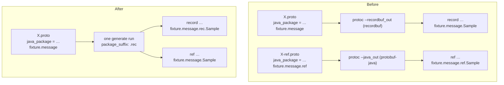

# Managed protoc and Single-Proto Interop - Plan

## Goal Capsule

- **Objective:** Make `recordbuf`'s own build self-contained so it no longer
  depends on a system-installed `protoc`, and collapse the interleaved base/`-ref`
  fixture protos into one `.proto` per family by teaching recordbuf a
  package-suffix transform — all while keeping the live protobuf-java
  byte-compatibility oracle.
- **Product authority:** User. The three framing choices are the user's: adopt a
  build-managed `protoc` with cross-module plugin consumption; keep the live
  protobuf-java oracle rather than freeze golden bytes; express the package
  transform as a *suffix* (a relative shadow-jar-style relocation), not a full
  override.
- **Open blockers:** None. The generation-driver fork is resolved: adopt the
  protobuf-Gradle plugin. Remaining open items are implementation-time details,
  not blockers (see Outstanding Questions).
- **Execution profile:** Standard. A build rewiring plus one small, additive
  recordbuf parameter and a fixture-proto consolidation; the interop suite is the
  standing regression oracle and stays green throughout.
- **Tail ownership:** The implementing agent; `ce-work` or `/goal` are both
  acceptable executors.

---

## Product Contract

### Summary

The build stops reading `protoc` from the host and starts pulling it in as a
build-managed dependency, and generation runs through a cross-module-aware
mechanism that consumes the recordbuf plugin from `:recordbuf-generator` instead
of globbing its launcher. To let one `.proto` per family produce *both* the
recordbuf record and its protobuf-java reference, recordbuf gains a
`package_suffix` parameter — a relative transform that appends a segment to each
generated type's Java package — so the two outputs no longer collide and the
parallel `-ref.proto` files are removed. The live protobuf-java oracle is kept.

### Problem Frame

`recordbuf`'s plugin verification shells out to a `protoc` found on the host's
`PATH` (falling back to a hard-coded Homebrew location), so the build can only
run where that binary happens to exist. The interop fixtures additionally carry a
`X.proto`/`X-ref.proto` pair per family: `X.proto` generates the recordbuf record
and `X-ref.proto` — the same message shape at a sibling `.ref` Java package —
generates the protobuf-java reference the test byte-compares against. Both files
are generated by two separate `protoc` invocations, and the second exists purely
so the record and the reference can coexist in one source set without a
same-simple-name collision. The base/ref pair looks like duplication, but under
the current driver the two generators cannot be pointed at one file: the record
and the reference both derive their Java package from the proto's `java_package`
option, which is one value per file.

### Key Decisions

- **Adopt a build-managed, cross-module generation driver.** The driver is the
  protobuf-Gradle plugin: it downloads `protoc` as a per-platform dependency
  (removing the host/PATH dependence and the hard-coded location) and supports a
  custom plugin referenced by path, which lets the fixture consume the recordbuf
  plugin from a *different* module. It also retires the launcher-glob lookup the
  multi-module split deferred (KTD6).
- **Keep the live protobuf-java oracle.** The reference stays a freshly generated
  protobuf-java type, not a frozen byte capture, so the interop suite keeps
  proving recordbuf matches the *current* protobuf-java rather than a past
  snapshot.
- **Package transform is a suffix, not an override or relocation.** A relative
  transform that appends a segment composes uniformly across every family in one
  generate run — each family's distinct `java_package` stays distinct after the
  suffix — and it is the minimal shape (YAGNI) versus prefix/relocate or a full
  replacement.
- **The record is the suffixed side; the reference is the natural package.**
  protobuf-java's output package is immovable (it is fixed by the file's
  `java_package`/`package` option and has no per-invocation override), so record
  is the side we can relocate. The interop tests therefore flip orientation: the
  protobuf-java reference becomes the natural, unqualified package and the record
  is referenced by its suffixed fully-qualified name.
- **Consolidate to one file; no module split.** The suffix collapses record and
  reference into a single `.proto` per family, so the "maybe split the reference
  into its own module" contingency is no longer needed — a module boundary and a
  package boundary give the same collision-avoidance, and the suffix makes a
  package the right lever.

### Requirements

**Self-contained generation**

- R1. The build sources the `protoc` binary as a managed build dependency
  (per-platform), so `./gradlew build` succeeds on a host with no `protoc` on
  its `PATH` and no hard-coded binary location.
- R2. Generation runs through a build-managed, cross-module-aware mechanism that
  references the recordbuf plugin from `:recordbuf-generator`'s distribution —
  not a hand-rolled `ProcessBuilder` and not a launcher glob — so the module-
  under-test consumes its own generator's artifact cleanly.

**Package-suffix transform**

- R3. recordbuf accepts a `package_suffix` parameter that, for every generated
  type, appends the given suffix to the type's output Java package — a relative
  transform over the proto's `java_package`, not a full replacement.
- R4. The suffix composes uniformly across every file in a single generate run;
  because each family's `java_package` is already distinct, the suffixed packages
  stay distinct, so no cross-family type-name collision results.
- R5. recordbuf treats an absent `package_suffix` as a no-op: generation produces
  output byte-for-byte identical to today for any `.proto` or build that does not
  pass the parameter.

**Single-proto consolidation and oracle**

- R6. Each interop family is expressible as a single `.proto` that yields *both*
  the recordbuf record and its protobuf-java reference, so the interleaved
  `-ref.proto` files are removed.
- R7. The protobuf-java reference is still produced by the live protobuf-java
  generator (not frozen bytes), preserving the byte-equality proof against the
  current protobuf-java.
- R8. From one `.proto`, the record and the reference land in distinct Java
  packages (record suffixed, reference at the file's natural `java_package`) so
  both coexist on the test classpath without collision.
- R9. `iface_marker` — which has no byte-compatibility reference — is unchanged by
  the change.

**Interop test reorientation**

- R10. The interop tests are updated so the protobuf-java reference is the natural
  (unqualified) package and the recordbuf record is referenced by its suffixed
  fully-qualified name; no byte-comparison behavior is added or removed — only the
  names and imports move.

### Key Flows

- F1. Consolidated generate and cross-check
  - **Trigger:** A family `.proto` (e.g. `fixtures/src/main/proto/message.proto`)
    declares `java_package = "bijnagte.recordbuf.fixture.message"`; the generate
    carries `package_suffix: .rec`.
  - **Actors:** Build maintainer (owner of the repo)
  - **Steps:** One generate run produces the record into the suffixed package
    (`bijnagte.recordbuf.fixture.message.rec.Sample`, `…Item`) and the reference
    into the natural package (`bijnagte.recordbuf.fixture.message.Sample`,
    `…Item`), both joined into `:recordbuf-fixtures`. The interop test
    byte-compares record encode against reference `toByteArray()` and decodes
    reference bytes into the record.
  - **Covered by:** R1, R3, R4, R6, R7, R8, R10

### Visualizations

Before: two files, two `protoc` invocations, two packages. After: one file, one
generate run, two packages (the record suffixed).

### Acceptance Examples

- AE1. Covers R3, R4, R6, R8. Given a family `.proto` declaring
  `java_package = "bijnagte.recordbuf.fixture.message"` and a generate carrying
  `package_suffix: .rec`, when it runs, then the record emits as
  `bijnagte.recordbuf.fixture.message.rec.Sample` / `…Item` and the protobuf-java
  reference emits as `bijnagte.recordbuf.fixture.message.Sample` / `…Item`, both
  in `:recordbuf-fixtures`, with no `message-ref.proto` present.
- AE2. Covers R7, R10. The interop test cross-checks record encode against
  protobuf-java `toByteArray()` byte-for-byte, and decodes protobuf-java bytes
  into the record — behavior unchanged, imports reoriented to the natural
  reference package and the suffixed record package.
- AE3. Covers R5. A `.proto` generated without the `package_suffix` parameter
  produces output byte-identical to today's output for the same input.
- AE4. Covers R1. On a host with no `protoc` on its `PATH` and no hard-coded
  binary location, `./gradlew build` is green.
- AE5. Covers R4. Generating every family in one run yields distinct suffixed
  packages with no type-name collision between families.

### Success Criteria

- `./gradlew build` is green — compile plus the interop/byte-equality and
  interface suites — on a host with no system `protoc`.
- No `*-ref.proto` file remains under `fixtures/src/main/proto/`; each family is
  a single `.proto`.
- The interop byte-equality suite against protobuf-java is unchanged in coverage
  (bytes/fixed/int32/map/message/optional/order/packed/string/combined families),
  only reoriented.

### Scope Boundaries

- Downstream-installable recordbuf (a convention plugin / published generator for
  external consumers): outside this pass — the change is repo-only.
- Frozen golden bytes / dropping the live protobuf-java oracle: outside — the live
  oracle is retained by decision.
- Prefix, relocate, or full-override forms of the transform: outside — suffix only
  (YAGNI).
- A separate reference module: outside — the suffix collapses record and reference
  into one file, so a module split is not required.
- Error Prone / NullAway / Spotless / SLF4J tooling: untouched — separate deferred
  tracks.

### Dependencies / Assumptions

- A protobuf-Gradle driver that (a) downloads `protoc` as a per-platform
  dependency and (b) supports a custom plugin referenced by path/execution, and
  that is compatible with protoc 36.2 / protobuf-java 4.36.2 (the version the
  `com.google.protobuf.compiler.PluginProtos` shim was generated from).
- recordbuf is unaffected by `option java_multiple_files = true` on the
  consolidated byte-compat protos — it already emits one file per top-level type
  independently of that option. To be confirmed in planning.
- The `:recordbuf-options` include path (needed by `iface_marker`, which imports
  `recordbuf_options.proto`) can be expressed on the new generate mechanism.

### Outstanding Questions

All resolved by the implementation (see **Implementation Notes** below).

---

## Implementation Notes

The plan was driven to a green `./gradlew build`. Concretely:

- **Generation driver — protobuf-Gradle plugin, not a hand-rolled task.**
  `:recordbuf-fixtures` now applies `com.google.protobuf` (0.10.0, buildscript
  classpath) and declares `protoc { artifact = 'com.google.protobuf:protoc:4.36.2' }`
  (R1/R7: managed protoc, no system binary). The old `genFixtures` Exec-
  task/`ProcessBuilder` + launcher-glob is gone. The script is **Groovy** not
  Kotlin (this was settled empirically by attempting a `.kts` conversion and
  watching it fail at the per-task DSL: `includeDirs` is a `FileCollection` with
  no `.from`; `builtins.removeByName("java")` and the plugin's own `remove`/`id`
  Kotlin extension holder `ProtobufConfiguratorExtsKt` do not resolve on the KTS
  script classpath; `option()` *is* typed and works from both). Groovy's runtime
  dispatch resolves all of these for free; a single-module Groovy script keeps
  the rest of the build on kotlin-dsl. See the `NOTE` at the top of
  `fixtures/build.gradle` for the full list.
- **`package_suffix` is a plugin parameter, comma-separated `key=value`.**
  The generate task passes `option 'package_suffix=.rec'` for the byte-compat
  families; `CodeGenerator.parsePackageSuffix` normalizes it (strips surrounding
  dots) and hands it to `FileTable(String)`, which composes it as the final
  java-package segment via `applyPackageSuffix(base, suffix)`.
- **Two generate tasks, per R9.** `ofSourceSet('main')` → `generateProto` does
  the byte-compat families: `--recordbuf_out` with `package_suffix=.rec` gives
  the record at `…fixture.<fam>.rec`, the `java` builtin emits the protobuf-java
  reference at the natural `…fixture.<fam>` package. `ofSourceSet('test')` →
  `generateTestProto` does `iface_marker`: natural record, the `java` builtin
  removed (no reference → no same-simple-name collision), and
  `recordbuf_options.proto` reached via `includeDirs.from(optionsProtoDir, …)`.
- **WCT include.** `recordbuf_options.proto` imports
  `google/protobuf/descriptor.proto` (WKT). The java builtin normally supplies
  it; since `generateTestProto` drops the java builtin, a `Copy` task extracts
  `google/protobuf/*.proto` from the managed `protobuf-java` jar so the include
  still resolves.
- **Per-task plugin registration.** The top-level `plugins { create("recordbuf") {
  path = recordbufLauncher } }` supplies the executable locator; each generate
  task does `task.plugins.create("recordbuf")` (referencing the locator by name)
  and then `getByName("recordbuf").option(...)` for the suffixed family. Per-task
  `create` is the API that actually attaches the plugin — a top-level locator alone
  does not populate a task's plugin container.
- **Catalog note.** `com.google.protobuf:protobuf-gradle-plugin:0.10.0` is
  pinned inline (buildscript classpath), not in the version catalog: a catalog key
  with the `protobuf` prefix collides with the existing `protobuf = "4.36.2"`
  version entry (see `gradle/libs.versions.toml` comment).
- **R10 test rewrite.** The invariant that the record and its reference share a
  simple type name in one source set is preserved, but the *which is qualified*
  side is flipped: the record moves to the `.rec` sibling and the test now refers
  to it by fully-qualified name (`bijnagte.recordbuf.fixture.<fam>.rec.Sample`),
  while the protobuf-java reference stays in the natural family package and is
  unqualified (the tests live in that same package).
- **`java_multiple_files = true` on the byte-compat protos** is now correct for
  the reference emission (one file per top-level type) and leaves recordbuf's one-
  file-per-type output unaffected.
- **`string` family.** `string.proto` sets `option java_outer_classname =
  "StringProto"` so its protobuf-java `GeneratedFile` does not collide with
  `java.lang.String` now that the reference lives in the family's natural package
  and shares it with the same-package test.
- **Verification.** `./gradlew clean build` green: 11 fixtures test classes (29
  assertions) plus the generator's 14; the interop byte-equality suite vs
  protobuf-java 4.36.2 `toByteArray()` still passes.

### Sources / Research

- `fixtures/build.gradle.kts` `genFixtures` — the current system-`protoc`
  `ProcessBuilder` plus the launcher-glob lookup that R1/R2 replace.
- `generator/src/main/java/bijnagte/recordbuf/plugin/CodeGenerator.java`,
  `javaPackage(FileDescriptorProto)` — the output-package resolver where a suffix
  would apply; note recordbuf reads only `getFileToGenerateList()` today and
  ignores plugin parameters, so a parameter parser is new plumbing.
- `options/src/main/proto/recordbuf_options.proto` — the project's existing
  custom-option convention (`java_interface` 50000 / `java_enum_interface`
  50001). A `package_suffix` is a *generation parameter*, not a new proto option,
  but this file shows where option-like surface lives.
- `docs/plans/2026-11-01-002-refactor-multi-module-split-plan.md` (KTD6) — the
  "glob the generator launcher" fragility R2 removes, and the four-module layout
  (`runtime`/`options`/`fixtures`/`generator`) the change keeps.
- `fixtures/src/main/proto/*-ref.proto` vs `*.proto` — the base/ref shape being
  collapsed; each base `.proto` already carries a distinct `java_package`
  (`…fixture.message`, `…i32`, `…map`, `…order`, `…bytes`, `…fixed`,
  `…optional`, `…packed`, `…string`, `…combined`).
- protobuf-Gradle-plugin concept (`com.google.protobuf`): downloads `protoc`
  per-platform and runs registered custom generator plugins — the mechanism that
  yields both no-system-protoc and cross-module consumption. Planner to confirm the
  exact plugin and version.
