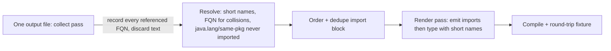

## Goal Capsule

- **Objective:** Improve the readability of recordbuf-generated Java by emitting
  short type names backed by a deduped, ordered import block instead of
  fully-qualified names (FQNs), collecting imports per generated file.
- **Product authority:** The recordbuf plugin maintainers (single-owner repo);
  readability of generated output is the goal, achieved without changing wire
  behavior.
- **Open blockers:** None — scope is decided; remaining items are planning-level.

## Product Contract

### Summary

Generated records, enums, and their nested `Codec` classes will reference types
by short name with an imported block, instead of fully-qualified names. An
import accumulator collects, per generated file, every type that file actually
references; a fixed "standard" batch (the runtime framing classes,
`java.io.IOException`, and the JSpecify `@Nullable` annotation) is a known
ordered prefix but still emitted only when referenced. `java.lang.*` types
collapse to short names with no import line. Cross-package types and `implements`
interfaces are imported like everything else, falling back to FQN only on a
simple-name collision. The change is source-level only: wire encoding, decoding,
and runtime behavior do not change.

---

### Problem Frame

Every generated type today references its collaborators by fully-qualified name
— `bijnagte.recordbuf.runtime.Encoder`, `java.io.IOException`,
`java.util.ArrayList`, `java.lang.String`, cross-file records and enums, and the
`implements` interfaces. This kept the generator decoupled from the consumer
classpath while avoiding any import-tracking machinery, at the cost of dense,
hard-to-scan output where every statement names its package. The runtime framing
classes and a few others are effectively always needed, so a large share of the
noise is a fixed, predictable set that could be simplified mechanically.

---

### Key Decisions

- **Usage-gated standard imports over an unconditional preamble.** The "standard"
  batch is a known, ordered set — the runtime framing classes, `IOException`, and
  `@Nullable` — so it is registered as a fixed prefix rather than discovered; but
  each is still emitted only when the file references it, so marker-only types get
  no unused imports.
- **FQN fallback on simple-name collision.** Java has no import aliasing, so when
  two cross-package types share a simple name, the colliding type is emitted
  fully-qualified instead of imported. This is both correct and simple, versus
  trying to prevent collisions.
- **Individual, non-wildcard imports.** No `java.util.*`; each referenced type
  gets its own import line, matching clean-Java style.
- **One import accumulator per output file.** Each top-level record or enum is
  its own source file, so import collection and collision detection are file-scoped.

---

### Requirements

**Emission core**

- R1. Each generated file emits an import block of the simple names it
  references. A referenced type is written by short name when it is imported and
  by FQN when it is not.
- R2. Same-package types are written by short name with no import line.
- R3. `java.lang.*` types are written by short name with no import line; `java`
  is never placed in the import block.
- R4. The standard batch — the runtime framing classes, `java.io.IOException`, and
  the JSpecify `@Nullable` annotation — is registered as a known ordered prefix of
  the import set, but each is emitted only when the file actually references it.

**Formatting**

- R5. The import block sits after the `package` declaration and before the type.
  Imports are deduped, grouped with `java.*` first, then a blank line, then all
  other packages, and sorted alphabetically within each group.

**Collision handling**

- R6. When two cross-package types share a simple name, both are emitted fully
  qualified (neither is imported).
- R7. `implements` interface types are imported like any other cross-package type,
  subject to the same collision fallback as R6.

**Annotations**

- R8. The `@Nullable` annotation is added to the import set when a file has a
  nullable field. The annotation placement stays correct for both the short-name
  form (`@Nullable Integer`) and the FQN-fallback form
  (qualified type with the annotation before the final identifier).

**Non-regression**

- R9. Regenerated output must still compile. Wire `encode`/`decode` bytes and all
  runtime behavior remain byte-for-byte and behavior-for-behavior unchanged.

---

### Acceptance Examples

- AE1. Covers R3. A message with a `string` field renders the component as
  `String name` with no import line for `java.lang.String`.
- AE2. Covers R4. A marker-only enum (no `Codec`) emits zero imports. A message
  with a `Codec` emits imports for the runtime framing classes and
  `java.io.IOException`, each only because it is referenced.
- AE3. Covers R6. Two cross-package types both named `Item` referenced by one file
  both render fully qualified; neither contributes an import line.
- AE4. Covers R8. A nullable `int32` field renders `@Nullable Integer` with an
  `org.jspecify.annotations.Nullable` import; if that type also falls back to FQN
  on collision, the annotation sits before the final identifier of the qualified
  name.

**Illustrative before/after (R1, R5):**

```java
// Before
public static byte[] encode(Sample v) throws java.io.IOException {
    var enc = bijnagte.recordbuf.runtime.Encoder.start();
    ...
    if (v.id() != bijnagte.recordbuf.runtime.CodecDefaults.int32()) out.writeInt32(1, v.id());
}

// After
import bijnagte.recordbuf.runtime.CodecDefaults;
import bijnagte.recordbuf.runtime.Encoder;
import java.io.IOException;
...
public static byte[] encode(Sample v) throws IOException {
    var enc = Encoder.start();
    ...
    if (v.id() != CodecDefaults.int32()) out.writeInt32(1, v.id());
}
```

---

### Scope Boundaries

- Wire encoding, decoding, and any codec/runtime behavior — source text only.
- Import organizing or enforcement via a formatting tool — Spotless is not wired
  into this project and is not part of this work.
- Wildcard imports.
- Migrating or hand-patching already-generated output files.

---

### Dependencies / Assumptions

- Fixture tests assert behavior (encode/decode round-trip and protobuf-java wire
  compatibility), not exact generated source text — confirmed by inspecting the
  test sources — so a textual change is low-risk, but regenerated output must
  still be recompiled and round-trip-tested before this is declared done.
- One output file is produced per top-level record or enum; nested entry records
  and the `Codec` share the parent type's file and its import set.
- Individual (non-wildcard) imports are emitted.

---

### Outstanding Questions

All deferred questions below were resolved by KTD-1 through KTD-4 in the
Planning Contract: the two-pass resolution and collector placement (KTD-1), the
`java.lang` exclusion (KTD-2), the standard-batch membership (KTD-3), and the
ordering/formatting (KTD-4); `@Nullable` FQN-fallback placement is carried into
the U3 approach; fixture regeneration and the green `./gradlew build` are the
U4 verification.

---

## Product Contract preservation

Product Contract unchanged.

## Planning Contract

### Key Technical Decisions

**KTD-1 — Two-pass, per-file name resolution (collision-safe).** Whether a type
renders as a short name or an FQN is a file-global property: it depends on whether
*another* type in the same file shares its simple name (collision → FQN), which is
unknown until every reference is collected. The runtime framing classes
(`bijnagte.recordbuf.runtime.Encoder/Decoder/Wire/CodecDefaults`),
`java.io.IOException`, and the `java.util.*` helpers live only in the generator
code (not the `ProtoFile`/`Message` model), so a model-only single pass would miss
them. The robust default is a two-pass per output file: (1) generate the source
once through a collector that records every referenced canonical FQN and discards
the text; (2) build a resolved name map — short for everything except colliding
types (FQN), with `java.lang.*` and same-package types always short and never
imported — and regenerate using it. `ce-work` may find a precomputed-name-map
single pass that records names at emit time and post-resolves; two-pass is the
safe default.

**KTD-2 — `java.lang.*` is never imported.** `String`, `Integer`, `Long`,
`Double`, `Float`, `Boolean`, `Object` collapse to short names unconditionally; no
import line is ever emitted for `java.lang`.

**KTD-3 — Standard batch is a known ordered prefix, usage-gated.** The standard
batch is `bijnagte.recordbuf.runtime.Encoder`, `...Decoder`, `...Wire`,
`...CodecDefaults`, `java.io.IOException`, and the `@org.jspecify.annotations.Nullable`
annotation. They are registered in a fixed order but emitted only when the file
actually references them — a marker-only enum imports nothing, and a codec-less
message skips the runtime classes and `IOException`.

**KTD-4 — Individual (non-wildcard) imports, grouped and sorted.** No `java.util.*`.
Each referenced type gets its own import line, deduped, grouped with the `java.*`
group first, a blank line, then all other packages, alphabetical within each
group, emitted after `package ...;` and before the first type.

### High-Level Technical Design

The per-file generation loop in `CodeGenerator.generateForFile` (one
`JavaWriter` per top-level enum or message) gains a collect-pass and a resolve
pass. A new collector (a small `writer.Imports` component or folded into
`JavaWriter`) is the single owner of the referenced-FQN set, the collision
resolution, and the ordered import block. `TypeResolver`, `CodecGenerator`,
`CodeGenerator`, `EnumGenerator`, and `RecordGenerator` are the five call sites
that reference FQNs today; each is converted to register-and-resolve through the
collector.



### Implementation Units

#### U1. Import collector and resolution

**Goal:** A per-file collector that accumulates referenced canonical FQNs, applies
KTD-2/KTD-3/KTD-4, and resolves each FQN to its emitted text (short name, or FQN
on collision) plus the ordered, deduped import block.

**Requirements:** R1 (short-name emission), R5 (block placement/order/dedupe), R6
(collision → FQN for the colliding type). KTD-1, KTD-2, KTD-3, KTD-4.

**Dependencies:** None.

**Files:**
- Create `generator/src/main/java/bijnagte/recordbuf/plugin/writer/Imports.java`
  (or an equivalent collector; `ce-work` may fold it into `JavaWriter`)
- Create
  `generator/src/test/java/bijnagte/recordbuf/plugin/writer/ImportsTest.java`

**Approach:** Registry of canonical FQN → short name. `resolve(fqn)` returns the
text to emit: short unless the short name is claimed by two different FQNs, in
which case both resolve to FQN. `java.lang.*` and same-package FQNs resolve to
short and are excluded from the import block. Standard batch is registered as a
known ordered prefix. The import block is built from the registered, in-block
names, grouped `java.*` then others, alphabetical, one blank line between groups.
Collision resolution must be order-independent: the *set* of referenced FQNs
determines which names collide, not the order they are added (this is why
KTD-1's two-pass collects the whole set first).

**Test scenarios:**
- **Happy path:** registering `java.io.IOException` and
  `bijnagte.recordbuf.runtime.Encoder` yields two import lines and short names
  `IOException` / `Encoder` on resolve.
- **Edge — collision:** registering `com.a.Item` and `com.b.Item` resolves both to
  FQN (`com.a.Item`, `com.b.Item`) and emits neither in the import block.
- **Edge — java.lang excluded:** resolving `java.lang.String` and
  `java.lang.Integer` yields short `String`/`Integer` with no import line. (Covers
  AE1.)
- **Edge — dedupe/order:** registering the same FQN twice and mixing `java.*` with
  another package yields one line each, `java.*` first, alphabetical, blank line
  between groups.
- **Edge — standard batch usage-gated:** a registry that references nothing emits
  no import block; one that references only `Encoder` emits only the runtime
  prefix it actually touched. (Covers AE2.)

**Execution note:** Unit-test the collector in isolation first (pure logic, no
`JavaWriter` coupling) — it is the collision-correctness core.

**Verification:** `ImportsTest` is green; collector resolves collisions
order-independently and excludes `java.lang`/same-package.

#### U2. Emit the import block from `JavaWriter`

**Goal:** `JavaWriter` (or the collector) renders the ordered import block between
the `package` line and the first type, and the per-file loop drives the two-pass
resolution of KTD-1.

**Requirements:** R1, R5. KTD-1, KTD-4.

**Dependencies:** U1.

**Files:**
- Modify `generator/src/main/java/bijnagte/recordbuf/plugin/writer/JavaWriter.java`
- Modify `generator/src/main/java/bijnagte/recordbuf/plugin/CodeGenerator.java`
  (the per-file loop in `generateForFile`)
- Create
  `generator/src/test/java/bijnagte/recordbuf/plugin/ImportBlockEmissionTest.java`

**Approach:** `CodeGenerator.generateForFile` runs the enum/message generation
twice per file: a collect pass that populates the collector, then a render pass
that emits the resolved import block followed by the type(s) using short names.
The `JavaWriter` header/package emission is unchanged; imports are inserted after
`package ...;` and a blank line, before the first `public record`/`public enum`.
Nested messages/enums and the `Codec` live in the same file, so they share the
file's import set; the collect pass spans the whole file.

**Test scenarios:**
- **Happy path:** a message with a codec produces output where the import block
  appears after `package` and before `public record`, and the codec body uses
  short names.
- **Edge — no references:** a marker-only enum emits `package`, a blank line, then
  `public enum` with no import block. (Covers AE2.)
- **Edge — nested + codec:** a message with a nested enum and a map field produces
  one import block covering the whole file's references (e.g.
  `java.util.HashMap`, `java.util.Map`, and the entry type) without duplicates.

**Verification:** Generated text for a sample fixture shows the import block in the
correct position; `ImportBlockEmissionTest` is green.

#### U3. Convert every FQN emission site to register-and-resolve

**Goal:** All five call sites reference the collector instead of emitting literal
FQNs; `java.lang` collapses; `@Nullable` placement stays correct; `java.util.*`
and interfaces are imported per KTD-3/decision answers.

**Requirements:** R1, R2, R3, R4, R7, R8. KTD-2, KTD-3.

**Dependencies:** U1, U2.

**Files:**
- Modify `generator/src/main/java/bijnagte/recordbuf/plugin/writer/CodecGenerator.java`
  (`RT` → the four `bijnagte.recordbuf.runtime.*` classes; `java.io.IOException`;
  `java.util.Comparator`, `java.util.ArrayList`, `java.util.HashMap`)
- Modify `generator/src/main/java/bijnagte/recordbuf/plugin/writer/RecordGenerator.java`
  (`implementsClause`: interface FQNs → resolved short names / FQN on collision)
- Modify `generator/src/main/java/bijnagte/recordbuf/plugin/writer/EnumGenerator.java`
  (`java.util.Map`, `java.util.HashMap`, interface `implementsClause`)
- Modify `generator/src/main/java/bijnagte/recordbuf/plugin/CodeGenerator.java`
  (`java.util.List`/`Map` `of`/`copyOf`; `java.util.Arrays`/`Objects`; the
  `@org.jspecify.annotations.Nullable` annotation emission in `withNullable`;
  thread the collector through `resolveJavaType`)
- Modify `generator/src/main/java/bijnagte/recordbuf/plugin/types/TypeResolver.java`
  (`java.util.List<>`/`Map<>`, boxed `java.lang.*`, `java.lang.String`/
  `java.lang.Object`, cross-file `resolveType` FQNs → resolved names)
- Create or extend a test that asserts on a generated file's import block, e.g.
  augment `generator/src/test/java/bijnagte/recordbuf/plugin/ImplementsClauseEmissionTest.java`

**Approach:** Replace each literal FQN string with a `collector.resolve(fqn)`
call (and a `register` at the same site for the collect pass). `TypeResolver`
becomes collector-aware: it registers each referenced FQN and returns the resolved
short name; cross-file types and interfaces flow through the same path. For
KTD-2, `java.lang.*` never registers an import. `@Nullable` registers
`org.jspecify.annotations.Nullable` and is emitted short; `withNullable` keeps its
dot-split placement for the FQN-fallback case (a nullable field whose type
collided and resolved to FQN) but the common short-name case becomes a plain
`@Nullable` prefix. No behavioral/wire change: only the textual form of names
changes.

**Test scenarios:**
- **Happy path — runtime + IOException:** the iface fixture's `Codec` body reads
  `Encoder.start()`, `CodecDefaults.int32()`, `Throws IOException` with matching
  imports. (Covers AE1.)
- **Edge — nullable short + FQN fallback:** a nullable `int32` renders `@Nullable
  Integer` with a `org.jspecify.annotations.Nullable` import; a nullable field whose
type collided renders the annotation before the final identifier of the FQN. (Covers
  AE4.)
- **Edge — interface import + collision:** an `implements` type from another package
  is imported and short; an interface that collides with a referenced type falls
  back to FQN. (Covers AE3.)
- **Edge — java.util helpers:** a repeated/scalar field and a `byte[]`-carrying
  record import `java.util.List`, and the equality overrides import
  `java.util.Arrays`/`java.util.Objects`, each exactly once.

**Verification:** Each conversion site emits short names with imports; `java.lang`
ever appears imported; no literal `java.`/`bijnagte.recordbuf.runtime.` FQN remains
in generated output except deliberate FQN-on-collision cases.

#### U4. Regenerate fixtures and prove wire parity

**Goal:** Regenerate every fixture through the changed generator, confirm the
imported output compiles, round-trips, and stays byte-for-byte wire-compatible
with protobuf-java.

**Requirements:** R9.

**Dependencies:** U1, U2, U3.

**Files:**
- All `fixtures/build/generated/**` fixture sources (regenerated)
- Any golden/snapshot assertions in
  `fixtures/src/test/java/bijnagte/recordbuf/fixture/**` or
  `generator/src/test/java/bijnagte/recordbuf/plugin/**` that assert exact
generated text (update if present; behavior tests need no change)

**Approach:** `./gradlew installDist`, regenerate fixtures, then
`./gradlew build`. The fixture tests assert behavior (encode/decode
round-trip plus protobuf-java `toByteArray` equality), not source text, so they
should pass unchanged; only source-text assertions, if any, need updating. Inspect
a sample generated `Sample.java` to confirm the import block is present, ordered,
and correct by eye.

**Execution note:** This is the integration proof — start from a regenerated
fixture and drive it through the full `./gradlew build` gate rather than trusting
isolated unit output.

**Test scenarios:**
- **Happy path:** every fixture round-trips and matches protobuf-java bytes after
  regeneration; full `./gradlew build` is green.
- **Edge — compile:** the imported output compiles (no unused-import errors that
  fail the build; no dangling FQNs).
- **Error path:** any fixture that fails compilation or round-trip is a regression
  to fix before declaring done.

**Verification:** `./gradlew build` green; hand-inspected sample shows a correct
import block.

### Verification Contract

| Gate | Command | Applies to |
|---|---|---|
| Unit (collector + emission) | `./gradlew :recordbuf-generator:test` | U1, U2, U3 |
| Fixture behavior + wire parity | `./gradlew :recordbuf-fixtures:test` | U4 |
| Regenerate fixtures | `./gradlew installDist` then the project's `protoc` generate | U4 |
| Full build (compile + test + assemble) | `./gradlew build` | all |
| No residual FQN in output | `grep -rn 'java\.\|bijnagte.recordbuf.runtime\.' fixtures/build/generated` after U4 (excluding deliberate collision FQNs and the protobuf-runtime's own output) | U3, U4 |

### Definition of Done

- The import collector, emission, and all call-site conversions are in place and
  tested (U1-U3).
- All fixtures regenerate, compile, round-trip, and stay wire-compatible
  (U4); `./gradlew build` is green.
- No literal `java.lang.*` import, and no `java.`/`bijnagte.recordbuf.runtime.`
  FQN remains in recordbuf-generated output except for deliberate
  collision fallbacks.
- A hand-inspected generated sample shows the import block in the correct
  position, grouped and deduped per KTD-4.
