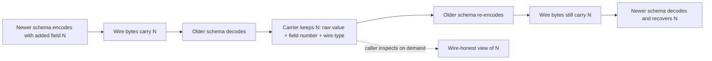

## Goal Capsule

- **Objective:** Forward-compatibility for generated record codecs. Decoding under a schema that predates a field in the bytes must *carry* that field rather than drop it; it must re-emit on the next encode and stay inspectable without the newer schema.
- **Product authority:** recordbuf owner. Aligns with protobuf-java's default unknown-field semantics; this is the documented follow-on to the bridge plan's deferral of unknown-field preservation.
- **Execution profile:** Code — runtime carrier + generator changes to the codec's decode/encode arms + a runtime inspection helper.
- **Status:** Planning-unblocked. Both pre-planning forks are decided: the accessor is a default method on the universal record message interface, and the new canonical-constructor component is accepted without a convenience overload. Wire-type coverage on the unknown arm is deferred to planning.

---

## Product Contract

### Summary

Forward-compatibility for generated record codecs: a message decoded under a schema that predates a field the bytes carry *keeps* that field, and it survives a round-trip. Every generated record gains an always-on unknown-field carrier with a shared empty default, exposed through a record-level accessor; the hot decode-to-encode path only buffers raw value bytes, and a runtime helper structures a captured field into a wire-honest view on demand.

### Problem Frame

A generated codec today drops any field on the wire that its schema does not model — the decode loop's skip arm simply skips it. So a message produced by a newer schema (one added field) read by an older schema loses that field, and re-encoding yields bytes that no longer carry it. This diverges from protobuf-java, which preserves unknown fields, and it breaks the "byte-identical to protobuf-java" property at a gRPC or protobuf boundary: a record that absorbs, then re-sends, a message it only half-understands silently strips the newer producer's field. The pain is specific to additive schema evolution — add a field in a new version — because that is exactly the field an older reader does not model. The case was recognised as a known gap and explicitly deferred as a follow-on.

### Key Decisions

- **Lazy capture, on-demand structure, over eager structuring on decode.** The common same-version decode that sees no unknown field pays nothing; structuring a captured field into a readable value is a caller pull, so the decode-to-encode hot path only buffers raw bytes.
- **Always-on carrier on every record, over per-message opt-in.** Forward-compat becomes universal and matches protobuf-java's default, at the cost of a component that rides every record and a change to record equality — worth it over a per-message opt-in that re-opens the compatibility guarantee per message.
- **Wire-honest inspection, over best-effort auto-typing.** The wire cannot distinguish string/bytes/embedded-message, or int64/bool/enum, so the helper reports a field's number, wire type, and raw value and leaves type resolution to the caller — never emitting a value that may be the wrong type.
- **Accessor is a default method on the universal record interface, not a new interface.** "No unknowns" is the default value, so a record or user implementor with nothing to report needs no code, and access reaches off every record through the interface it already implements. Chosen over a dedicated carrier interface to avoid growing the generated surface.
- **Accept the canonical-constructor signature change, with no convenience overload.** Adding the carrier as a component changes every record's canonical constructor; the fluent builder (the recommended path) is unaffected, so existing positional callers are expected to move to the builder. Chosen over an extra per-record overload that would grow the generated surface without serving the recommended path.

### Requirements

**Capture and re-emit (the guarantee)**

- R1. On decode, a codec captures every field present on the wire that the message's schema does not model — instead of skipping it — into that record's unknown-field carrier.
- R2. On encode, the codec writes captured unknown fields back onto the wire, preserving occurrence order and multiplicity, so a byte stream round-trips a field the current schema cannot name.
- R3. The common case — a decode that sees no unknown field — is zero-cost: no per-record allocation; the carrier's empty state is a shared, immutable default.
- R4. A nested message captures its own unknown fields independently; the parent carries the nested record (itself carrying its own carrier), with no flattening between levels.

Capture and re-emit in place of today's skip, plus on-demand inspection:

**Carrier and access**

- R5. Every generated message (top-level and nested) carries the unknown-field carrier as an always-on record component. Chosen over per-message opt-in and over a hidden non-canonical accessor.
- R6. The carrier is exposed as an accessor that is a default method on the universal record message interface — the one every generated record already implements — yielding that record's unknown fields. The default supplies the "no unknowns" value, so any implementor with nothing to report needs no code, and the accessor reaches off every record polymorphically.
- R7. The carrier participates in record value equality and hashing, comparing by content. Two records that differ only in absorbed unknown fields are unequal.

**Inspection**

- R8. Structuring a captured unknown field into a readable value happens on demand — a runtime helper a caller invokes to inspect — never automatically on every decode. The hot decode-to-encode path only buffers raw value bytes.
- R9. The on-demand structure is wire-honest: it reports each captured field's number, wire type, and raw value, and offers best-effort reads (for example a string view or a nested-message view) that a caller invokes only when it knows the field's real type. It never auto-guesses the real proto type from the wire.

### Scope Boundaries

**Deferred for later**

- Carrying unknown fields across the opt-in protobuf-java structural bridge, already listed as a follow-on of the bridge plan.

**Outside this feature's identity**

- Auto-typing or guessing a field's real proto type from raw bytes. Recovering a newly-modelled field needs no feature: once the newer codec runs, it decodes the preserved bytes directly.

### Acceptance Examples

- AE1. Forward-compat round-trip. **Given** a message written by a schema that includes an added field the reader's schema predates. **When** the reader decodes and the record is re-encoded, then decoded again by the newer schema. **Then** the recovered message retains the added field's value. **Covers R1, R2.**
- AE2. No-unknowns decode. **Given** bytes that carry no field unknown to the decoding schema. **When** decoded. **Then** the record reports the empty carrier (the shared default) and the common path allocates no carrier per record. **Covers R3.**
- AE3. On-demand inspection. **Given** a record that absorbed unknown fields. **When** a caller invokes the structure helper to read them. **Then** each is reported by number, wire type, and raw value, and a string or nested read is available the caller requests — with no type guessed. **Covers R8, R9.**
- AE4. Equality reflects unknowns. **Given** two records equal in all modelled fields but differing in absorbed unknown fields. **When** compared. **Then** they are unequal. **Covers R7.**

### Outstanding Questions

**Deferred to planning:**

- **Wire-type coverage on the unknown arm.** Which wire types the capture supports — standard scalars and length-delimited plus the deprecated group type — and how it treats the invalid wire types. Recommendation: mirroring protobuf-java; settled during planning.

### Dependencies / Assumptions

- Generated code already depends on the runtime module and on protobuf-java; the carrier and the on-demand helper live in the runtime, beside the existing tag/skip decode primitives and the codec-framing helpers.
- Assumes protobuf-java's raw stream primitives are available for both the decode-side capture and the encode-side re-emit, as they are today.
- Relies on the additive-evolution model: newer schemas add fields; re-emit preserves unknowns, so no schema stream is ever downgraded.

### Sources / Research

- `docs/plans/2026-11-02-005-feat-protobuf-interop-bridge-plan.md` — its deferral of unknown-field preservation is exactly the gap this feature closes.
- `docs/plans/2026-10-31-001-fix-wire-format-compatibility-plan.md` — the wire-format-compatibility context the passthrough must not regress.
- `runtime/src/main/java/bijnagte/recordbuf/runtime/Wire.java` — the skip primitive that the capture side replaces.
- `options/src/main/proto/recordbuf_options.proto` — the existing per-message option mechanism, the opt-in shape considered and not taken.
