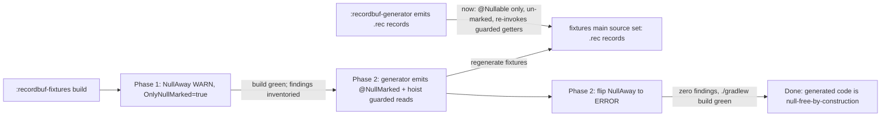

## Goal Capsule

- **Objective:** Make the recordbuf plugin's *generated* output null-safe by construction, and prove it. Today the plugin itself (`:recordbuf-generator`) and the runtime (`:recordbuf-runtime`) are `@NullMarked` + NullAway@error and green, but the code the plugin emits — the `.rec` records under `bijnagte.recordbuf.fixture.*.rec.*` — rides the fixtures module, which does **not** apply Error Prone at all, so it is zero null-checked. Split the work into two phases: (1) turn NullAway on for the generated code in `:recordbuf-fixtures` as a **report-only / warning** pass so the build stays green and a real finding inventory is captured; (2) fix the generator to emit `@NullMarked` output and to hoist nullable values into locals so the generated code actually **satisfies** NullAway, then flip the fixtures from warn to **error** and prove it with `./gradlew build` green.
- **Product authority:** recordbuf owner. This extends the project's "null-free-by-construction" guarantee from the plugin's own model layer and the runtime to the *output the plugin ships into user classpaths*. Generated output already carries `org.jspecify.annotations.Nullable` on nullable components; this makes that contract *checked*, not merely decorative.
- **Execution profile:** Code — a generator change (emit `@NullMarked`; hoist nullable reads into locals in the emit arms) plus build-config changes to `:recordbuf-fixtures` (apply the error-prone plugin, add the NullAway check at warn then error severity, scope it to the recordbuf-generated packages).
- **Status:** Planning-unblocked. All three pre-planning forks are decided (below); the sole open item is the empirical finding inventory, which Phase 1 exists to produce.

---

## Product Contract

### Summary

Close the null-safety coverage gap between "the plugin and runtime are NullAway-clean" and "the code the plugin generates is NullAway-clean." The generated `.rec` records are placed on the fixtures `main` compile source set by the protobuf-gradle-plugin and are already half-annotated with `@Nullable`; they are today un-marked (no `@NullMarked`) and unchecked. Phase 1 turns NullAway on *for the recordbuf-generated code only* at warning severity so the build stays green and the missing `@NullMarked` plus any real violations surface as findings rather than errors. Phase 2 changes the generator so generated packages are `@NullMarked` (one generated `package-info.java` per output package) and so the emit arms never un-box or pass a `@Nullable` value from a guarded-but-re-invoked getter, fixing the findings; then the fixtures flip to error severity and `./gradlew build` proves it.

### Problem Frame

The project's nullability guarantee is currently two layers deep and stops at the output boundary. `:recordbuf-generator` and `:recordbuf-runtime` are `@NullMarked` with NullAway at error severity (verified green). But `:recordbuf-fixtures` applies only `java-library` and `com.google.protobuf` — no `net.ltgt.errorprone` — so the `.rec` records it compiles from `fixtures/build/generated/sources/proto/main/recordbuf/...` get no nullness analysis. The generator already emits `import org.jspecify.annotations.Nullable` and `@Nullable` on nullable record components and builder fields, so the *intent* of nullability is present, but two things stand between that intent and a guaranteed-clean result:

- **The generated code is not null-marked.** No generated `package-info.java` carries `@NullMarked`, and no type carries class-level `@NullMarked`. Under the project's `OnlyNullMarked=true` convention, an un-marked generated package is *out of scope* — NullAway would silently skip it rather than check it. So even the warn pass in Phase 1 checks nothing until Phase 2 emits the mark.
- **The generated code has latent violations.** The encode arms null-guard a getter but then *re-invoke* it inside the guarded block without hoisting: `if (v.a() != null) out.writeInt32(1, v.a());` and `if (getter != null) { … nestedCodec.encode(getter); }` (`writer/CodecGenerator.java`, `emitMessage`/scalar arms). NullAway treats the second `v.a()` / `encode(getter)` as a fresh `@Nullable` result, so un-boxing it to `int` or passing it to a `@NonNull` codec parameter is a finding — and it is *systematic across every nullable field of every generated codec*, so it is not an isolated defect. Phase 2 must fix the generator's emit arms, not patch generated output.

This is a real "fix code generation" effort, not just wiring: the fix lives in the encoder/decoder emit logic and the `@NullMarked` emission, which are in `:recordbuf-generator`.

### Key Decisions

- **Per-package generated `package-info.java` carries `@NullMarked`, over class-level `@NullMarked` over deferring the choice.** Each output package gets one generated `package-info.java` marking the whole package non-null-by-default, matching how the runtime (`runtime/.../package-info.java`) and the plugin's `plugin.*` packages already declare the mark. Chosen over per-class `@NullMarked`, which is easy to miss on a nested `Codec`/`Builder` or a sealed oneof interface, and over deferring (a "get fixtures green first, settle emit later") because the mark is a product contract that ships into user classpaths — a consumer who runs their own nullness analysis inherits the non-null-by-default guarantee the moment the mark exists, so the shape should be fixed now, not papered over.
- **Phase 1 enables NullAway at *warning* severity, over error.** A real finding does not break the build in Phase 1; the warn pass keeps `./gradlew build` green, records the findings as a log/inventory, and lets Phase 1 land independently of Phase 2. Chosen over error-from-day-one, which would couple the two phases into a red window until the generator fix lands, and over a skip-only Phase 1, which would not actually surface what needs fixing. The flip to error severity is the *definition of done* for Phase 2.
- **Cover the recordbuf-generated `.rec` records only, via `OnlyNullMarked=true`.** The fixtures `main` source set also compiles the protobuf-java *reference* output (`Sample`/`SampleOrBuilder`/`Optional`) and the WKT-generated `recordbuf.RecordbufOptions`, none of which are `@NullMarked`. `OnlyNullMarked=true` restricts NullAway to the mark-carrying packages — which, once Phase 2 emits the marks, is exactly the recordbuf-generated code — and leaves the un-marked java-builtin output and third-party `com.google.protobuf` classes out of scope. Chosen over also-checking the java-builtin reference output, which would require annotating generated protobuf-java glue we do not own.

### Requirements

**Phase 1 — turn the analyzer on for the generated code, report-only.**

- R1. `:recordbuf-fixtures` applies the `net.ltgt.errorprone` plugin and adds the `errorprone(nullaway)` + `errorprone(error-prone.core)` configurations, mirroring `:recordbuf-generator` and `:recordbuf-runtime`.
- R2. The fixtures' Java compile is configured with NullAway at **warning** severity (report findings; do **not** fail the build), scoped with `OnlyNullMarked=true` to the mark-carrying packages per the Key Decisions.
- R3. After Phase 1, `./gradlew build` and `./gradlew :recordbuf-fixtures:test` remain **green**; NullAway findings are observable on a build and form an inventoried list (recorded in the plan's Outstanding Questions handoff, or a `docs/solutions/` note), so Phase 2 has a target.
- R4. Phase 1 changes are build-config only: the generator and its output are untouched, so the recorded inventory is faithful to the *current* generator.

**Phase 2 — fix the generator so the generated code satisfies NullAway, then enforce it.**

- R5. The generator emits a `package-info.java` carrying `@NullMarked` for each generated output package, so the recordbuf-generated records fall inside NullAway's scope.
- R6. The generator's emit arms never un-box or pass a `@Nullable` value read through a guarded-but-re-invoked getter: a nullable read is hoisted into a local that the null-guard constrains (e.g. `T x = v.a(); if (x != null) out.writeInt32(1, x);`), so every guarded use reads the local, not a fresh getter call. This applies to scalar un-boxes, nested-message encode/decode, and any other arm that currently re-invokes a guarded getter.
- R7. After the generator fix, `:recordbuf-fixtures` enables NullAway at **error** severity; `./gradlew build` (compile + `:recordbuf-fixtures:test` + assemble) is green with **zero** NullAway findings on the generated code. This is the acceptance gate for Phase 2.
- R8. No hand-edits to generated `.rec` output: every fix lives in `:recordbuf-generator`; the fixtures are regenerated via `./gradlew` (`generateProto` / `generateTestProto`) and the regenerated output is what is checked.
- R9. The round-trip / byte-compat interop tests in `:recordbuf-fixtures` stay green — the codegen changes must not alter the wire contract, only the shape of the null-guard in the emit arms.

### Scope Boundaries

**Deferred for later**

- Checking the protobuf-java *reference* output (`Sample`/`SampleOrBuilder`/`Optional`) and the WKT-generated `recordbuf.RecordbufOptions` with NullAway — a separate, larger undertaking that would require annotating generated glue the project does not own.
- Extending other Error-Prone checks (beyond NullAway) to the generated code; Phase 1 mirrors the project's `disableAllChecks=true + error/warn(NullAway)` convention, so only NullAway is active on the fixtures.
- A permanent fixtures test that asserts "the generated code has a `@NullMarked` package-info" — a nice-to-have guardrail, not required to prove Phase 2.

**Outside this feature's identity**

- Changing the *runtime* or the *plugin's own* model layer — both are already `@NullMarked` + NullAway@error and out of scope here.
- Bumping the generated-code baseline (it stays close to the wider baseline the user classpaths run on); only nullability annotation + a null-guard shape change are in scope.
- Any change to the `com.google.protobuf.compiler` plugin-protocol shim.

### Acceptance Examples

- AE1. Phase 1 is green-and-reporting. **Given** `:recordbuf-fixtures` with NullAway at warning severity (R1–R2). **When** `./gradlew :recordbuf-fixtures:compileJava` runs. **Then** it succeeds and the console/log contains NullAway findings for the generated `.rec` records (or, once Phase 2 marks the packages, a clean report); the build does not fail. **Covers R2, R3, R4.**
- AE2. The `.rec` output is in scope after marking. **Given** Phase 2's generated `package-info.java` (R5) and `OnlyNullMarked=true`. **When** NullAway runs on the fixtures. **Then** it analyzes the recordbuf-generated packages and no longer silently skips them, while leaving the un-marked java-builtin output out of scope. **Covers R5 + Key Decisions.**
- AE3. A guarded nullable encode is null-safe. **Given** a generated scalar nullable field with a non-zero wire default. **When** its `Codec.encode` is null-analyzed with a null field. **Then** the value read under the `!= null` guard is the hoisted local (R6), so the un-box to `int` is provably non-null and produces no NullAway finding. **Covers R6.**
- AE4. Phase 2 acceptance gate. **Given** the generator fix and the warn→error flip on `:recordbuf-fixtures`. **When** `./gradlew build` runs. **Then** it is green with zero NullAway findings on the generated code and the interop/round-trip tests still pass. **Covers R7, R8, R9.**

### Outstanding Questions

**Deferred to implementation / produced by U2**

- **The finding inventory (execution-time).** The concrete NullAway findings on the *current* generated code — expected to be dominated by the systematic guarded-getter re-invocation un-boxes/passes in `emitScalar`/`emitEnum`/`emitMessage` — plus any outliers U2 surfaces (decode arms, the `OneofGenerator`/`InteropGenerator` guarded reads, map entry construction). U2 produces the authoritative list; U3 consumes it. Not pre-enumerated here because the exact set is a runtime result, per the planning/execution separation.
- **Exact `package-info.java` content.** The runtime's `package-info.java` is a rich comment; the generated one may instead be just `@NullMarked` + import + the generated-file header (minimal, clean-output style). Settled in U1 from the clean-output style the plugin already uses.
- **Exact `options.errorprone { … }` DSL at warning severity on this toolchain.** Mirror `error("NullAway")` to `warning("NullAway")`; whether generated-code warning suppression (`disableWarningsInGeneratedCode`) is also needed is confirmed during U2 (it was present in the generator's block but is likely irrelevant once U1 marks the packages and `OnlyNullMarked=true` scopes the check to them).

### Dependencies / Assumptions

- `:recordbuf-fixtures` is Groovy `build.gradle` by deliberate, documented choice (the protobuf-gradle-plugin per-task DSL does not convert to `.kts` cleanly — see the module header). All Phase 1/2 build-config edits go in that Groovy file; the error-prone plugin must apply there.
- JSpecify `org.jspecify.annotations` is already on the fixtures compile classpath (`implementation libs.jspecify`, required to compile the `@Nullable` the generated code already emits), so emitting `@NullMarked` needs no new dependency.
- The protobuf-gradle-plugin already registers the recordbuf-plugin output directory on the `main` source set (verified: the `.rec` records compile), so the generated code is compiled and reachable by NullAway once marked — no new `sourceSet`/`srcDir` wiring.
- `OnlyNullMarked=true` is honored on this toolchain combo as it is in `:recordbuf-generator`/`:recordbuf-runtime` (NullAway 0.14.x auto-detects JSpecify on JDK 22+; `JSpecifyMode` is not set).
- The generator fix must preserve the wire contract: hoisting a guarded read into a local and using the local is behavior-preserving, so the byte-compat interop tests (AE4) stay green.

### Sources / Research

- `fixtures/build.gradle` — applies only `java-library` + `com.google.protobuf`; no `net.ltgt.errorprone` (the Phase 1 gap). Confirmed by inspection.
- `:recordbuf-generator/build.gradle.kts` and `:recordbuf-runtime/build.gradle.kts` — the error-prone + NullAway pattern (`disableAllChecks=true; error("NullAway"); OnlyNullMarked=true`) this plan mirrors; the generator also uses `excludedPaths` for its record-builder-generated sources.
- `runtime/src/main/java/bijnagte/recordbuf/runtime/package-info.java` — the `@NullMarked` package-info the generator should start emitting for each output package.
- `fixtures/build/generated/sources/proto/main/recordbuf/bijnagte/recordbuf/fixture/optional/rec/Sample.java` — current generated output: `@Nullable` components, no `@NullMarked`, and encode arms of the form `if (v.a() != null) out.writeInt32(1, v.a());` (the latent finding).
- `generator/src/main/java/bijnagte/recordbuf/plugin/writer/CodecGenerator.java` — the emit arms (`emitMessage` and scalar arms) that re-invoke a guarded getter without hoisting; the R6 fix target. No generated `package-info.java` is emitted today (R5 target).
- `~/.pi/agent/AGENTS.md` project block — confirms generated user output is *not* `@RecordBuilder`-annotated (stays dependency-free); the `@Nullable` escape is the only nullability annotation record output carries today.
- `docs/plans/2026-11-01-004-feat-enable-nullaway-null-checks-plan.md` — the plan that enabled NullAway on the generator/runtime; this plan extends that guarantee to the generated output.

---

## Key Technical Decisions

- **The `@NullMarked` emission precedes the check — mark-first sequencing, over check-first.** NullAway's only package-scope switch is `OnlyNullMarked`: a package is in scope iff it carries `@NullMarked` (or, with `OnlyNullMarked=false`, everything is in scope as mixed). The scope decision — check *only* the recordbuf-generated `.rec` records, not the java-builtin protobuf-java reference output `Sample`/`SampleOrBuilder`/`Optional` or the WKT-generated `recordbuf.RecordbufOptions` — is achievable *only* by marking the generated packages and running with `OnlyNullMarked=true`; the java-builtin glue stays unmarked and is excluded for free. Emitting the mark first is therefore a prerequisite of a clean, narrowly-scoped check, even though the brainstorm filed "properly annotate" under Phase 2. Confirmed call with the user on 2026-11-04. **Rejected:** mixed-mode (`OnlyNullMarked=false`) "check first, mark later" — it would analyze the whole `main` source set, flooding on un-owned generated glue the project cannot fix, and cannot scope to just the `.rec` records; it is available as a fallback only if mark-first proves impractical.
- **NullAway stays warning-severity in Phase 1, error-severity in Phase 2.** R2 enables the check at warning severity so the build stays green and the finding inventory is captured as a log; R7 flips `:recordbuf-fixtures` to error severity as the definition of done for Phase 2. This keeps the two phases independently landable, per the brainstorm's gating decision, and preserves the existing `disableAllChecks=true` + single-check convention from `:recordbuf-generator`/`:recordbuf-runtime` (only NullAway is active on the fixtures; the ~15 first-party default checks stay deferred).
- **The guarded-read fix is a local hoist, not an annotation or API change.** The generate arms read a nullable getter, null-guard it, then re-invoke the same getter inside the guarded block (e.g. `if (getter != null) out.writeInt32(num, getter);`, `if (getter != null) { … nestedCodec.encode(getter); }`). NullAway does not carry the nullness of one getter call into a second identical call, so the second use reads as `@Nullable` and is flagged on un-box or on being passed to a `@NonNull` codec parameter. The fix hoists the read into a local under the guard (a local's nullness *is* tracked through the guard by NullAway's flow analysis) and uses the local thereafter. It is behavior-preserving on the wire (the same value, guarded the same way, re-emitted identically), so the byte-compat/interop tests are the guardrails — not a new behavior.
- **One `package-info.java` per generated package, emitted by the generator.** Generation is per-`.proto`-file in `CodeGenerator.generateForFile`; several files can map to one Java package, so a `package-info.java` must be de-duplicated per package within a `CodeGeneratorRequest`, not emitted per file. The emitter reuses the existing `JavaWriter`/`TypeImports` machinery and the runtime's `package-info.java` as the content template (`@NullMarked` + the `org.jspecify.annotations.NullMarked` import). No new dependency: JSpecify is already on the generated code's classpath (the existing `@Nullable` components already import it).

---

## Implementation Units

### U1. Emit a `@NullMarked` `package-info.java` per generated package

- **Goal:** Every generated output package the recordbuf plugin produces carries a `package-info.java` marked `@NullMarked`, so NullAway (with `OnlyNullMarked=true`) scopes to exactly the recordbuf-generated `.rec` records and excludes the java-builtin reference glue and WKT classes.
- **Requirements:** R5.
- **Dependencies:** None.
- **Files:**
  - Modify `generator/src/main/java/bijnagte/recordbuf/plugin/CodeGenerator.java` (emit the per-package `package-info.java`, de-duplicated per package across the request's `file_to_generate` files, reusing `JavaWriter`/`TypeImports`).
  - Modify (if a shared emitter is warranted) `generator/src/main/java/bijnagte/recordbuf/plugin/writer/` — a small emitter for the `package-info.java` content, or a direct emission in `CodeGenerator`, mirroring `runtime/src/main/java/bijnagte/recordbuf/runtime/package-info.java`'s shape (the `@NullMarked` annotation + JSpecify import + a one-line generated-file header). Implementer chooses which is cleaner; keep it minimal.
  - Test: `generator/src/test/java/...` — a generator unit test asserting that generating a multi-message proto emits exactly one `package-info.java` per Java package and that its content carries `@NullMarked` (covers the de-dup-across-files behavior; see KTD on per-package de-dup). Existing generator tests (model/writer coverage) stay green.
- **Approach:** Emit the `package-info.java` into the same `outDir` (`javaPkg.replace('.', "/") + "/package-info.java"`) as the record/enum files for that package. Track emitted packages per `CodeGeneratorRequest` so a second file in the same package does not re-emit. Content: file header (matching the `/* Generated by recordbuf -- DO NOT EDIT. */` style), `@NullMarked`, `package <javaPkg>;`, `import org.jspecify.annotations.NullMarked;`.
- **Execution note:** Verify the emitted `package-info.java` compiles in the fixtures and that the generated records in that same package are now in-scope (a known-null violation, if re-introduced, would be reported — the U1 test can assert presence of the marker; U2's build confirms scope).
- **Patterns to follow:** `runtime/src/main/java/bijnagte/recordbuf/runtime/package-info.java` (content shape); `CodeGenerator.generateForFile` / `generateFile` (per-file emission + `FileTable.javaPackage` for the package name and out-dir).
- **Test scenarios:**
  - Single-message proto emits one `package-info.java` in its package, carrying `@NullMarked` and the `org.jspecify.annotations.NullMarked` import and the generated-file header. *Covers R5.*
  - A proto whose file declares several top-level types in one package emits one `package-info.java` for that package (not one per type). *Covers R5 + per-package de-dup KTD.*
  - Two different `.proto` files that map to the same Java package produce one `package-info.java` for the package across the whole request, not two. *Covers R5 + per-package de-dup KTD.*
  - The emitted `package-info.java` is well-formed Java: the regenerated fixtures still compile (`./gradlew :recordbuf-fixtures:compileJava`, or equivalent in the generator test harness that compiles a generated sample).
- **Verification:** A regenerated sample shows a `package-info.java` per generated package carrying `@NullMarked`; de-dup is proven by the two-files-one-package scenario; existing generator tests green.

### U2. Enable NullAway at warning severity on `:recordbuf-fixtures`, scoped to the generated packages

- **Goal:** Turn `:recordbuf-fixtures` over to NullAway so the recordbuf-generated `.rec` records are analyzed, at **warning** severity so the build stays green and the finding inventory is captured, scoped via `OnlyNullMarked=true` to the packages U1 marked.
- **Requirements:** R1, R2, R3, R4.
- **Dependencies:** U1 (U1's `@NullMarked` packages must exist for `OnlyNullMarked=true` to scope the check to the `.rec` records; without U1 the check is empty).
- **Files:**
  - Modify `fixtures/build.gradle` — apply `net.ltgt.errorprone` (`alias(libs.plugins.gradle.errorprone)`, importing `net.ltgt.gradle.errorprone.errorprone` at the top as the generator/runtime `build.gradle.kt(s)` do), add `errorprone(libs.nullaway)` + `errorprone(libs.error.prone.core)` to `dependencies`, and configure the `configureEach` block on `JavaCompile` tasks: `options.errorprone { disableAllChecks = true; warning("NullAway"); option("NullAway:OnlyNullMarked", "true") }`. Mirror `generator/build.gradle.kts`'s rationale comments; note the warn-vs-error difference (R7 flips it).
- **Approach:** This module is Groovy `build.gradle` by deliberate, documented choice (the protobuf-gradle-plugin per-task DSL is Groovy-idiomatic); apply the error-prone plugin in Groovy, matching the generator/runtime pattern but at warning severity. Do **not** touch the generator or its output in this unit — R4 (R3 "faithful to the current generator") depends on it. Capture the finding log from a `./gradlew :recordbuf-fixtures:compileJava`/`:test` run; record it (in the commit message, a `docs/solutions/` note, or the open-questions trail) as the Phase-2 target.
- **Execution note:** Execute after U1. Expect the systematic guarded-read un-box/pass findings from the encoder arms to surface as warnings. The exact list (which arms — scalar/enum/message/oneof/interop — and their counts) is an execution-time discovery this unit exists to produce; the plan does not pre-enumerate it.
- **Patterns to follow:** `generator/build.gradle.kts` and `runtime/build.gradle.kts` (error-prone import, `errorprone(...)` deps, the `tasks.withType<JavaCompile>().configureEach { options.errorprone { … } }` block). For Groovy, the equivalent `tasks.withType(JavaCompile).configureEach { options.errorprone { … } }`.
- **Test scenarios:**
  - `./gradlew :recordbuf-fixtures:compileJava` (and later `:test`) **succeed**: NullAway runs on the generated `.rec` records, emits findings, but does **not** fail the build. *Covers R2, R3.*
  - The finding log is non-empty for the guarded-read pattern (confirming the check actually reaches the generated code, not an empty in-scope set), or — if a future U3 lands first — empty (confirming the code is clean). Either way, scope is proven: the un-marked java-builtin reference output produces findings under `OnlyNullMarked=false` but none under `OnlyNullMarked=true`, demonstrating the scope is exactly the generated records. *Covers R2 + scope KTD.*
  - `./gradlew build` and `./gradlew :recordbuf-fixtures:test` remain green end-to-end. *Covers R3.*
  - The generator source and any generated output is byte-unchanged by this unit (R4): the only diff is `fixtures/build.gradle`. *Covers R4.*
- **Verification:** A warning-severity build on `:recordbuf-fixtures` is green with NullAway findings observable in the log; the log is captured as the Phase-2 target list.

### U3. Hoist guarded nullable reads into locals in the generator's emit arms, and fix any other U2 findings

- **Goal:** Make the generator's output null-clean so that, under NullAway, no generated `.rec` record carries a finding — by hoisting each guarded nullable read into a local under the null-guard instead of re-invoking the guarded getter — plus any other specific findings U2's inventory surfaced.
- **Requirements:** R6, R8.
- **Dependencies:** U1 (records must be in-scope for the fix to be checkable), U2 (the finding inventory is U3's target list).
- **Files:**
  - Modify `generator/src/main/java/bijnagte/recordbuf/plugin/writer/CodecGenerator.java` — the guarded encoder arms: `emitScalar` (present-able boxed-scalar path: `if (getter != null) out.<call>(num, getter)` and the un-nulled default-value path that reads a reference getter), `emitEnum` (nullable path), `emitMessage` (`if (getter != null) { … nestedCodec.encode(getter); }`). Introduce a local copy under the guard and use the local in the write call.
  - Modify any other emit sites U2's inventory names (e.g. `OneofGenerator`, `InteropGenerator` guarded reads, nested message decode paths where a guarded getter is re-invoked) — implementer-driven from the U2 log.
  - Test: `generator/src/test/java/...` — add/extend a generator test that regenerates a fixture exercising the guarded arms and asserts the emitted arm hoists into a local (structural assertion on the generated source, or an analyzer run; implementer chooses). Existing interop/round-trip tests in `fixtures/src/test/java/...` are the behavioral guardrails (they must stay green — R9) and are the compile-time proof the wire output is unchanged.
- **Approach:** For each guarded arm, emit a local of the field's nullable component type and bind it under the guard rather than re-invoking the getter: the scalar boxed-scalar case becomes "read the field into a local, skip when the local is null, otherwise write the local" — the write then references the local, which NullAway's flow analysis knows is non-null inside the guard. The value, the guard, and the wire effect are all identical, so the byte-compat/interop round-trip tests are the behavioral oracle (R9) and the interop bridge's non-oneof path is untouched. This is a generator change only; no hand-patch of generated output (R8).
- **Execution note:** Work the U2 finding list; after each arm is fixed, re-run `./gradlew :recordbuf-fixtures:compileJava` with U2's warning config and confirm that arm no longer appears, rather than fixing all arms blind. Confirm byte-identity by the interop/round-trip suite, not by eyeballing.
- **Patterns to follow:** the existing decode arms already hoist into locals (`var value = …; var unknown = UnknownFields.builder();` in `Codec.decode`), which is the null-hygiene local pattern this change generalizes; `TypeImports`/`ci.use` for any new local type-name emission.
- **Test scenarios:**
  - Each guarded encoder arm (boxed-scalar, nullable enum, nullable nested message) emits a local under the guard and references that local in the write, so regenerated fixtures carry **zero** NullAway findings for those arms. *Covers R6.*
  - Round-trip / byte-compat / interop tests in `fixtures/src/test/java/...` stay green after regeneration — the hoist is wire-behavior-preserving. *Covers R9.*
  - No hand-edited generated `.rec` output survives a clean `generateProto`/`generateTestProto` run (regeneration is idempotent). *Covers R8.*
  - The U2 inventory's other named arms (oneof/interop/nested-decode, if any) are fixed and absent from the re-run log. *Covers R6.*
- **Verification:** With U2's warning config, the re-run finding log on `:recordbuf-fixtures` is empty for the recordbuf-generated records; the interop/round-trip suite passes.

### U4. Flip `:recordbuf-fixtures` NullAway to error severity and prove a clean full build

- **Goal:** Make the null-safety guarantee *enforcing*: any future regression in the generated code — a new nullable field, a new guarded-read arm, a missing `@NullMarked` — fails the build.
- **Requirements:** R7, R9.
- **Dependencies:** U3 (findings must be driven to zero before the flip, or the build goes red for old findings).
- **Files:**
  - Modify `fixtures/build.gradle` — change the `options.errorprone { … }` block from `warning("NullAway")` to `error("NullAway")`, matching `:recordbuf-generator`/`:recordbuf-runtime`. Update the surrounding comment to remove the warn-todo and note it now mirrors the error-severity convention.
- **Approach:** The flip is a one-line severity change in the block U2 added. It is the definition-of-done gate: `onlyNullMarked=true` + `error("NullAway")` means any finding on the generated records blocks the build, making U1's marks and U3's hoist permanent guardrails.
- **Execution note:** Run the full `./gradlew build` (compile + `:recordbuf-fixtures:test` + assemble) and confirm green with zero NullAway findings. This is the acceptance run, not a recipe.
- **Patterns to follow:** `generator/build.gradle.kts` / `runtime/build.gradle.kts` `options.errorprone { disableAllChecks = true; error("NullAway"); option("NullAway:OnlyNullMarked", "true") }` blocks.
- **Test scenarios:**
  - `./gradlew build` is green end-to-end at error severity, with the NullAway check active on the generated records. *Covers R7.*
  - Mutation guard: re-introducing a guarded-read re-invocation (temporarily, in a generator arm) makes the regenerated fixtures fail `./gradlew build` — proving the check is a real guardrail, not a no-op. Remove the mutation after confirming. *Covers R7, mirrors the mutation-test discipline the project already uses for the generator/runtime NullAway wiring.
- **Verification:** `./gradlew build` green with NullAway at error severity on `:recordbuf-fixtures`; a deliberate null violation fails it (then is reverted).

---

## Verification Contract

- `./gradlew :recordbuf-fixtures:compileJava` / `:test` green after U2 with NullAway at warning severity (R3).
- The U2 finding inventory is captured and consumed by U3; U3's re-run log is empty for the recordbuf-generated records (R6).
- `./gradlew build` green at error severity after U4 — the end-to-end gate (R7) — plus the mutation guard in U4 (R7).
- All existing interop / round-trip / byte-compat tests in `fixtures/src/test/java/...` stay green throughout (R9); no hand-edited generated output (R8).
- The `:recordbuf-generator` and `:recordbuf-runtime` modules stay green — the change is additive to the generator's emitter and to `fixtures/build.gradle`, not a touch to either module's NullAway wiring.

---

## Definition of Done

- All of R1–R9 satisfied and verified per the Verification Contract.
- `:recordbuf-fixtures` runs NullAway at **error** severity, scoped to the recordbuf-generated packages, with zero findings.
- The generator emits one `@NullMarked` `package-info.java` per generated package; regenerated fixtures are null-clean without any hand-edited generated output.
- Full `./gradlew build` is green, and the mutation guard confirms the check is a real guardrail (not a no-op).
