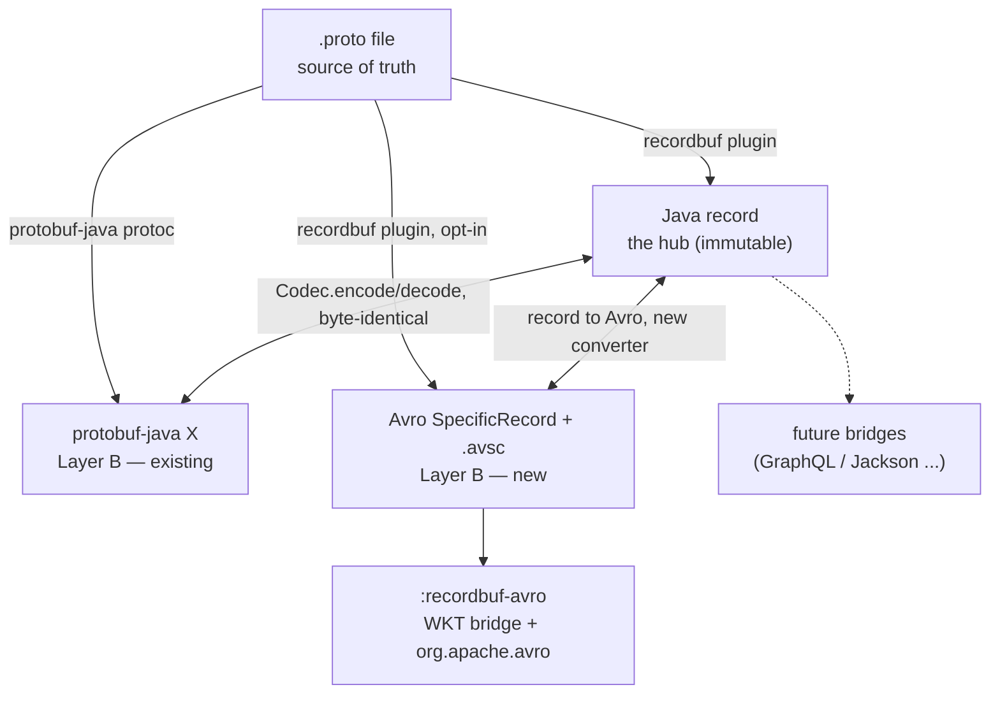
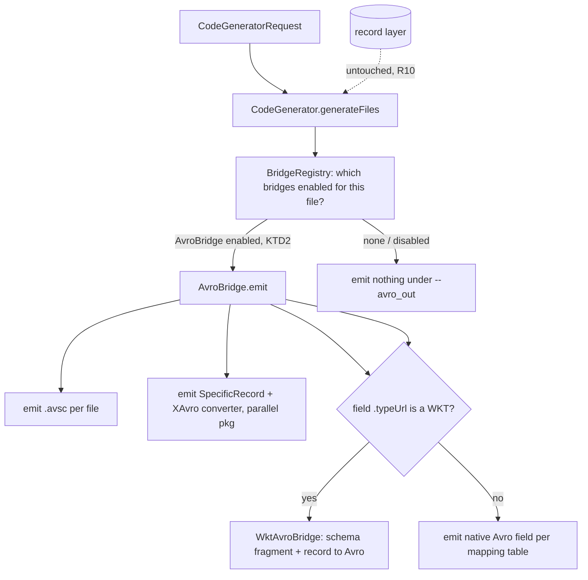
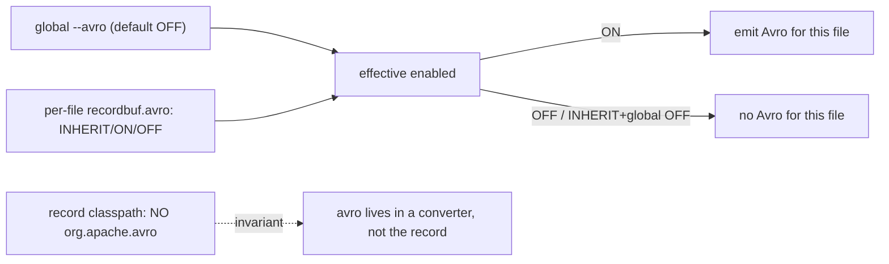

# Avro Conversion Bridge - Plan

## Goal Capsule

**Objective:** Give `recordbuf` an opt-in **Apache Avro** bridge, built on the
record as the central data-class hub. When enabled for a file, the plugin — driven
by the `.proto` (the single source of truth) — emits **an Avro schema and a
structural `record ↔ Avro SpecificRecord` serializer/deserializer**, plus a
standalone `.avsc` per proto. The generated Java record and the existing
protobuf-java interop layer stay byte-for-byte untouched; Avro is a purely
additive sibling surface, the first of a deliberately extensible family of
per-protocol format bridges.

**Product authority:** This document and `AGENTS.md`. The record stays the central
data class and the proto stays authoritative; no generated record may pull
`org.apache.avro` onto its own classpath (Avro lives in its own generated package
backed by a dedicated runtime module, mirroring how `:recordbuf-runtime` hosts the
protobuf framing). The existing protobuf-java interop (`Layer A` always-on
marshaller, `Layer B` structural converter) is unchanged. The bridge is additive
and is a complete no-op when not enabled.

**Open blockers:** None launch-blocking. All brainstorm-time framing is resolved
in **Key Decisions**; the shape-level forks left to ce-plan are resolved in the
**Planning Contract** (KTDs). Deferred follow-ons - Confluent/SR dialect, dynamic
WKTs, `uint64` lossless, map-of-message/enum, per-message toggle, cross-file
nesting - do not block v1. Per the user's scoping decision, the record-level Avro
wire wrappers (P2, R20) move to a **separate follow-on plan**; this plan executes
**P1 only** (converter + `SpecificRecord` + schema + `.avsc` + toggle + WKT
bridge + schema-driven `GenericDatumReader/Writer`).

**Execution profile (sequential P1):** unit 1 (module + catalog) -> 2 (bridge seam
+ per-file tri-state toggle) -> 3 (WKT bridge) -> 4 (schema + `.avsc` emitter) ->
5 (converter + `SpecificRecord` emitter) -> 6 (fixtures interop + parity oracle).
Stop conditions: a failing build or a parity-oracle mismatch halts the unit on its
current diff; a record classpath that ever acquires `org.apache.avro`, or any
change to Layer A/B output, is an invariant breach and halts immediately; a P1
type with no spec-clean Avro target is a fail-loud (R17) - confirm the deferral,
don't coerce. Tail ownership passes to the P2 plan once P1's fixtures interop is
green and committed (P1 independently shippable; P2 additive).

---

## Product Contract

### Summary

Add an opt-in **Avro** format bridge to `recordbuf` as an extension of the record
hub, modeled directly on the existing protobuf-java interop. A new extensible
**format-bridge extension point** in the plugin is registered by the Avro bridge
(a future bridge — GraphQL schema, Jackson JSON — is the same registration, not a
core rewrite). When the bridge is enabled for a file, the plugin emits **from the
proto**: an Avro schema, generated **`SpecificRecord`** classes, and a structural
`record ↔ Avro` converter, plus one standalone `.avsc` per proto. The generated
record and the codec/protobuf layers are untouched; `org.apache.avro` is isolated
to the generated Avro package and a new `:recordbuf-avro` runtime module that
also hosts a **well-known-types bridge** (native Avro logical types). The bridge
is two capabilities in two phases: **P1** = converter + specific type + schema
(embedded and `.avsc`); **P2** = lightweight record-level Avro wire wrappers.
Coverage follows the existing interop boundary and **fails loud** at generation on
the lossy/unsupported edges rather than emit a wrong schema.

### Problem Frame

The interop story so far has been a single axis: recordbuf and protobuf-java share
byte-identical wire bytes, so crossing a *protobuf* boundary is cheap. That leaves
the non-protobuf Java ecosystem — **Avro, and by extension the data / streaming
world that speaks Avro** — without a first-class path from recordbuf. A team wants
to carry domain logic in records and cross a boundary where the peer speaks
Avro; today that means hand-writing, per message, both an Avro schema and a
`record ↔ Avro` mapping — boilerplate that scales with the message count and is
error-prone, and that risks drift between a hand-written schema and the
authority that actually *is* the proto.

The structural fact that makes this tractable: the proto already **is** the
authority, and the record is the hub every surface already converts through. So
the proto-to-Avro mapping can be *emitted*, not authored, and the Avro
serializer/deserializer can be a converter on the record rather than a parallel
data model. The remaining cost is the genuinely hard part of any cross-IDL bridge
— mapping proto's type system onto Avro's, losslessly where possible and failing
cleanly where it is not.

### Why it matters

The user's stated direction is that conversion is a **family**: recordbuf will
also generate GraphQL schemas and Jackson-native JSON serialization. Each of those
will arrive as its own protocol-specific runtime module. The Avro work is the
**pilot** that establishes the shared shape a bridge module takes — the option
that turns it on, the extension point a bridge registers against, the runtime
module's structure, and the "record is the hub, proto is the source of truth"
discipline. Getting the *seam* right now — not just the Avro-specific bits — is
what lets GraphQL and Jackson be drop-in later instead of a second, differently
shaped effort.

### Key Decisions

- **Record is the hub; proto is the source of truth.** The Avro schema and the
  converter are *emitted from the proto*; the record is the central data class the
  bridge converts through (`proto ⇄ record ⇄ avro ⇄ record ⇄ proto`). The record
  layer and the protobuf-java interop are unchanged; Avro handling is a pure
  Avro-layer concern. Chosen over a record-as-`SpecificRecord` approach, which
  would couple the record to Avro and force Avro semantics onto the central type.
- **Delegated specific-record generation (decided 2026-11-06, KTD6).** The v1
  per-type `XSpecific` is produced by **Avro's own
  `org.apache.avro.compiler.specific.SpecificCompiler`** (added 2026), running on the
  per-file `.avsc` U4 emits -- not hand-emitted by recordbuf. Rationale: KTD6 says
  compose/reuse Avro's own code rather than re-implement it; a ~300-line hand-rolled
  emitter would duplicate Avro's exact API (which 1.12's own `SpecificCompiler`
  template produces) and have to track Avro version drift. Cost: the delegation runs
  on a *generation/build-time* classpath via the `org.apache.avro:avro-compiler`:
  `1.12.2` sub-artifact, which transitively pulls Apache Velocity + Jackson; the
  *consumed* `XSpecific` still compiles against core `avro` alone. `AvroConverterGenerator`
  (KTD6 delegation: the only recordbuf-owned generated piece) now targets the
  `SpecificCompiler`-emitted class by its fully-qualified name, not our own
  `XSpecific`. Proven by `SpecificCompilerDelegationTest` (`.avsc` -> `SpecificCompiler`
  -> a compilable `SpecificRecordBase` that round-trips through the
  `GenericDatumReader`/`GenericDatumWriter` schema-driven API).
- **R5 output + integration shape (decided 2026-11-06, operator, KTD1 refinement).** No
  build-system coupling: everything the bridge produces comes from the single
  `protoc --recordbuf_out=...` invocation -- **no** build-time Gradle task that compiles
  the `.avsc`, which would couple the plugin's output to the build. Avro types land in
  the **same** generated source dir the proto files already go to (the `--recordbuf_out`
  dir, the `.rec` package family) -- not a separate dir, not a second invocation. Consequence:
  the `XSpecific` must be produced **in-process by the plugin itself** -- the `AvroBridge`
  runs Avro's `SpecificCompiler` over the per-file `.avsc` it emits, reads back the generated
  `XSpecific.java`, and emits it as a `CodeGeneratorResponse.File` alongside the `.avsc` + the
  `XAvro` converter. This preserves R22 (generated `*.rec` code stays dependency-free) and the
  recordhub design, at the cost of `avro-compiler` (+ Velocity+Jackson, generation-time only)
  landing on the *plugin's* classpath -- the deliberate, one-way coupling the operator accepted
  for build-system decoupling.
- **Specific, not generic.** `SpecificRecord` classes are the v1 target, not
  `GenericRecord`/`Map`. Specific gives a concrete, IDE-navigable type, a
  compile-time schema, and the cleanest generated converter; generic is a
  deferred variant.
- **Extensible bridge family, built as a thin generic extension point first.**
  A future bridge registers its option + emitter + runtime module against one
  seam; Avro is the pilot. Chosen over an Avro-only minimal build now and a
  generalization later — the upfront cost is the seam, and it is what makes the
  promised family not a second rewrite.
- **Native Avro logical types, Confluent/SR deferred but not shut off.** v1 uses
  Avro's *native* logical types (`timestamp-micros`, etc.). A Confluent
  Schema-Registry-compatible variant is an explicit **later feature**, kept open
  because native logical types are a subset of Confluent's and the
  `SpecificRecord` shape is portable — "add the Confluent dialect" is a runtime
  addition on the same bridge, not a regeneration (a "don't cut off the path").
- **Well-known types via a runtime bridge, not a hard fork.** recordbuf does not
  *recognize* WKTs today (it treats `google.protobuf.*` as ordinary nested
  messages), and a naive proto→Avro mapping is silently lossy at the edges. So a
  **WKT bridge lives in `:recordbuf-avro`** — canonical Avro schema fragments +
  conversion per known WKT, reused by every generated converter — exactly the
  shape `:recordbuf-runtime` already takes for the protobuf framing. Unmapped
  types **fail loud at generation** (a clear error), which is the mechanism that
  keeps a path closed-to-now but open-for-later, not permanently forbidden.
- **WKT v1 set, with a structured `Duration`.** Covered natively: scalar
  wrappers, `Timestamp` → `timestamp-micros`, `FieldMask` (bytes), `Empty`,
  `NullValue`, and **`Duration` → `{ seconds: long, nanos: int }`** (a record,
  *not* logical `duration`, which only carries micros and would lose
  > 1 s of nanos). Deferred: the dynamic types `Struct`/`Value`/`ListValue`/`Any`.
- **Standalone schema, proto-package namespace.** Embedding the schema on each
  `SpecificRecord` is mandatory (Avro's `getSchema()` contract); a standalone
  `.avsc` per proto (all of that proto's records nested; oneof as a union;
  generated-header'd) is added as a shareable, registry-ready artifact. The
  Avro **namespace is the proto `package`** — consistent with the
  proto→`java_package` rule.
- **Hardened Avro reader/writer API.** `GenericDatumReader`/`GenericDatumWriter`
  + `SpecificData` on the schema-driven API, on a pinned recent Avro (1.12.x GA
  line), *not* the legacy class-name `SpecificDatumReader`, whose no-arg
  constructor is deprecated and unsafe.
- **Opt-in toggle = global param + per-file tri-state, default off.** A global
  plugin flag plus a per-file option that can force `ON`/`OFF`/`INHERIT`, with the
  per-file value beating the global in either direction — mirroring the
  `package_suffix` global param and the per-message option pattern. Per-message
  granularity is deferred.
- **Two serializers, phased.** Both a `record ↔ Avro` converter (**P1**, first)
  and lightweight record-level Avro wire wrappers (**P2**, additive on P1) are
  wanted; P1 makes the record the schema's native carrier (the thing Avro is
  optimized for) while P2 keeps an `encode`/`toAvroBytes`-style ergonomics
  symmetric with the protobuf `Codec`.

### Requirements

**Bridge architecture and source of truth**

- R1. **Extensible bridge family.** `recordbuf` gains a generic *format-bridge*
  extension point that a per-protocol bridge registers against (option that turns
  it on, emitter, runtime module). A future bridge — GraphQL schema, Jackson JSON,
  or another — is added by registering against the same seam, not by rewriting the
  plugin core. Avro is the pilot bridge.
- R2. **Specific target.** The v1 Avro representation is Avro *Specific*
  (`SpecificRecord` classes), not `GenericRecord`/`Map` or a `SpecificRecord`
  stand-in on the Java record.
- R3. **Record stays the hub.** The `record ↔ Avro` path is a converter *on* the
  record. The record layer, its `Codec`, and the existing protobuf-java interop
  are unchanged; Avro handling is a pure Avro-layer concern.
- R4. **Proto is authoritative.** The Avro schema and the converter are emitted
  **from the proto**; no hand-authored `*.avsc` is the basis for generated code
  (a standalone `.avsc` may be *emitted* for sharing, per R6, but it is not the
  input).
- R5. **Java-package isolation.** Generated Avro types live in their **own java
  package** (analogous to how the protobuf-java reference `X` types sit in a
  `.ref`/suffix package), so `org.apache.avro` is confined to the Avro types'
  classpath and **never reaches a generated record's classpath**.
- R6. **Schema output is both embedded and standalone.** Each generated
  `SpecificRecord` carries its Avro schema (mandatory for specific classes), and
  each `.proto` produces **one standalone `.avsc`** containing that proto's
  records (nested messages nested, oneof as a union), with a
  `// Generated by recordbuf -- DO NOT EDIT` header.
- R7. **Namespace = proto package.** The Avro namespace is the proto's `package`
  (or `java_package`, consistent with the existing proto→Java mapping).

**Well-known-types bridge**

- R8. **WKT bridge in the Avro runtime.** `:recordbuf-avro` hosts the WKT
  mapping — canonical Avro **schema fragments** plus **conversion** per known
  WKT (Wrappers, `Timestamp`, `FieldMask`, `Empty`, `NullValue`, `Duration`) —
  reused by every generated Avro converter rather than re-open-coded per record.
  WKTs map to **native Avro logical types**, not Confluent extensions.
- R9. **`Duration` is structured.** A proto `Duration` maps to Avro `{ seconds:
  long, nanos: int }` (a record), *not* logical `duration`; the structured form
  preserves full nanos and is lossless across the `record ↔ Avro` bridge.
- R10. **WKTs are recognized, not authored.** The generated Avro converter
  recognizes WKT fields on a message (by the WKT type they carry) and delegates to
  the runtime bridge; the **record layer does not learn about WKTs** — its
  generated fields stay untouched.
- R11. **Dynamic WKTs are out of scope and fail loud.** `Struct`, `Value`,
  `ListValue`, and `Any` are not mapped in v1 and are reported as generation
  errors, not silently coerced.

**Opt-in toggle**

- R12. **Global toggle, default off.** A global plugin parameter (a direct
  analogue of `package_suffix`) enables the Avro bridge; absent it, no Avro output
  is produced.
- R13. **Per-file override, bidirectional.** A per-file option is tri-state
  (`ON`/`OFF`/`INHERIT`); a set per-file value beats the global in **either**
  direction.
- R14. **No-op when off.** Output for a bridge that is off is byte-for-byte
  unchanged; enabling it adds only the Avro files.

**Type coverage, mapping, and fail-loud**

- R15. **Coverage follows the interop boundary.** The generator handles the proto
  constructs the existing interop already supports: scalars, `bytes`, `repeated`,
  nested `message`, `enum`, `oneof`, and `map<K,V>` with a string key and a
  scalar/enum value.
- R16. **Enum / presence / default rules.** A proto enum maps to an Avro `enum`
  whose **`default` is the number-0 constant**. A presence-tracked (nullable)
  scalar maps to `["null", T]`; a non-present scalar takes the Avro **default
  (zero-value)**.
- R17. **Fail loud at generation.** A type with no clean proto→Avro mapping —
  `uint64` (lossy; the record holds it as `long`), non-string map keys,
  `map` of message/enum values, and the deferred dynamic WKTs — is reported as a
  **generation error with a clear message** rather than emitting a silently wrong
  schema. Fail loud is the mechanism that keeps a path *deferred, not closed*.
- R18. **proto3 only.** v1 targets proto3, consistent with the existing interop
  harness; proto2 presence is out of scope.

**Reader/writer API and phasing**

- R19. **Schema-driven, hardened read/write.** Generated converters use
  `GenericDatumReader`/`GenericDatumWriter` + `SpecificData` on a pinned recent
  Avro (1.12.x GA), **not** the legacy class-name `SpecificDatumReader` (its
  no-arg constructor is deprecated and unsafe).
- R20. **Two serializers, in two phases.** **P1** ships the `record ↔ Avro`
  converter, the generated `SpecificRecord` types, and the schema (embedded +
  `.avsc`). **P2** adds lightweight record-level Avro wire wrappers
  (`toAvroBytes`/`fromAvroBytes`, throwing `IOException` like the protobuf
  `Codec`), strictly additive on P1. Both capabilities are wanted; P1 first.

**Runtime module and purity**

- R21. **Dedicated Avro runtime module.** A new module — working name
  `:recordbuf-avro` — holds `org.apache.avro` and the WKT bridge and is the **only**
  place the Avro dependency is declared. It mirrors `:recordbuf-runtime`
  (co-versioned from the root `subprojects {}` block; the Avro version pinned in
  the version catalog).
- R22. **Purity preserved.** No generated *record* may import `org.apache.avro`;
  the dependency is confined to the generated Avro types' package via R5/R21. New
  first-party code participates in the project's Spotless + NullAway/@`NullMarked`
  wiring, and generated Avro output stays format-clean.
- R23. **Confluent/SR stays a runtime seam.** Confluent/SR compatibility is not a
  hard fork of the bridge: v1 uses native logical types, and the seam to add a
  Confluent dialect later is preserved on the WKT bridge, not foreclosed.

**Interop and verification**

- R24. **Locked in the harness.** Avro interop is locked in
  `:recordbuf-fixtures` alongside the existing protobuf family: a
  `record → Avro → record` round-trip and a **reference/parity** check (against
  Avro's own serialization of the same data for the same fields, or a committed
  reference) — the orange being byte/field identity and round-trip equality.
- R25. **No change to the protobuf layers.** Enabling the Avro bridge changes
  nothing about Layer A/Layer B behavior or output; the protobuf and Avro paths
  are independent and coexist.

### Key Flows

- F1. **Record-hub Avro exchange.** proto bytes → record (protobuf decode) →
  Avro `SpecificRecord` (`record → Avro` converter) → Avro wire bytes → Avro
  `SpecificRecord` → record (`Avro → record` converter → protobuf encode).

  ```mermaid
  flowchart LR
    P[proto bytes] -->|protobuf decode| R[record]
    R -->|record to Avro| A[Avro SpecificRecord]
    A -->|Avro serialize| W[Avro wire bytes]
    W -->|Avro deserialize| A2[Avro SpecificRecord]
    A2 -->|Avro to record| R2[record]
  ```
  **Covers R3, R8, R10, R19, R24.**

- F2. **Toggle evaluation.** For a given file, is the bridge enabled? Per-file
  value, else the global.

  ```mermaid
  flowchart TB
    start[Generate Avro bridge for a file?] --> per{Per-file option set?}
    per -->|ON| on[Emit Avro bridge]
    per -->|OFF| off[Skip — no Avro output]
    per -->|INHERIT or absent| glob{Global toggle on?}
    glob -->|true, default false| on
    glob -->|false / absent| off
  ```
  **Covers R12, R13, R14.**

**Source-of-truth fan-out** (one proto feeds every bridge surface; the record is
the hub converting between them):


**Covers R1, R3, R5, R21, R23.**

**proto → Avro type mapping (v1)**

| Proto | Avro | Notes |
|---|---|---|
| `int32`/`fixed32`/`sfixed32` | `int` | |
| `int64`/`fixed64`/`sfixed64` | `long` | |
| `sint32`/`sint64` | `int` / `long` | |
| `uint32` | `int` | |
| `uint64` | — | **fail-loud** (lossy as `long`; R17) |
| `double`/`float` | `double` / `float` | |
| `bool` | `boolean` | |
| `string` | `string` | |
| `bytes` | `bytes` | |
| `enum` | `enum` | `default` = number-0 constant (R16) |
| scalar wrapper | `["null", logical]` | |
| `Timestamp` | `date`/`timestamp-micros` | bridge (R8) |
| `Duration` | `{seconds: long, nanos: int}` | structured, not logical duration (R9) |
| `FieldMask` / `Empty` / `NullValue` | `bytes` / `{"type":"record","fields":[]}` / `int` | bridge |
| `message` | `record` | nested message nested |
| `oneof` | `["null", …members]` union | |
| presence / optional | `["null", T]` or default | R16 |
| `repeated<T>` | `array` | |
| `map<K,V>` | `map` | string key + scalar/enum value; else out of scope (R15/R17) |
| `Struct`/`Value`/`ListValue`/`Any` | — | **out of scope, fail-loud** (R11) |
| `map` of message/enum value | — | **out of scope** (matches the codec/Interop boundary) |

### Acceptance Examples

- AE1. **`Timestamp` round-trips micros.** A `Timestamp` field encodes to
  `timestamp-micros` and decodes back to the same seconds+nanos. **Covers R8.**
- AE2. **`Duration` round-trips as a pair.** `{seconds,.nanos}` survive
  `record → Avro → record` exactly, including a value whose nanos exceed 1 s.
  **Covers R9.**
- AE3. **Wrapper field maps to `[null, logical]`.** A scalar wrapper field is
  present as a union and absent as `null`. **Covers R8, R16.**
- AE4. **Non-present scalar → zero-value.** A non-present scalar decodes to its
  Avro default (zero); a present one carries its value. **Covers R16.**
- AE5. **Enum default round-trips.** Each enum constant round-trips by number and
  the number-0 constant is the declared Avro default. **Covers R16.**
- AE6. **Off is a no-op.** A bridge that is off emits nothing new; the record,
  its `Codec`, and the protobuf Layer A/B output are unchanged byte-for-byte.
  **Covers R14, R25.**
- AE7. **Per-file beats global both ways.** Global ON + per-file OFF yields no
  Avro for that file; global off + per-file ON yields Avro for that file.
  **Covers R12, R13.**
- AE8. **Fail-loud on unsupported.** A field using `uint64`, a non-string-map-key
  or message/enum-valued map, or a dynamic WKT (`Struct`/`Value`/`ListValue`/`Any`)
  surfaces a clear generation error; no partial or wrong schema is emitted.
  **Covers R11, R17.**
- AE9. **Schema is emitted both ways.** Each generated `SpecificRecord` exposes its
  schema, and a valid standalone `.avsc` (with the DO-NOT-EDIT header, namespace =
  proto package) is produced per proto. **Covers R6, R7.**
- AE10. **`.avsc` + specific types interop.** The standalone `.avsc` and the
  generated `SpecificRecord` classes load and round-trip the same data
  (the `.avsc` and the embedded schema are in agreement). **Covers R6.**
- AE11. **P1 converter round-trips.** `record → SpecificRecord → record` is
  field-identical for every supported field family; P2's `toAvroBytes`/`fromAvroBytes`
  round-trip on top of it. **Covers R2, R20.**
- AE12. **Hardened reader/writer.** The generated converters run on the
  schema-driven `GenericDatumReader/Writer` + `SpecificData` API; no legacy
  class-name `SpecificDatumReader` is exercised. **Covers R19.**
- AE13. **Record purity.** No generated record imports `org.apache.avro`; the
  dependency is confined to the generated Avro package and `:recordbuf-avro`.
  **Covers R5, R21, R22.**
- AE14. **proto3 only.** A proto2 file is not a v1 target. **Covers R18.**
- AE15. **Clean first-party code.** New `:recordbuf-avro` source and the generated
  Avro output pass Spotless and participate in NullAway/`@NullMarked` consistently
  with the project wiring. **Covers R22.**

### Scope Boundaries

**In scope (v1)**

- The record-based **record ↔ Avro `SpecificRecord` converter** and the generated
  `SpecificRecord` types, emitted from the proto.
- The standalone `.avsc` per proto (plus the mandatory embedded schema).
- The **WKT bridge** in `:recordbuf-avro` for the R8/R9 set, native logical types.
- The **opt-in toggle** (global param + per-file tri-state, default off).
- The **`GenericDatumReader/Writer` + `SpecificData`** reader/writer (P1).
- Locking the above in `:recordbuf-fixtures` with a reference/parity check.

**Deferred for later (paths kept open)**

- **Confluent / Schema-Registry dialect** on WKTs — a later feature on the bridge
  seam (R23), not foreclosed.
- **Dynamic WKTs** — `Struct`, `Value`, `ListValue`, `Any` (fail-loud by error
  until supported; R11).
- **`uint64` lossless** — deferred as a `byte[]`/logical variant; v1 fails loud
  (R17).
- **Map of message/enum** — out of scope for v1, matching the codec/Interop
  boundary (R15/R17).
- **Per-message toggle granularity** — v1 is global + per-file (R13); per-message
  is deferred.
- **P2 record-level Avro wire wrappers** (`toAvroBytes`/`fromAvroBytes` on the
  record) - a **separate follow-on plan**, additive on P1 (R20). *Deferred-to-
  separate-plan* per the user's scoping decision; not an active unit in this plan.
- **Other bridges** — GraphQL schema generation and Jackson JSON serialization,
  built on the same extension point as future registrations (R1).
- **Avro `GenericRecord`/`Map`** representation — a deferred variant; v1 is
  specific.
- **proto2** presence (R18).
- **Stream-direct** Avro encode/decode (into/out of a stream, no intermediate
  `byte[]`) — a carry-variant if P2 profiling shows the intermediate matters.
- **Cross-file WKT/message closure** beyond the same-file shape the interop
  supports today.

**Outside this product's identity**

- A new data model that *is* the Avro type (v1 keeps the record as the type;
  Avro is a converter *on* it).
- Any change to the existing codec/`Encoder`/`Decoder`/`Wire` or the protobuf-java
  interop contract.
- Schema Registry *deployment* (registration, versioning, lookup) — v1 produces
  schemas compatible with later registration; it does not do registry I/O.

### Explicit Non-Goals

- No `org.apache.avro` on any generated *record* classpath (R5/R21/R22).
- No change to Layer A / Layer B / `Codec` semantics or output (R25).
- No hand-authored schema as the source of recordbuf output (R4).
- No silent coercion of an unmappable type — fail loud instead (R17).
- No `GenericRecord`/`Map` representation in v1 (R2).
- No proto2 in v1 (R18).
- No Schema-Registry runtime integration (registration/lookup) in v1.
- No GraphQL or JSON bridge in v1 — the seam exists for them, the modules do not
  yet (R1).

---

## Assumptions

- Generated Avro-output consumers will carry `org.apache.avro` on their classpath
  for the *Avro* surface — the same way a protobuf consumer already carries
  `com.google.protobuf:protobuf-java` — while the record's classpath stays free of
  `org.apache.avro` (R5/R21).
- The Avro version is pinned at a recent GA (1.12.x as of this writing; the 1.11.x
  line is a maintained LTS) and stays a **stable wire + schema resolution**, so
  emitted schemas and generated read/write stay compatible (see **Sources /
  Research**).
- The proto is proto3 (R18); proto2 fields are not present.
- The fixture/interop harness already provides a per-family structure the Avro
  round-trip + reference parity can layer onto, mirroring the protobuf family.
- A WKT on a message is recognizable at generation time (the field carries a WKT
  type), so the converter can delegate to the bridge without changing the record
  layer (R10).
- No cross-file WKT/message nesting beyond the same-file shape in v1.

---

## Planning Contract

This Planning Contract resolves the shape-level forks the brainstorm parked in its
former "Open Sub-Decisions" section. The general assumptions are in the Product
Contract's **Assumptions**; two implementation-specific ones are added below.
No requirement, flow, or acceptance example was rewritten (R1-R25, AE1-AE15
unchanged).

### Key Technical Decisions

#### KTD1 - Bridge extension seam (R1)
Add a small **`FormatBridge`** seam the generator consults per file:
`String name()`, `boolean enabled(CodeGeneratorOptions global, FileOptions file)`,
v`List<String> emit(ProtoFile model, String outDir)`. A `BridgeRegistry` holds the
registered bridges; v1 registers exactly one, **`AvroBridge`**. A future GraphQL /
JSON bridge is a new registrant, not a change to core generation (R1).
YAGNI: ship the interface + one registrant now; build out a multi-bridge registry
only when a second bridge actually exists. *Deferred-to-impl:* the registry's
exact location (a package-private `Bridges` list vs a `ServiceLoader`-style scan).

#### KTD2 - Bridge enablement / toggle (R12 / R13)
- **Global:** a new `--avro` boolean, parsed in `CodeGenerator` (the
  `--package_suffix` analogue) and threaded via `CodeGeneratorOptions`; **default off**.
- **Per-file tri-state:** a new `extend google.protobuf.FileOptions {`
  `recordbuf.AvroControl avro = 50003; }` in `recordbuf_options.proto` where
  `AvroControl { INHERIT = 0; ON = 1; OFF = 2 }`. `ModelLoader` reads the tag off
  the `FileDescriptorProto` options `UnknownFieldSet` (the existing
  `protobuf_java`/`interfaces` tag-read pattern, **not** by linking the extension
  class) and projects it to `model.ProtoFile.avroControl()` ∈ {INHERIT, ON, OFF}.
- **Effective:** `enabled = (perFile == INHERIT) ? globalOn : (perFile == ON)`.
*Deferred-to-impl:* the exact free tag number (50003 assumed; take the next free
slot) and `--avro` vs `--avro_on`.

#### KTD3 - WKT recognition + record representation (R8 / R9)
Net-new finding: the record layer is **WKT-agnostic** - a WKT field today emits a
nested record mirroring the WKT's own proto structure (e.g. `Timestamp{seconds,nanos}`);
there is **no** Java-typed `Timestamp → Instant` mapping in `:recordbuf-runtime`.
Therefore the **bridge owns WKT handling**: (i) it recognizes a WKT field by its
proto `typeUrl` FQN (`.google.protobuf.Timestamp`, `...Duration`, ...) matched
against a known-WKT set the bridge names; (ii) it converts that record's nested
WKT fields ↔ the Avro representation. The record layer and its output are
**untouched** (R10). *This corrects the earlier `WktFieldMappings` assumption* -
that mapping does not exist; the bridge introduces it over the record's nested
representation.

#### KTD4 - Per-WKT mapping + enum/presence rules (R9 / R16)
- `Timestamp` → `{"type":"long","logicalType":"timestamp-micros"}` (epoch micros,
  ↔ record `seconds`/`nanos`) — *or* structured `{seconds,nanos}`; **adopt
  timestamp-micros** (a native Avro logical type, no Confluent dependency).
- `Duration` → structured record `{seconds: long, nanos: int}` (per the structured-
  duration decision; Avro's duration-logical is micros-only).
- `FieldMask` → `["null","string"]` (null ⇒ empty mask; string = canonical paths).
- `NullValue` → `["null", enum]`; message wrappers (`*Value`/`DoubleValue`/...) →
  `["null", inner logical]`; `Empty` → an empty Avro record.
- **Enum** absent-in-`SpecificRecord` default → the **number-0** Avro enum
  constant (documented; proto3 requires a 0-value constant, so it is always
  valid).
- **Presence** (`optional`) → `[null, T]`, default `null`. **Non-present scalar**
  → Avro's default (zero/empty), **not null**.
*Deferred-to-impl:* exact `FieldMask`/`NullValue` encodings; confirm
`timestamp-micros` over `{seconds,nanos}` on first compile.

#### KTD5 - Package + namespace (R5 / R7)
Generated Avro types live in a **parallel Java package**: default = proto
`java_package` + a bridge-decided base (e.g. `.avro`), overridable by a new global
`--avro_package` (or a suffix form). **Namespace = proto package** (`model.ProtoFile()
.package()` - the Avro default, distinct from the Java package). Record package /
namespace and the `.rec`/java-reference outputs are **unaffected**. *Deferred-to-
impl:* the exact override knob (whole-package vs suffix) and the default base.

#### KTD6 - Converter shape + reader/writer (P1)
Per-type **static converter** in `:recordbuf-avro`, mirroring `Interop`:
`XAvro.fromRecord(XRecord) → SpecificX` and `XAvro.toRecord(SpecificX) → XRecord`
- **not** a method on the record, so the record stays `org.apache.avro`-free.
Nested-message converters compose recursively, schema-qualified by FQN. The reader
/writer is **schema-driven**: Avro `GenericDatumReader`/`GenericDatumWriter` +
`SpecificData` (rejected: the legacy class-name `SpecificDatumReader` class-scan /
`AVRO-3659` path, per **Sources**). Each generated `SpecificRecord` carries
`public static final Schema SCHEMA` (the embedded schema, R3). P2's
`toAvroBytes`/`fromAvroBytes` are deferred to a separate plan (KTD12).

#### KTD7 - Module `:recordbuf-avro` (R21)
`settings.gradle.kts`: `include(":recordbuf-avro")` +
`project(":recordbuf-avro").projectDir = File(rootDir, "avro")`, co-versioned by
the existing root `subprojects {}` (group `bijnagte.recordbuf`, version `0.0.1`).
A new `avro/build.gradle.kts` **mirrors `runtime/build.gradle.kts`** (Spotless +
NullAway auto-applied by the root `subprojects { withPlugin("java") }` blocks;
a `@NullMarked` package-info) plus `api org.apache.avro:avro:<catalog>`. Package
`bijnagte.recordbuf.avro` hosts the bridge, the WKT registry, and converter
helpers; the generated Avro types (consumer package, KTD5) `import
bijnagte.recordbuf.avro.*` exactly as records import `bijnagte.recordbuf.runtime.*` -
the record never imports Avro.

#### KTD8 - Avro version (R6)
Pin `org.apache.avro:avro:1.12.2` (latest GA 1.x; the 1.11.x LTS line is the
fallback). 1.x wire + schema are stable (the binary encoding has not changed across
1.x); **not** Avro 2.0 (its JSON-schema rework is future work). Catalog key
`avro`; add `avro = "1.12.2"` to `gradle/libs.versions.toml`.

#### KTD9 - Fail-loud for unsupported P1 (R11 / R17)
Unsupported P1 (`uint64` lossless, `map<…,message/enum>`, dynamic WKTs
`Struct`/`Value`/`ListValue`/`Any`) → a **generation-time error**
(`CodeGeneratorResponse.error`, as `Main` currently reports) - the "don't cut off
the path" mechanism: a deferral, not a hard no, so each path can be filled in
later.

#### KTD10 - Emission wiring
The enabled bridge emits Avro into a **new output path** `--avro_out=DIR`, a
sibling of `--recordbuf_out` (parsed and threaded like `package_suffix`). A
disabled (OFF / INHERIT+global-off) file emits **nothing** under `--avro_out`.
The `recordbuf_options.proto` `AvroControl` extension is declared; the java/
`.rec` outputs are unaffected. *Deferred-to-impl:* a dedicated `--avro_out` on the
recordbuf plugin (one process, one pass) is recommended over a second
`GenerateProtoTask`.

#### KTD11 - Interop parity oracle + harness (R24)
Per family (mirroring the protobuf-interop family) the fixtures grow an Avro
output + a test asserting two things: (a) the **round-trip**
`record → SpecificRecord → record == original`, and (b) a **committed Avro-bytes
golden reference** - serialize a known `SpecificRecord` and compare the written
byte[] to committed bytes (the "orange", parallel to the protobuf family's
`*Proto.bytes` oracle). WKT conversions are asserted in both directions against
the reference. Test classpath: `implementation project(':recordbuf-avro')` +
`implementation org.apache.avro:avro`.

#### KTD12 - P2 deferral
P2 record-level `toAvroBytes`/`fromAvroBytes` (R20) is **deferred to a separate
follow-on plan**; it is additive on the P1 converter (KTD6) and is **not** an
active unit here.

### High-Level Technical Design

The generator consults the bridge registry per file; the bridge emits schema +
`SpecificRecord` into a parallel package via existing `Generator`/`Writer`
patterns; the record layer is never touched:



Toggle precedence and the record-clean invariant:



**Field-type mapping (proto → Avro)**, P1 (a `mermaid-table` equivalent):

| Proto type (P1)            | Avro schema (P1)                                     | Fail-loud instead? |
|----------------------------|-----------------------------------------------------|--------------------|
| `int32`/`int64`/`uint32`/`fixed…`/`double`/`float`/`bool`/`string`/`bytes` | native Avro `int`/`long`/`double`/`float`/`boolean`/`string`/`bytes` | — |
| `enum`                       | Avro `enum`; absent default = number-0 constant      | — |
| `repeated T`                 | Avro `array` of T; empty → empty array               | — |
| `map<K,v>` (K scalar; v scalar) | Avro `map<v>`; `K` → `int`/`long`/`string` per Avro rule | map of message/enum → **error** |
| `message` (nested, same-file) | nested Avro record                                   | cross-file (dynamic) → **error** |
| `oneof`                      | `[null, field]` union per alternative                | — |
| `Timestamp`/`Duration`/`FieldMask`/`NullValue`/wrappers/`Empty` | WKT bridge fragment (KTD4) | dynamic WKTs → **error** |
| `uint64` (> `Long.MAX`)      | —                                                    | **generation error** |

### Dependencies / Prerequisites
- `:recordbuf-runtime` (codec helpers, unchanged) and the fixtures oracle harness.
- `org.apache.avro:avro:1.12.2` (KTD8) on `:recordbuf-avro` (+ on the fixtures
test classpath).
- No prerequisite external systems; the plugin needs only `--avro_out` wired (KTD10).

### Sequencing
U1 (module + catalog) → U2 (bridge seam + per-file tri-state toggle) and
U3 (WKT bridge) in parallel (both depend only on U1) → U4 (schema + `.avsc`
emitter, needs U2+U3) → U5 (converter + `SpecificRecord` emitter, needs U4) →
U6 (fixtures interop + parity oracle, needs U5).

## Implementation Units

### U1 - Module `:recordbuf-avro` + Avro catalog pin

**Goal:** Stand up the Avro runtime module (KTD7/KTD8) so the bridge and
generated types have a home, co-versioned and tooling-clean.

**Requirements:** R5, R21, R22.
**Dependencies:** none (foundation).
**Files:**
- `settings.gradle.kts` (add `include(":recordbuf-avro")` + `projectDir = File(rootDir, "avro")`).
- `avro/build.gradle.kts` (new; mirror `runtime/build.gradle.kts`; add
  `api("org.apache.avro:avro:" + libs.versions.avro.get())` or a catalog accessor).
- `gradle/libs.versions.toml` (add `avro = "1.12.2"` under `[versions]`; a
  `[libraries]` `avro = { module = "org.apache.avro:avro", version.ref = "avro" }`).
- `avro/src/main/java/bijnagte/recordbuf/avro/package-info.java` (new `@NullMarked`).

**Approach:** Mirror `:recordbuf-runtime` exactly (build, `@NullMarked` package-
info, Spotless + NullAway auto-applied by the root `subprojects {}`). Verify the
module compiles empty + `./gradlew :recordbuf-avro:build` (no main yet, just the
package-info + an empty module is fine; add a trivial type or rely on the package-
info). Keep the record's classpath free of `org.apache.avro` (the module is
`api`-only, reached by generated consumers, never by the record).

**Patterns:** `:recordbuf-runtime`'s `build.gradle.kts` + `package-info.java`.
**Test scenarios (U1):** `./gradlew :recordbuf-avro:build` compiles; the module
is co-versioned (`group`/`version` inherit from `subprojects {}`).
**Verification:** `./gradlew :recordbuf-avro:build` green; `settings` recognizes
the module.

### U2 - Bridge seam + per-file tri-state toggle

**Goal:** Add the `FormatBridge` seam + registry and the per-file `recordbuf.avro`
tri-state + global `--avro`, so the Avro bridge is gated correctly (KTD1/KTD2).

**Requirements:** R1, R12, R13, R14 (global param + per-file knob), R17 (the
default-off no-op).
**Dependencies:** U1.
**Files:**
- `options/src/main/proto/recordbuf_options.proto` (add `extend google.protobuf.FileOptions {`
  `recordbuf.AvroControl avro = 50003; }` + `enum AvroControl { INHERIT=0; ON=1; OFF=2; }`).
- `generator/…/plugin/model/*` (read the `FileOptions` tag in `ModelLoader` the way
  `protobuf_java`/`interfaces` are read; project `ProtoFile.avroControl()`
∈ {INHERIT,ON,OFF}; add the model accessor).
- `generator/…/plugin/CodeGenerator.java` (+ `CodeGeneratorOptions`/options model —
parse + thread the global `--avro` param).
- `generator/…/plugin/Bridge` / `BridgeRegistry` / `AvroBridge`(stub until U4/U5)
- (new seam types under `bijnagte.recordbuf.plugin` — package-info not yet needed).

**Approach:** Introduce the `FormatBridge` interface + a registry the generation
loop consults per file (the `emitMessage`/`generateFiles` seam). `AvroBridge.enabled(...)`
computes the effective per-file decision from KTD2. The `AvroBridge.emit(...)` is
a stub in U2 (returns nothing for the message/enum/schema writers, U4/U5); it
becomes real in U4/U5. Assert the toggle: OFF / INHERIT+global-off emit nothing
under `--avro_out`; ON / INHERIT+global-on emit for that file.

**Patterns:** `protobufJavaFqnFor` / `interfacesFor` (tag-read off the options
UnknownFieldSet); the `generateFiles` per-file emit loop. The existing `--package_suffix`
global-param plumbing.
**Test scenarios (U2):** `AvroBridgeEnabledTest` (JUnit 5, plain asserts):
inherited default off ⇒ no emits; global on ⇒ emits; `ON`/`OFF` per-file override
the global; `INHERIT` falls back to global.
**Verification:** `:recordbuf-generator:test` green; OFF/INHERIT+global-off files
produce no `--avro_out` output.

### U3 - WKT bridge (recognition + mapping + conversion)

**Goal:** In `:recordbuf-avro`, implement the WKT bridge over the record's nested
representation, so WKT fields map to Avro via native logical types / structured
`Duration` and the record layer stays WKT-agnostic (KTD3/KTD4).

**Requirements:** R8, R9, R10, R16.
**Dependencies:** U1.
**Files:**
- `avro/…/wkt/` (new): a known-WKT registry (typeUrl FQN → schema fragment +
  record↔Avro converter); `Timestamp`→timestamp-micros, `Duration`→`{seconds,nanos}`,
  `FieldMask`→`["null","string"]`, `NullValue`/wrappers → `["null",…]`, `Empty` →
  an empty record.
- `avro/…/wkt/*Test` (JUnit 5): per-WKT round-trip + (where applicable)
  logical-type assertions.

**Approach:** The registry maps each known WKT `typeUrl` to (a) its Avro schema
fragment and (b) a `record-nested-WKT ↔ Avro` converter. WKT recognition is purely
a `typeUrl` check here (the generator consults it in U4/U5); the record layer is
never asked to know about WKTs. Structured `Duration`, not the micros-only
logical. Native logicals (`timestamp-micros`) only - no Confluent (R8/R9).

**Patterns:** a `Map<String, WktBridge>` / a small registry; converters that are
null-aware (a nullable WKT is `[null, T]`).
**Test scenarios (U3):** `WktBridgeTest` - for each WKT, `record ↔ Avro` round-
triips and (for `Timestamp`) the micros boundary (whole-seconds + sub-second
`nanos`). `Duration` structured boundary. `FieldMask`/`NullValue`/wrapper null
handling.
**Verification:** `:recordbuf-avro:test` green on the WKT suite.

### U4 - Avro schema emitter (`.avsc` + embedded `SCHEMA`)

**Goal:** Emit the Avro schema per proto as a standalone `.avsc` (R3) and embed
it on the generated types' `SCHEMA` constant, translating field types per the
KTD4 table (native / presence / enum / map / oneof / WKT) and failing loud on
unmappable P1 types (KTD4/KTD9).

**Requirements:** R2, R3, R2, R4, R6, R7, R17 (+ KTD4 mapping table).
**Dependencies:** U2, U3.
**Files:**
- `generator/…/plugin/writer/AvroSchemaGenerator.java` (new; a
  `Generator`/`Writer` that builds `org.apache.avro.Schema` from `model.ProtoFile` -
  or an emitted JSON schema string; recommend building the `Schema` object and
  writing `toString()`).
- `generator/…/plugin/AvroBridge.emit` (wire the U2 stub to emit the `.avsc` + the
  embedded schema fragment; per-message/enum, namespace = proto package).
- `generator/…/plugin/writer/*Test` / emit-test asserts the emitted `.avsc` +
  `SCHEMA` contain the expected schema fragments (schema text / structure).

**Approach:** Walk `model.ProtoFile` (messages/enums/repeated/map/oneof/WKT),
build the corresponding `Schema` (record/enum/array/map/union/logical), embed it.
WKT fields delegate to the U3 bridge (`typeUrl` match). Unknown/unmappable P1
(`uint64`, map-of-message/enum, dynamic WKTs) → `throw` a generation error
(KTD9). Namespace = proto package. Output under `--avro_out` as `.avsc` (R3).

**Patterns:** `Generator`/`Writer` + `generateFile(w -> new AvroSchemaGenerator().write(w, …))`
(the existing per-file emit pattern); `WktBridge` for WKT fragments.
**Test scenarios (U4):** `AvroSchemaGeneratorTest` - (a) a nested message → nested
Avro record; (b) `repeated T` → array; (c) `map<int32,int32>` → `map`; (d) a
`oneof` → union; (e) a `Timestamp` field → `timestamp-micros` (delegated to U3);
(f) a `uint64`/map-of-message → generation error (fail-loud).
**Verification:** `:recordbuf-generator:test` green; emit a sample proto and assert
the `.avsc`/`SCHEMA` shape + that an unsupported type errors.

### U5 - Converter + `SpecificRecord` emitter

**Goal:** Emit the generated `SpecificRecord` types + the per-type
`record ↔ SpecificRecord` converters, composing nested-message converters and
routing WKT fields through the U3 bridge (KTD6).

**Requirements:** R20 (P1 portion), R17, R1 (converter on the seam), R6.
**Dependencies:** U4.
**Files:**
- `generator/…/plugin/writer/AvroSpecificGenerator.java` (new; emits
  `public class XSpecific extends org.apache.avro.specific.SpecificRecord` with a
  `public static final Schema SCHEMA` and accessors; or an equivalent record-shaped
  `SpecificRecord` — recommend the classic `SpecificRecord` with a static schema).
- `generator/…/plugin/writer/AvroConverterGenerator.java` (new; emits
  `XAvro.fromRecord/toRecord`; nested converters composed; WKT via U3).
- `AvroBridge.emit` wires these into the per-file emit.
- emit-tests assert the generated types + converter fragments compile + round-trip.

**Approach:** Emit a `SpecificRecord` per message (fields per KTD4 mapping +
presence/enum rules; `SCHEMA` = U4 output). Emit `XAvro.fromRecord(R)→SpecificX`
/ `toRecord(SpecificX)→R`; nested message fields call the nested converter; WKT
fields call the U3 bridge converter. Reader/writer is schema-driven
(`GenericDatumReader`/`GenericDatumWriter` + `SpecificData`) used in tests, not
custom per the legacy shim. P1 only (no `toAvroBytes`; KTD12).

**Patterns:** `InteropGenerator`'s structural-converter shape; `Generator`/`Writer`.
**Test scenarios (U5):** `AvroConverterGeneratorTest` - a generated type compiles
+ `XAvro.fromRecord/toRecord` round-trips a representative value; a nested + a WKT
field both convert; presence/enum defaults behave per KTD4.
**Verification:** `:recordbuf-generator:test` green; generated type compiles
under `:recordbuf-fixtures` and round-trips via `XAvro`.

### U6 - Fixtures interop + parity oracle

**Goal:** Lock the whole bridge with the fixtures' interop harness: a per-family
Avro output + a round-trip + committed-bytes parity oracle (KTD11), proving
"same data" against a committed reference and proving the record stays avro-free
+ Layer A/B unchanged (R25).

**Requirements:** R24, R25, R5 (+ R17 fail-loud coverage), R12/R13 (the toggle is
tested ON for the interop family).
**Dependencies:** U1, U5 (U4, U3).
**Files:**
- `fixtures/…` an Avro interop proto (mirrors a protobuf-interop family, plus a
  WKT field and an enum for presence/enum coverage); wire an `--avro_out` task in
  `fixtures/build.gradle` + `implementation project(':recordbuf-avro')` +
  `implementation org.apache.avro:avro` on the test classpath.
- `fixtures/src/test/java/bijnagte/recordbuf/fixture/*AvroInterop*` + a committed
  Avro-bytes golden reference.

**Approach:** Generate the Avro output for the interop family. Test: (a) round-
trip `record → XSpecific → record == original`; (b) serialize a known `XSpecific`
via `GenericDatumWriter` + `SpecificData` and assert the written bytes equal the
committed golden (the orange); (c) assert a generated record's classpath has no
`org.apache.avro` import (a source grep or an import assertion — R25/R22); (d)
assert Layer A/B output is unchanged (the codec + interop golden bytes still match
— regress, don't break). Optionally assert the fail-loud path (an unsupported
type errors).

**Patterns:** the protobuf-interop family's round-trip + `*Proto.bytes` golden-
bytes oracle (now `*Avro.avro` golden bytes); `output.upToDateWhen { false }` for
regeneration.
**Test scenarios (U6):** `AvroInteropTest` - round-trip for a message with nested,
`repeated`, `map`, `oneof`, an enum (presence/enum default), and a WKT field;
committed-bytes parity; "record is avro-free" assertion; Layer A/B golden bytes
unchanged.
**Verification:** `:recordbuf-fixtures:test` green (round-trip + parity); record
stays avro-free; Layer A/B regression clean.

## Verification Contract

- `./gradlew build` - full build (compile + test) green across all modules incl.
  the new `:recordbuf-avro`.
- `./gradlew :recordbuf-avro:test` - WKT bridge (U3) + any converter-helper tests green.
- `./gradlew :recordbuf-generator:test` - schema-contract + converter tests (U4/U5) green.
- `./gradlew :recordbuf-fixtures:test` - the interop + parity oracle (U6) - the orange. Green.
- `./gradlew spotlessCheck` - Spotless clean across all modules incl. `:recordbuf-avro`
  + any generated Avro output (the `:recordbuf-fixtures` Avro output is format-clean).
- `./gradlew :recordbuf-generator:installDist` + `protoc --plugin=protoc-gen-recordbuf=… --avro_out=… <proto>`
  regenerates a sample; the generated `.avsc` + `SpecificRecord` + `XAvro` compile
  and round-trip.
- NullAway clean on `:recordbuf-avro` (the @NullMarked package-info scopes it; the
  WKT null-paths use `@Nullable`/`[null,T]` correctly).

## Definition of Done

- **P1 shipped** behind the `--avro` toggle: per-type `record ↔ Avro
  SpecificRecord` converter + generated `SpecificRecord` types + standalone `.avsc`
  per proto + embedded `SCHEMA` + the WKT bridge (native logicals, structured
  `Duration`) + schema-driven `GenericDatumReader/Writer` (KTD6/KTD11). All of it
  additive; a disabled file is a complete no-op (R17/R14).
- `:recordbuf-fixtures` Avro interop passes the round-trip **and** the committed-
  Avro-bytes parity oracle (the orange), and a source/import assert that no record
  class is on the `org.apache.avro` classpath (R25/R22).
- Layer A/B + the codec/`Encoder`/`Decoder`/`Wire` are **byte-for-byte unchanged**
  (R25) - proven by the unchanged `*Proto.bytes`/codec goldens.
- All `./gradlew build` / `spotlessCheck` / the per-module tests above are green;
  NullAway clean.
- `README.md` / project docs note the new `:recordbuf-avro` module + the `--avro`/`
  `recordbuf.avro` toggle + the deferrals (Confluent/SR, dynamic WKTs, `uint64`,
  map-of-message/enum, per-message toggle); **P2 record-level wire wrappers are
  recorded as a separate follow-on plan (KTD12)**, not built here.
- Each KTD's deferred-to-implementation note is resolved or carried explicitly into
  the follow-on work. **Stop conditions** (Goal Capsule): a failing build or parity
  mismatch halts the unit on its current diff; any record-on-Avro-classpath or
  Layer A/B change is an immediate invariant breach. **Tail ownership** passes to
  the P2 plan once P1's fixtures interop is green and committed.

---

## Sources / Research

- **Apache Avro current version.** Download index as of this writing shows
  **1.12.2** (latest GA) and a separate **1.11.5** LTS line — both postdate
  Jan 2025. Pin on the stable GA line (1.12.x) for v1.
- **Avro 2.0.** The current major effort reworks schema syntax toward JSON-Schema
  compatibility; it is *not* the pin target — v1 uses the classic schema syntax and
  the 1.11/1.12 runtime.
- **Wire/spec stability.** The wire format and binary encoding are defined by the
  Avro 1.0 spec and have not changed across 1.x releases; **schemas remain the
  authoritative source of the schema** and schema resolution governs
  read-compatibility. This means emitted schemas and generated read/write are
  stable, and schema-driven read/write (R19) is the correct API stance.
- **Avro Java runtime API.** In 1.10/1.12, `SchemaBuilder` (programmatic
  `Schema.create*`) and `GenericDatumReader`/`GenericDatumWriter` are the
  supported paths; the class-name `SpecificDatumReader` is a legacy shim whose
  no-arg constructor is deprecated/unsafe (a class-scan / `AVRO-3659` family of
  issues). Prefer `GenericDatumReader`/`Writer` + `SpecificData`.
- **Avro logical types** (native, non-Confluent): `timestamp-micros` for
  `Timestamp`; `Duration` has a logical form but it is micros-only, so v1 uses the
  structured `{ seconds: long, nanos: int }` (R9). Confluent's
  `org.apache.avro:avro-confluent` (or a SR connector) is the *later* path for
  Confluent `logicalType` extensions and `Timestamp` with `CONFLUENT.WELL_KNOWN`
  semantics.
- **recordbuf's existing bridge pattern.** The protobuf-java interop
  (`Layer A` always-on `ProtobufMessage`/`ProtobufMarshaller`, `Layer B`
  `InteropGenerator` structural converter on an opt-in `recordbuf.protobuf_java`
  option, `:recordbuf-runtime` hosting the framing, `:recordbuf-fixtures` as
  the orange) is the exact analogue the Avro bridge mirrors.
- **WKT recognition + mapping is net-new for the Avro surface.** Confirmed at
  ce-plan: the record layer is WKT-agnostic - a WKT field today emits a nested
  *record* mirroring the WKT's proto structure (e.g. a `Timestamp` record with
  `seconds`/`nanos`); there is **no** Java-typed `Timestamp → Instant` mapping in
  `:recordbuf-runtime` today. So the bridge (i) recognizes a WKT field by its
  proto `typeUrl` FQN (`.google.protobuf.Timestamp`, ...) against a known set, and
  (ii) translates that nested record to Avro (native logical types, structured
  `Duration`). *(The brainstorm's "from `:recordbuf-runtime`'s `WktFieldMappings`"
  was aspirational and is corrected here.)*
- **recordbuf toggle knobs.** `package_suffix` is the global-param analogue; the
  per-message `recordbuf.protobuf_java` option is the per-file override analogue.
