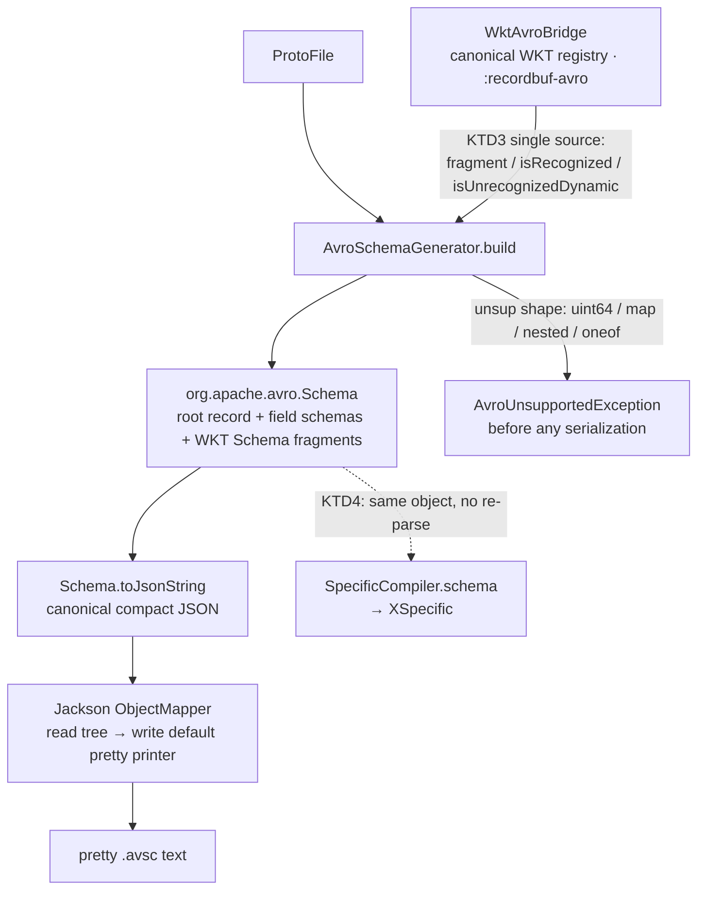

# Refactor AvroSchemaGenerator to a Schema model + Jackson pretty-print

## Goal Capsule

**Objective:** Stop `AvroSchemaGenerator` from hand-concatenating JSON strings and
instead build the Avro schema from a **model** (`org.apache.avro.Schema`, the same
type `WktAvroBridge` and `AvroBridge.generateSpecific` already use), then
**serialize it with Jackson** and **pretty-print** the emitted `.avsc` to a
multi-line document. Jackson lands as an **explicit, version-aligned dependency**
(via the Jackson BOM), not a bare transitive reliance. Crucially, the WKT
fragments are **single-sourced from `WktAvroBridge`** (`:recordbuf-avro`) rather
than re-open-coded in a local `Map` — the operator has authorized the one-way
`generator → :recordbuf-avro` edge (recordbuf-avro is, functionally, the Avro half
of the generator's job; it never depends back on the generator). The refactor
preserves `AvroSchemaGenerator`'s fail-loud surface (R11/R17 of the avro-bridge
plan) and keeps the `.avsc` byte-identical **except for formatting** — it stays
valid Avro, parsable by `Schema.Parser` and consumable by `SpecificCompiler`. No
generated `.java` type changes.

**Product authority:** This refactor is a follow-on to the implementation-ready
`docs/plans/2026-11-05-001-feat-avro-bridge-plan.md` (R4/R6/R8/U4). It does not
rewrite any requirement of that plan; it changes the *shape of the schema text the
bridge emits*, not what is bridged. The two design forks the operator resolved up
front — the model to serialize, how Jackson lands, **and whether to single-source
the WKT map (yes)** — are recorded as **KTD1/KTD2/KTD3**; a secondary reuse
simplification is **KTD4** (recommended) and may be split out if implementation
proves heavier than expected.

**Open blockers:** None. The only judgment call left to implementation is whether
to also fold in **KTD4** (reuse the built `Schema` in `AvroBridge.generateSpecific`
and drop its re-parse); it is a modest, self-contained cross-file touch and is
recommended but separable.

**Execution profile:** U1 (dependency wiring) → U2 (the emitter rewrite, the core
unit) → U3 (end-to-end reuse + regression lock). A failing `./gradlew build` or a
broken `.avsc` parse halts the unit; any change that alters a generated `.java`
type or a wire round-trip is out of scope and halts.

---

## Problem Frame

`AvroSchemaGenerator` (in `:recordbuf-generator`, the plugin's own code — **not**
generated user output) builds the per-file `.avsc` by concatenating JSON string
fragments: a static `Map<String,String> WKT_FRAGMENT` of raw JSON, a `StringBuilder`
root-record assembly, and a hand-written `jsonStr` escaper. This is the one place
in the Avro bridge that does *not* speak Avro's own model: its siblings,
`WktAvroBridge.FRAGMENTS` and `AvroBridge.generateSpecific`, already reason in
`org.apache.avro.Schema` objects.

Two things the operator now wants, made possible by Jackson already being on the
generator classpath (transitively via `avro-compiler → avro → jackson-databind`
`2.22.1`):

1. **Model instead of strings.** Build the schema as a real `org.apache.avro.Schema`
record (root record + field schemas + WKT fragments), and let Avro + Jackson
produce the JSON — never hand-assembled.
2. **Pretty output.** The `.avsc` is currently one line; the operator wants a
readable, indented document. No test or committed golden asserts the linear shape
(everything validates by *parsing* the `.avsc`), so this is behaviorally free.

The subtlety: a real `org.apache.avro.Schema` **validates named-type references at
construction time**, stricter than string concatenation. For the shapes v1
actually bridges (scalars, repeated-scalars, WKTs) that is a no-op; the one place
it bites — the pre-existing "enum referenced by short name but never declared in
the schema" gap — becomes a **fail-loud**, which is aligned with R17 and invisible
to every current fixture (see Assumptions/A1).

A further wrinkle the operator surfaced: the generator's local `WKT_FRAGMENT`
map + `WKT` recognition set are a near-exact **duplicate** of
`WktAvroBridge.FRAGMENTS` / `isRecognized` / `isUnrecognizedDynamic` — and
`WktAvroBridge` is *designed* to be the single WKT registry (avro-bridge R8: "the
bridge is the only place that knows about WKTs"). `WktAvroBridge` already exposes
`fragment(typeUrl)` returning the very `org.apache.avro.Schema` objects KTD1 builds
with, so the local copy is pure re-open-coding — tolerated only as an
accommodation to a "generator can't reach `:recordbuf-avro`" view the operator has
now lifted. This refactor **single-sources** the mapping (KTD3): the generator
drops its local map and reaches into `WktAvroBridge` one-way.

---

## Requirements

- **R1. Model, not strings.** The `.avsc` is produced by building an
  `org.apache.avro.Schema` (root record + per-field schemas + WKT fragments) and
  serializing that model — `AvroSchemaGenerator` no longer concatenates JSON
  fragments by hand.
- **R2. Pretty-printed.** The emitted `.avsc` is a multi-line, indented JSON
  document, produced by Jackson's `ObjectMapper` with its default pretty printer.
- **R3. Fail-loud preserved.** `uint64`, `map` fields, non-WKT nested messages,
  and oneofs still abort with `AvroUnsupportedException` **before** any
  serialization, exactly as today (avro-bridge R11/R17). The mapping itself is
  unchanged.
- **R4. Semantically identical artifact.** The `.avsc` differs from today's only
  in formatting: it parses with `Schema.Parser` and feeds `SpecificCompiler`
  identically — the root record, namespace, field types, enum-by-short-name
  behavior, and WKT fragments are unchanged.
- **R5. WKT fragments single-sourced from `WktAvroBridge`.** The generator stops
  maintaining its own `WKT_FRAGMENT` map + `WKT` recognition set + `typeUrlIfWkt`/
  `fragments()` and instead obtains each WKT's `org.apache.avro.Schema` from
  `WktAvroBridge.fragment(typeUrl)` (recognition via `WktAvroBridge.isRecognized`,
  dynamic-WKT fail-loud via `isUnrecognizedDynamic`). Both modules now use the
  **same `Schema` objects**, not a synced duplicate — realizing avro-bridge R8
  ("the bridge is the only place that knows about WKTs"). This lands a **one-way**
  `generator → :recordbuf-avro` dependency; recordbuf-avro never depends back, so
  it is a cycle-free, layering-safe edge (the operator's stated invariant). R22,
  which governs **generated output** being recordbuf-only, does not forbid this
  plugin-build edge and still bounds R7.
- **R6. Explicit, aligned Jackson dependency.** Jackson is wired as an explicit
  `implementation` dependency via the **Jackson BOM** pinned to match Avro's
  transitive `2.22.1`, so the coupling is visible and single-sourced rather than an
  implicit transitive pull a future Avro bump could silently drop.
- **R7. Nothing else generated changes.** No generated `.java` type (`.rec`
  record, `XSpecific`, `XAvro` converter) and no wire round-trip changes. The only
  generated artifact whose bytes change is the standalone `.avsc` (compact →
  pretty; semantically identical).

---

## Key Technical Decisions

### KTD1 — Model: Avro's own `org.apache.avro.Schema`; Jackson owns formatting *(decided)*

The schema is built as an `org.apache.avro.Schema` — the model `WktAvroBridge` and
`AvroBridge.generateSpecific` already use — and Jackson is the **serializer /
pretty-printer over that model**, not a parallel data structure. Jackson formats
**Avro's canonical JSON**, it does **not** re-build the schema as a hand-written
`JsonNode`/`ObjectNode` tree:

- Avro's `Schema` carries the authoritative shape via `Schema.toJsonString()`
  (compact, canonical). We feed that compact JSON to a shared Jackson
  `ObjectMapper` reading it to a tree and writing it back with
  `writerWithDefaultPrettyPrinter()`.
- This keeps a **single source of truth for the schema JSON** (Avro produces it;
  `SpecificCompiler` parses *that same* shape), so formatting can never drift the
  parsed shape. A hand-built Jackson tree (or a bespoke record model — the "our
  own records" option the operator considered) is **rejected**: it would be a
  second Avro-schema model that must stay in lock-step with both
  `WktAvroBridge.FRAGMENTS` and what `Schema.Parser` accepts, duplicating the
  schema shape for no upside over formatting Avro's canonical output.
- Rejected as the primary too: "Avro owns emission, Jackson only re-pretty" was the
  operator's third option — and it is *exactly* KTD1's recommended mechanics (Avro
  `toJsonString` + Jackson pretty-print). Chosen.
- **Unification is now literal (KTD3).** Because the generator single-sources its
  WKT fragments from `WktAvroBridge.fragment(...)`, both modules use the *same
  `Schema` objects* — not a shared representation approximated by a locally
  re-parsed copy. KTD1's "single source of truth" claim is realized in full.

### KTD2 — Jackson via the Jackson BOM, version-aligned to Avro *(decided)*

Jackson lands as an **explicit** dependency, version-pinned by the **Jackson BOM**:

- `gradle/libs.versions.toml` gains a `jackson = "2.22.1"` version pin (matching
  Avro `1.12.2`'s transitive Jackson, already visible in the dependency graph) plus
  a `jackson-bom` platform library and a `jackson-databind` library.
- `generator/build.gradle.kts` imports the BOM as a platform constraint and adds
  `implementation(libs.jackson.databind)` (which pulls `jackson-core` under the same
  BOM). The schema pretty-printer needs `com.fasterxml.jackson.databind.ObjectMapper`
  + `com.fasterxml.jackson.core.util.DefaultPrettyPrinter`.
- Because the BOM is pinned to Avro's transitive `2.22.1`, alignment holds with no
  conflict resolution; a future Avro bump that shifts the transitive Jackson is
  reconciled by bumping the single `jackson` version pin here.

This is the *plugin's* own code (allowed to carry Jackson/Avro today, via
`implementation(libs.avro.compiler)`); it does **not** touch any generated
dependency-free artifact (R7, avro-bridge R22).

### KTD3 — WKT fragments single-sourced from `WktAvroBridge`; generator gains a one-way `:recordbuf-avro` dep *(decided, operator-authorized)*

The generator **deletes its local WKT map** (`WKT_FRAGMENT`, the `WKT` recognition
set, `fragments()`, and `typeUrlIfWkt`) and reaches into `:recordbuf-avro`'s
`WktAvroBridge` for every WKT decision — `fragment(typeUrl)` for the `Schema`
(KTD1's model piece), `isRecognized(typeUrl)` for recognition, and
`isUnrecognizedDynamic(typeUrl)` for the dynamic-WKT fail-loud. This is the
operator's call that "`:recordbuf-avro` is functionally the Avro half of the
generator's job": the generator may **see** recordbuf-avro; only the **reverse**
is forbidden (recordbuf-avro must not depend on the generator — and it doesn't, so
the edge is cycle-free, A5).

Concretely:
- `generator/build.gradle.kts` gains `implementation(project(":recordbuf-avro"))`
  (U1). It acquires `:recordbuf-avro` → `:recordbuf-runtime` + core `avro` +
  JSpecify — all already in via `avro-compiler`, so the marginal classpath surface
  is just `WktAvroBridge` + its WKT knowledge.
- In `AvroSchemaGenerator`, a MESSAGE-kind field is a WKT iff
  `WktAvroBridge.isRecognized(f.typeUrl())` — its schema is
  `WktAvroBridge.fragment(f.typeUrl())`; a recognized-but-dynamic WKT
  (`Struct`/`Value`/`ListValue`/`Any`) fails loud via `isUnrecognizedDynamic`, and
  a non-WKT message still fails loud via the existing switch path. The fail-loud
  *outcomes* are unchanged (R3); only their source moves from the local set to
  `WktAvroBridge`.
- **Net:** KTD1's "single source of truth" becomes literal; R8 is realized instead
  of approximated by two maps kept in sync by a test, and that sync-test burden
  vanishes.

### KTD4 — Reuse the built `Schema` end-to-end; drop `AvroBridge`'s re-parse *(recommended, separable)*

`AvroBridge.generateSpecific` today re-parses the emitted `.avsc` string
(`new Schema.Parser().parse(avscJson)`) before feeding `SpecificCompiler`, even
though the emitter already *built* that `Schema`. Having the emitter expose the
built `Schema` lets the bridge hand **the same** object to both the pretty-print
and `new SpecificCompiler(schema)`, deleting the redundant parse. The temp `.avsc`
**file** is still written (it is `SpecificCompiler.compileToDestination`'s source
arg). Net: a modest simplification, one extra cross-file touch (`AvroBridge`).
Sequenced as U3 and self-contained, so it can be split into a later commit if U2
lands first. **If U3 is deferred, the emitter may keep returning the pretty `String`
(its current surface) and `AvroBridge` keeps re-parsing — both states are correct
and the plan is complete either way.**

---

## High-Level Technical Design

The data path after the refactor — proto model → Avro `Schema` → Jackson pretty
JSON → `.avsc`, with the same `Schema` object also handed to `SpecificCompiler`
(KTD4):

Two cross-component edges: KTD4 reuses the `Schema` node across the `build →
SpecificCompiler` edge; and KTD3's new **one-way** `WktAvroBridge → build` edge —
the generator now reaches into `:recordbuf-avro` for the WKT `Schema` fragments
instead of re-opening its own table (recordbuf-avro still never sees the
generator).

---

## Scope Boundaries

**In scope**

- `AvroSchemaGenerator` rebuilt on the `org.apache.avro.Schema` model with Jackson
  pretty-printing; the local WKT map **single-sourced from `WktAvroBridge` and
  deleted** (KTD1/KTD3).
- `:recordbuf-avro` wired as a **one-way** dependency of `:recordbuf-generator`
  (cycle-free; KTD3/A5); Jackson as an explicit BOM-aligned dependency (KTD2).
- `AvroSchemaGeneratorTest` migrated to assert on the `Schema` / pretty output
  (mirroring `WktAvroBridgeTest`) while keeping every existing assertion's
  coverage.
- The KTD4 reuse + regression lock (recommended; separable).

**Deferred to follow-up work**

- **Declaring the file's enums in the emitted schema.** The pre-existing
  "enum-by-short-name is never declared" gap (avro-bridge U4 docstring
  over-promises; the code never emits `types:`) is left as-is. Under KTD1 it
  surfaces as a **fail-loud** for a bridged file with an enum field, which no v1
  fixture exercises. Declaring enums is a natural, separate enhancement.
- **A `// Generated by recordbuf -- DO NOT EDIT` header on the `.avsc`** (avro-
  bridge R6/AE9, aspirational). Not added: `Schema.Parser` / `SpecificCompiler`
  consume the raw JSON body, and a `//` comment would break the parse. Adding a
  header is a distinct, out-of-scope change (it would require header-stripping on
  the parse path).
- **Declaring/serializing the file's full type universe (nested messages, oneofs
  as unions).** Still v1-out, still fail-loud (R3 / avro-bridge R11/R17).

**Outside this plan**

- Any change to a generated `.java` type or a wire round-trip (R7).
- `WktAvroBridge` itself is **not modified** — it is reused as-is; this plan only
  *reaches in* to it (KTD3).

---

## Assumptions

- **A1 — Enum-by-short-name is invisible to current fixtures.** No fixture the
  bridge actually emits a valid `.avsc` for contains an enum field: `fixed` (a
  `uint64`) and any oneof/map/message-bearing file already fail-loud and skip; the
  only successful `.avsc`s (`i32`, `string`, `bytes`, `order`, and `message`
  → first message `Item`) are scalar-only. So KTD1's stricter validation, and any
  schema built under it, parses cleanly today. The enum case is exercised only as
  an existing per-field `avroType` mapping assertion, not as a full-schema parse.
- **A2 — No committed `.avsc` golden.** The `.avsc` is validated everywhere by
  *parsing* it (`Schema.Parser` / `SpecificCompiler` / the delegation tests), not by
  byte-comparison; no `*.avsc` golden lives in `src`. Formatting change is
  therefore behaviorally free. (`SpecificCompilerDelegationTest` builds its own
  hand-written minimal `.avsc`, independent of the generator's output.)
- **A3 — Jackson `2.22.1` is what Avro `1.12.2` pulls transitively** (verified in
  the dependency graph); the BOM pin matches it, so no conflict resolution is
  needed at landing time.
- **A4 — `:recordbuf-generator`'s `writer` package is not `@NullMarked`** (per the
  project's nullability wiring, only `model` is), so NullAway's
  `OnlyNullMarked=true` does not gate the emitter's new Jackson/Avro imports; the
  new code follows the emitter's existing un-annotated style (the file already
  carries a stray `org.jspecify.annotations.Nullable` import consistent with that).
- **A5 — `generator → :recordbuf-avro` is cycle-free and layering-safe.**
  `:recordbuf-avro`'s only project dependency is `:recordbuf-runtime` (verified:
  no module depends on `:recordbuf-generator`), so adding
  `implementation(project(":recordbuf-avro"))` to the generator creates a one-way
  edge, not a Gradle circular-dependency error. The operator's invariant — "the
  runtime/avro layers may be visible to the generator, never the reverse" — holds
  both before and after.

---

## Risks & Dependencies

- **R1 — Jackson/BOM vs Avro-transitive drift.** *Mitigation:* KTD2 pins the BOM to
  the same `2.22.1` Avro carries and names it the single place to reconcile on a
  future Avro bump. Low risk at landing.
- **R2 — Strict `Schema` construction surfaces the enum gap.** *Mitigation:* A1
  shows it is invisible to current fixtures, and the resulting fail-loud is aligned
  with R3/R17; enum declaration is explicitly deferred. No fixture breaks.
- **R3 — Pretty output breaks a consumer that expects compact JSON.** *Mitigation:*
  R4 + the retained `Schema.Parser` round-trip test in U2 prove the pretty `.avsc`
  still parses; no consumer compares the linear text (A2).
- **R4 — KTD4's `AvroBridge` touch is heavier than expected.** *Mitigation:* KTD4 /
  U3 is separable; U2 alone leaves the current `.avsc` surface intact and the plan
  is complete without it.
- **R5 — the new `generator → :recordbuf-avro` edge introduces a build cycle.**
  *Mitigation:* A5 — `:recordbuf-avro`'s only project dep is `:recordbuf-runtime` and
  no module depends on `:recordbuf-generator`, so the edge is one-way/acyclic;
  `:recordbuf-avro:build` staying green confirms it.
- **R6 — pulling `:recordbuf-avro` onto the plugin's own runtime classpath**
  (it `api`s core `avro` + `:recordbuf-runtime`) **could leak.** *Mitigation:*
  those are already in via `avro-compiler`; the marginal gain is just
  `WktAvroBridge` + its WKT knowledge, and the generated `XAvro` converters already
  reference `WktAvroBridge` at the *consumer* site — so the plugin gaining it is
  benign; R7 still forbids any **generated `.java`** change.

**Dependencies:** U1 (wire `:recordbuf-avro` + the Jackson BOM) precedes U2
(emitter rewrite, which needs both resolvable); U3 (reuse + regression) depends on
U2. External: Jackson `2.22.1` (+ `jackson-core`) reachable via `mavenCentral`
under the BOM; `:recordbuf-avro` is a local project.

---

## Implementation Units

### U1 — Wire `:recordbuf-avro` + Jackson into `:recordbuf-generator`

**Goal:** Make `WktAvroBridge` (and Jackson) first-class, aligned inputs to
`:recordbuf-generator` so the emitter can single-source the WKT map and use
Jackson without relying on an implicit transitive pull.

**Requirements:** R5, R6.
**Dependencies:** none (foundation).
**Files:**
- `gradle/libs.versions.toml` — add `jackson = "2.22.1"` under `[versions]`; add a
  `jackson-bom` platform library and a `jackson-databind` library (both
  `version.ref = "jackson"`), with a comment tying it to Avro's transitive pin.
- `generator/build.gradle.kts` — import the BOM as a platform constraint and add
  `implementation(libs.jackson.databind)` (pulls `jackson-core` under the same
  BOM), **plus `implementation(project(":recordbuf-avro"))`**, on the generator's
  compile classpath.

**Approach:** Mirror the existing catalog style (a pinned version + a
`{ module = ... , version.ref = ... }` library, as `protobuf`/`avro` are
declared). In `build.gradle.kts`, declare the platform on `implementation`
(`implementation(platform(libs.jackson.bom))`) and the module
(`implementation(libs.jackson.databind)`). Add
`implementation(project(":recordbuf-avro"))` alongside — confirm it is one-way
(`:recordbuf-avro` does not depend back, A5) and that both
`:recordbuf-generator:compileJava` and `:recordbuf-avro:build` compile. Confirm
nothing else in the build needs the BOM (only the generator uses Jackson
directly).

**Patterns to follow:** the `protobuf`/`avro`/`avro-compiler` catalog entries; the
existing `implementation(libs.avro.compiler)` line, and the
`api(project(":recordbuf-runtime"))` line in `recordbuf-avro/build.gradle.kts`.

**Test scenarios:** *Test expectation: none — pure dependency/config.* Verify by
resolving the classpath: `./gradlew :recordbuf-generator:dependencies
--configuration compileClasspath` shows `jackson-databind` + `jackson-core` under
the BOM **and `:recordbuf-avro`**, and `:recordbuf-generator:compileJava` +
`:recordbuf-avro:build` are both green (proving the edge is acyclic).

**Verification:** The generator classpath resolves Jackson explicitly (not only
via Avro) at the BOM-pinned version, plus `:recordbuf-avro`; no build-cycle error.

### U2 — Rebuild `AvroSchemaGenerator` on the `org.apache.avro.Schema` model + Jackson pretty-print

**Goal:** Replace the hand-concatenated JSON assembly with a `Schema`-model build
serialized to a pretty `.avsc` via Jackson, preserving the fail-loud surface and
the emitted schema shape.

**Requirements:** R1, R2, R3, R4, R5.
**Dependencies:** U1.
**Files:**
- `generator/src/main/java/bijnagte/recordbuf/plugin/writer/AvroSchemaGenerator.java` — rewrite the assembly.
- `generator/src/test/java/bijnagte/recordbuf/plugin/AvroSchemaGeneratorTest.java` — migrate assertions.

**Approach:**
- **Build the model (KTD1/KTD3):** the root record is assembled from
  `org.apache.avro.Schema` pieces — primitives for scalars (the
  `scalarAvro`/`elementAvroType` mapping, now yielding a `Schema`), an array schema
  for `repeated`, the WKT `Schema` **from `WktAvroBridge.fragment(typeUrl)`**
  (KTD3 — the local `fragments()` map + `WKT`/`typeUrlIfWkt` are deleted), and the
  enum-by-short-name reference (unchanged mapping). Dynamic WKTs fail loud via
  `WktAvroBridge.isUnrecognizedDynamic`; `uint64` / `map` / non-WKT nested message
  / `oneof` continue to throw `AvroUnsupportedException` **during the build**,
  before any serialization.
- **Serialize + pretty-print (KTD1):** a shared `ObjectMapper` (single `static final`
  instance, `writerWithDefaultPrettyPrinter()`) reads `schema.toJsonString()` (Avro's
  canonical compact JSON) and writes it back indented — Avro owns the shape, Jackson
  owns the indentation. No hand-assembled JSON string remains.
- **Public surface:** `schema(ProtoFile)` still returns the pretty `String` (so
  `AvroBridge` is unchanged unless KTD4 lands). `avroNamespace` /
  `specificRecordName` unchanged. The per-field `avroType`/`scalarAvro` helpers may
  be repurposed to yield a `Schema` or retained as fragment helpers; their *mapping
  semantics* are unchanged (asserted by the migrated test).
- **Nullability/style (A4):** follow the emitter's existing un-`@NullMarked` style;
  add the Jackson/Avro imports needed for the model + pretty-print.
- **WKT recognition is now `WktAvroBridge`'s** — the local `WKT`/`typeUrlIfWkt` are
  deleted; a field is a WKT iff `WktAvroBridge.isRecognized(f.typeUrl())`, resolving
  its schema via `WktAvroBridge.fragment(f.typeUrl())` (KTD3).

**Patterns to follow:** `WktAvroBridge` (a `Map<String,Schema>` of canonical
fragments + its JUnit5 `WktAvroBridgeTest` asserting on `Schema` types — the target
style for the migrated test); `AvroSchemaGeneratorTest.packagedSchemaIsValidParseabl
eAvro` (the `Schema.Parser` round-trip guard to retain).

**Test scenarios (U2) — migrate `AvroSchemaGeneratorTest`, keep every current
assertion's coverage:**
- **Happy path:** scalars map to native types (`int32→int`, `int64→long`,
  `double→double`, `float→float`, `bool→boolean`, `string→string`, `bytes→bytes`); a
  repeated scalar yields an array; an enum field references the enum by short name;
  WKT fields (`Timestamp`→`long`, `Duration`→`{seconds,nanos}`) resolve to the
  `WktAvroBridge.fragment(typeUrl)` `Schema` — asserted on the built schema (field
  `.schema().getType()`), mirroring `WktAvroBridgeTest`, not on string fragments.
- **Pretty-print (R2):** a multi-field packaged schema's `schema(pf)` output
  contains **more than one line** (asserts the document is indented, not one line)
  **and** still parses (`new Schema.Parser().parse(...)`), with root type
  `RECORD`, the `SampleAvro` name, the proto-package namespace, and the expected
  field types — the retained round-trip guard now on the pretty output.
- **Fail-loud (R3):** `uint64` (`scalarAvro` and a field), a `map` field, a repeated
  nested message, and unrecognized WKTs (`Struct`/`Any`) each throw
  `AvroUnsupportedException` — the dynamic-WKT case routes through
  `WktAvroBridge.isUnrecognizedDynamic` but the throw type is unchanged.
- **Single-source (KTD3/R5):** no local WKT map remains — `WKT`/`WKT_FRAGMENT`/
  `fragments()`/`typeUrlIfWkt` are gone; a recognized WKT field resolves its schema
  via `WktAvroBridge.fragment`, and a dynamic WKT via `WktAvroBridge.isUnrecognized`
  A negative check (source inspection + a test that the emitter routes through
  `WktAvroBridge`, not a local map) guards the single-source.
- **Edge:** the empty-message case still yields the empty/`""` result; a packaged
  schema with a namespace emits a valid (no adjacent-string-comma) document.

**Verification:** `:recordbuf-generator:test` green on the migrated suite; a
hand-emitted sample shows a multi-line, indented `.avsc` that still parses.

### U3 — Reuse the built `Schema` end-to-end + regression lock (KTD4, recommended/separable)

**Goal:** Delete the redundant re-parse in `AvroBridge.generateSpecific` by handing
`SpecificCompiler` the `Schema` the emitter already built, then lock the whole
bridge green.

**Requirements:** R4 (and completes the KTD1 "serialize from the model" story).
**Dependencies:** U2.
**Files:**
- `generator/.../plugin/bridge/AvroBridge.java` — use the emitter's built `Schema` for
  `SpecificCompiler` instead of re-parsing the `.avsc` string.
- `generator/.../plugin/writer/AvroSchemaGenerator.java` — expose the built `Schema`
  (or a small `{Schema, String}` result) so `AvroBridge` can reuse it; the temp `.avsc`
  file written for `compileToDestination` stays (it is the compiler's source arg).
- `recordbuf-avro/.../SpecificCompilerDelegationTest.java` / fixture round-trip —
  confirm the delegation still compiles + round-trips through the reused path.

**Approach:** Have the emitter surface the `Schema` it built (the natural "model"
output of KTD1) and pass it straight to `new SpecificCompiler(schema)`, removing
`new Schema.Parser().parse(avscJson)`. `AvroBridge.emit` still writes the `.avsc` (now
pretty) to the temp source and emits it as a response file unchanged. If implementation
proves this heavier than U2, it is the separable follow-up (KTD4): the plan is
complete with U2 alone.

**Patterns to follow:** `AvroBridge.generateSpecific`'s existing temp-file +
`compileToDestination` flow (kept); `WktAvroBridgeTest`/`SpecificCompilerDelegationTest`
as the round-trip proof style.

**Test scenarios (U3):**
- **Regression:** `./gradlew :recordbuf-avro:test` round-trip + delegation green
  through the no-re-parse path; no test regresses from U2.
- **Integration:** a full generate (the sample `.proto`) produces a pretty `.avsc`
  that `SpecificCompiler` turns into a compiling `XSpecific` and that round-trips —
  proving the reused `Schema` and the pretty `.avsc` agree.

**Verification:** `./gradlew build` green end-to-end; `installDist` + regenerate a
sample and confirm the `.avsc` is pretty, valid, and the specific record builds.

---

## Verification Contract

1. `./gradlew build` green (compile + `test` + Spotless + NullAway as configured).
2. `./gradlew :recordbuf-generator:compileJava` resolves Jackson explicitly under
   the BOM **and `:recordbuf-avro` (one-way; `:recordbuf-avro:build` still green)**
   (U1).
3. Migrated `AvroSchemaGeneratorTest` green: every current assertion preserved plus
   the "pretty = multi-line **and** parses" guard (U2).
4. If KTD4/U3 lands: `:recordbuf-avro` round-trip + delegation green through the
   no-re-parse path.
5. Manual: `./gradlew :recordbuf-generator:installDist`, regenerate a sample
   `.proto`, and confirm the `.avsc` is multi-line/indented, parses via
   `Schema.Parser`, and the generated `XSpecific` compiles + round-trips — with no
   `.java` type output other than the `.avsc` formatting (R7).

## Definition of Done

- `AvroSchemaGenerator` builds the `.avsc` from an `org.apache.avro.Schema`
  model and pretty-prints it via Jackson; no JSON is hand-concatenated (R1/R2/R5).
- Fail-loud on `uint64`/`map`/nested/oneof is preserved and runs before
  serialization (R3).
- The `.avsc` is semantically identical to today's (parseable, consumable by
  `SpecificCompiler`), differing only in formatting (R4); no generated `.java`
  type or round-trip changes (R7).
- Jackson is an explicit BOM-aligned dependency (R6); `:recordbuf-avro` is a
  one-way dependency of the generator and the local WKT map is deleted, WKT
  fragments single-sourced from `WktAvroBridge` (R5/KTD3).
- `./gradlew build` green; KTD4 either landed or explicitly deferred as the
  separable follow-up, and the plan is complete either way.

---

## Sources & Research

- `AvroSchemaGenerator.java` (current JSON assembly + the local WKT map being
  deleted, `:recordbuf-generator`), `AvroBridge.java` (`generateSpecific`'s re-parse
  — the KTD4 target, `:recordbuf-generator`), `WktAvroBridge.java` +
  `WktAvroBridgeTest.java` (`:recordbuf-avro`) — the **single WKT registry now
  reused by the generator**: `fragment(typeUrl)` → `Schema`, `isRecognized`,
  `isUnrecognizedDynamic`, plus the target JUnit5 test style; and
  `SpecificCompilerDelegationTest.java` (`:recordbuf-avro`, delegation/round-trip
  lock).
- Dependency graph: `avro-compiler → avro → jackson-databind / jackson-core
  2.22.1` and `com.fasterxml.jackson:jackson-bom:2.22.1` confirm the transitive
  Jackson + BOM KTD2 pins to.
- `org.apache.avro.Schema` (1.12.2) API surface — `toJsonString()` (canonical
  compact JSON) and `SchemaBuilder` / `createRecord`/`createArray`/`createUnion`
  / `createEnum` factories — is the model KTD1/KTD3 build on; `SpecificCompiler`
  has a `Schema` constructor (KTD4).
- Origin plan: `docs/plans/2026-11-05-001-feat-avro-bridge-plan.md` (R4/R6/R8/U4,
  KTD4/KTD6), which this refactor extends without rewriting.
