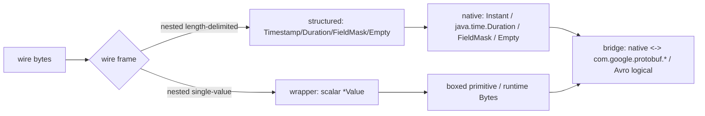

# Native Well-Known-Type Types - Plan

## Goal Capsule

- **Objective:** Generated record fields for protobuf well-known types (WKTs) use native Java types instead of generated or foreign record types. Timestamp becomes `java.time.Instant`, Duration becomes `java.time.Duration`, the scalar `*Value` wrappers become their boxed primitives, `BytesValue` becomes the existing runtime `Bytes`, and new runtime types `FieldMask` and `Empty` stand for those two. On-wire encodings are unchanged, so byte-equivalence with protobuf-java holds.
- **Authority hierarchy:** Project owner's confirmed scope (this brainstorm) over the codebase defaults; repo `AGENTS.md` and the `recordbuf` toolchain over the cross-project defaults.
- **Stop conditions:** All `R`/`U` items true and the Verification Contract gates green (`./gradlew build`, WKT fixture byte-equivalence, spotless clean). A genuine blocker that changes scope or contradicts this plan stops the run.
- **Execution profile:** `code`. Work units in dependency order; each is an atomic commit.
- **Tail ownership:** `recordbuf` maintainer. Co-versioned 0.0.1, so a codegen-output shift for existing WKT fields is acceptable.

---

## Product Contract

### Summary

recordbuf maps recognized well-known protobuf types to native Java types on a generated record's field: `Timestamp` to `java.time.Instant`, `Duration` to `java.time.Duration`, the scalar `*Value` wrappers to their boxed primitives, `BytesValue` to the existing runtime `Bytes`, plus new runtime types for `FieldMask` and `Empty`. The wire form is unchanged, so byte-equivalence with protobuf-java holds.

### Problem Frame

Today a WKT field such as `google.protobuf.Timestamp` is treated as an ordinary nested message: it resolves to a generated record (or a foreign type), so using a timestamp reaches through a `seconds`/`nanos` record instead of a `java.time.Instant`. The Avro bridge already recognizes WKTs for logical types, but the record layer itself stays WKT-unaware. Users building domain models expect the idiomatic Java types at their boundaries. This closes that gap in the core generation path without touching the wire.

---

### Key Decisions

- **Default-on, no new option.** Native WKT mapping applies to every file. Per-file and per-field opt-in were considered; the per-field channel does not exist in the model layer today, and at 0.0.1 an output shift is a smaller cost than the option machinery.
- **Hybrid presence.** Scalar `*Value` wrappers carry presence (`@Nullable` boxed primitive, present iff the wrapper is present). Structured WKTs (`Timestamp`, `Duration`, `Empty`, `FieldMask`) stay non-null with faithful proto3 zero defaults (`Instant.EPOCH`, `Duration.ZERO`, empty `Empty`/`FieldMask`). Full presence for all WKTs is left open for a later pass.
- **`FieldMask` is a normalized, proto-faithful set.** Over an opaque ordered name list: two semantically-equal masks compare equal and the type matches proto's FieldMask semantics. On the wire it canonicalizes (lowercase, dot-trim, dedup, sort) so re-encoding stays byte-equal to protobuf-java's normalized form.
- **WKT knowledge moves into the record layer.** This inverts the earlier Avro-bridge stance that "the record layer does not learn about WKTs." The boundary shifts on purpose; the bridges (below) reuse the existing WKT recognizers rather than re-deriving them.
- **Cheap hard WKTs get runtime carriers; dynamic JSON WKTs are deferred.** `FieldMask` and `Empty` get small, dependency-free runtime types. `Struct`/`Value`/`Any`/`ListValue`/`NullValue` stay as they are today; a mapped file that uses one fails loud rather than emitting a broken native type.

---

### Requirements

**Native type mapping**

- R1. Recognized WKT fields map to native Java field types: `Timestamp` to `java.time.Instant`, `Duration` to `java.time.Duration`, `BytesValue` to `bijnagte.recordbuf.runtime.Bytes`, and the scalar `*Value` wrappers to their boxed primitive (`BoolValue` to `Boolean`, `Int32Value`/`Int64Value`/signed/unsigned/fixed variants to `Integer`/`Long`, `FloatValue`/`DoubleValue` to `Float`/`Double`, `StringValue` to `String`).
- R2. A mapped WKT field's on-wire encoding is unchanged: it still encode/decodes through its own length-delimited codec form, so byte-equivalence with the equivalent protobuf-java message holds.

**Runtime types**

- R3. A new runtime type `FieldMask` represents proto `FieldMask` as a normalized, order-independent set of dotted path names (lower-cased, dot-trimmed, de-duplicated, no empties) that is value-equal by content.
- R4. A new runtime type `Empty` represents proto `Empty` as a zero-value marker holder.

**Presence**

- R5. Presence follows the hybrid decision: scalar `*Value` wrappers map to a `@Nullable` boxed primitive present iff the wrapper field is present; structured WKTs map to a non-null type with a faithful proto3 zero default.

**Enablement**

- R6. Native WKT mapping is on by default for every generated file; there is no new per-file or per-field option.

**Unmapped dynamic types**

- R7. Dynamic JSON WKTs (`Struct`, `Value`, `Any`, `ListValue`, `NullValue`) remain generated-or-unsupported; a mapped file using one fails generation loudly, mirroring the existing `AvroUnsupportedException` precedent, rather than emitting a broken native type.

**Bridge translation**

- R8. The protobuf-java interop converter and the Avro bridge translate the native types at their boundaries: `Instant` to/from `com.google.protobuf.Timestamp`, `java.time.Duration` to/from structured seconds/nanos, boxed primitive to/from primitive, `Bytes` to/from `com.google.protobuf.ByteString`, `FieldMask` to/from `com.google.protobuf.FieldMask`, `Empty` to/from `com.google.protobuf.Empty`. The bridges' source type changes; their WKT recognition does not.

---

### Acceptance Examples

- AE1. **A `Timestamp` field is a native instant.** **Given** a singular `Timestamp` field, **when** a wire buffer decodes, **then** the field is a `java.time.Instant` and re-encoding is byte-identical to the equivalent protobuf-java `toByteArray()`. **Covers R1, R2.**
- AE2. **A wrapper is presence-tracked.** **Given** a singular `Int32Value`, **when** the wrapper is absent versus present, **then** the field is `null` versus its `Integer`. **Covers R5.**
- AE3. **`FieldMask` normalizes to a set.** **Given** paths in mixed case with a leading dot and a duplicate, **when** two `FieldMask` values are compared, **then** they are equal and encode the canonical form. **Covers R3.**
- AE4. **A dynamic WKT fails loud.** **Given** an `Any` field in a file under native mapping, **when** generation runs, **then** it reports a clear error rather than emitting a broken type. **Covers R7.**
- AE5. **Interop translates a native type.** **Given** a record with an `Instant` timestamp and a `com.google.protobuf.Timestamp` reference, **when** the converter runs both directions, **then** the values round-trip through the boundary. **Covers R8.**

---

### Scope Boundaries

**Deferred for later**

- Full presence for all mapped WKTs (making structured WKTs `@Nullable`, so unset is distinguishable from epoch/zero).
- Dynamic JSON WKTs (`Struct`, `Value`, `Any`, `ListValue`, `NullValue`) as first-class native types.

**Outside this product's identity**

- A per-file or per-field opt-in toggle for native WKT mapping.

---

## Planning Contract

### Key Technical Decisions

- KTD1. **Intercept WKTs in the type table, not at the wire.** A recognized WKT is resolved to its native Java type in `TypeResolver` while the protobuf field number and wire type stay untouched. Byte-equivalence is therefore preserved for free: the generator emits the *same* wire frame, only the Java-facing type and the encode/decode endpoint change.
- KTD2. **Native carriers live in `:recordbuf-runtime`, dependency-free.** Following the `Bytes` pattern: `FieldMask` is content-equal (a normalized path set), `Empty` is a marker; no new third-party dependency.
- KTD3. **Hybrid presence.** Wrappers are `@Nullable` (present iff the wrapper is present); structured WKTs are non-null with proto3 zero defaults (`Instant.EPOCH`, `Duration.ZERO`, empty `Empty`/`FieldMask`).
- KTD4. **`FieldMask` canonicalizes on encode.** Paths are lower-cased, dot-trimmed, de-duplicated, and sorted on encode, so re-encoding matches protobuf-java's normalized byte form.
- KTD5. **WKT knowledge moves to the record layer (an intentional inversion).** `TypeResolver`/model layer now recognizes WKTs; the bridges *reuse* the existing WKT recognizers rather than the record layer avoiding them. Recognition logic is shared, not duplicated.
- KTD6. **Dynamic WKTs fail loud.** A mapped file using `Struct`/`Value`/`Any`/`ListValue`/`NullValue` raises a clear generation error modeled on `AvroUnsupportedException`, never a broken native type.

### High-Level Technical Design

A WKT field is a three-stage transform on decode and its inverse on encode. The wire frame never changes; only the Java type and the endpoint of the codec change.

- **Structured WKTs** keep their existing length-delimited nested-message framing (`CodecGenerator` nested-message arms); the encoder/decoder arm is swapped to convert between the nested fields and the native type (`Instant` from `seconds`/`nanos`, `java.time.Duration` from `seconds`/`nanos`, `FieldMask` from repeated `paths`, `Empty` from zero-length).
- **Wrapper WKTs** keep the nested single-value frame on the wire; the field's Java type becomes the boxed primitive (or `Bytes` for `BytesValue`), with `null` when the wrapped message is absent.
- **Bridges** translate at their outer edge only (`InteropConverterGenerator`, `WktAvroBridge`); inner nested fields are still generated in the native form, so the bridge changes source type, not recognition.

### Assumptions

- **A1. `java.time.Duration` is lossless for `Duration`.** `java.time.Duration` is 19-nanosecond `long`-of-nanos; proto `Duration` is `seconds` (int64) + `nanos` (int32, 0..999999999). Every in-range proto value maps cleanly; the inverse clamps sub-second to the same nanos.
- **A2. WKT names are the standard `google.protobuf.*` fully-qualified names.** A user-defined type that collides with a WKT fully-qualified name is treated as the WKT (these names are reserved by the proto spec).
- **A3. `FieldMask` byte-equality holds post-normalization.** protobuf-java normalizes `FieldMask` on set; the generator's canonical (sorted) encode matches that canonical byte form, so equality is asserted after both sides are normalized.
- **A4. Empty is non-null and always encodes its (zero-length) frame under the hybrid decision**, matching its proto3 faithful non-null default; a later full-presence pass may revisit this.

---

## Implementation Units

### Unit Index

- U1 · WKT mapping registry · `plugin/types/WellKnownTypes.java` (new) · –
- U2 · Resolve WKT to native type in `TypeResolver` · `plugin/types/TypeResolver.java`, `plugin/ModelLoader.java` · U1
- U3 · Runtime `FieldMask` · `runtime/.../FieldMask.java` (new) · –
- U4 · Runtime `Empty` · `runtime/.../Empty.java` (new) · –
- U5 · Native WKT encode/decode arms · `plugin/writer/CodecGenerator.java` · U1–U4
- U6 · Presence + repeated wiring · `plugin/model/Field.java`, record writer · U5
- U7 · Bridge translation (protobuf-java + Avro) · `plugin/InteropConverterGenerator.java`, `plugin/bridge/WktAvroBridge.java`, `plugin/bridge/AvroCodecGenerator.java` · U5, U6
- U8 · Fail loud for dynamic WKTs · `plugin/bridge/AvroUnsupportedException.java` (+ new WKT error), `plugin/types/TypeResolver.java`, `plugin/GenerationException.java` · U1
- U9 · WKT fixtures + byte-equivalence regression · `fixtures/src/main/proto/*.proto`, `fixtures/src/test/java/...` · U5, U6, U7

### U1. WKT mapping registry

- **Goal:** One source of truth mapping recognized WKT fully-qualified names to their native Java type and a classification (structured / wrapper / bytes / new-runtime / dynamic-unsupported).
- **Requirements:** R1, R6, R7.
- **Dependencies:** none.
- **Files:** `generator/src/main/java/bijnagte/recordbuf/plugin/types/WellKnownTypes.java` (new); test `generator/src/test/java/bijnagte/recordbuf/plugin/types/WellKnownTypesTest.java` (new).
- **Approach:** A registry keyed on the `google.protobuf.<Name>` fully-qualified name. Each entry names the target Java type and one classification. Recognized: `Timestamp`→`java.time.Instant` (structured), `Duration`→`java.time.Duration` (structured), `BoolValue`/`Int32Value`/`Int64Value`/`UInt32Value`/`UInt64Value`/`SInt32Value`/`SInt64Value`/`Fixed32Value`/`Fixed64Value`/`SFixed32Value`/`SFixed64Value`→`Integer`/`Long` (wrapper), `FloatValue`→`Float`, `DoubleValue`→`Double`, `StringValue`→`String`, `BytesValue`→`bijnagte.recordbuf.runtime.Bytes` (bytes), `FieldMask`→new runtime `FieldMask`, `Empty`→new runtime `Empty` (new-runtime). Dynamic-unsupported: `Struct`, `Value`, `Any`, `ListValue`, `NullValue`. A lookup returns the entry or "not a WKT".
- **Patterns to follow:** the scalar table in `TypeResolver` for the classification shape; `WktAvroBridge` for the existing name recognition to reuse.
- **Test scenarios:** each recognized WKT resolves to the expected target type + classification; an unknown type reports "not a WKT"; each dynamic WKT is classified dynamic-unsupported.
- **Verification:** unit tests pass; the registry is the only place the WKT set is enumerated.

### U2. Resolve WKT to a native type in `TypeResolver`

- **Goal:** A field whose type is a recognized WKT resolves to its native Java type instead of a generated/foreign record; generation of a record for that WKT is suppressed.
- **Requirements:** R1, R6.
- **Dependencies:** U1.
- **Files:** `generator/src/main/java/bijnagte/recordbuf/plugin/types/TypeResolver.java`; `generator/src/main/java/bijnagte/recordbuf/plugin/ModelLoader.java` (where nested-message/record resolution is decided) and the model's field/type as needed.
- **Approach:** When a field's resolved base is a message whose fully-qualified name is a WKT, substitute the native Java type (from U1) and mark the field "native" so `CodecGenerator` emits a native arm. Repeated WKT resolves to `List<Native>`. The protobuf field number and wire type are unchanged (KTD1). Do not emit a generated record for a consumed WKT.
- **Patterns to follow:** how `TypeResolver` resolves scalar vs. message today; how `ModelLoader` decides foreign-vs-record.
- **Test scenarios:** a `.proto` field of each WKT compiles to a record carrying the native field type (incl. `List<Instant>` for repeated); no generated WKT record is produced; non-WKT messages are unaffected.
- **Verification:** generation of a sample proto yields native-typed fields and no WKT record.

### U3. Runtime `FieldMask`

- **Goal:** A dependency-free, proto-faithful `FieldMask`: a normalized, order-independent set of dotted path names, content-equal, that exposes its paths.
- **Requirements:** R3.
- **Dependencies:** none.
- **Files:** `runtime/src/main/java/bijnagte/recordbuf/runtime/FieldMask.java` (new); test `runtime/src/test/java/bijnagte/recordbuf/runtime/FieldMaskTest.java` (new).
- **Approach:** Store a normalized path set (lowercase, dot-trim, dedup, drop empties). Provide an ordered view of paths and membership; `equals`/`hashCode`/`toString` are content-based. The exact public surface (builder vs. canonical factory, view type) is refined during implementation (per the confirmed scoping choice).
- **Patterns to follow:** `runtime/.../Bytes.java` for the content-equal runtime-type style.
- **Test scenarios (AE3):** mixed-case / leading-dot / duplicate paths normalize to an equal value; ordering is irrelevant to equality; empty and duplicate inputs collapse; content equality drives `equals`/`hashCode`.
- **Verification:** unit tests pass; `FieldMask` is dependency-free.

### U4. Runtime `Empty`

- **Goal:** A dependency-free `Empty` marker (A4: non-null holder for proto `Empty`).
- **Requirements:** R4.
- **Dependencies:** none.
- **Files:** `runtime/src/main/java/bijnagte/recordbuf/runtime/Empty.java` (new); test `runtime/src/test/java/bijnagte/recordbuf/runtime/EmptyTest.java` (new).
- **Approach:** The simplest faithful marker. A `record` needs at least one component, so prefer a `final` class with a single canonical instance (or an equivalent minimal value type); decide the exact form during implementation.
- **Patterns to follow:** minimal, self-contained, no third-party dependency.
- **Test scenarios:** the type has a single canonical/constant instance (or defined value equality); it is usable as a non-null field default.
- **Verification:** unit tests pass; `Empty` is dependency-free.

### U5. Native WKT encode/decode arms in `CodecGenerator`

- **Goal:** Encode/decode WKT fields to/from their native Java types while keeping the wire byte-equal.
- **Requirements:** R1, R2, R5, R3, R4, R8.
- **Dependencies:** U1, U2, U3, U4.
- **Files:** `generator/src/main/java/bijnagte/recordbuf/plugin/writer/CodecGenerator.java`; test `generator/src/test/java/bijnagte/recordbuf/plugin/writer/CodecGeneratorTest.java` (extend).
- **Approach:** Add native arms beside the existing nested-message arms:
  - **Timestamp:** nested `{seconds=int64, nanos=int32}`; encode `Instant`→`seconds`/`nanos`, decode nested→`Instant`.
  - **Duration:** nested `{seconds, nanos}`; `java.time.Duration`↔`(seconds,nanos)` (A1).
  - **Wrapper `*Value`:** nested single-value message; encode value→nested `{value}`, decode nested→value; singular is `@Nullable`.
  - **BytesValue:** nested `{bytes value}`↔runtime `Bytes`.
  - **FieldMask:** repeated `paths` (string)↔runtime `FieldMask`; encode the canonical (sorted) form (KTD4, A3).
  - **Empty:** nested zero-length frame↔`Empty` marker; non-null (A4).
  - **Repeated WKT:** `List<Native>`.
- **Patterns to follow:** existing nested-message encode/decode arms and the scalar arms in `CodecGenerator` for the framing and helper shape.
- **Test scenarios:**
  - Happy path: each WKT round-trips (encode→decode returns an equal native value); byte output equals the protobuf-java equivalent (AE1).
  - Edge cases: absent wrapper → null; present wrapper → value (AE2); `Duration`/`Timestamp` boundary values (`Instant.EPOCH`, `Duration.ZERO`, large seconds); `FieldMask` with mixed-case/dup/leading-dot inputs encodes the canonical form (AE3).
  - Integration: a message with a mix of WKT fields encodes/decodes as a whole and stays byte-equal.
- **Execution note:** anchor this unit on a byte-equivalence regression against the protobuf-java reference before adding arms, so each new arm is validated the moment it lands.
- **Verification:** round-trip and byte-equality unit tests pass.

### U6. Presence and repeated wiring

- **Goal:** Apply hybrid presence (wrappers `@Nullable`; structured non-null with zero defaults) and `List` for repeated WKT.
- **Requirements:** R5.
- **Dependencies:** U5.
- **Files:** `generator/src/main/java/bijnagte/recordbuf/plugin/model/Field.java` (presence flags, mirroring the `hasOptional`/`optionalValue` oneof treatment); the record writer that emits field defaults and `@Nullable` annotations.
- **Approach:** Reuse the existing `optionalValue`/`hasOptional` machinery for the wrapper case (a wrapper field is present iff its nested message is present). Structured WKTs get their proto3 zero default. Repeated WKT fields map to `List<Native>`.
- **Patterns to follow:** the oneof optional-value handling in the record writer; the `@Nullable` usage already in the model.
- **Test scenarios (AE2):** absent singular wrapper decodes to `null`; present decodes to its value; repeated decodes to a populated `List`; structured fields default to their zero value when unset.
- **Verification:** presence unit tests pass; generated fields carry the right nullability.

### U7. Bridge translation (protobuf-java interop + Avro)

- **Goal:** Translate native WKT types at each bridge's boundary, reusing existing WKT recognizers; change source type, not recognition.
- **Requirements:** R8.
- **Dependencies:** U5, U6.
- **Files:** `generator/src/main/java/bijnagte/recordbuf/plugin/InteropConverterGenerator.java`; `generator/src/main/java/bijnagte/recordbuf/plugin/bridge/WktAvroBridge.java`; `generator/src/main/java/bijnagte/recordbuf/plugin/bridge/AvroCodecGenerator.java`; extend the relevant bridge tests.
- **Approach:**
  - **protobuf-java converter:** `Instant`↔`com.google.protobuf.Timestamp` (via `toInstant`/`ofInstant`), `java.time.Duration`↔`com.google.protobuf.Duration`, boxed primitive↔primitive (auto-unbox), runtime `Bytes`↔`com.google.protobuf.ByteString`, runtime `FieldMask`↔`com.google.protobuf.FieldMask`, `Empty`↔`com.google.protobuf.Empty`.
  - **Avro bridge:** map native WKT fields to their Avro logical types at the outer edge; dynamic WKTs fail loud (delegated to U8).
  - Reuse `WktAvroBridge`'s name recognition (KTD5); only the source type changes from record to native.
- **Patterns to follow:** `InteropConverterGenerator`'s existing arms; `WktAvroBridge` recognizers.
- **Test scenarios (AE5):** interop round-trips (record→protobuf-java→record and the reverse) for each WKT stay byte/value-equivalent; an Avro bridge encodes/decodes a WKT field using its native type; both directions covered.
- **Verification:** interop and Avro bridge tests pass.

### U8. Fail loud for dynamic WKTs

- **Goal:** A mapped file using `Struct`/`Value`/`Any`/`ListValue`/`NullValue` fails generation with a clear error instead of emitting a broken native type.
- **Requirements:** R7.
- **Dependencies:** U1.
- **Files:** `generator/src/main/java/bijnagte/recordbuf/plugin/bridge/AvroUnsupportedException.java` (or a new WKT-specific extension, e.g. `UnsupportedWktException`); `generator/src/main/java/bijnagte/recordbuf/plugin/types/TypeResolver.java` (where the WKT classification is consulted); `generator/src/main/java/bijnagte/recordbuf/plugin/GenerationException.java` if the error must surface on the plugin's response channel; a test fixture and test.
- **Approach:** When `TypeResolver` hits a dynamic-unsupported classification (U1), raise a clear, named error naming the offending WKT and field, mirroring `AvroUnsupportedException`. Decide whether to reuse the existing exception type or add a sibling (a new type keeps the message specific; reusing keeps one error path — prefer reusing if the message can be specific enough).
- **Patterns to follow:** `AvroUnsupportedException`'s construction and how it propagates through generation.
- **Test scenarios (AE4):** a fixture proto with an `Any` (and separately `Struct`, `Value`, `ListValue`, `NullValue`) field fails generation with a message naming the field and type; a file without dynamic WKTs is unaffected.
- **Verification:** error is raised for each dynamic WKT; no broken output is emitted.

### U9. WKT fixtures + byte-equivalence regression

- **Goal:** Extend `:recordbuf-fixtures` with WKT fixtures and add byte-equivalence round-trip tests against protobuf-java.
- **Requirements:** R2, R8, and regression coverage for R1/R3/R5.
- **Dependencies:** U5, U6, U7.
- **Files:** `fixtures/src/main/proto/*.proto` (add WKT message fixtures); `fixtures/src/test/java/...` (byte-equivalence + round-trip tests); generator proto inputs for the fixtures as needed.
- **Approach:** Mirror the existing interop/avro fixture pattern. For each WKT, encode through recordbuf and separately through protobuf-java, asserting byte-identical `toByteArray()`; add cases exercising `FieldMask` normalization (AE3) and wrapper presence (AE2). Regenerate the generated `.rec`/reference output after each change.
- **Patterns to follow:** the existing `ProtoBufInteropTest`-style byte-equivalence assertions and the fixtures' codegen step.
- **Test scenarios:** covers AE1 (byte-identical `Timestamp`), AE3 (`FieldMask` canonical byte form), AE2 (wrapper presence), plus a whole-message multi-WKT byte-equivalence case and a `Struct`/`Any` fail-loud generation case (AE4).
- **Verification:** `./gradlew :recordbuf-fixtures:test` passes; fixture outputs regenerate and compile.

---

## Verification Contract

- `./gradlew build` green (compile + tests + assemble).
- `./gradlew :recordbuf-generator:installDist`, then regenerate a WKT-bearing `.proto` via `protoc --recordbuf_out`; confirm the generated code compiles and round-trips.
- `./gradlew test`, including the new `:recordbuf-fixtures` WKT byte-equivalence and round-trip cases.
- `./gradlew spotlessApply` before committing; `./gradlew spotlessCheck` clean.
- Byte-equivalence gate: recordbuf and protobuf-java agree, byte for byte, on every WKT fixture (AE1, AE3, plus the multi-WKT message).

---

## Definition of Done

- WKT fields generate to the native Java types in R1; no generated WKT record is emitted (U1, U2).
- The wire is unchanged: recordbuf and protobuf-java agree byte-for-byte on every WKT fixture (U5, U9; AE1/AE3).
- Hybrid presence holds: wrappers are `@Nullable`, structured WKTs are non-null with proto3 zero defaults (U6; AE2).
- `FieldMask` is a content-equal normalized set that canonicalizes on encode (U3, U5; AE3); `Empty` is a dependency-free non-null marker (U4).
- Dynamic WKTs fail loud with a clear named error (U8; AE4).
- Both bridges translate the native types at their boundaries, reusing existing recognizers (U7; AE5).
- `./gradlew build` is green and `spotlessCheck` is clean; generated outputs regenerate and compile.
- **Cleanup:** no experimental or dead-end code (e.g. a rejected `Empty`/`FieldMask` API shape, a discarded error type) remains in the diff.
