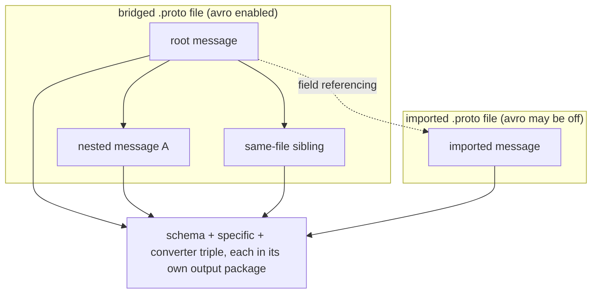
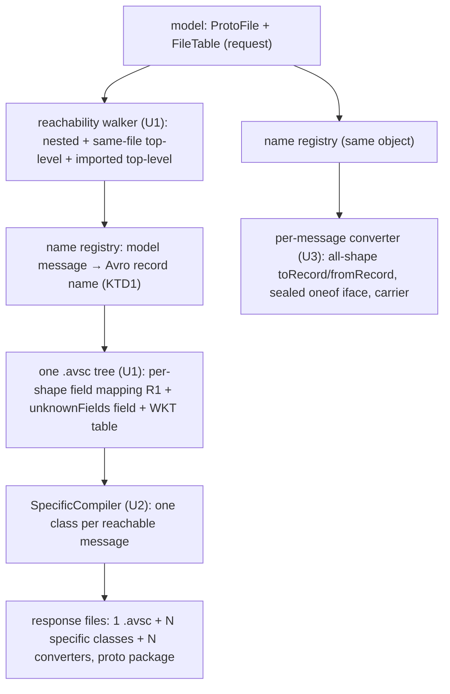

# Avro Structural Twin - Plan

## Goal Capsule

- **Objective:** Make the opt-in Avro bridge a complete structural twin of the generated record — the shapes it rejects today (maps, oneofs, nested non-WKT message fields, `uint64`) get exact, queryable Avro representations, and a file that currently yields *no* Avro output because it contains one of them gets a full one.
- **Product authority:** the 2026-11-17 brainstorm dialogue, captured in the Product Contract below; the project owner confirmed the three planning locks (R4/R7 clarifications, single-.avsc-tree KTD) on 2026-11-17.
- **Stop conditions:** `./gradlew build` green; the fixture Avro round-trip bar (R8) green including the ≥ 2^63 `uint64` and a non-empty unknown-field carrier; regenerated record/codec fixture output byte-identical (R6); every emitted `.avsc` parses with real Apache Avro.
- **Open blockers:** none.
- **Execution profile:** interactive `ce-work` in this session; units U1 → U6 in dependency order.
- **Tail ownership:** the user reviews and lands via the repo's git workflow.

## Product Contract

**Product Contract preservation:** changed: R4 (reachable enums emit no standalone artifact — the string mapping the user chose gives them no Avro type of their own), R7 (byte-for-byte document preservation → per-field preservation, since R3 adds an unknowns field to every bridged record). Both are clarifications of decisions the user confirmed in the 2026-11-17 dialogue; no product-scope change.

### Summary

The bridge grows from "scalars, WKTs, and repeated scalars of the first top-level message only" into a structural twin of the record: the generator derives a schema / specific-record / converter triple for every message and enum reachable from the bridged root, each field shape mapped to an exact Avro representation, and the record's unknown-field carrier transiting 1:1.

### Problem Frame

The v1 bridge (2026-11-05 plan) is a scoped subset with deliberate fail-loud points: the schema generator aborts on oneof groups, map fields, nested and repeated non-WKT messages, and `uint64`, and the bridge catches that abort at file level and skips the whole file — records and codecs still emit, so the operator gets no Avro output and no error. It also bridges only the first top-level message of a file, maps proto enums to *closed* Avro enums, and drops the record's unknown-field carrier on the floor. The cost shape: one proto file containing a single map field silently loses its entire Avro surface, and Avro-side consumers of what is emitted see a partial, divergent view of the record.

### Key Decisions

- **Full native mapping, envelope dissolved.** The tiering rule is "native where the representation is exact, envelope where it isn't" — but the only true representational gap (`uint64`) closes with a bit-exact `long`, so no shape needs the `{format, content-type, payload}` wrapper. The envelope is shelved, not burned: it returns only if the record side ever starts carrying dynamic WKTs (`Struct`/`Any`/`Value`/`ListValue`), which it currently cannot.
- **`uint64` → Avro `long`, bit-exact.** The record side already models `uint64` as `long` with two's-complement wraparound for values ≥ 2^63 — the same contract a protobuf-java consumer faces; an Avro `long` is the same 64 bits, so a plain mapping is lossless and the Avro consumer inherits the protobuf contract.
- **Enums → `string`, not Avro enum.** Proto enums are open (any integer is a value); the record side already coerces an undefined value to the first constant, so the bridge only ever sees named constants — but a `string` keeps the *Avro side* open: a newly-declared constant needs no schema change. This supersedes v1's closed-enum mapping, accepted as pre-release churn.
- **Recursive, reference-following generation.** Every reachable message and enum gets a triple — nested types, same-file top-level siblings, and imported top-level messages — emitted into the referencing/declaring message's own output package. A referenced message whose own file has the Avro option *off* still gets its triple, by transitive necessity of the bridged root.
- **Unknown fields transit 1:1.** The carrier's entries (field number, on-wire shape, raw value bytes, in wire order) map to an always-present array field on every bridged record; an empty carrier round-trips as an empty array.

### Requirements

**Field-shape mapping**

- R1. Every field shape in the reachable type graph maps to the exact Avro representation in the table — this table is the contract the third-party Avro consumer sees.

  | Proto shape | Avro representation |
  |---|---|
  | scalar (except `uint64`) | the matching Avro primitive (v1 mapping, unchanged) |
  | `uint64` (any position: singular, repeated, map key/value, oneof case) | `long` — bit-exact two's complement |
  | enum | `string` — the constant's name |
  | well-known type | the v1 WKT mapping (unchanged) |
  | `map<string, V>` where V is natively mappable | Avro `map` |
  | `map<K, V>` where K is a non-string key type | `array` of a record with `key` and `value` fields |
  | oneof | a union of `null` and one member per case, typed by each case's own mapping |
  | singular or repeated message field | the nested Avro record, defined in the schema tree |
  | `repeated X` | `array` of X's mapping (message, map, WKT elements included) |

- R2. A oneof's union carries at most one non-null member; the "unset" state is the `null` member. A message-typed case maps to that case's nested record, which carries its own unknown-fields array (so unknown data inside a oneof member transits with it).
- R3. The record's unknown-field carrier maps to an always-present array of `{number, wire shape, raw value bytes}` entries on every bridged record, 1:1 and in wire order with the carrier; nothing unknown is dropped or reordered through the bridge.

**Generation scope**

- R4. The bridge emits a schema/specific-record/converter triple for every reachable **message** from the bridged root: nested types, same-file top-level siblings, and imported top-level messages — each emitted into the package of its declaring message, referenced by its specific class from the referencing side. A referenced message gets its triple even when its own file has the Avro option off. A reachable **enum** emits no standalone artifact: as a `string` it has no Avro type of its own, and its constant-name ↔ constant knowledge already lives in the generated record-side enum class.
- R5. Generation no longer skips a file because of map, oneof, nested-message, or `uint64` shapes. The fail-loud gate remains as a safety net for shapes with no representable mapping; no such shape exists in the current record-side type set, so a v1-style silent whole-file skip does not occur for any generatable record.

**Contract preservation**

- R6. The record side is untouched: record shapes, codecs, the protobuf reference interop, and the record-side undefined-enum coercion (first-constant fallback) are all unchanged. The work adds and reshapes Avro output only.
- R7. Every v1 mapping that remains (scalars, WKTs, repeated scalars) keeps the same **per-field** Avro representation. The `.avsc` document itself legitimately gains the always-present `unknownFields` field (R3) and the reachable-type tree (R4); one document per bridged file is preserved.

**Acceptance**

- R8. A new fixture family locks the bridge: messages covering a oneof (scalar, enum, and message cases including unset), a nested message (singular and repeated), a `map<string, …>` and a non-string-keyed map, and a `uint64` field holding a value ≥ 2^63. The round-trip `record → specific → record` holds full equality, the ≥ 2^63 `uint64` arrives bit-identical, and a record whose unknown-field carrier is non-empty returns its entries 1:1. Every emitted `.avsc` parses with real Apache Avro.

### Acceptance Examples

- AE1. Oneof member with inner unknown data.
  - **Covers:** R2, R3.
  - **Given** a record whose oneof holds a message case that itself decoded unknown fields.
  - **When** converted to the specific record and back.
  - **Then** the union carries that one non-null member, the member record's unknown-fields array preserves the entries, and the final record equals the original.
- AE2. New enum constant, no schema change.
  - **Covers:** R1.
  - **Given** an Avro `string` field holding the name of a constant declared after the specific record was generated.
  - **When** the converter maps it back.
  - **Then** it resolves through the record-side `forNumber` fallback rather than failing — the same behavior as today's undefined-value coercion.
- AE3. `uint64` at the top of the unsigned range.
  - **Covers:** R1.
  - **Given** a `uint64` field holding `2^64 − 1` (record side: `long` −1).
  - **When** round-tripped through the specific record.
  - **Then** the value returns bit-identical (−1), with no widening, wrapper, or precision loss.

### Scope Boundaries

- **Deferred for later:**
  - The `{format, content-type, payload}` envelope wrapper — dissolved by YAGNI; it re-enters scope only if the record side gains support for dynamic WKTs.
  - Record-side open-enum support — the first-constant coercion of undefined values is pre-existing record behavior; the bridge inherits it rather than fixing it.
  - Bridging anything in the protobuf-java reference output — the bridge is record-only, as v1.
- **Outside this work's identity:**
  - Changing the record's own `uint64` representation, or any other record-side type decision.

### Open Questions

- **Deferred to implementation (non-blocking):** the exact class-file layout Avro `SpecificCompiler` produces for *nested* named records in a multi-record tree (package and file naming for an inlined record). KTD1 names what the bridge *needs* from that behavior; U2 pins the actual behavior with a spike test before the emission loop is written, and KTD2's plan-B fallback covers the case where the inline tree fights the library.

---

## Planning Contract

### Key Technical Decisions

- **KTD1 — one `.avsc` per file, one inline tree, a name registry as the single source of type names.** The schema generator replaces its single-root walk with a *reachability* pass over the model: nested messages, same-file top-level siblings, and imported top-level messages reached through `TypeRef.Named` field references (resolved via the request's `FileTable`). Every reachable message becomes a named Avro record in the tree, defined inline at its first reference and name-referenced afterwards. The Avro record name is `specificRecordName(shortName)` (v1's rule, e.g. `Sample` → `SampleAvro`); when two reachable messages in one namespace share a short name, the registry disambiguates by prefixing the last enclosing-chain segment (collision-free by construction). A per-run name registry maps each reachable model message to its Avro name; the `.avsc`, the specific-class emission, and the converter generation all read from it, so the three artifacts can never disagree.
- **KTD2 — `SpecificCompiler` emits one class per reachable message; plan-B fallback if the library fights the tree.** The bridge runs `SpecificCompiler` over the single `.avsc` (v1's in-process delegation, KTD6 of the 2026-11-05 plan) and generalizes the "locate the single root class" step to *collect every generated class* and emit each as a response file in the proto package. Avro library behavior for nested named records (package/filename layout) is library-internal and unverified here, so U2's first step is a spike test pinning it. **Plan B (fallback):** if the inline tree produces class layout the output router can't route cleanly, emit one `.avsc` per reachable message, cross-referenced via Avro `additional_types`. The name registry (KTD1) makes the switch mechanical: only the document layout changes.
- **KTD3 — enums are strings with a degenerate triple.** A reachable enum produces no standalone Avro artifact. In the tree, every enum field is `"string"`. Converter directions: record enum → constant name; Avro string → the generated record-side enum's `forNumber`, which already carries the first-constant fallback for names that don't resolve (AE2). The v1 WKT `NullValue` closed-enum mapping stays as-is (it is a WKT mapping, not a user enum).
- **KTD4 — `uint64` is a plain `long` on both sides.** The record side already uses `long`; Avro `long` is the same bits. The schema maps `uint64 → long` (replacing the v1 fail-loud), and the converter needs no special case — the generic scalar line already passes a `long` through. The two's-complement contract is documented on the generated converter's javadoc, not encoded in a type.
- **KTD5 — oneof: null-first union, and the converter drives the sealed interface.** The Avro union is `[null, <case members in declaration order>]`; the specific class exposes it as `Object`. Record side, per oneof: one `@Nullable` component of the oneof's nested sealed interface (`Oneof.iface`), whose permits are the message-member records plus the shared scalar/enum value wrapper. `fromRecord`: each iface instance maps to its union member (message member via its own converter; the value wrapper resolves its case by the wrapper's tag and maps the member's value by shape). `toRecord`: the non-null union member maps back to the iface — cast to the case's specific type, then via the member's converter; non-message members build the value wrapper with the member's field tag. Unset → `null` member / absent component.
- **KTD6 — unknown fields as a named entry record, one runtime factory.** Every bridged record's schema gains an always-present field `unknownFields`: an `array` of a named record `{number: int, wireType: string, value: bytes}` (`wireType` is the runtime `WireType` enum's name). The converter maps `UnknownFields.fields()` ↔ the entry list in both directions. The runtime gains one additive factory, `UnknownFields.of(Iterable<UnknownField>)` (empty input → the shared `empty()`), so the generated `toRecord` can build a carrier from Avro entries without widening the carrier's API.
- **KTD7 — fail-loud rescoped to the safety net.** `AvroUnsupportedException` no longer fires for maps, oneofs, nested/repeated non-WKT messages, or `uint64` — those have mappings now. It remains for genuinely unmappable input (an unknown proto scalar in `scalarAvro`), and the bridge's file-level catch stays as the safety net R5 describes. No generatable record triggers it.
- **KTD8 — WKTs: v1's table, preserved verbatim — and the fail-loud contract is fixed.** The WKT Avro table (by FQN) below is v1's, byte for byte (R7). The record's `UnknownFields` carrier holds a *raw* value plus a wire-type byte and never a WKT object, so `google.protobuf.Timestamp` and its friends cannot appear in unknown fields. The one v1 fail-loud that remains is now a *contract*: a WKT with no static Avro schema — anything absent from the table, including the dynamic `Struct`/`Any`/`Value`/`ListValue`/`Object` and v1-unmapped wrappers like `Int32Value` and `TimeOfDay` — fails loud rather than the bridge silently dropping the whole file. The record itself cannot represent those shapes, so the twin cannot either.

| Proto WKT (by FQN) | Avro mapping (v1, verbatim) |
|---|---|
| Timestamp | `long` (int64 seconds; v1's accepted simplification drops `nanos`) |
| Duration | `record {seconds: long, nanos: int}` |
| StringValue | `["null", "string"]` |
| BoolValue | `["null", "boolean"]` |
| BytesValue | `["null", "bytes"]` |
| Int64Value | `["null", "long"]` |
| DoubleValue | `["null", "double"]` |
| FieldMask | `["null", "string"]` (v1's simplification of the repeated-string shape) |
| NullValue | `["null", enum {NULL_VALUE, TRUE, FALSE}]` — the one closed enum the bridge keeps |
| Empty | `{}` |

A WKT reference is then excluded from the reachable-type tree (no types entry, no triple): its fragment is inlined at every use site.

### High-Level Technical Design

### Assumptions

- The record side (R6) is frozen for this work: oneof = one `@Nullable` sealed-iface component per group (`Oneof` model, `K4`), maps = `HashMap` component + nested entry record, every record carries an `UnknownFields` component.
- The Avro bridge defaults **on** (`BridgeContext` absent → on), so every fixture proto is bridged by default; the fixture protos are test inputs — adding shapes there is the green bar, not a record-side change.
- v1's WKT mapping (`WKT_SCHEMA`, incl. the `NullValue` closed enum) and the `.avsc`-per-file rule are preserved (R7).
- The generated specific classes are referenced by the converters; their package (the bare proto package, v1's `avroNamespace`) keeps them collision-free from the `.rec` record package and the protobuf-java reference.

### Sequencing

U1 (schema) → U2 (bridge emission; spike first) → U3 (converter lines) with U4 (runtime factory) in parallel with U3 → U5 (fixture green bar) → U6 (docs). Each unit is independently committable; U5 is the behavioral gate the earlier units only set up.

---

## Implementation Units

### U1. Reachability walk and full shape mapping in `AvroSchemaGenerator`

- **Goal:** the schema generator emits the complete reachable-type tree (R1/R4) instead of a single-root v1 subset, with the fail-loud rescoped (KTD7).
- **Requirements:** R1, R2, R3, R4, R5, R7.
- **Dependencies:** none.
- **Files:** `generator/src/main/java/bijnagte/recordbuf/plugin/writer/AvroSchemaGenerator.java` (rewrite the walk + shape methods; the `WKT_SCHEMA` table and Jackson-tree machinery are preserved), `generator/src/test/java/bijnagte/recordbuf/plugin/writer/AvroSchemaGeneratorTest.java`.
- **Approach:** a reachability pass over the model — `Message.messages()` (nested), `ProtoFile.messages()` (same-file top-level), and `TypeRef.Named` message references resolved through the request's `FileTable` (imported top-level) — seeds the name registry (KTD1) and the tree. `typeNode`/`elementNode` (and their fail-loud branches) are rewritten to the R1 table: `uint64 → long` in `scalarAvro`; enums → `"string"`; maps → Avro `map` or the pair-record array; oneof fields → null-first unions; message fields → the registry name; repeated → arrays of any element mapping. Every record's field list gains the trailing `unknownFields` array (KTD6 entry record). The v1 `AvroUnsupportedException` survives only for unknown proto scalars. The request's `FileTable` is already wired into the generator's entry point (the 2026-07-19 typed-model work) and threaded to the writer seam; the walk consumes it, and single-file input (a `null` table) degrades to same-file-only resolution. `CodeGenerator.generate` already receives the request and passes the table to `format.generate(file, table)`, so no call-site change is needed.
- **Patterns to follow:** the existing Jackson-tree construction (`typeNode`/`arrayType`/`text`) and the tests' structural re-parse assertions (no string matching).
- **Test scenarios:**
  - `uint64` in each position (singular, repeated, map value, oneof case) yields `long` in the tree.
  - An enum field yields `"string"`; the v1 closed-enum behavior is gone.
  - `map<string, V>` yields an Avro `map`; `map<int32, V>` yields an array of the named pair record with `key`/`value` fields.
  - A oneof yields a null-first union whose member types follow each case's own mapping; a WKT oneof case keeps its v1 WKT node.
  - A nested message field references the registry name with the definition inlined at first reference; a repeated message yields an array of the record.
  - Every emitted record — including oneof message members — carries the trailing `unknownFields` array field.
  - Reachability: a root referencing a nested type, a same-file sibling, and an imported top-level message produces all three in one tree; the imported type's *own file* is not otherwise affected.
  - Collision: two reachable messages with the same short name in one namespace get distinct registry names.
  - R7: a v1-bridgeable file's `.avsc` is byte-identical to v1's except for the new `unknownFields` field.
  - Safety net: a field of an unparseable scalar still throws `AvroUnsupportedException`.
- **Verification:** unit tests green; a hand-built two-level tree parses with `org.apache.avro.Schema.Parser` (the same parser U2's `SpecificCompiler` uses).

### U2. Multi-class `SpecificCompiler` emission and per-message output routing in `AvroBridge`

- **Goal:** the bridge emits the full triple set — one `.avsc`, one specific class, one converter per reachable message — with the referenced type's triple emitted by the bridged root's file even when the referenced file's Avro option is off (R4).
- **Requirements:** R4, R5, R8.
- **Dependencies:** U1.
- **Files:** `generator/src/main/java/bijnagte/recordbuf/plugin/bridge/AvroBridge.java`, `generator/src/test/java/bijnagte/recordbuf/plugin/bridge/` (existing bridge test home).
- **Execution note:** start with the spike — a test that runs `SpecificCompiler` over a small two-level tree and asserts the actual generated class files' packages and names. If the layout matches KTD1's registry names, proceed; if it fights the output router, switch to KTD2 plan-B (per-type `.avsc` + `additional_types`) before writing the emission loop.
- **Approach:** generalize `generateSpecific` from "locate the single root `.java`" to collecting **all** generated classes and emitting each as a response file routed through the existing output router (v1 already routes the specific record by slashed proto-package path). The per-message converter call (v1's `AvroConverterSourceMapping.generate` shape) runs once per reachable message, receiving the shared name registry so cross-references agree. The v1 file-level skip on `AvroUnsupportedException` stays as the safety net.
- **Patterns to follow:** v1's `generateSpecific` temp-dir + walk + read-back; the router's dotted-vs-slashed path semantics (documented in the current javadoc).
- **Test scenarios:**
  - Spike (first): `SpecificCompiler` over a two-level tree — assert each generated class's package and filename, and record the finding (it settles the KTD1 disambiguation rule if the library differs).
  - A file with root + nested + sibling emits exactly `1 .avsc + 3 specific + 3 converters`; each specific file's declared class matches the registry name.
  - A bridged root referencing an imported message whose file has Avro off still receives the referenced triple; the imported file's own output is unchanged (R4).
  - A single-message v1 file emits the same artifact set as v1 plus the `unknownFields`-aware specific/converter (R7/R3).
  - The safety net: a file whose tree throws `AvroUnsupportedException` is still skipped whole, with the `.avsc` withheld — no partial emission, no abort (R5).
- **Verification:** bridge tests green; `./gradlew build` green (the generated fixture output compiles, checkstyle-clean).

### U3. All-shape conversion lines in `AvroConverterSourceMapping`

- **Goal:** `toRecord`/`fromRecord` convert every shape of the R1 table, so a record and its specific record are interchangeable across the whole reachable graph.
- **Requirements:** R1, R2, R3.
- **Dependencies:** U1 (registry), U2 (per-message invocation), U4 (carrier factory).
- **Files:** `generator/src/main/java/bijnagte/recordbuf/plugin/writer/AvroConverterSourceMapping.java`, `generator/src/test/java/bijnagte/recordbuf/plugin/writer/AvroConverterSourceMappingTest.java`.
- **Approach:** extend the per-field line builders (v1 handles WKT/bytes/string/scalars) with: enum → name string / `forNumber` (KTD3); map → `Map` ↔ `Map` for string keys, and the pair-record array ↔ entry map for non-string keys; oneof component ↔ null-first union per KTD5, driven by `Oneof.members` (each member's kind + field tag from the model, no protobuf leaks); `uint64` → the generic `long` line (KTD4, no special case); nested/repeated message → element converters via the registry; and the trailing `unknownFields` ↔ entry-list mapping (KTD6) in both directions, using the U4 factory on the `toRecord` side.
- **Patterns to follow:** v1's `toRecordFieldLine`/`fromRecordFieldLine` element-builder style (`Element.expr`, `RawExpr`, `WktAvroBridge`/`BYTES`/`ByteSource` type refs in `TypeRefs`).
- **Test scenarios:**
  - Generated `fromRecord` for a oneof message-cast member routes through that member's converter; a scalar-case member maps into the value wrapper with the member's tag; the unset state maps to an absent component.
  - Generated `toRecord` builds the sealed-iface instance from the union's non-null member; the `null` member leaves the component unset.
  - A map-line renders `Map` ↔ Avro map for string keys and pair-record array handling for non-string keys; a repeated-message line maps element-by-element.
  - The `unknownFields` line maps carrier entries ↔ the entry list in wire order; an empty carrier round-trips to an empty list.
  - The converter javadoc documents the `uint64` two's-complement contract (KTD4) — asserted structurally.
  - The generated source compiles in the fixture build (the real type-level check lives in U5).
- **Verification:** generator unit tests green; rendered source for a two-message file passes `javac`-level sanity via the fixture build in U5.

### U4. Runtime `UnknownFields.of` factory

- **Goal:** give the generated `toRecord` a carrier constructor from Avro entries without widening the carrier's existing API.
- **Requirements:** R3.
- **Dependencies:** none (parallel with U3).
- **Files:** `runtime/src/main/java/bijnagte/recordbuf/runtime/UnknownFields.java`, its existing test.
- **Approach:** one additive static factory `of(Iterable<UnknownField>)`: copies the entries to an immutable list, returns the shared `empty()` for empty input (preserving the `EMPTY` identity-equal fast path), never `null`.
- **Patterns to follow:** the class's existing canonical-constructor + `EMPTY` style.
- **Test scenarios:** empty input returns the shared `empty()` instance (identity); non-empty input preserves order and contents; `null`-free contract holds under NullAway (the module is `@NullMarked`).
- **Verification:** runtime module tests green under the module's NullAway gate.

### U5. Fixture green bar (R8)

- **Goal:** lock the whole bridge behaviorally: `record → specific → record` full equality across every new shape, plus real-Avro schema parsing.
- **Requirements:** R8; covers AE1, AE2, AE3.
- **Dependencies:** U2, U3, U4.
- **Files:** `fixtures/src/main/proto/` (extend existing shape protos where the shape exists — `oneof.proto`, `map.proto`, `message.proto`, the int proto for a `uint64`; add a non-string-keyed map field or file where absent), `fixtures/src/test/java/bijnagte/recordbuf/fixture/avro/AvroInteropTest.java` (existing v1 test home).
- **Approach:** per new shape, build a record (using the generated builder/codec), convert to the specific record, assert equality on the way back — including the ≥ 2^63 `uint64` arriving bit-identical (AE3), a oneof whose message case carries non-empty unknowns (AE1), and an undefined-enum string resolving through the `forNumber` fallback rather than throwing (AE2). Parse every emitted `.avsc` in the fixture with `Schema.Parser`. The `unknownFields` carrier case uses a record built from wire bytes that include a field the schema predates.
- **Patterns to follow:** the existing `AvroInteropTest` round-trip style and the interop fixture's builder/codec usage.
- **Test scenarios:** the four AE-linked scenarios above, one per shape group; a regression scenario asserting a v1-shape fixture (scalars/WKTs) round-trips as before (R7).
- **Verification:** `./gradlew :recordbuf-generator:installDist`, regenerate the fixtures, `./gradlew :recordbuf-fixtures:build` green with the new assertions.

### U6. Documentation

- **Goal:** bring the project docs in line with the structural-twin contract.
- **Requirements:** none directly (supports R1's consumer-facing table).
- **Dependencies:** U5 (so the docs describe verified behavior).
- **Files:** `README.md` (the Avro section), `CONCEPTS.md` (the *Structural twin* entry was already added by the brainstorm; verify it matches the final behavior).
- **Approach:** the R1 mapping table in the README's Avro section (it is the third-party consumer's contract), the enum-string and `uint64`-as-`long` semantics, and a note that every bridged record carries `unknownFields`.
- **Test expectation:** none — docs; verification is a read-through against R1/R3.
- **Verification:** README table matches the R1 table cell-for-cell; CONCEPTS entry accurate against the shipped code.

---

## Verification Contract

- **Gate 1 — full build:** `./gradlew build` (compile, Spotless, Checkstyle, Error Prone/NullAway, `-Werror`, all tests).
- **Gate 2 — generated-output reality:** `./gradlew :recordbuf-generator:installDist`, regenerate the fixtures, `./gradlew :recordbuf-fixtures:build` — the new generated Avro output compiles, passes the fixtures' Checkstyle/EP gates, and the `AvroInteropTest` bar is green.
- **Gate 3 — record-side invariance (R6):** after regenerating the fixtures, the diff on record/codec/interop output is limited to the new fixture shapes' own files — no diff in existing generated records, codecs, or interop adapters.
- **Gate 4 — real Avro:** every emitted `.avsc` parses with `Schema.Parser` and its specific classes construct (exercised by Gate 2's tests).

## Definition of Done

- **Global:** Gates 1–4 green; the R8 fixture bar passes including the ≥ 2^63 `uint64` and a non-empty unknown-field carrier; every new shape in the R1 table has a round-trip assertion; no plan file, spike scaffolding, or experimental code is left in the diff; the work is committed in the unit order U1 → U6 (or a coarser split that preserves those boundaries) following the repo's git workflow.
- **Per unit:** each unit's Verification section holds; U2's spike finding (the `SpecificCompiler` layout question) is recorded where it settles KTD1/KTD2 — in the plan's Open Questions or a `docs/solutions/` note, not in a passing test comment.

---

## Risks & Dependencies

- **`SpecificCompiler` nested-class layout (the one external unknown).** Avro 1.12.1 is the only library behavior the plan can't verify from the repo; the spike-first execution note in U2 plus the plan-B fallback bounds the exposure. The name registry (KTD1) is designed so that only the document layout changes if plan-B fires.
- **Generated-output gates.** The fixtures pull generated Avro output into their Checkstyle/EP/`-Werror` build; the new classes (specific records, entry records) must be gate-clean, which the v1 fixture wiring already enforces for the existing specific output.
- **R7 golden churn.** v1 `.avsc` goldens shift by the new `unknownFields` field for previously-bridgeable files — expected pre-release churn, but the test updates must be the *only* such diff (Gate 3).
- **Model dependency:** U3's oneof lines read `Oneof.members` + field tags from the model (which the 2026-07-19 typed-model work settled); no model changes are anticipated, and if any prove necessary that is a plan-level escalation, not a silent model edit.
