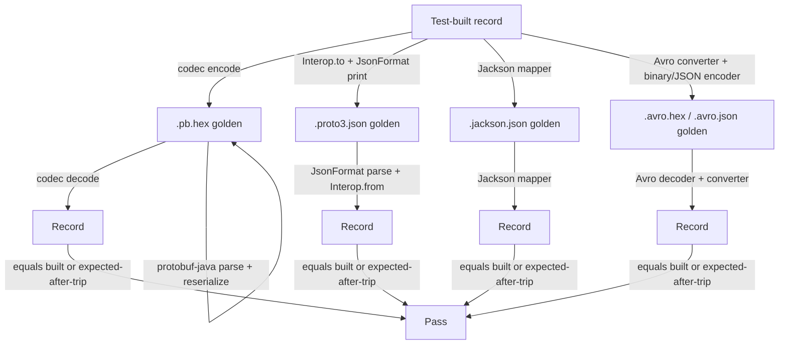
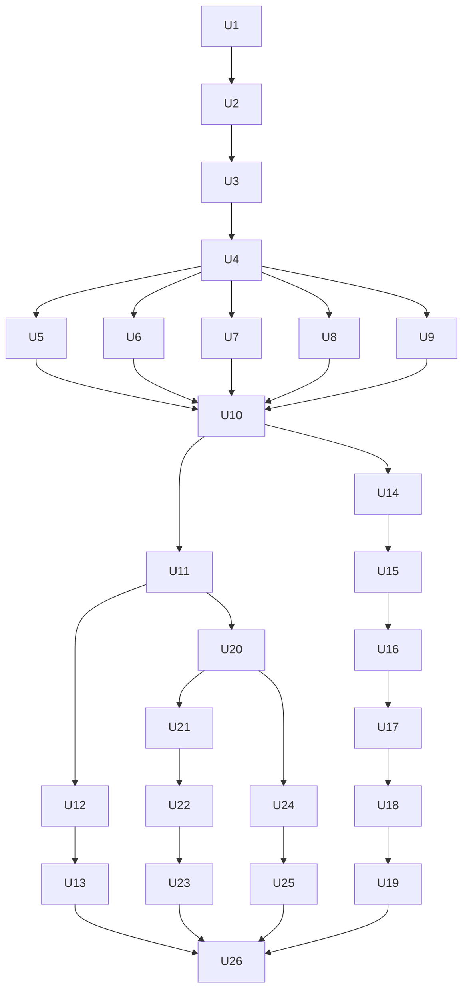

# Golden Compatibility Suite - Plan

## Goal Capsule

- **Objective:** Turn the fixtures module into one suite that does two things: prove recordbuf-generated records stay compatible with frozen golden copies of their data in five formats, and measure protobuf compatibility against the official conformance coverage.
- **Product authority:** The project owner, through this brainstorm. Goldens produced by third-party libraries (protobuf-java, Apache Avro) are the external compatibility oracle. Jackson goldens are recordbuf's own contract.
- **Open blockers:** None.
- **Execution profile:** 26 small units. Each one ends on a green `./gradlew build` and lands as its own commit. Units run in U-ID order unless their Dependencies say otherwise.
- **Stop conditions:** Stop and surface the problem if any of these happens:
  - an existing golden would have to change;
  - the coverage gate needs its baseline lowered;
  - a migrated family loses a case;
  - a gap can't be commented out without breaking generation for the rest of the file.

---

## Product Contract

Product Contract preservation: changed R15. The proto3 JSON path runs through recordbuf's generated `Interop` structural converter, so it is a recordbuf-owned path. The owner directed this change during planning.

### Summary

Vendor `test_messages_proto3` as an exhaustive fixture corpus. Each test-built record is serialized to Jackson JSON, proto3 JSON, canonical Avro JSON, protobuf binary and Avro binary. Each result is compared against a frozen golden, and each golden is deserialized back and compared with the record. The existing fixture families keep their cases, restructured into the same shape as narrower subsets that exercise recordbuf's options. Constructs the generator doesn't support yet are closed one gap at a time, each tracked in the vendored proto.

### Problem Frame

The fixtures grew one family at a time. About 30 test classes each prove one slice:
- wire round-trips;
- protobuf-java byte compatibility;
- a few golden prototypes (`jackson/*`, `jacksonformat`, `canonicalformat`, `AvroCanonicalFormTest`, the Avro JSON view of `Dyn`).

Every family has its own resource layout and assertion style. No single data set is checked across all formats. Nothing measures recordbuf against the proto language as a whole, so there is no answer to "what proto3 features don't we support yet?" The golden prototypes also use several comparison strategies (exact text, tree, compact vs pretty files), so adding a format or a case means making a design decision every time.

### Key Decisions

- **One shared corpus, every applicable format.** The same built records get a golden in every format where that format applies. Format gaps are recorded explicitly instead of being hidden by per-format corpora.
- **Goldens are seeded once, then frozen.** They are generated from the libraries and committed. After that they change only by reviewed hand edit. The suite never rewrites them.
- **JSON comparison normalizes both sides through a JSON tree to pretty-printed text.** Member order, structure and values are asserted. Whitespace is not. This replaces the previous split between exact-text and tree comparison.
- **Lossy paths declare an expected-after-trip record.** Where a format drops information by design, the reverse assertion compares against a record declared per format, so equality stays strict.
- **Existing families are kept, not deleted.** They move into the same case-and-format structure as narrower, already-covered subsets with recordbuf's options turned on.
- **Gaps close one at a time.** A construct the generator can't handle yet is commented out in the vendored proto with a gap-tracking comment. Closing the gap means uncommenting it, fixing the generator, and adding its goldens. There is no big-bang generator rewrite.
- **Conformance is mirrored, not executed.** Protobuf compatibility is measured by reproducing the official conformance suite's binary and JSON scenarios as cases in the Java suite. Google's C++ conformance runner is not adopted.

### Requirements

**Corpus**

- R1. The suite includes a vendored copy of upstream `test_messages_proto3.proto` with recordbuf's Jackson and Avro surfaces enabled.
- R2. Every construct in the vendored proto is either active or commented out with a gap-tracking comment that names the gap.
- R3. The gap-tracking comments together form a readable gap ledger, including gaps that wire round-trips would otherwise hide.
- R4. The restructured family cases cover recordbuf-specific behavior that upstream protos don't exercise: `jackson_format`, `json_name`, `json_ignored`, `json_oneof`, the dynamic WKT envelope, interfaces, and the Avro options.

**Formats and assertions**

- R5. Each corpus case is serialized to Jackson JSON, proto3 JSON (Google's `JsonFormat`), canonical Avro JSON (Avro's JSON encoder), protobuf binary and Avro binary, wherever the format applies to that case.
- R6. JSON output and JSON goldens are both normalized through a JSON tree to pretty-printed text and compared, so member order and structure both count.
- R7. Binary output is compared byte-for-byte with its golden.
- R8. Each golden is deserialized through its format's path. The result must equal the test-built record, or the case's declared expected-after-trip record for that format.
- R9. A case that doesn't apply to a format is listed as such, not silently skipped.

**Restructure of existing tests**

- R10. Every existing fixture family keeps its cases, reorganized into the same case-and-format structure and resource layout as the corpus.
- R11. Wire round-trip and protobuf-java byte-compatibility checks become part of the protobuf binary format in that structure.
- R12. The restructure does not reduce code coverage of the generated code or the runtime.

**Protobuf conformance coverage**

- R13. The official conformance suite's binary and JSON scenarios for proto3 are mirrored as cases in the suite.
- R14. A conformance scenario recordbuf can't satisfy yet is recorded in the gap ledger with the reason.
- R15. A JSON scenario is mirrored through recordbuf's own path: `JsonFormat` to the protobuf-java message, then the generated `Interop` converter to the record and back. Scenarios that only exercise `JsonFormat`'s own parse rejection are marked not applicable (Google-owned), not counted as gaps.

**Gap closure**

- R16. Each gap closes in its own change: uncomment the construct, fix the generator, add goldens, remove the ledger entry.

### Acceptance Examples

- AE1. Lossless case across formats.
  - **Covers R5, R6, R8.**
  - **Given** a built TestAllTypesProto3 with scalar, repeated, map and nested fields populated,
  - **When** the suite runs,
  - **Then** each of the five formats matches its golden, and each golden deserializes to a record equal to the built one.
- AE2. Lossy path.
  - **Covers R8.**
  - **Given** a family case with a `json_ignored` field set,
  - **When** its Jackson golden is deserialized,
  - **Then** the result equals the declared expected-after-trip record (that field cleared), not the original record.
- AE3. Commented-out field still on the wire.
  - **Covers R2, R3.**
  - **Given** a TestAllTypesProto3 field commented out as a gap,
  - **When** a binary payload containing it round-trips through the unknown-field carrier,
  - **Then** the round-trip passes, and the gap is still listed in the ledger.
- AE4. Member-order regression.
  - **Covers R6.**
  - **Given** a change that reorders members in a format's JSON output,
  - **When** the suite runs,
  - **Then** the golden comparison fails, even though a value-only tree comparison would pass.
- AE5. Closing a gap.
  - **Covers R16.**
  - **Given** one ledger entry,
  - **When** its gap is closed,
  - **Then** the change uncomments only that construct, adds its goldens in every applicable format, and removes the entry.

### Scope Boundaries

- Google's C++ conformance runner, and any build dependency on it.
- A recordbuf-native proto3 JSON codec.
- Text format, proto2 and editions test messages.
- Deleting existing fixture coverage.
- A golden-regeneration switch in the suite.

#### Deferred to Follow-Up Work

- Closing each gap the vendoring surfaces. Each one is a separate change under R16. This plan creates the ledger and closes none of them.
- A `docs/solutions/` learning on the harness, captured with `ce-compound` once the suite has settled.

### Dependencies / Assumptions

- Upstream `test_messages_proto3.proto` and the conformance inventory are pinned to protobuf tag `v36.2`, which matches the project's protobuf-java `4.36.2`. Following later upstream changes is a manual refresh.
- Commenting out a construct leaves its field number free, so upstream payloads that carry it still round-trip as unknown fields (see AE3).
- Avro coverage applies only to files with the Avro surface turned on. The vendored proto turns it on.

### Sources / Research

- Upstream corpus: https://github.com/protocolbuffers/protobuf/blob/v36.2/src/google/protobuf/test_messages_proto3.proto
- Conformance protocol and categories: https://github.com/protocolbuffers/protobuf/blob/v36.2/conformance/conformance.proto
- Conformance scenario inventory: https://github.com/protocolbuffers/protobuf/blob/v36.2/conformance/binary_json_conformance_suite.cc. The binary groups are `TestPrematureEOFForType`, `TestIllegalTags`, `TestIllegalLengths`, `TestUnmatchedGroup`, `TestUnknownWireType`, `TestInvalidUtf8String`, `TestValidDataForType`, `TestValidDataForMapType`, `TestValidDataForOneofType`, `TestMergeOneofMessage`, `TestOneofMessage`, `TestUnknownMessage`, `TestUnknownOrdering` and `RunRecursionLimitTests`. The JSON group is `RunJsonTests` with its sub-groups (field names, non-repeated, repeated, wrappers, null, unknown enum strings, field mask, struct, value, any).
- Existing golden prototypes: `fixtures/src/test/java/bijnagte/recordbuf/fixture/JsonGolden.java`, `fixtures/src/test/java/bijnagte/recordbuf/fixture/canonicalformat/ProtoCanonicalJsonTest.java`, `fixtures/src/test/java/bijnagte/recordbuf/fixture/avro/AvroCanonicalFormTest.java`, `fixtures/src/test/java/bijnagte/recordbuf/fixture/jackson/JacksonDynamicWktTest.java`.
- Interop converter precedent: `fixtures/src/test/java/bijnagte/recordbuf/fixture/combined/CompatInteropTest.java`, and the `protobuf_java` option in `options/src/main/proto/recordbuf_options.proto`.
- Interop harness learning: `docs/solutions/design-patterns/proto-codegen-wire-compat-interop-harness.md`.
- Known generator gaps: `NullValue` is `DYNAMIC_UNSUPPORTED` (`generator/src/main/java/bijnagte/recordbuf/plugin/types/WellKnownTypes.java`). Recursive messages are a documented Avro v1 gap (`generator/src/main/java/bijnagte/recordbuf/plugin/writer/AvroSchemaGenerator.java`).

---

## Planning Contract

### Key Technical Decisions

- KTD1. **Five format adapters behind one interface.** Each adapter owns four things: serialize a record, deserialize golden content to a record, an applicability rule, and its golden file extension. A single parameterized suite runs case × format. A case lists, per format, either "lossless", an expected-after-trip record, or "not applicable" with a reason (R8, R9).
- KTD2. **The proto3 JSON adapter goes through `Interop`, not the wire.** The serialize path is record → `Interop.to` → protobuf-java message → `JsonFormat` printer. The deserialize path is `JsonFormat` parser → protobuf-java message → `Interop.from` → record. So the proto3 JSON adapter exercises the structural converter, and the protobuf binary adapter exercises the wire codec (R15).
- KTD3. **The protobuf binary adapter carries the live oracle.** Beyond the golden byte comparison, it parses the golden with the protobuf-java reference, re-serializes it, and checks the bytes are identical. That keeps the byte-compatibility guarantee the families had (R11).
- KTD4. **Binary goldens are committed as lowercase hex text,** 32 bytes per line, ending in a newline. The hex form diffs and reviews in git. The existing `avro/dyn-representative.avro` is converted when migrated.
- KTD5. **Golden layout is `fixtures/src/test/resources/golden/<family>/<case>.<format-ext>`.** The extensions are `.jackson.json`, `.proto3.json`, `.avro.json`, `.pb.hex` and `.avro.hex`. One directory per family puts all five formats for a case side by side.
- KTD6. **A seeding task writes only missing goldens.** It is a separate Gradle task that is not part of `check`. It refuses to overwrite an existing golden, so frozen goldens stay frozen, while new cases and closed gaps get seeded without throwaway probes. Each format seeds from its independent source:
  - protobuf binary from protobuf-java's encoding of the equivalent message;
  - proto3 JSON from `JsonFormat` on that message;
  - both Avro formats from Avro's encoders;
  - Jackson from recordbuf's mapper output, flagged in the seeding report for human review.
- KTD7. **The gap ledger is one committed file plus `GAP(<id>)` markers.** The markers live in the vendored proto's comments, and each ledger entry carries id, construct or scenario, affected formats, and reason. A consistency test checks both directions:
  - every marker has an entry;
  - every entry has a marker, or is tagged conformance-only;
  - every conformance manifest category is covered, gapped, or marked not applicable.
- KTD8. **The conformance mirror lives in its own suite, separate from the golden corpus.** Binary scenarios are byte vectors built in the test, mirroring the runner's semantics: decode with recordbuf, re-encode, and compare against the expected payload by message equality through the protobuf-java reference. Inputs the runner expects to be rejected must make recordbuf's decode throw.
- KTD9. **Non-format structural checks stay structural.** Reflection and surface tests are not golden cases: Jackson resolution and invariance, annotations and interfaces. They are relocated next to their family and otherwise untouched.
- KTD10. **The coverage gate is JaCoCo over fixtures test execution.** It is scoped to the runtime, json and avro modules' classes plus the generated `.rec` output. A baseline captured before any test moves becomes the minimum in a verification rule wired into `check`.
- KTD11. **The vendored proto is edited only to switch on recordbuf's surfaces and to comment out gaps.** It keeps its upstream package, so it stays diffable against upstream. A header comment records the upstream tag and lists the local edits.

### High-Level Technical Design

Data flow per format. The two directions of each adapter meet at the committed golden.

Unit dependency shape:

### Assumptions

- The `Interop` converter is generated for every message that carries `(recordbuf.protobuf_java)`, including the vendored proto's nested and foreign messages. Wherever it isn't, the construct becomes a gap specific to the proto3 JSON format.
- JaCoCo's Gradle plugin works on the Java 25 toolchain at a current catalog version. U1 confirms this before anything depends on it.

---

## Implementation Units

### U1. Wire JaCoCo coverage reporting

- **Goal:** Produce a coverage report from the fixtures test run without enforcing anything yet.
- **Requirements:** R12
- **Dependencies:** none
- **Files:** `fixtures/build.gradle`, `gradle/libs.versions.toml`
- **Approach:** Apply JaCoCo to `:recordbuf-fixtures`, scoped per KTD10. Include the runtime, json and avro module classes as class directories, and exclude the protobuf-java reference, Avro specifics and the compiler shim. Pin the tool version in the catalog.
- **Test scenarios:** Test expectation: none. This is build configuration only. Proof is a generated report that lists runtime and `.rec` classes.
- **Verification:** `./gradlew build` is green, and the coverage report exists and names classes from each scoped module.

### U2. Record the coverage baseline and gate it

- **Goal:** Fail `check` if coverage drops below today's numbers.
- **Requirements:** R12
- **Dependencies:** U1
- **Files:** `fixtures/build.gradle`
- **Approach:** Capture line and branch ratios from the unchanged suite. Wire a verification rule with those ratios as minimums, and a comment recording the date and the source of the numbers. Hook the rule into `check`.
- **Test scenarios:**
  - Temporarily disabling one family test class makes `check` fail on the coverage rule (verified once by hand, then reverted).
- **Verification:** `./gradlew build` is green and the coverage verification task runs as part of `check`.

### U3. Golden store and JSON normalization

- **Goal:** Load goldens under the KTD5 layout and compare JSON the KTD rule's way.
- **Requirements:** R6, R7
- **Dependencies:** U2
- **Files:**
  - create `fixtures/src/test/java/bijnagte/recordbuf/fixture/golden/GoldenStore.java`
  - create `fixtures/src/test/java/bijnagte/recordbuf/fixture/golden/GoldenAssertions.java`
  - create `fixtures/src/test/java/bijnagte/recordbuf/fixture/golden/GoldenAssertionsTest.java`
- **Approach:** JSON comparison parses both sides into a JSON tree and pretty-prints each, then compares the text. Binary comparison decodes KTD4 hex and compares bytes. A mismatch prints both normalized texts, or a hex diff with the first differing offset.
- **Patterns to follow:** `fixtures/src/test/java/bijnagte/recordbuf/fixture/JsonGolden.java` (resource loading, mismatch messages).
- **Test scenarios:**
  - Covers AE4. Two JSON texts with the same members in a different order fail.
  - The same JSON with different whitespace and indentation passes.
  - `1.0` vs `1` fails, because tree number types differ.
  - Hex with mixed case or a missing final newline is rejected as malformed.
  - Bytes that differ at one offset fail with that offset in the message.
  - A missing golden fails with its full resource path.
- **Verification:** The new assertion tests pass and the existing suite is untouched.

### U4. Case model, format interface and matrix runner

- **Goal:** One parameterized engine that runs case × format, including not-applicable entries.
- **Requirements:** R8, R9
- **Dependencies:** U3
- **Files:**
  - create `fixtures/src/test/java/bijnagte/recordbuf/fixture/golden/GoldenCase.java`
  - create `fixtures/src/test/java/bijnagte/recordbuf/fixture/golden/GoldenFormat.java`
  - create `fixtures/src/test/java/bijnagte/recordbuf/fixture/golden/GoldenMatrix.java`
  - create `fixtures/src/test/java/bijnagte/recordbuf/fixture/golden/GoldenMatrixTest.java`
- **Approach:** A case holds a family, a name, a built record, and per format one of: lossless, expected-after-trip record, or not applicable with a reason. The matrix emits one forward test (serialize vs golden) and one reverse test (golden → record) for each applicable pair. It emits one visible disabled entry, carrying the reason, for each not-applicable pair.
- **Technical design:** directional only. `case × format → {forward, reverse} | notApplicable(reason)`.
- **Test scenarios:** These use a stub in-memory format.
  - A lossless case passes forward and reverse.
  - An expected-after-trip case passes reverse against the declared record and fails against the built one.
  - A not-applicable pair shows as disabled with its reason, and never as passed.
  - A case that declares neither an outcome nor not-applicable for a format fails construction.
- **Verification:** The matrix self-tests pass.

### U5. Protobuf binary format adapter

- **Goal:** Golden checks for the wire codec, including the live protobuf-java oracle.
- **Requirements:** R5, R7, R8, R11
- **Dependencies:** U4
- **Files:**
  - create `fixtures/src/test/java/bijnagte/recordbuf/fixture/golden/format/ProtobufBinaryFormat.java`
  - create `fixtures/src/test/java/bijnagte/recordbuf/fixture/golden/format/ProtobufBinaryFormatTest.java`
- **Approach:** Encode with the record codec, decode with the record codec, and parse and re-serialize the golden through the matching protobuf-java message class (KTD3). The format applies only when a reference class exists.
- **Patterns to follow:** the byteEqual / interopDecodes / roundTrip trio in `docs/solutions/design-patterns/proto-codegen-wire-compat-interop-harness.md`.
- **Test scenarios:**
  - An existing family record (`int` family) with a hand-made hex golden passes all three checks.
  - A golden with one flipped byte fails the forward check.
  - A record without a reference class reports not applicable.
- **Verification:** Adapter tests pass.

### U6. Proto3 JSON format adapter via Interop

- **Goal:** Golden checks for proto3 JSON through recordbuf's structural converter.
- **Requirements:** R5, R6, R8, R15
- **Dependencies:** U4
- **Files:**
  - create `fixtures/src/test/java/bijnagte/recordbuf/fixture/golden/format/Proto3JsonFormat.java`
  - create `fixtures/src/test/java/bijnagte/recordbuf/fixture/golden/format/Proto3JsonFormatTest.java`
- **Approach:** Use the KTD2 paths. The format applies only to records that carry a generated `Interop`.
- **Patterns to follow:** `fixtures/src/test/java/bijnagte/recordbuf/fixture/combined/CompatInteropTest.java`, `fixtures/src/test/java/bijnagte/recordbuf/fixture/canonicalformat/ProtoCanonicalJsonTest.java`.
- **Test scenarios:**
  - The `combined` Compat record round-trips JSON → record equal to the built record.
  - 64-bit values render as JSON strings.
  - A record without `Interop` reports not applicable.
- **Verification:** Adapter tests pass.

### U7. Jackson format adapter

- **Goal:** Golden checks for recordbuf's Jackson surface.
- **Requirements:** R5, R6, R8
- **Dependencies:** U4
- **Files:**
  - create `fixtures/src/test/java/bijnagte/recordbuf/fixture/golden/format/JacksonFormat.java`
  - create `fixtures/src/test/java/bijnagte/recordbuf/fixture/golden/format/JacksonFormatTest.java`
- **Approach:** Use the same mapper configuration the jackson tests use today. The format is not applicable for jackson-off files.
- **Patterns to follow:** `fixtures/src/test/java/bijnagte/recordbuf/fixture/jackson/JacksonRoundTripTest.java`.
- **Test scenarios:**
  - The `Full` record round-trips.
  - A `json_ignored` field case reverse-matches its expected-after-trip record. This is the adapter-level proof for AE2.
  - A jackson-off record reports not applicable.
- **Verification:** Adapter tests pass.

### U8. Avro binary format adapter

- **Goal:** Golden checks for Avro binary through the generated converter.
- **Requirements:** R5, R7, R8
- **Dependencies:** U4
- **Files:**
  - create `fixtures/src/test/java/bijnagte/recordbuf/fixture/golden/format/AvroBinaryFormat.java`
  - create `fixtures/src/test/java/bijnagte/recordbuf/fixture/golden/format/AvroBinaryFormatTest.java`
- **Approach:** Serialize with record → converter → specific datum writer, and deserialize the reverse way. Avro's class-trust setup moves into the adapter so cases don't repeat it. The format applies only to records with a generated converter.
- **Patterns to follow:** `fixtures/src/test/java/bijnagte/recordbuf/fixture/avro/AvroCanonicalFormTest.java` (binary encoding, `ClassSecurityValidator`).
- **Test scenarios:**
  - The `Dyn` representative record matches a hex golden converted from `avro/dyn-representative.avro`.
  - A record without a converter reports not applicable.
- **Verification:** Adapter tests pass.

### U9. Avro JSON format adapter

- **Goal:** Golden checks for canonical Avro JSON.
- **Requirements:** R5, R6, R8
- **Dependencies:** U4
- **Files:**
  - create `fixtures/src/test/java/bijnagte/recordbuf/fixture/golden/format/AvroJsonFormat.java`
  - create `fixtures/src/test/java/bijnagte/recordbuf/fixture/golden/format/AvroJsonFormatTest.java`
- **Approach:** Use `EncoderFactory` to get the JSON encoder and `DecoderFactory` to get the JSON decoder, with the same converter as U8.
- **Patterns to follow:** the `canonicalAvroJson` helper in `fixtures/src/test/java/bijnagte/recordbuf/fixture/jackson/JacksonDynamicWktTest.java`.
- **Test scenarios:**
  - Both `Dyn` payload variants match the existing `json/jackson/avro/` goldens and decode back equal.
- **Verification:** Adapter tests pass.

### U10. Golden seeding task (write missing only)

- **Goal:** Seed new goldens from each format's independent source, without ever overwriting an existing one.
- **Requirements:** R5, R16
- **Dependencies:** U5, U6, U7, U8, U9
- **Files:**
  - create `fixtures/src/test/java/bijnagte/recordbuf/fixture/golden/GoldenSeeder.java`
  - create `fixtures/src/test/java/bijnagte/recordbuf/fixture/golden/GoldenSeederTest.java`
  - modify `fixtures/build.gradle`: a `seedGoldens` JavaExec task on the test runtime classpath, not wired into `check`
- **Approach:** Walk the registered cases. For each applicable format, write the golden only if it is absent, using the KTD6 source per format. Print a report of created files, with Jackson goldens flagged for review. Exit non-zero if asked to write over an existing file.
- **Test scenarios:**
  - Against a temp golden root, an absent golden is created.
  - A present golden is left byte-identical and listed as skipped.
  - A protobuf binary golden equals protobuf-java's encoding of the equivalent message.
  - A not-applicable pair writes nothing.
- **Verification:** Seeder tests pass, and `check` does not run the seeder.

### U11. Gap ledger and consistency test

- **Goal:** The ledger file and the both-ways consistency check, before any gaps exist.
- **Requirements:** R2, R3, R14, R16
- **Dependencies:** U10
- **Files:**
  - create `fixtures/src/test/resources/golden/gap-ledger.md`
  - create `fixtures/src/test/java/bijnagte/recordbuf/fixture/golden/GapLedgerTest.java`
- **Approach:** The ledger is a markdown table with columns id, construct or scenario, formats, kind (construct / conformance-only), and reason. The test scans the vendored proto sources for `GAP(<id>)` markers and the ledger rows, and asserts the KTD7 rules. U20 wires in the conformance-manifest leg.
- **Test scenarios:**
  - An empty ledger with no markers passes.
  - Fixture inputs with a marker but no row fail and name the marker.
  - Fixture inputs with a construct row but no marker fail and name the row.
  - A duplicate id fails.
- **Verification:** The ledger test passes against the real (empty) ledger.

### U12. Vendor test_messages_proto3 with gaps commented out

- **Goal:** The upstream corpus generates and compiles in every surface, with every unsupported construct ledgered.
- **Requirements:** R1, R2, R3
- **Dependencies:** U11
- **Files:**
  - create `fixtures/src/main/proto/test_messages_proto3.proto`
  - modify `fixtures/src/test/resources/golden/gap-ledger.md`
- **Approach:**
  - Copy at tag `v36.2` and add the KTD11 header.
  - Turn on the Avro surface and `(recordbuf.protobuf_java)` on every message. Jackson is on by default.
  - Comment out each construct that breaks generation or compilation, one at a time, each with a `GAP(<id>)` marker and a ledger row. Expected first entries are `NullValue` fields and the recursive and corecursive message fields under Avro. Candidates to check are aliased enums, `ctype` options, field-name edge cases and `DeprecatedEnum` under `-Werror`.
  - Never comment out an entire message when one field is enough.
- **Execution note:** Add constructs incrementally from a minimal message, so each failure is attributed to one construct rather than guessed.
- **Test scenarios:**
  - Covers AE3. The ledger test passes with every marker matched.
  - Generated `.rec` output passes Spotless, Checkstyle, Error Prone and NullAway.
- **Verification:** `./gradlew build` is green, and the ledger lists every commented construct with a reason.

### U13. TestAllTypesProto3 corpus cases

- **Goal:** The exhaustive corpus runs in all five formats, with goldens seeded.
- **Requirements:** R5, R6, R7, R8, R9
- **Dependencies:** U12
- **Files:**
  - create `fixtures/src/test/java/bijnagte/recordbuf/fixture/corpus/TestAllTypesCorpusTest.java`
  - create `fixtures/src/test/resources/golden/corpus/` (seeded)
  - modify `fixtures/src/test/resources/golden/gap-ledger.md`
- **Approach:**
  - Build three cases: all active fields populated with boundary values (extremes, negative enum, non-ASCII, empty and non-empty collections), each oneof arm once, and the default-only record.
  - Seed with U10 and review the Jackson goldens.
  - A format the converter can't serve for some field becomes a format-specific ledger row, with the case declared not applicable for that format or given an expected-after-trip record.
- **Test scenarios:**
  - Covers AE1. The populated case matches and reverse-equals in all applicable formats.
  - Each oneof arm round-trips and stays exclusive.
  - The default case serializes to empty or minimal output and reverse-equals.
  - The populated case's protobuf binary golden equals protobuf-java's bytes.
- **Verification:** `./gradlew build` is green and the coverage gate still passes.

### U14. Migrate the Jackson golden prototypes

- **Goal:** The `jackson/*` and `jacksonformat` golden checks run through the matrix.
- **Requirements:** R4, R10
- **Dependencies:** U10
- **Files:**
  - modify `fixtures/src/test/java/bijnagte/recordbuf/fixture/jackson/JacksonRoundTripTest.java`
  - modify `fixtures/src/test/java/bijnagte/recordbuf/fixture/jackson/JacksonDynamicWktTest.java`
  - modify `fixtures/src/test/java/bijnagte/recordbuf/fixture/jackson/JacksonOneofRoundTripTest.java`
  - modify `fixtures/src/test/java/bijnagte/recordbuf/fixture/jacksonformat/JacksonFormatTest.java`
  - move `fixtures/src/test/resources/json/jackson/*` and `json/jacksonformat/*` into `golden/<family>/`
- **Approach:**
  - Golden-comparing tests become cases, and their resources are renamed (content unchanged).
  - Masked and with-extras renderings become expected-after-trip or one-way cases.
  - Non-golden assertions in those classes stay as structural tests (KTD9).
  - Formats newly applicable to these records get seeded.
- **Test scenarios:**
  - Every former golden still matches with its bytes unchanged (verified by `git diff --stat` showing renames only).
  - The masked case reverse-matches its expected-after-trip record.
- **Verification:** `./gradlew build` is green, the coverage gate passes, and no golden content changed.

### U15. Migrate proto canonical JSON, oneof compat and Avro goldens

- **Goal:** The remaining golden prototypes run through the matrix, and the Avro schema checks are relocated.
- **Requirements:** R4, R10
- **Dependencies:** U14
- **Files:**
  - modify `fixtures/src/test/java/bijnagte/recordbuf/fixture/canonicalformat/ProtoCanonicalJsonTest.java`
  - modify `fixtures/src/test/java/bijnagte/recordbuf/fixture/avro/AvroCanonicalFormTest.java`
  - modify `fixtures/src/test/java/bijnagte/recordbuf/fixture/avro/AvroInteropTest.java`
  - modify `fixtures/src/test/java/bijnagte/recordbuf/fixture/oneof/OneofRoundTripTest.java`
  - move `json/canonicalformat/*`, `json/oneof/*`, `json/jackson/avro/*`, `avro/dyn-representative.avro` (converted to hex) into `golden/`
- **Approach:**
  - Canonical-format and oneof compat goldens become proto3 JSON and Jackson cases.
  - The schema canonical-form and fingerprint goldens stay standalone schema checks (KTD9), moved under `golden/avro-schema/`.
  - Retire `JsonGolden` once nothing references it.
- **Test scenarios:**
  - Former goldens match with content unchanged, except `dyn-representative`, which is converted to hex holding the same bytes.
  - The schema canonical-form and fingerprint checks still pass.
- **Verification:** `./gradlew build` is green, the coverage gate passes, and `JsonGolden` is deleted.

### U16. Migrate scalar families, batch A

- **Goal:** The `int`, `fixed`, `string` and `bytes` families become matrix cases.
- **Requirements:** R10, R11
- **Dependencies:** U15
- **Files:** `fixtures/src/test/java/bijnagte/recordbuf/fixture/{i32,fixed,string,bytes}/*Test.java`, `fixtures/src/test/resources/golden/{int,fixed,string,bytes}/` (seeded)
- **Approach:** Every value each family tests today becomes a case. Byte-compat and round-trip assertions move into the protobuf binary adapter. The other formats are seeded where they apply. Delete a family class only once all of its cases are in the matrix.
- **Test scenarios:**
  - Each former test value appears as a case (one-to-one count against the old class).
  - Boundary values (min/max, negative zero, empty and non-ASCII strings, empty bytes) still pass the live oracle.
- **Verification:** `./gradlew build` is green and the coverage gate passes.

### U17. Migrate scalar families, batch B

- **Goal:** The `packed`, `repeated`, `optional` and `order` families become matrix cases.
- **Requirements:** R10, R11
- **Dependencies:** U16
- **Files:** `fixtures/src/test/java/bijnagte/recordbuf/fixture/{packed,repeated,optional,order}/*Test.java`, matching `golden/` dirs
- **Approach:** Same as U16. Packed-vs-unpacked decode-acceptance checks that have no golden shape stay as protobuf binary reverse cases with a hand-made input golden.
- **Test scenarios:**
  - Unpacked input decodes into a packed field and vice versa.
  - Unset optional vs set-to-default stays distinct in binary and in proto3 JSON.
  - Field-order output matches protobuf-java.
- **Verification:** `./gradlew build` is green and the coverage gate passes.

### U18. Migrate message, map and well-known families

- **Goal:** The `message`, `map` and `wellknown` families become matrix cases.
- **Requirements:** R4, R10, R11
- **Dependencies:** U17
- **Files:** `fixtures/src/test/java/bijnagte/recordbuf/fixture/{message,map,wellknown}/*Test.java`, matching `golden/` dirs
- **Approach:** Same as U16. Builder-behavior tests in `MessageBuilderTest` stay structural (KTD9).
- **Test scenarios:**
  - Nested message presence vs absence is preserved.
  - Each map key type round-trips, and map entry order in JSON follows the format's documented order.
  - Each WKT renders natively in proto3 JSON and Jackson.
- **Verification:** `./gradlew build` is green and the coverage gate passes.

### U19. Migrate oneof, combined, annotations and interface families

- **Goal:** The last families become matrix cases, with structural checks relocated.
- **Requirements:** R4, R10, R11
- **Dependencies:** U18
- **Files:** `fixtures/src/test/java/bijnagte/recordbuf/fixture/{oneof,oneoforder,oneofwkt,combined,annotations,iface}/*Test.java`, matching `golden/` dirs
- **Approach:**
  - Data cases move into the matrix.
  - Unknown-field round-trip cases become protobuf binary cases whose golden carries unknown fields. Their proto3 JSON expected-after-trip record has the unknowns dropped.
  - Annotation and interface reflection tests stay structural (KTD9).
- **Test scenarios:**
  - Unknown fields survive binary byte-identically.
  - The proto3 JSON reverse result equals the record minus its unknowns.
  - `json_oneof` renderings match their goldens.
  - Interface conformance assertions still pass.
- **Verification:** `./gradlew build` is green, the coverage gate passes, and no fixture family test class is left outside the matrix except the KTD9 structural tests.

### U20. Conformance manifest

- **Goal:** A committed inventory of the `v36.2` scenario categories, each tagged covered, gap, or not applicable.
- **Requirements:** R13, R14, R15
- **Dependencies:** U11
- **Files:**
  - create `fixtures/src/test/resources/golden/conformance-manifest.md`
  - modify `fixtures/src/test/java/bijnagte/recordbuf/fixture/golden/GapLedgerTest.java`
- **Approach:** List every binary group and JSON sub-group named in Sources, each with a status and either a test reference or a ledger id. Mark proto2, editions, MessageSet, delimited-field and text-format groups not applicable. Mark JSON parse-rejection groups not applicable (Google-owned) per R15. Extend the ledger test to cross-check the manifest.
- **Test scenarios:**
  - A manifest row marked covered that has no test reference fails.
  - A row marked gap that has no ledger id fails.
  - A conformance-only ledger row that isn't in the manifest fails.
- **Verification:** The ledger test passes, with every category initially gap or not applicable.

### U21. Conformance binary mirror: valid data

- **Goal:** Mirror the valid-data scenarios for scalar, map and oneof types.
- **Requirements:** R13, R14
- **Dependencies:** U20
- **Files:**
  - create `fixtures/src/test/java/bijnagte/recordbuf/fixture/conformance/WireBytes.java`
  - create `fixtures/src/test/java/bijnagte/recordbuf/fixture/conformance/BinaryValidDataConformanceTest.java`
  - modify `fixtures/src/test/resources/golden/conformance-manifest.md`
- **Approach:** Port the value tables from `TestValidDataForType`, `TestValidDataForMapType` and `TestValidDataForOneofType`, including over-long varints and 64-bit → int32 truncation. Use KTD8 semantics. Failing scenarios become ledger rows.
- **Test scenarios:**
  - An over-long varint encoding of 12345 decodes and re-encodes canonically.
  - `varint(1<<33)` in an int32 field decodes to 0.
  - Repeated scalar input in packed and unpacked form both decode.
  - The last value wins for a repeated singular field.
  - A map entry with a missing key or value decodes with defaults.
  - Oneof arms decode exclusively.
- **Verification:** Covered rows reference this test, and `./gradlew build` is green.

### U22. Conformance binary mirror: malformed input

- **Goal:** Mirror the rejection scenarios.
- **Requirements:** R13, R14
- **Dependencies:** U21
- **Files:**
  - create `fixtures/src/test/java/bijnagte/recordbuf/fixture/conformance/BinaryMalformedConformanceTest.java`
  - modify `fixtures/src/test/resources/golden/conformance-manifest.md`
- **Approach:** Port `TestPrematureEOFForType` (per type), `TestIllegalTags`, `TestIllegalLengths`, `TestUnmatchedGroup`, `TestUnknownWireType` and `TestInvalidUtf8String`. Each expects recordbuf's decode to throw.
- **Test scenarios:**
  - Truncation inside a varint, a fixed, a length prefix and a nested message each throws.
  - Field number 0 throws.
  - A negative length throws.
  - Wire type 6 or 7 throws.
  - An END_GROUP without a matching start throws.
  - Invalid UTF-8 in a string field throws.
- **Verification:** Covered rows reference this test, and gaps are ledgered.

### U23. Conformance binary mirror: unknowns, merge and recursion

- **Goal:** Mirror the remaining binary behavior scenarios.
- **Requirements:** R13, R14
- **Dependencies:** U22
- **Files:**
  - create `fixtures/src/test/java/bijnagte/recordbuf/fixture/conformance/BinaryBehaviorConformanceTest.java`
  - modify `fixtures/src/test/resources/golden/conformance-manifest.md`
- **Approach:** Port `TestUnknownMessage`, `TestUnknownOrdering`, `TestOneofMessage`, `TestMergeOneofMessage` and `RunRecursionLimitTests`. Any recursion that is ledgered under Avro is unaffected here, because binary doesn't depend on Avro.
- **Test scenarios:**
  - Unknown fields are preserved, in order, across a round-trip.
  - A second occurrence of a oneof message arm merges with the first.
  - Nesting at the limit decodes and nesting beyond the limit throws.
- **Verification:** Covered rows reference this test, and gaps are ledgered.

### U24. Conformance JSON mirror: core types

- **Goal:** Mirror the valid-JSON scenarios for field names, scalars, repeated fields, maps and enums through the Interop path.
- **Requirements:** R13, R14, R15
- **Dependencies:** U20
- **Files:**
  - create `fixtures/src/test/java/bijnagte/recordbuf/fixture/conformance/JsonCoreConformanceTest.java`
  - modify `fixtures/src/test/resources/golden/conformance-manifest.md`
- **Approach:** For each ported valid-JSON scenario, run `JsonFormat` parse → message → `Interop.from` → record → `Interop.to` → `JsonFormat` print, and compare with the expected JSON through U3 normalization. Port from `RunJsonTestsForFieldNameConvention`, `RunJsonTestsForNonRepeatedTypes`, `RunJsonTestsForRepeatedTypes`, `RunJsonTestsForUnknownEnumStringValues` and `RunJsonTestsForStoresDefaultPrimitive`.
- **Test scenarios:**
  - Both `fieldName1` and `field_name1` input spellings reach the record.
  - 64-bit values given as strings and as numbers both parse.
  - NaN/Infinity strings are preserved.
  - An unknown enum string with ignore-unknown leaves the field unset.
  - Map keys of every scalar key type round-trip.
- **Verification:** Covered rows reference this test, and `./gradlew build` is green.

### U25. Conformance JSON mirror: well-known types

- **Goal:** Mirror the WKT JSON scenarios through the Interop path.
- **Requirements:** R13, R14, R15
- **Dependencies:** U24
- **Files:**
  - create `fixtures/src/test/java/bijnagte/recordbuf/fixture/conformance/JsonWktConformanceTest.java`
  - modify `fixtures/src/test/resources/golden/conformance-manifest.md`
- **Approach:** Port from `RunJsonTestsForWrapperTypes`, `RunJsonTestsForNullTypes`, `RunJsonTestsForFieldMask`, `RunJsonTestsForStruct`, `RunJsonTestsForValue` and `RunJsonTestsForAny`. A construct ledgered in U12, such as `NullValue`, makes its scenarios gaps that reference the same ledger id.
- **Test scenarios:**
  - Wrapper null vs zero stays distinct.
  - Duration and Timestamp at second, milli and nano precision round-trip.
  - FieldMask camelCase paths round-trip.
  - A Struct with nested lists round-trips.
  - An `Any` packing a WKT and an `Any` packing a message both round-trip.
- **Verification:** Covered rows reference this test, and every JSON manifest row is covered, gap or not applicable.

### U26. Documentation

- **Goal:** Make the suite and the gap workflow discoverable.
- **Requirements:** R3, R16
- **Dependencies:** U13, U19, U23, U25
- **Files:** `README.md`, `AGENTS.md`, `CONCEPTS.md`
- **Approach:**
  - README fixtures section: the five formats, the golden layout, how to seed, and how to close a gap. The diagram is in mermaid.
  - AGENTS.md: replace the per-family fixture description with the matrix and its stop rules.
  - CONCEPTS.md: refresh the Golden, Expected-after-trip record and Gap ledger entries against the as-built names.
- **Test scenarios:** Test expectation: none. Documentation only.
- **Verification:** The docs name the real task, paths and ledger file, and `./gradlew build` is green.

---

## Verification Contract

| Gate | Command | Applies to |
|---|---|---|
| Format | `./gradlew spotlessApply` then `./gradlew spotlessCheck` | every unit |
| Full build (compile, Error Prone/NullAway, Checkstyle, `-Werror`, tests, coverage rule) | `./gradlew build` | every unit |
| Generator launcher refresh before fixture generation | `./gradlew :recordbuf-generator:installDist` | U12 and any unit touching generation |
| Seeding new goldens | `./gradlew :recordbuf-fixtures:seedGoldens` | U13–U19 when new cases are added |
| Golden immutability | `git diff --stat` shows only renames or additions under `golden/`, never content edits to existing goldens | U14–U19 |

---

## Definition of Done

- Every unit landed as its own green commit.
- The five formats run over the vendored corpus and every migrated family. Each applicable pair has a forward and a reverse check. Each non-applicable pair is visible with its reason.
- The vendored proto's commented constructs, the ledger and the conformance manifest pass the consistency test. Every manifest category is covered, gap or not applicable.
- The coverage gate is wired into `check` at the pre-restructure baseline and passes.
- No existing golden changed content. The only exception is the `.avro` → hex conversion, which holds the same bytes.
- README, AGENTS.md and CONCEPTS.md describe the suite as built.
