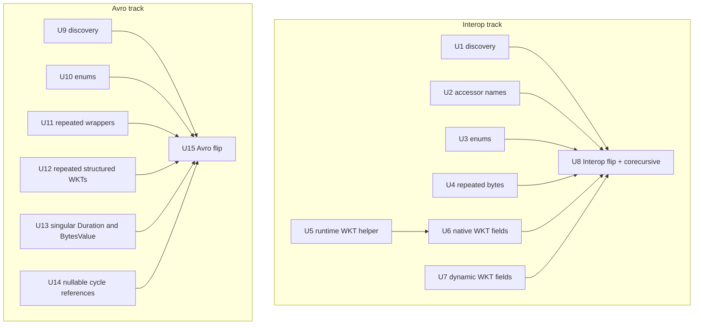

# Close the Interop and Avro Gaps on TestAllTypesProto3 - Plan

## Goal Capsule

- **Objective:** Close the gap-ledger rows `interop-all-types`, `nested-message-corecursive` and `avro-surface`, so that `TestAllTypesProto3` runs in proto3 JSON and both Avro formats and the already-written JSON conformance mirror runs its recordbuf halves for real.
- **Authority:** This plan, then `AGENTS.md` (repo root), then the gap-ledger and golden rules in its *Fixtures: golden matrix* section. The ledger rows are the to-do lists this plan works through.
- **Open blockers:** None.
- **Execution profile:** 15 small units in two independent tracks: Interop (U1–U8) and Avro (U9–U15). Each unit ends on a green `./gradlew build` and lands as its own commit. Within a track the fix units are independent of each other, except that U6 needs U5. The track's flip unit comes last. The tracks can run in parallel.
- **Stop conditions:** Stop and surface the problem if any of these happens:
  - an existing golden would have to change content;
  - the JaCoCo minimums would have to be lowered;
  - a flip unit hits a compile error that no landed fix unit covers;
  - a newly running conformance scenario fails for a reason that one new ledger row cannot explain;
  - a fix needs a new `@SuppressWarnings`, a NullAway exclusion or a Checkstyle suppression in generated code.

---

## Product Contract

### Summary

Fix each item on the `interop-all-types` and `avro-surface` to-do lists in its own small change, each proven on a new fixture family. Then switch both surfaces on for `TestAllTypesProto3` in the vendored corpus. The flip units seed the new goldens, retire the ledger rows and flip the conformance manifest.

### Problem Frame

The vendored `fixtures/src/main/proto/test_messages_proto3.proto` keeps two recordbuf surfaces switched off, because the code generated for them does not compile.

- **Interop.** The `TestAllTypesProto3` `Interop` converter fails javac with 84 errors. Without an `Interop` the message has no proto3 JSON format.
- **Avro.** The `TestAllTypesProto3AvroConverter` fails javac with 60 errors. Because the Avro option is file-level, the whole file loses Avro.

The test code is already written. `JsonCoreConformanceTest` and `JsonWktConformanceTest` detect the missing `Interop` by reflection and abort hundreds of recordbuf-half scenarios with `interop-all-types`. The corpus cases declare proto3 JSON and Avro not applicable. Closing the gaps switches all of that on without writing new conformance tests.

A third problem surfaced while planning. The Avro twin declares every singular message field non-nullable (the ledgered gap `avro-absent-singular-message`). `recursive_message` refers to its own message type, so no finite `TestAllTypesProto3` can be written to Avro. `NestedMessage.corecursive` adds a mutual cycle, and the schema's dependency ordering cannot place a mutual cycle.

### Requirements

**Interop**

- R1. `TestAllTypesProto3` carries `(recordbuf.protobuf_java)` and its generated `Interop` compiles. Gap `interop-all-types` is closed.
- R2. `NestedMessage.corecursive` is uncommented and gap `nested-message-corecursive` is closed.
- R3. The Interop converter supports singular proto3 enum fields. The known finding "Interop converter for singular proto3 enum fields" in `docs/known-findings.md` is closed.

**Avro**

- R4. `test_messages_proto3.proto` sets `(recordbuf.avro) = RECORDBUF_AVRO_ON`, and the generated converters compile. Gap `avro-surface` is closed.
- R5. A message reference that is part of a cycle (self or mutual recursion) is nullable in the Avro twin, so a finite recursive record round-trips through Avro.
- R6. A fully populated `TestAllTypesProto3` corpus case runs in both Avro formats. It is a new case, because the existing `all-types-populated` leaves message fields absent inside its `recursive_message`, and Avro rejects those.

**Conformance and suite**

- R7. The JSON conformance mirror's recordbuf halves run. Each manifest `gap` row that names `interop-all-types` flips to `covered`. A scenario that still fails aborts with an existing or new ledger id.
- R8. Each fix unit lands independently with a green build, proven by its own small golden family before any flip.
- R9. No existing golden changes content, and the JaCoCo minimums stay where they are.
- R10. Generated code stays clean under NullAway, Checkstyle, Google Java Format and `-Werror` without new suppressions.

### Scope Boundaries

- `oneof-snake-case-member` and `field-name-uppercase-start` stay open. Two to-do items are latent while the oneof is commented out: Interop item (5), the oneof member getter, and Avro item (2), the `oneof_field` accessors. Both move into the `oneof-snake-case-member` row.
- `map-bytes-value`, `map-message-value` and `map-enum-value` stay open. The map-bytes half of Interop item (3) moves into the `map-bytes-value` row.
- `avro-absent-singular-message` stays open for non-recursive message fields. Cases that leave a non-recursive message absent declare the Avro formats not applicable, citing that id.
- The wire-byte gaps, `null-value-field`, `enum-alias-name-collision`, `avro-unknown-fields-dropped`, `avro-first-message-only` and `optional-avro-presence` stay open and are cited where a case needs them.

#### Deferred to Follow-Up Work

- Put `canonical_format.proto` `Sample` on Interop once U3 lands, and promote its structural proto3 JSON checks to matrix cases.
- Close `oneof-snake-case-member` next. It unblocks the oneof conformance groups and both latent oneof items.

### Sources / Research

- `fixtures/src/test/resources/golden/gap-ledger.md`: the `interop-all-types` and `avro-surface` rows carry the probed to-do lists.
- `fixtures/src/test/resources/golden/conformance-manifest.md`: the JSON group rows gated on `interop-all-types`.
- `fixtures/src/test/java/bijnagte/recordbuf/fixture/conformance/JsonConformance.java`: reflective `Interop` detection (`INTEROP_GAP_ID`). The recordbuf halves switch on with no test edit.
- `generator/src/main/java/bijnagte/recordbuf/plugin/writer/InteropSourceMapping.java`: getters built from `JavaNames.cap(f.javaName())`, enum references built as `refPkg + "." + lastSegment(typeUrl)`, and repeated bytes typed `byte[]`.
- `generator/src/main/java/bijnagte/recordbuf/plugin/writer/AvroConverterSourceMapping.java`: the WKT check runs before the repeated check in both directions, so repeated WKTs take the singular arm. `enumType` builds a `.rec` path by string surgery on the enum's type URL, which breaks for nested enums.
- `generator/src/main/java/bijnagte/recordbuf/plugin/writer/AvroSchemaGenerator.java`: `namedMessageNode` gives a non-nullable record, and `dependencyOrder` leaves a cycle unordered.
- `json/src/main/java/bijnagte/recordbuf/json/DynamicWkt.java` already converts between protobuf-java `Struct`/`Value`/`ListValue`/`Any` and Jackson nodes.
- `docs/solutions/design-patterns/all-shapes-avro-structural-twin.md`: the per-shape Avro contract. Enums map to name strings and resolve unknown names through the record's fallback.
- `docs/known-findings.md`: the singular-enum Interop finding, which the ledger row does not list.

---

## Planning Contract

### Key Technical Decisions

- KTD1. **Fix first, flip last, in each track.** Each to-do item is fixed in its own unit and proven on a new small golden family proto with the surface switched on. Only the flip unit touches the vendored proto, the ledger rows and the manifest. This keeps every unit green and small, and it honors the ledger rule that a gap closes in one change.
- KTD2. **Probe families are ordinary golden families.** Each probe proto lives in `fixtures/src/main/proto` and gets a `*Cases` source registered in `GoldenCaseRegistry` and a matrix test. Goldens come from `seedGoldens`. The proto3 JSON goldens come from protobuf-java's `JsonFormat`, which is the independent check of a new Interop arm. Put the probe's target message first in the file (`avro-first-message-only`).
- KTD3. **Interop names protobuf-java accessors with protoc's own camel-case rule.** A new `JavaNames` helper mirrors protoc's Java accessor naming: underscores drop and capitalize the next letter, a letter after a digit is capitalized, and the first letter is capitalized. Every getter, setter, `has`, `List`, `Map`, `addAll` and `put` call in `InteropSourceMapping` uses it. The record's `javaName` stays as it is. This fixes edge names such as `field0name5`, whose protobuf-java getter is `getField0Name5`.
- KTD4. **Interop converts enums through protobuf-java's int-value accessors.** Use `get<X>Value`, `set<X>Value`, `get<X>ValueList` and `addAll<X>Value`, so the converter never names the protobuf-java enum type. That removes the wrong nested-enum path and the `UNRECOGNIZED.getNumber()` throw. On `from`, a singular field holding 0 maps to `null` (absent), because proto3 has no enum presence and the binary decoder yields `null` from protobuf-java's bytes. Every other value, and every repeated element (zero included), goes through the record's `forNumber`. On `to`, a `null` singular field skips the setter.
- KTD5. **A runtime helper converts the natively mapped WKTs to protobuf-java.** A new class beside `runtime.wkt.Wkt` converts `Timestamp`, `Duration`, `FieldMask`, `Empty`, the scalar wrappers and `BytesValue` between protobuf-java messages and the record's native types. `:recordbuf-runtime` already exposes protobuf-java as `api`. Generated Interop calls one helper method per element, instead of inlining conversion logic in every converter.
- KTD6. **The dynamic WKTs reuse `DynamicWkt`.** `Struct`, `Value`, `ListValue` and `Any` convert through the existing `DynamicWkt` protobuf-java methods. A file with these fields already requires the Jackson surface, so `:recordbuf-json` is already on its classpath.
- KTD7. **Interop `to` omits a structured WKT that holds its zero default.** This mirrors the binary encoder, so `Interop.to(r)` equals protobuf-java parsing `encode(r)`. Repeated elements always convert, defaults included.
- KTD8. **Only cycle references become nullable in the Avro twin.** A message reference becomes a `null`-first union only when it closes a cycle in the reachable graph (the owner decided this during planning). No current fixture has recursion, so no frozen Avro golden changes. A mutual cycle must parse: define the cyclic record inline at its first use, or otherwise order it so every name is defined before it is referenced. The implementer chooses the mechanism.
- KTD9. **Avro enums convert by constant name with the record's fallback.** The Avro side is a `CharSequence`. Map it to the record constant by name, and fall back the same way the record's `forNumber` does instead of throwing. Resolve the record enum's type from the model, not by string surgery on the type URL.
- KTD10. **Each track opens with a discovery unit.** It switches the surface on locally, groups the javac errors by to-do item, rewrites the ledger row to match, and reverts the switch. Fix units then aim at the exact errors. A new item found here becomes a new fix unit with the next free U-ID, placed before the track's flip unit.
- KTD11. **Flip units ledger new failures; they do not fix them.** When a flip switches on scenarios that then fail, each failure must map to an existing ledger id or to one new ledger row (plus a manifest or known-gap entry where the mirror needs one). Generator fixes beyond the to-do list are follow-up work.
- KTD12. **Latent items move rows at the flip.** A to-do item that only matters once another gapped construct is uncommented moves into that construct's ledger row. The closed row then really is closed.

### High-Level Technical Design

The two tracks share no units. Whichever flip lands second must keep both surfaces green. U14 makes the corecursive cycle safe in Avro, so the tracks can flip in either order.

### Assumptions

- The ledger's to-do lists, plus the known enum finding, cover every compile error. The discovery units (U1, U9) confirm this before any flip.
- The existing `all-types-populated` case cannot carry Avro, and its record must not change because its goldens are frozen. U15 adds a new case, `all-types-avro`. At every nesting level it sets each non-recursive singular message field, and it ends `recursive_message` one level down. If its timestamps carry sub-microsecond nanos, Avro needs an expected-after-trip record.

### Risks

- **Coverage ratio.** The probe families add generated classes under `fixtures/src/main/proto`, and those classes count toward the JaCoCo scope. Each probe's matrix cases exercise its codec, Interop or Avro converter, and Jackson surface. If a ratio still dips, add cases. The minimums are never lowered.
- **Conformance fan-out at U8.** Hundreds of JSON scenarios start running at once. KTD11 keeps the unit bounded: it ledgers failures and does not fix them. A failure that one ledger row cannot explain is a stop condition.

---

## Implementation Units

| U-ID | Title | Files touched (primary) | Depends on |
|---|---|---|---|
| U1 | Interop discovery | `gap-ledger.md` | none |
| U2 | protobuf-java accessor names | `JavaNames.java`, `InteropSourceMapping.java`, `interop_names.proto` | none |
| U3 | Interop enums | `InteropSourceMapping.java`, `interop_enum.proto`, `docs/known-findings.md` | none |
| U4 | Interop repeated bytes | `InteropSourceMapping.java`, `interop_bytes.proto` | none |
| U5 | Runtime WKT helper for protobuf-java | `runtime/.../wkt/ProtobufJavaWkt.java` | none |
| U6 | Interop natively mapped WKT fields | `InteropSourceMapping.java`, `interop_wkt.proto` | U5 |
| U7 | Interop dynamic WKT fields | `InteropSourceMapping.java`, `interop_dynamic.proto` | none |
| U8 | Interop flip and corecursive | `test_messages_proto3.proto`, ledger, manifest, corpus cases | U1–U7 |
| U9 | Avro discovery | `gap-ledger.md` | none |
| U10 | Avro enums | `AvroConverterSourceMapping.java`, `avro_enum.proto` | none |
| U11 | Avro repeated wrapper WKTs | `AvroConverterSourceMapping.java`, `avro_wkt_repeated_wrappers.proto` | none |
| U12 | Avro repeated structured WKTs | `AvroConverterSourceMapping.java`, `avro_wkt_repeated_structured.proto` | none |
| U13 | Avro singular Duration and BytesValue | `AvroConverterSourceMapping.java`, `avro_wkt_singular.proto` | none |
| U14 | Nullable cycle references in Avro | `AvroSchemaGenerator.java`, `AvroConverterSourceMapping.java`, `avro_recursive.proto` | none |
| U15 | Avro flip | `test_messages_proto3.proto`, ledger, corpus cases | U9–U14 |

Each probe family needs a case source and a matrix test under `fixtures/src/test/java/bijnagte/recordbuf/fixture/<family>/`, registration in `fixtures/src/test/java/bijnagte/recordbuf/fixture/golden/GoldenCaseRegistry.java`, and goldens under `fixtures/src/test/resources/golden/<family>/`. Follow `fixtures/src/test/java/bijnagte/recordbuf/fixture/wellknown/WktCases.java` and `WktInteropTest.java`. Jackson goldens a probe family seeds need human review before commit (AGENTS.md).

### U1. Interop discovery

- **Goal:** Make the `interop-all-types` ledger row an exact to-do list.
- **Requirements:** R1, R8
- **Dependencies:** None
- **Files:** modify `fixtures/src/test/resources/golden/gap-ledger.md`
- **Approach:** Locally uncomment the `TestAllTypesProto3` option, run `:recordbuf-fixtures:compileJava`, group the errors by to-do item, and revert the option. Add the singular-enum NullAway failure (`docs/known-findings.md`) as an item. Mark items (5) and the map-bytes half of (3) as latent. If an error fits no item and no planned unit, add a fix unit to this plan before U8.
- **Test expectation:** none. This is a ledger text update; `GapLedgerTest` must still pass.
- **Verification:** The row lists every error group; the vendored proto is unchanged; the build is green.

### U2. protobuf-java accessor names

- **Goal:** Generated Interop calls the accessor names that protobuf-java really generates.
- **Requirements:** R1, R8, R10
- **Dependencies:** None
- **Files:**
  - modify `generator/src/main/java/bijnagte/recordbuf/plugin/model/JavaNames.java`
  - modify `generator/src/main/java/bijnagte/recordbuf/plugin/writer/InteropSourceMapping.java`
  - create `generator/src/test/java/bijnagte/recordbuf/plugin/model/JavaNamesTest.java`
  - create `fixtures/src/main/proto/interop_names.proto` and its family under `fixtures/src/test/java/bijnagte/recordbuf/fixture/interopnames/`
- **Approach:** KTD3. Apply the helper to field accessors and to oneof member accessors. Base the probe proto on the active edge names of `TestAllTypesProto3` (`fieldname1`, `field_name2`, `field__name4_`, `field0name5`, `field_0_name6`, `fieldName7`, `field_Name9`, `field__name15`, `field__Name16`, `field_name17__`), plus one repeated field and one map field with a digit in the name. Leave out the names that start upper-case (`field-name-uppercase-start`).
- **Patterns to follow:** `fixtures/src/main/proto/compat.proto` (Interop opt-in and options import), `fixtures/src/test/java/bijnagte/recordbuf/fixture/combined/CompatCases.java`.
- **Test scenarios:**
  - The helper maps each vendored edge name to protobuf-java's accessor stem: `field0name5` → `Field0Name5`, `field_0_name6` → `Field0Name6`, `field__name4_` → `FieldName4`, `fieldName7` → `FieldName7`, `field_Name9` → `FieldName9`, `field_name17__` → `FieldName17`.
  - A plain snake name (`optional_int32`) maps to `OptionalInt32`, unchanged from today.
  - A populated probe record round-trips in `pb.hex`, `proto3.json` and `jackson.json`.
  - An all-default probe record round-trips in the same formats.
- **Verification:** The probe family compiles and passes; existing Interop families (`combined`, `oneof`) still pass.

### U3. Interop enums

- **Goal:** Interop converts singular, repeated and nested enum fields, including the nullable singular field.
- **Requirements:** R1, R3, R8, R10
- **Dependencies:** None
- **Files:**
  - modify `generator/src/main/java/bijnagte/recordbuf/plugin/writer/InteropSourceMapping.java`
  - create `fixtures/src/main/proto/interop_enum.proto` and its family under `fixtures/src/test/java/bijnagte/recordbuf/fixture/interopenum/`
  - modify `docs/known-findings.md`: remove the Interop enum section
- **Approach:** KTD4. Cover the field arms and the oneof member arms. The probe message has a top-level enum and a message-nested enum with a negative constant, a singular field of each, a repeated (packed by default) field of each, and an `[packed = false]` repeated nested enum. In the populated case, keep the packed repeated enums empty in `pb.hex` (`repeated-enum-unpacked-only`), or declare `pb.hex` not applicable for that case with the gap id.
- **Patterns to follow:** `fixtures/src/main/proto/compat.proto`; `toSetStatement` and `fromExpr` in `InteropSourceMapping`.
- **Test scenarios:**
  - A singular nested enum set to `BAR` round-trips in `proto3.json`.
  - A singular enum left `null` reaches protobuf-java as unset and comes back `null`.
  - A singular enum set to the zero constant comes back `null` after the trip. Declare this as the case's expected-after-trip record for `proto3.json`.
  - A repeated nested enum `[BAR, NEG, FOO]` round-trips element for element.
  - A protobuf-java message whose enum holds an undeclared number converts without throwing and yields the record's fallback constant.
- **Verification:** The probe family passes; NullAway raises nothing on the generated converter.

### U4. Interop repeated bytes

- **Goal:** Interop converts `repeated bytes`, which the record holds as `List<Bytes>`.
- **Requirements:** R1, R8
- **Dependencies:** None
- **Files:**
  - modify `generator/src/main/java/bijnagte/recordbuf/plugin/writer/InteropSourceMapping.java`
  - create `fixtures/src/main/proto/interop_bytes.proto` and its family under `fixtures/src/test/java/bijnagte/recordbuf/fixture/interopbytes/`
- **Approach:** Convert each element through `Bytes` ↔ `ByteString` in both directions. Leave the map-bytes arms alone (latent under `map-bytes-value`). The probe has a singular and a repeated `bytes` field.
- **Test scenarios:**
  - A repeated bytes list holding an empty element, a one-byte element and an element with every high-bit byte round-trips in `pb.hex` and `proto3.json`.
  - An empty repeated list round-trips as empty.
  - Singular bytes still round-trip; this guards against regressing the existing arm.
- **Verification:** The probe family passes.

### U5. Runtime WKT helper for protobuf-java

- **Goal:** One runtime class converts each natively mapped WKT to and from its protobuf-java message.
- **Requirements:** R1, R8
- **Dependencies:** None
- **Files:**
  - create `runtime/src/main/java/bijnagte/recordbuf/runtime/wkt/ProtobufJavaWkt.java` (name is the implementer's call)
  - create `runtime/src/test/java/bijnagte/recordbuf/runtime/wkt/ProtobufJavaWktTest.java`
- **Approach:** KTD5. Cover `Timestamp` ↔ `Instant`, `Duration` ↔ `java.time.Duration`, `FieldMask` ↔ runtime `FieldMask`, `Empty` ↔ runtime `Empty`, each scalar wrapper ↔ its boxed value, and `BytesValue` ↔ `Bytes`. A negative duration uses protobuf's sign rule: seconds and nanos carry the same sign. Keep the class `@NullMarked`, and make wrapper conversions null-in/null-out.
- **Patterns to follow:** `runtime/src/main/java/bijnagte/recordbuf/runtime/wkt/Wkt.java`; `WktInteropTest` for comparisons against protobuf-java.
- **Test scenarios:**
  - `Instant.ofEpochSecond(1_700_000_000, 123)` round-trips through protobuf-java `Timestamp`.
  - A pre-epoch `Instant` with nanos round-trips.
  - `Duration.ofMillis(-1500)` converts to seconds -1 and nanos -500,000,000, and back.
  - A `FieldMask` with two paths round-trips in order.
  - Each wrapper (`UInt32Value` above `Integer.MAX_VALUE` included) round-trips, and `null` maps to `null` in both directions.
  - `BytesValue` with empty and non-empty content round-trips.
- **Verification:** The runtime tests pass; the generator is unchanged.

### U6. Interop natively mapped WKT fields

- **Goal:** Interop converts singular and repeated `Timestamp`, `Duration`, `FieldMask`, `Empty`, wrapper and `BytesValue` fields.
- **Requirements:** R1, R8, R10
- **Dependencies:** U5
- **Files:**
  - modify `generator/src/main/java/bijnagte/recordbuf/plugin/writer/InteropSourceMapping.java`
  - create `fixtures/src/main/proto/interop_wkt.proto` and its family under `fixtures/src/test/java/bijnagte/recordbuf/fixture/interopwkt/`
- **Approach:** Route WKT-typed fields to the U5 helper before the generic message arm, which today calls a nonexistent `Duration.Interop`. A singular wrapper is present iff `has` is true. A singular structured WKT follows KTD7. A repeated field converts every element. The probe mirrors the vendored WKT fields: each wrapper singular and repeated, plus `Duration`, `Timestamp`, `FieldMask` and `Empty` singular and repeated.
- **Patterns to follow:** `fixtures/src/main/proto/wellknown.proto`; the `WellKnownTypes.resolve` classification.
- **Test scenarios:**
  - A populated record (wrappers set, non-default structured values, two-element repeated lists) round-trips in `pb.hex` and `proto3.json`.
  - An all-default record maps to a protobuf-java message with every WKT unset, and back to the same record.
  - A repeated `Duration` list containing `Duration.ZERO` keeps the element through Interop. Keep it out of the `pb.hex` case (`repeated-wkt-default-element`).
  - A wrapper set to its zero value (`Int32Value` 0) stays present through the trip.
- **Verification:** The probe family passes.

### U7. Interop dynamic WKT fields

- **Goal:** Interop converts singular and repeated `Struct`, `Value`, `ListValue` and `Any` fields.
- **Requirements:** R1, R8, R10
- **Dependencies:** None
- **Files:**
  - modify `generator/src/main/java/bijnagte/recordbuf/plugin/writer/InteropSourceMapping.java`
  - create `fixtures/src/main/proto/interop_dynamic.proto` and its family under `fixtures/src/test/java/bijnagte/recordbuf/fixture/interopdynamic/`
- **Approach:** KTD6. Route dynamic WKT fields to the matching `DynamicWkt` method in both directions. The probe mirrors `optional_struct`, `optional_any`, `optional_value`, `repeated_struct`, `repeated_any`, `repeated_value` and `repeated_list_value`. Pack `Any` with a message from the same file, so the proto3 JSON adapter can resolve its type. Check how `JsonWktConformanceTest` registers types.
- **Patterns to follow:** `fixtures/src/test/proto/jackson_full.proto` and `JacksonDynamicWktCases` for building node values; `DynamicWkt`.
- **Test scenarios:**
  - A `Struct` with nested object, list, number, bool and null members round-trips in `proto3.json`.
  - A `Value` holding each kind (null, number, string, bool, struct, list) round-trips.
  - A packed `Any` round-trips with its type URL intact.
  - Absent singular dynamic fields stay absent.
- **Verification:** The probe family passes.

### U8. Interop flip and corecursive

- **Goal:** Close `interop-all-types` and `nested-message-corecursive`.
- **Requirements:** R1, R2, R7, R9
- **Dependencies:** U1–U7
- **Files:**
  - modify `fixtures/src/main/proto/test_messages_proto3.proto`: uncomment the option and `corecursive`, drop both `GAP` markers, update the header's local-edit 3 text
  - modify `fixtures/src/test/resources/golden/gap-ledger.md`
  - modify `fixtures/src/test/resources/golden/conformance-manifest.md`
  - modify `fixtures/src/test/java/bijnagte/recordbuf/fixture/corpus/TestAllTypesCorpusCases.java`
  - modify `fixtures/src/test/java/bijnagte/recordbuf/fixture/conformance/BinaryValidDataConformanceTest.java`
  - add `fixtures/src/test/resources/golden/corpus/*.proto3.json`
  - modify `README.md` (the conformance note that mentions `interop-all-types`) and `docs/known-findings.md` (its closing reference to the row)
- **Approach:** Remove both rows. Move latent item (5) to `oneof-snake-case-member` and the map-bytes half of item (3) to `map-bytes-value` (KTD12). In the corpus cases, make proto3 JSON lossless for every `TestAllTypesProto3` case; use an expected-after-trip record where KTD4 or KTD7 changes the value. Seed the missing goldens. In the binary mirror's known-gap table, re-point `RepeatedScalarMessageMerge` from `nested-message-corecursive` to `message-field-not-merged`. Flip each manifest JSON row that names `interop-all-types` to `covered`, with its test class reference, and drop `interop-all-types` from rows that stay gaps. Triage the newly running JSON scenarios per KTD11. If U15 has already landed, `corecursive` relies on U14 to keep Avro green.
- **Test scenarios:**
  - `all-types-populated` and `all-types-default` pass forward and reverse in `proto3.json`.
  - `JsonCoreConformanceTest` and `JsonWktConformanceTest` run their recordbuf halves. Each one passes or aborts with a ledger id that exists.
  - `GapLedgerTest` passes with both rows and markers gone.
  - The existing `nested-message`, `foreign-message` and `all-types-*` goldens are unchanged.
- **Verification:** `./gradlew build` is green. `git diff --stat` under `golden/` shows only added files.

### U9. Avro discovery

- **Goal:** Make the `avro-surface` ledger row an exact to-do list.
- **Requirements:** R4, R8
- **Dependencies:** None
- **Files:** modify `fixtures/src/test/resources/golden/gap-ledger.md`
- **Approach:** Locally switch the file option to `RECORDBUF_AVRO_ON`, compile, group the errors by to-do item, and revert. Record the recursion finding: `recursive_message` cannot be written to Avro, which U14 fixes. Mark item (2) as latent (the oneof is commented out). An error that fits no item becomes a new fix unit before U15.
- **Test expectation:** none. This is a ledger text update; `GapLedgerTest` must still pass.
- **Verification:** The row matches the compiler output; the vendored proto is unchanged.

### U10. Avro enums

- **Goal:** The Avro converter maps singular and repeated enum fields, top-level and nested, both ways.
- **Requirements:** R4, R8, R10
- **Dependencies:** None
- **Files:**
  - modify `generator/src/main/java/bijnagte/recordbuf/plugin/writer/AvroConverterSourceMapping.java`
  - modify `generator/src/test/java/bijnagte/recordbuf/plugin/writer/AvroConverterSourceMappingTest.java`
  - create `fixtures/src/main/proto/avro_enum.proto` and its family under `fixtures/src/test/java/bijnagte/recordbuf/fixture/avroenum/`
- **Approach:** KTD9. Replace `enumType`'s string surgery with the model's type reference for the record enum, which fixes the bogus `TestAllTypesProto3.rec.NestedEnum` import. Handle a `null` singular enum on `fromRecord`. The probe has a top-level and a nested enum, singular and repeated, with Avro on.
- **Test scenarios:**
  - A populated record with nested-enum `BAZ` and a repeated `[BAR, NEG]` round-trips in `avro.hex` and `avro.json`.
  - An Avro string naming an undeclared constant converts to the record's fallback constant without throwing.
  - At the generator level, the converter for a nested enum imports the record-side enum under its enclosing record.
- **Verification:** The probe family passes.

### U11. Avro repeated wrapper WKTs

- **Goal:** The Avro converter maps repeated scalar-wrapper and `BytesValue` fields element by element.
- **Requirements:** R4, R8, R10
- **Dependencies:** None
- **Files:**
  - modify `generator/src/main/java/bijnagte/recordbuf/plugin/writer/AvroConverterSourceMapping.java`
  - create `fixtures/src/main/proto/avro_wkt_repeated_wrappers.proto` and its family under `fixtures/src/test/java/bijnagte/recordbuf/fixture/avrowrappers/`
- **Approach:** Check `isRepeated` before the singular WKT arm, and map each element with the singular conversion: `CharSequence` to `String` for `StringValue`, `ByteBuffer` to `Bytes` for `BytesValue`, pass-through for the numeric wrappers. Confirm the schema side gives an array of the element type, and fix it there if not.
- **Test scenarios:**
  - Two-element lists of each wrapper (including `StringValue` with non-ASCII text and `BytesValue` with high-bit bytes) round-trip in both Avro formats.
  - Empty lists round-trip as empty.
- **Verification:** The probe family passes.

### U12. Avro repeated structured WKTs

- **Goal:** The Avro converter maps repeated `Duration`, `Timestamp`, `FieldMask` and `Empty`, and confirms that the repeated dynamic WKTs work through the envelope.
- **Requirements:** R4, R8, R10
- **Dependencies:** None
- **Files:**
  - modify `generator/src/main/java/bijnagte/recordbuf/plugin/writer/AvroConverterSourceMapping.java`
  - create `fixtures/src/main/proto/avro_wkt_repeated_structured.proto` and its family under `fixtures/src/test/java/bijnagte/recordbuf/fixture/avrostructured/`
- **Approach:** Same per-element routing as U11, using the singular `Duration` floor pair (AGENTS.md *WKT Duration ↔ avro* note), `Timestamp` pass-through, the `FieldMask` bridge and `Empty`. Add `repeated Struct` and `repeated Any` to the probe so the envelope's repeated arm is proven on the vendored shapes.
- **Test scenarios:**
  - A repeated `Duration` `[1.5s, -1.5s]` round-trips, with the negative element keeping its value.
  - A repeated `Timestamp` with microsecond precision round-trips. A nanosecond value uses an expected-after-trip record cut to micros.
  - A repeated `FieldMask` with two masks round-trips.
  - Repeated `Struct` and `Any` round-trip through the envelope.
- **Verification:** The probe family passes.

### U13. Avro singular Duration and BytesValue

- **Goal:** Fix the singular arms that call getters missing on the Avro side (to-do item 4).
- **Requirements:** R4, R8, R10
- **Dependencies:** None
- **Files:**
  - modify `generator/src/main/java/bijnagte/recordbuf/plugin/writer/AvroConverterSourceMapping.java`
  - create `fixtures/src/main/proto/avro_wkt_singular.proto` and its family under `fixtures/src/test/java/bijnagte/recordbuf/fixture/avrosingular/`
- **Approach:** Use U9's error list to find the failing arms; the ledger names `getSeconds()`, `getNano()`, `array()` and `toByteArray()`. Read a `ByteBuffer` by its position and remaining bytes, not through `array()`, as the repeated bytes arm already does. Keep the `Duration` floor pair.
- **Test scenarios:**
  - A singular `Duration` of -1.5s round-trips in both Avro formats.
  - A singular `BytesValue` backed by a heap `ByteBuffer` with a non-zero position decodes the right bytes. This is a generator- or converter-level test if the matrix cannot build such a buffer.
  - An absent `BytesValue` and an absent `Duration` round-trip as absent.
- **Verification:** The probe family passes; `AvroInteropTest`'s duration tests still pass.

### U14. Nullable cycle references in Avro

- **Goal:** Self-recursive and mutually recursive messages get an Avro twin that parses and round-trips finite values.
- **Requirements:** R5, R8, R9
- **Dependencies:** None
- **Files:**
  - modify `generator/src/main/java/bijnagte/recordbuf/plugin/writer/AvroSchemaGenerator.java`
  - modify `generator/src/main/java/bijnagte/recordbuf/plugin/writer/AvroRegistry.java` (cycle detection, if it lives there)
  - modify `generator/src/main/java/bijnagte/recordbuf/plugin/writer/AvroConverterSourceMapping.java`
  - modify `generator/src/test/java/bijnagte/recordbuf/plugin/writer/AvroSchemaGeneratorTest.java`
  - create `fixtures/src/main/proto/avro_recursive.proto` and its family under `fixtures/src/test/java/bijnagte/recordbuf/fixture/avrorecursive/`
- **Approach:** KTD8. Mark a singular or repeated-element message reference as cycle-closing when its target can reach the reference's owner. Only a singular cycle reference becomes a `null`-first union; a repeated one is already finite through an empty array. The converter null-checks it in both directions. Make the mutual cycle parse, and update the `dependencyOrder` note that calls recursion a v1 gap. The probe has a self-recursive `Node {child}` first in the file and an `A {b}` / `B {a}` pair reachable from it.
- **Test scenarios:**
  - A three-level `Node` chain with an absent innermost child round-trips in both Avro formats.
  - An `A → B → A` chain ending absent round-trips.
  - At the generator level, a non-recursive message reference still emits a plain named record, not a union.
  - The `.avsc` of every existing family is byte-identical, which proves no frozen schema golden moved.
- **Verification:** The probe family passes; no existing `avro-schema` or Avro golden changes.

### U15. Avro flip

- **Goal:** Close `avro-surface`.
- **Requirements:** R4, R6, R9
- **Dependencies:** U9–U14
- **Files:**
  - modify `fixtures/src/main/proto/test_messages_proto3.proto`: switch to `RECORDBUF_AVRO_ON`, drop the `GAP` marker, update local-edit 2 in the header
  - modify `fixtures/src/test/resources/golden/gap-ledger.md`
  - modify `fixtures/src/test/java/bijnagte/recordbuf/fixture/corpus/TestAllTypesCorpusCases.java`
  - add `fixtures/src/test/resources/golden/corpus/*.avro.hex` and `*.avro.json`
  - modify `CONCEPTS.md` (*Structural twin*: cycle references are nullable)
- **Approach:** Remove the row and move latent item (2) to `oneof-snake-case-member` (KTD12). In the corpus cases:
  - Add case `all-types-avro` (see Assumptions), lossless in both Avro formats or with an expected-after-trip record for timestamp precision. It declares the formats it does not target as not applicable, with a reason.
  - `all-types-populated` and `all-types-default` declare Avro not applicable, citing `avro-absent-singular-message`. Their records do not change.
  - `foreign-message` and `nested-message` become Avro-applicable when the registry reaches them.

  Seed the missing goldens. If a schema-golden test enumerates bridged files, add the new schema golden. Triage any newly failing case per KTD11.
- **Test scenarios:**
  - `all-types-avro` passes forward and reverse in `avro.hex` and `avro.json`, with `recursive_message` set one level deep.
  - Non-applicable Avro pairs report their gap id.
  - Every existing golden is unchanged, including the corpus `pb.hex` and `jackson.json` files.
  - `GapLedgerTest` passes.
- **Verification:** `./gradlew build` is green. `git diff --stat` under `golden/` shows only added files.

---

## Verification Contract

| Gate | Command | Applies to |
|---|---|---|
| Format | `./gradlew spotlessApply`, then `./gradlew spotlessCheck` | every unit |
| Full build (compile, Error Prone/NullAway, Checkstyle, `-Werror`, tests, JaCoCo minimums) | `./gradlew build` | every unit |
| Launcher refresh before fixture generation | `./gradlew :recordbuf-generator:installDist` | every unit that changes the generator or a fixture proto |
| Seed new goldens (missing only) | `./gradlew :recordbuf-fixtures:seedGoldens` | probe-family units, U8, U15 |
| Golden immutability | `git diff --stat -- fixtures/src/test/resources/golden` shows only added files, never edits | every unit |
| Probe isolation | the vendored `test_messages_proto3.proto` is unchanged | every unit except U8 and U15 |

---

## Definition of Done

- Every unit landed as its own green commit.
- `TestAllTypesProto3` carries an `Interop`, `corecursive` is active, and the file has Avro on. The rows `interop-all-types`, `nested-message-corecursive` and `avro-surface` and their markers are gone. Their latent items live in the rows named in Scope Boundaries.
- The JSON conformance mirror's recordbuf halves run. No manifest row names `interop-all-types`. Every still-failing scenario aborts with an existing ledger id.
- The corpus runs `TestAllTypesProto3` in all five formats across its cases: proto3 JSON on `all-types-populated` and `all-types-default`, Avro on `all-types-avro`.
- No existing golden changed content, and the JaCoCo minimums are unchanged.
- `docs/known-findings.md` no longer lists the singular-enum Interop finding. `README.md` and `CONCEPTS.md` match the new state.
- No abandoned or experimental code from discovery or failed attempts is left in the diff.
