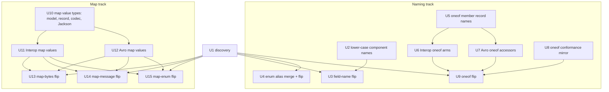

# Close the Naming and Map Gaps on TestAllTypesProto3 - Plan

## Goal Capsule

- **Objective:** Close the gap-ledger rows `field-name-uppercase-start`, `enum-alias-name-collision`, `oneof-snake-case-member`, `map-bytes-value`, `map-message-value` and `map-enum-value`. After this, every construct of the vendored `TestAllTypesProto3` is active except the NullValue fields.
- **Authority:** This plan, then `AGENTS.md` (repo root), then its *Fixtures: golden matrix* rules. The six ledger rows are the to-do lists. KTD9 is this plan's one owner-approved exception to the frozen-golden rule.
- **Open blockers:** None.
- **Execution profile:** 15 small units in two independent tracks: naming (U1–U9) and maps (U10–U15). U1 is shared discovery. Each unit ends on a green `./gradlew build` and lands as its own commit. Each gap closes in its own flip unit.
- **Stop conditions:** Stop and surface the problem if any of these happens:
  - an existing golden would change in a way KTD9 does not allow;
  - the JaCoCo minimums would have to be lowered;
  - a flip unit hits a compile, Checkstyle or NullAway error that no landed fix unit covers;
  - a newly running conformance scenario fails for a reason that one existing or new ledger row cannot explain;
  - a fix needs a new `@SuppressWarnings`, NullAway exclusion or Checkstyle suppression in generated code;
  - a fix changes a generated type, component or constant name that already compiles and passes Checkstyle in an existing family.

---

## Product Contract

### Summary

Fix the generator for upper-case-start field names, case-colliding enum aliases, snake_case oneof members, and maps with `bytes`, message and enum values. Prove each fix on a small new golden family. Then uncomment each construct in the vendored corpus, one ledger row per flip unit. The flips retire the rows and mirror the two oneof conformance groups. They also extend the existing corpus goldens, and only by additive default-valued members.

### Problem Frame

Six constructs of the vendored `fixtures/src/main/proto/test_messages_proto3.proto` are commented out because the generated code fails to generate, compile or pass Checkstyle:

- **Field names.** Eight edge names (`_field_name3`, `FieldName8`, `FIELD_NAME11` and so on) camel-case to an upper-case-start component such as `FieldName3`, which fails Checkstyle `MemberName`/`ParameterName`.
- **Enum alias.** `AliasedEnum.moo` and `MOO` both upper-case to `MOO`, a duplicate constant.
- **Oneof.** Each member record is named `cap(protoName) + "Value"` (`Oneof_uint32Value`), which fails Checkstyle `TypeName`. The Interop and Avro converters carry latent oneof bugs that the ledger row lists.
- **Maps.** The model, the record and the codec take a map value's Java type from `TypeRef.boxedFor(mapValue)`. That only knows scalars, so a message or enum value becomes `Object` and the entry codec throws `wireScalar for typeUrl=…`. `bytes` falls through to `Object` and decodes into a `String` local.

The conformance mirror already names these constructs. The JSON scenarios abort through `JsonConformance.Blocker`, and the binary map scenarios through `BinaryValidDataConformanceTest`'s `BLOCKED` list. `RejectInvalidUtf8.String.Oneof` is blocked too. `TestValidDataForOneofType` and `TestOneofMessage` are not ported at all. Uncommenting a construct forces each blocker out, so the halves run.

The Jackson surface writes every map (`{ }`) and every scalar (`0`) even at the default, and Avro writes every field. So uncommenting any of these constructs in `TestAllTypesProto3` adds members to the existing corpus goldens. The owner approved additive edits (KTD9).

### Requirements

**Naming**

- R1. A field whose camel-cased name starts upper-case gets a record component that starts lower-case. The proto3 JSON name and the protobuf-java accessor are unchanged. Gap `field-name-uppercase-start` is closed.
- R2. Enum values that differ only in case and share a number become one Java constant. Jackson still reads the alias spelling. Gap `enum-alias-name-collision` is closed.
- R3. A oneof member's record is named in UpperCamelCase, and the Interop and Avro converters handle a snake_case oneof with every member kind of `TestAllTypesProto3.oneof_field`. Gap `oneof-snake-case-member` is closed. `oneof_null_value` stays commented under `null-value-field`.
- R4. The manifest groups `TestValidDataForOneofType` and `TestOneofMessage` are mirrored and flip to `covered`.

**Maps**

- R5. Maps with a `bytes`, message or enum value generate, compile and round-trip in the binary codec, Interop, Jackson and both Avro formats. Gaps `map-bytes-value`, `map-message-value` and `map-enum-value` are closed.

**Suite**

- R6. Each fix lands independently with a green build, proven on its own small golden family before any flip.
- R7. Existing goldens change only as KTD9 allows. The JaCoCo minimums stay where they are.
- R8. Generated code stays clean under NullAway, Checkstyle, Google Java Format and `-Werror`, with no new suppressions.
- R9. A conformance scenario that newly runs and fails aborts with an existing or new ledger id. It is not fixed here.

### Scope Boundaries

- `null-value-field` stays open: `optional_null_value` and `oneof_null_value` stay commented, and the `ONEOF_NULL_VALUE` and `NULL_VALUE` blockers stay.
- The binary wire-fidelity rows (`packed-*`, `repeated-enum-unpacked-only`, `uint32-negative-carrier-wire`, `float-negative-zero-skipped`, `enum-default-value-written`, `repeated-wkt-default-element`) and the decoder-hardening rows (`message-field-not-merged`, `decode-recursion-unlimited`, `invalid-utf8-accepted`, `tag-varint-truncated-accepted`) stay open. Newly running scenarios they explain are added to the known-gap tables.
- The Avro presence rows (`optional-avro-presence`, `avro-absent-singular-message`, `avro-unknown-fields-dropped`, `avro-first-message-only`) stay open.
- `enum-unknown-number-default` stays open. It also applies to enum map values.
- Maps whose value is a well-known type are not in the vendored corpus, and they stay unsupported.
- Enum alias handling beyond the case collision stays as it is. Aliases with distinct upper-cased names remain distinct constants, and `forNumber` still returns the last-declared constant for a number.

#### Deferred to Follow-Up Work

- Move the `TestMergeOneofMessage` mirror from `oneof.Compat.item` to the real `oneof_nested_message` arm.
- Close `null-value-field`, the last commented-out construct in the vendored corpus.

### Sources / Research

- `fixtures/src/test/resources/golden/gap-ledger.md`: the six rows, including the latent Interop and Avro oneof items and the map-bytes Interop half moved there by the previous plan.
- `docs/plans/2026-11-23-002-feat-close-interop-avro-gaps-plan.md`: the fix-first/flip-last shape, discovery units and KTD11 triage this plan reuses.
- `generator/src/main/java/bijnagte/recordbuf/plugin/model/ModelLoader.java`: `loadField` sets `javaName = JavaNames.camel(name)` and, separately, `jsonName = camel(name)`. `loadEnum` uses `snakeUpper`. `buildMapField` builds `Map<boxedFor(key), boxedFor(value)>`.
- `generator/src/main/java/bijnagte/recordbuf/plugin/model/JavaNames.java`: `camel`, `cap`, and `protobufJavaAccessor`, protoc's Java accessor rule.
- `generator/src/main/java/bijnagte/recordbuf/plugin/writer/RecordSourceMapping.java`, `CodecSourceMapping.java`, `InteropSourceMapping.java` and `AvroConverterSourceMapping.java`: six sites across these four files build `JavaNames.cap(member.name()) + "Value"`. `mapEntryRecord`, the codec's map local init and `emitEntryCodec` re-derive map types with `boxedFor` and `wireScalarForTypeUrl`.
- `AvroConverterSourceMapping.oneofToRecord` builds the getter and setter from the raw oneof name (`getOneof_field`). Other fields use `cap(javaName)`.
- `InteropSourceMapping.emitOneofFrom`/`emitOneofTo` build the case switch from `ifaceName()` and convert members with `fromExpr`, not the field arms' WKT and bytes conversions.
- `AvroSchemaGenerator.mapValueNode` already maps message values (record reference), enum values (`string`) and scalars; `mapToRecord`/`mapFromRecord` pass values through unchanged.
- `fixtures/src/test/java/bijnagte/recordbuf/fixture/conformance/JsonConformance.java` (`Blocker`, `KNOWN_GAPS`), `BinaryValidDataConformanceTest.java` (`blockedMapCases`, `knownGaps`), `BinaryMalformedConformanceTest.java` (`BLOCKED` UTF-8 oneof case), `BinaryBehaviorConformanceTest.java` (class doc on the unported oneof groups).
- `docs/solutions/design-patterns/all-shapes-avro-structural-twin.md`: Avro enums are name strings, and maps follow the string-key-map / pair-record split.

---

## Planning Contract

### Key Technical Decisions

- KTD1. **Fix first, flip last, one gap per flip.** Each fix is proven on a new small family proto with the relevant surfaces switched on. Only flip units touch the vendored proto, the ledger, the manifest and the corpus goldens. Each flip closes exactly one row (AGENTS.md: gaps close one per change). The enum alias is the exception: its fix and flip land together, because the fix is a few lines and touches no golden.
- KTD2. **Probe families are ordinary golden families.** Each new proto gets a `*Cases` source in `GoldenCaseRegistry`, a matrix test, and goldens from `seedGoldens`. The proto3 JSON goldens come from protobuf-java's `JsonFormat`, which independently checks every new Interop arm. Put the probe's target message first in the file (`avro-first-message-only`). A probe family's goldens are frozen once seeded, so each unit gets its own proto and does not grow an earlier unit's proto.
- KTD3. **Lower only the first letter of an upper-case-start component name.** Keep protoc's camel shape: `_field_name3` → `fieldName3`, `FieldName8` → `fieldName8`, `FIELD_NAME11` → `fIELDNAME11`, `FIELD_name12` → `fIELDName12`. The rule applies only when the camel-cased name starts upper-case, so no existing component changes. `jsonName` and the protobuf-java accessor stay on their own rules. A lowered name that collides with another field's name in the same message fails generation with an error that names both fields.
- KTD4. **Merge case-colliding aliases at load time.** When two values of an enum upper-case to the same constant name, they must share a number (protoc enforces this for proto3). Keep one constant at the first one's position, and record the other spelling on the model so Jackson reads it as an alias. No Avro symbol, `BY_NUMBER` entry or golden changes. Distinct upper-cased aliases stay distinct constants.
- KTD5. **The oneof member record name is owned by the model.** One model-level helper derives it: `JavaNames.cap(JavaNames.camel(member name)) + "Value"`, so `oneof_uint32` → `OneofUint32Value`. Every writer site calls the helper instead of building the name itself. Existing fixtures have no underscore member names, so their types are unchanged.
- KTD6. **Interop oneof arms reuse the field arms' conversions.** A `bytes` member, a natively mapped WKT member and a dynamic WKT member convert exactly as a singular field of that type does. The case accessor and its constants follow protoc's naming: `get<Accessor>Case()` from `protobufJavaAccessor(oneof name)`, and constants from the upper-cased member name.
- KTD7. **Avro oneof accessors follow the field rule.** Build the oneof getter and setter on the specific record, and the record and builder accessor calls in the converter, from the oneof's camel component name. That is the same way field accessors use `cap(javaName)`. U1 observed `getOneof_field`, `setOneof_field`, `r.oneof_field()` and `b.oneof_field(...)`, all of them raw-name calls.
- KTD8. **The map value's Java type is resolved once, in the model.** `buildMapField` resolves the value to its record type (message), enum type (enum), `Bytes` (bytes) or boxed scalar, through the same `FileTable` lookup a singular field uses. Writers read the key and value types from `Field.type()`'s generics, never from `boxedFor(mapValue)`. The entry codec writes and reads a message value as a length-delimited nested message, and an enum value as a varint through `forNumber`. A missing value in an entry decodes to the type's default: an empty message, the zero enum, or empty `Bytes`.
- KTD9. **Additive golden edits are authorized, for these files only:** `corpus/all-types-{populated,default,proto3-json,avro,wire-gaps}.jackson.json`, `corpus/all-types-avro.avro.json` and `corpus/all-types-avro.avro.hex`. A flip may add the default-valued members its newly uncommented construct produces, at every nesting level, at the position the serializer emits them. Nothing else may change. JSON goldens are hand-edited. The `avro.hex` golden is deleted and re-seeded from the unchanged case record, and the matching `avro.json` diff must show only additive changes. `corpus/nested-message.avro.hex` may also be re-seeded, but only for a fingerprint change: its writer schema embeds `TestAllTypesProto3Avro` through `corecursive`, so its bytes after the fingerprint must stay identical. The owner approved this after U1. The corpus cases that this plan's own earlier flips added (`all-types-edge-names.*` and the later `all-types-*` flip cases) follow the same additive rule in later flips. Any other golden change is a stop condition.
- KTD10. **Flips ledger new failures; they do not fix them.** A newly running scenario that fails maps to an existing ledger id or one new row. That row is added to the relevant `KNOWN_GAPS` table, with a manifest entry where the mirror needs one.
- KTD11. **An Avro-only remainder narrows a row instead of growing the plan.** If the Avro side of a map value kind or of the oneof needs more than a converter fix (for example a schema change that moves existing Avro schema goldens), the flip closes the row for the other formats. It then adds an Avro-only row with its own marker, and the corpus case declares Avro not applicable, citing it.
- KTD12. **New corpus cases carry the new constructs.** Existing corpus case records do not change (KTD9 covers only their defaults). Each flip adds a case that populates its construct. The case builds from the `all-types-avro` record shape, so all five formats apply. Use an expected-after-trip record where a known gap alters the value.

### High-Level Technical Design

The tracks share only U1. The fix units under a flip can land in any order. Flips in the same track can land in any order once their fixes are in, and each extends the same corpus goldens additively.

### Risks

- **Avro name mangling for the edge names.** The Avro converter calls `get` + `cap(javaName)` and relies on Avro's `SpecificCompiler` producing the same accessor for the proto name. That is unproven for leading underscores (`__field_name13`) and all-caps names. U2's probe has Avro on, so a mismatch surfaces there and is fixed in U2.
- **Jackson enum alias reading.** U4 assumes Jackson 3 honors an alias annotation on an enum constant for deserialization. If it does not, use the generated enum's creator path instead. Reading `"moo"` is a structural test, not a golden.
- **Coverage ratio.** Probe families add generated classes to the JaCoCo scope. Each probe's matrix cases must exercise its codec and converters. If a ratio dips, add cases; never lower the minimums.
- **Conformance fan-out at the flips.** The JSON blockers and the binary `BLOCKED` map cases switch on at once. KTD10 keeps each flip bounded. `ValidDataMap.STRING.MESSAGE.MergeValue` is expected to fail on the entry decoder's assign-not-merge behavior, which is `message-field-not-merged`.

---

## Implementation Units

| U-ID | Title | Files touched (primary) | Depends on |
|---|---|---|---|
| U1 | Discovery | `gap-ledger.md` | none |
| U2 | Lower-case component names | `ModelLoader.java`, `JavaNames.java`, `edge_names.proto` | none |
| U3 | Field-name flip | `test_messages_proto3.proto`, ledger, corpus | U1, U2 |
| U4 | Enum alias merge and flip | `ModelLoader.java`, `Enum.java`, `EnumSourceMapping.java`, `enum_alias.proto`, vendored proto | U1 |
| U5 | Oneof member record names | `Oneof.java`, four writer sites, `oneof_names.proto` | none |
| U6 | Interop oneof arms | `InteropSourceMapping.java`, `interop_oneof.proto` | U5 |
| U7 | Avro oneof accessors | `AvroConverterSourceMapping.java`, `avro_oneof.proto` | U5 |
| U8 | Oneof conformance mirror | `BinaryValidDataConformanceTest.java`, `BinaryBehaviorConformanceTest.java`, manifest | none |
| U9 | Oneof flip | `test_messages_proto3.proto`, ledger, manifest, conformance tables, corpus | U1, U6, U7, U8 |
| U10 | Map value types | `ModelLoader.java`, `RecordSourceMapping.java`, `CodecSourceMapping.java`, `map_values.proto` | none |
| U11 | Interop map values | `InteropSourceMapping.java`, `interop_map_values.proto` | U10 |
| U12 | Avro map values | `AvroConverterSourceMapping.java`, `avro_map_values.proto` | U10 |
| U13 | map-bytes flip | vendored proto, ledger, conformance tables, corpus | U1, U11, U12 |
| U14 | map-message flip | vendored proto, ledger, conformance tables, corpus | U1, U11, U12 |
| U15 | map-enum flip | vendored proto, ledger, conformance tables, corpus | U1, U11, U12 |

Each probe family needs a case source and a matrix test under `fixtures/src/test/java/bijnagte/recordbuf/fixture/<family>/`, registration in `fixtures/src/test/java/bijnagte/recordbuf/fixture/golden/GoldenCaseRegistry.java`, and goldens under `fixtures/src/test/resources/golden/<family>/`. Follow `fixtures/src/main/proto/interop_names.proto` with `fixtures/src/test/java/bijnagte/recordbuf/fixture/interopnames/`. Jackson goldens seeded by a probe need human review before commit (AGENTS.md).

Each flip unit modifies `fixtures/src/main/proto/test_messages_proto3.proto` (uncomment the construct, drop its `GAP` markers, keep the header's local-edit list accurate), `fixtures/src/test/resources/golden/gap-ledger.md`, `fixtures/src/test/java/bijnagte/recordbuf/fixture/corpus/TestAllTypesCorpusCases.java`, and the KTD9 golden files. It also modifies `fixtures/src/test/java/bijnagte/recordbuf/fixture/conformance/JsonConformance.java`: its `upstreamDescriptor()` adds the commented-out constructs back by hand, and it must stop adding the one the flip activates, or the descriptor fails with a duplicate-field error. It adds the new case's goldens.

### U1. Discovery

- **Goal:** Make each of the six ledger rows an exact to-do list.
- **Requirements:** R6
- **Dependencies:** None
- **Files:** modify `fixtures/src/test/resources/golden/gap-ledger.md`
- **Approach:** Locally uncomment all six constructs (leave `oneof_null_value` commented), set the launcher with `installDist`, and run `:recordbuf-fixtures:check`. Group the generation, javac, Checkstyle and NullAway failures by row, then revert the proto. Update each row's reason to list the items found. An item that fits no planned unit becomes a new fix unit with the next free U-ID, placed before its flip.
- **Test expectation:** none. This is a ledger text update; `GapLedgerTest` must still pass.
- **Verification:** Every observed failure maps to a row item and a planned unit. The vendored proto is unchanged, and the build is green.

### U2. Lower-case component names

- **Goal:** An upper-case-start camel name yields a lower-case-start record component.
- **Requirements:** R1, R6, R8
- **Dependencies:** None
- **Files:**
  - modify `generator/src/main/java/bijnagte/recordbuf/plugin/model/JavaNames.java`
  - modify `generator/src/main/java/bijnagte/recordbuf/plugin/model/ModelLoader.java`
  - modify `generator/src/test/java/bijnagte/recordbuf/plugin/model/JavaNamesTest.java`
  - create `fixtures/src/main/proto/edge_names.proto` and family `edgenames`
- **Approach:** KTD3. Apply the rule in `loadField` to `javaName` only. Add the per-message duplicate-name check in the loader. Probe proto: the eight upper-case-start names from the vendored file. Turn on Interop, Avro and Jackson.
- **Patterns to follow:** `fixtures/src/main/proto/interop_names.proto`.
- **Test scenarios:**
  - Each of the eight names maps to its component: `_field_name3` → `fieldName3`, `FieldName8` → `fieldName8`, `Field_Name10` → `fieldName10`, `FIELD_NAME11` → `fIELDNAME11`, `FIELD_name12` → `fIELDName12`, `__field_name13` → `fieldName13`, `__Field_name14` → `fieldName14`, `Field_name18__` → `fieldName18`.
  - A lower-case-start name (`field_name2`, `fieldName7`) is unchanged.
  - A message with `FieldName8` and `fieldName8` fails generation, naming both fields.
  - A populated probe record round-trips in all five formats. Its proto3 JSON keys are protoc's (`FieldName3`, `FIELDNAME11`).
  - An all-default probe record round-trips in all five formats.
- **Verification:** The probe passes. Every existing family's goldens are unchanged.

### U3. Field-name flip

- **Goal:** Close `field-name-uppercase-start`.
- **Requirements:** R1, R7, R9
- **Dependencies:** U1, U2
- **Approach:** Uncomment the eight fields and remove the row. Remove the `UPPERCASE_EDGE_NAME` blocker from `JsonConformance` and from the scenarios that cite it. Add case `all-types-edge-names` (KTD12) that sets all eighteen edge names, and fix the comment in `TestAllTypesCorpusCases` that cites the gap. Hand-edit the KTD9 files: the new `int32` members at default, at every `TestAllTypesProto3` level. Triage newly running scenarios per KTD10.
- **Test scenarios:**
  - `all-types-edge-names` passes forward and reverse in all five formats.
  - Existing corpus cases pass against the edited goldens.
  - The JSON field-name-convention scenarios that cited the blocker run their recordbuf halves and pass, or abort with a ledger id.
  - `GapLedgerTest` passes with the row and its markers gone.
- **Verification:** `./gradlew build` is green. The golden diff is additive only and limited to KTD9 files plus added files.

### U4. Enum alias merge and flip

- **Goal:** Close `enum-alias-name-collision`.
- **Requirements:** R2, R6, R7
- **Dependencies:** U1
- **Files:**
  - modify `generator/src/main/java/bijnagte/recordbuf/plugin/model/ModelLoader.java` and `generator/src/main/java/bijnagte/recordbuf/plugin/model/Enum.java`
  - modify `generator/src/main/java/bijnagte/recordbuf/plugin/writer/EnumSourceMapping.java`
  - create `fixtures/src/main/proto/enum_alias.proto` and family `enumalias`
  - the flip files: the vendored proto (`moo` uncommented), ledger, `JsonConformance.java` (`ALIAS_NAME` blocker gone)
- **Approach:** KTD4. Probe proto: an `allow_alias` enum with `ZERO = 0; FOO = 1; foo = 1; Bar = 2` and a message holding it. Turn on Jackson, Interop and Avro.
- **Test scenarios:**
  - The probe enum has one `FOO` constant. Jackson reads `"foo"` and `"FOO"` to it, and writes `"FOO"`.
  - The probe round-trips in all five formats.
  - The generated `AliasedEnum` has the same constants as before. `forNumber(2)` is unchanged, and the existing corpus goldens are byte-identical.
  - The `EnumFieldWithAliasLowerCase` JSON scenario runs its recordbuf half and passes.
  - `GapLedgerTest` passes.
- **Verification:** `./gradlew build` is green, and no existing golden changes.

### U5. Oneof member record names

- **Goal:** Oneof member records get UpperCamelCase names.
- **Requirements:** R3, R6, R8
- **Dependencies:** None
- **Files:**
  - modify `generator/src/main/java/bijnagte/recordbuf/plugin/model/Oneof.java`
  - modify `RecordSourceMapping.java`, `CodecSourceMapping.java`, `InteropSourceMapping.java` and `AvroConverterSourceMapping.java` under `generator/src/main/java/bijnagte/recordbuf/plugin/writer/`
  - create `fixtures/src/main/proto/oneof_names.proto` and family `oneofnames`
- **Approach:** KTD5. Probe proto: a oneof `oneof_field` with one member of each `TestAllTypesProto3.oneof_field` kind (`uint32`, message, `string`, `bytes`, `bool`, `uint64`, `float`, `double`, enum). Jackson on, Interop and Avro off.
- **Test scenarios:**
  - The generated member types are `OneofUint32Value`, `OneofNestedMessageValue`, …, and the record passes Checkstyle.
  - One case per member kind round-trips in `pb.hex` and `jackson.json`, and an empty oneof round-trips too.
  - Existing oneof families (`oneof`, `oneoforder`, `oneofwkt`, `interopenum`, `jackson-oneof`) compile unchanged and keep their goldens.
- **Verification:** The probe passes, and no existing golden changes.

### U6. Interop oneof arms

- **Goal:** Generated Interop converts every oneof member kind and calls protobuf-java's real case accessor.
- **Requirements:** R3, R6
- **Dependencies:** U5
- **Files:**
  - modify `generator/src/main/java/bijnagte/recordbuf/plugin/writer/InteropSourceMapping.java`
  - create `fixtures/src/main/proto/interop_oneof.proto` and family `interoponeof`
- **Approach:** KTD6. Probe proto: a snake_case oneof whose name puts a letter after a digit, so protoc's rule differs from `cap` (for example `pick_2way`). Give it `bytes`, `Timestamp`, `Struct`, enum, message and scalar members. Interop and Jackson on.
- **Test scenarios:**
  - One case per member kind passes forward and reverse in `proto3.json`, `pb.hex` and `jackson.json`. The `proto3.json` golden comes from protobuf-java.
  - An unset oneof converts to an unset protobuf-java case and back.
  - A `Timestamp` member at the epoch converts to a present member, because a oneof member's presence is explicit.
- **Verification:** The probe passes, and the existing Interop families still pass.

### U7. Avro oneof accessors

- **Goal:** The Avro converter compiles and round-trips for a snake_case oneof.
- **Requirements:** R3, R6
- **Dependencies:** U5
- **Files:**
  - modify `generator/src/main/java/bijnagte/recordbuf/plugin/writer/AvroConverterSourceMapping.java`
  - create `fixtures/src/main/proto/avro_oneof.proto` and family `avrooneof`
- **Approach:** KTD7. Probe proto: a oneof `oneof_field` with scalar, enum, `bytes` and message members, Avro on. Set every non-oneof message field in each case (`avro-absent-singular-message`). Apply KTD11 if the schema needs more than the accessor fix.
- **Test scenarios:**
  - One case per member kind round-trips in `avro.hex` and `avro.json`.
  - An unset oneof writes the null branch and reads back unset.
- **Verification:** The probe passes, and no existing Avro schema or golden changes.

### U8. Oneof conformance mirror

- **Goal:** Mirror `TestValidDataForOneofType` and `TestOneofMessage` against `TestAllTypesProto3`'s oneof, blocked until U9.
- **Requirements:** R4, R9
- **Dependencies:** None
- **Files:**
  - modify the binary conformance class that holds the matching upstream group: `fixtures/src/test/java/bijnagte/recordbuf/fixture/conformance/BinaryValidDataConformanceTest.java` for `TestValidDataForOneofType`, `BinaryBehaviorConformanceTest.java` for `TestOneofMessage`
  - modify `fixtures/src/test/resources/golden/conformance-manifest.md`
- **Approach:** Port the upstream payloads for fields 111–119 from `binary_json_conformance_suite.cc` at `v36.2`. Skip field 120 and cite `null-value-field` (the `NULL_VALUE` blocker shape). Until the oneof exists, each scenario runs its port check against protobuf-java alone. Its recordbuf half aborts with `oneof-snake-case-member` through the existing blocked-case mechanism, which fails once the reference has the field. Flip both manifest rows to `covered`. Update the `BinaryBehaviorConformanceTest` class doc that calls these groups unported.
- **Test scenarios:**
  - Every ported scenario's port check passes against protobuf-java.
  - Every recordbuf half aborts with `oneof-snake-case-member`.
  - `GapLedgerTest` resolves both new manifest references.
- **Verification:** `./gradlew build` is green, and the vendored proto is unchanged.

### U9. Oneof flip

- **Goal:** Close `oneof-snake-case-member`.
- **Requirements:** R3, R4, R7, R9
- **Dependencies:** U1, U6, U7, U8
- **Files:** the flip files, plus `JsonConformance.java` (`ONEOF` blocker removed from scenarios that do not also need `oneof_null_value`), `BinaryMalformedConformanceTest.java` (the `BLOCKED` UTF-8 case becomes a known gap) and the U8 test class (its blocked entries removed)
- **Approach:** Uncomment the oneof with `oneof_null_value` still commented, and keep that member's `null-value-field` marker. Remove the row. In `invalid-utf8-accepted`, drop the sentence about the `.Oneof` case waiting, and list `RejectInvalidUtf8.String.Oneof` under it. Add corpus cases (KTD12): one with `oneof_nested_message` set and one with `oneof_bytes` set. Hand-edit the KTD9 files: the null oneof branch in Avro. Jackson omits an unset oneof, so expect no Jackson change and treat one as a finding to check. Triage per KTD10.
- **Test scenarios:**
  - Both new cases pass forward and reverse in all five formats.
  - The U8 scenarios run their recordbuf halves: each passes, or aborts with a ledger id in the known-gap table.
  - `RejectInvalidUtf8.String.Oneof` aborts with `invalid-utf8-accepted`.
  - The JSON oneof scenarios run their recordbuf halves.
  - `GapLedgerTest` passes, and the manifest names no `oneof-snake-case-member`.
- **Verification:** `./gradlew build` is green. The golden diff is additive only, within KTD9.

### U10. Map value types

- **Goal:** Maps with `bytes`, message and enum values generate, compile and round-trip in the binary codec and Jackson.
- **Requirements:** R5, R6, R8
- **Dependencies:** None
- **Files:**
  - modify `generator/src/main/java/bijnagte/recordbuf/plugin/model/ModelLoader.java`
  - modify `generator/src/main/java/bijnagte/recordbuf/plugin/writer/RecordSourceMapping.java`
  - modify `generator/src/main/java/bijnagte/recordbuf/plugin/writer/CodecSourceMapping.java`
  - create `fixtures/src/main/proto/map_values.proto` and family `mapvalues`
- **Approach:** KTD8. Probe proto: `map<string, bytes>`, `map<string, Nested>`, `map<string, Color>`, and one non-string key with a message value (`map<int32, Nested>`). Jackson on, Interop and Avro off. Check that Jackson writes `Bytes` map values through the module's bytes serializer.
- **Test scenarios:**
  - A populated record round-trips in `pb.hex` and `jackson.json`. Its `pb.hex` golden comes from protobuf-java.
  - A message value that is the default instance round-trips as an entry with an empty value.
  - An entry with no value field decodes to the default message, `Bytes` and enum zero. Test this structurally from hand-built bytes.
  - An empty map round-trips.
  - Existing `map` and `map_keys` families keep their goldens.
- **Verification:** The probe passes, and no existing golden changes.

### U11. Interop map values

- **Goal:** Interop converts maps with `bytes`, message and enum values.
- **Requirements:** R5, R6
- **Dependencies:** U10
- **Files:**
  - modify `generator/src/main/java/bijnagte/recordbuf/plugin/writer/InteropSourceMapping.java`
  - create `fixtures/src/main/proto/interop_map_values.proto` and family `interopmapvalues`
- **Approach:** A message value goes through its record's `Interop.from`/`to`. An enum value goes through protobuf-java's `…ValueMap` int accessors and the record's `forNumber`, the same choice as singular enums in the previous plan. A `bytes` value converts through `ByteString`. Same map shapes as U10, plus Interop.
- **Test scenarios:**
  - A populated record passes forward and reverse in `proto3.json` against protobuf-java's `JsonFormat` output.
  - An enum value whose number no constant has follows `enum-unknown-number-default`. Note it, and do not fix it.
- **Verification:** The probe passes.

### U12. Avro map values

- **Goal:** The Avro converter maps `bytes`, message and enum map values.
- **Requirements:** R5, R6
- **Dependencies:** U10
- **Files:**
  - modify `generator/src/main/java/bijnagte/recordbuf/plugin/writer/AvroConverterSourceMapping.java`
  - create `fixtures/src/main/proto/avro_map_values.proto` and family `avromapvalues`
- **Approach:** Map each value through the same per-element conversion a repeated field of that type uses. A message goes through its converter, an enum maps by constant name with the record's fallback, and `bytes` converts to and from `ByteBuffer`. Cover the pair-record path for the non-string key. Apply KTD11 if the schema itself must change.
- **Test scenarios:**
  - A populated record round-trips in `avro.hex` and `avro.json`.
  - An empty map of each kind round-trips.
- **Verification:** The probe passes, and no existing Avro schema or golden changes.

### U13. map-bytes flip

- **Goal:** Close `map-bytes-value`.
- **Requirements:** R5, R7, R9
- **Dependencies:** U1, U11, U12
- **Approach:** Uncomment `map_string_bytes`, remove the row, and remove the `BYTES` entries from `blockedMapCases`. Add case `all-types-map-bytes` (KTD12). Hand-edit the KTD9 files: an empty `mapStringBytes` / `map_string_bytes` map at every level. Triage per KTD10.
- **Test scenarios:**
  - The new case passes in all five formats.
  - The `ValidDataMap.STRING.BYTES.*` scenarios run and pass, or abort with a ledger id.
  - `GapLedgerTest` passes.
- **Verification:** `./gradlew build` is green. The golden diff is additive only, within KTD9.

### U14. map-message flip

- **Goal:** Close `map-message-value`.
- **Requirements:** R5, R7, R9
- **Dependencies:** U1, U11, U12
- **Approach:** Uncomment `map_string_nested_message` and `map_string_foreign_message`. Remove the row, the `MESSAGE` blocked cases (including `MergeValue`) and the `MAP_MESSAGE_VALUE` blocker. Add case `all-types-map-message` (KTD12). Hand-edit the KTD9 files. Expect `MergeValue` to abort with `message-field-not-merged`, and add the map-entry shape to that row's text.
- **Test scenarios:**
  - The new case passes in all five formats.
  - The `ValidDataMap.STRING.MESSAGE.*` and JSON map-message scenarios run and pass, or abort with a ledger id.
  - `GapLedgerTest` passes.
- **Verification:** `./gradlew build` is green. The golden diff is additive only, within KTD9.

### U15. map-enum flip

- **Goal:** Close `map-enum-value`.
- **Requirements:** R5, R7, R9
- **Dependencies:** U1, U11, U12
- **Approach:** Uncomment `map_string_nested_enum` and `map_string_foreign_enum`. Remove the row, the `ENUM` blocked cases and the `MAP_ENUM_VALUE` blocker. Add case `all-types-map-enum` (KTD12). Hand-edit the KTD9 files. An unknown-number scenario aborts with `enum-unknown-number-default`.
- **Test scenarios:**
  - The new case passes in all five formats.
  - The `ValidDataMap.STRING.ENUM.*` and JSON map-enum scenarios run and pass, or abort with a ledger id.
  - `GapLedgerTest` passes.
- **Verification:** `./gradlew build` is green. The golden diff is additive only, within KTD9.

---

## Verification Contract

| Gate | Command | Applies to |
|---|---|---|
| Format | `./gradlew spotlessApply`, then `./gradlew spotlessCheck` | every unit |
| Full build (compile, Error Prone/NullAway, Checkstyle, `-Werror`, tests, JaCoCo minimums) | `./gradlew build` | every unit |
| Launcher refresh before fixture generation | `./gradlew :recordbuf-generator:installDist` | every unit that changes the generator or a fixture proto |
| Seed new goldens (missing only) | `./gradlew :recordbuf-fixtures:seedGoldens` | probe-family units and flips |
| Golden immutability | `git diff --stat -- fixtures/src/test/resources/golden` shows only added files, plus ledger and manifest text | U1, U2, U4–U8, U10–U12 |
| Additive-only golden edits | `git diff` of the KTD9 files shows only added lines (JSON) or a re-seeded `avro.hex` whose `avro.json` twin diff is additive | U3, U9, U13–U15 |
| Probe isolation | the vendored `test_messages_proto3.proto` is unchanged | every unit except U3, U4, U9, U13–U15 |

---

## Definition of Done

- Every unit landed as its own green commit.
- In `TestAllTypesProto3`, the eight edge names, `moo`, the oneof (minus `oneof_null_value`) and the five maps are active. The six rows and their markers are gone, and only the NullValue constructs stay commented.
- `TestValidDataForOneofType` and `TestOneofMessage` are `covered` in the manifest. No manifest row names a closed id.
- No `JsonConformance.Blocker` or binary `BLOCKED` entry cites a closed id. Every still-failing scenario aborts with an existing ledger id.
- Existing goldens changed only as KTD9 allows, and the JaCoCo minimums are unchanged.
- `README.md` matches the new state: its *Proto shape* table says map values may be messages, enums or `bytes`, and that oneof member records are UpperCamelCase. `CONCEPTS.md` needs no change unless a flip adds a term.
- No abandoned or experimental code from discovery or failed attempts is left in the diff.
