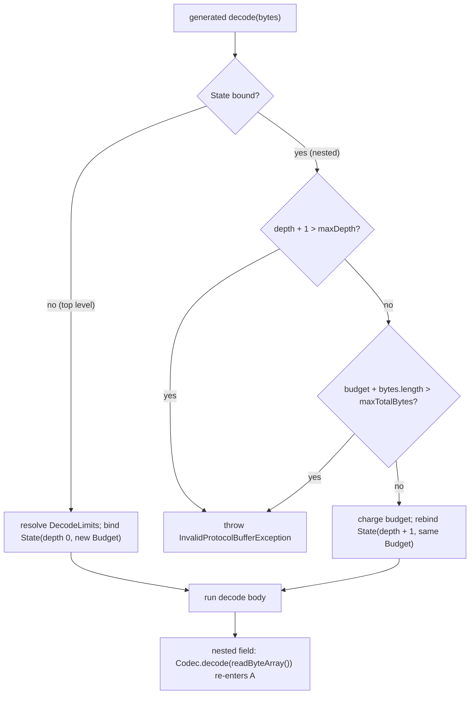

# Bound Decode Depth and Size with ScopedValue - Plan

## Goal Capsule

- **Objective:** Close gap-ledger row `decode-recursion-unlimited`. A generated binary decode tracks nesting depth and cumulative nested bytes in a `ScopedValue`, and rejects a hostile input with an `IOException` instead of `StackOverflowError` or runaway allocation. Callers can override the limits.
- **Authority:** This plan, then `AGENTS.md` (repo root), then its *Fixtures: golden matrix* rules.
- **Open blockers:** None.
- **Execution profile:** 4 units, sequential. Each ends on a green `./gradlew build`.
- **Stop conditions:** Stop and surface the problem if:
  - an existing golden would change;
  - the JaCoCo minimums would have to be lowered;
  - the at-limit conformance case (100 nested levels) stops decoding;
  - a fix needs a new `@SuppressWarnings`, NullAway exclusion or Checkstyle suppression in generated code;
  - the guard cannot be added without changing the generated public `decode`/`fromBytes` signatures.

---

## Product Contract

### Summary

Add a runtime decode scope that holds the current depth and a shared byte budget in a `ScopedValue`. Wrap every generated `decode(byte[])` in it, so nesting beyond the depth limit or cumulative nested bytes beyond the size limit throws `InvalidProtocolBufferException`. Defaults match protobuf-java for depth (100). Callers tighten or loosen the limits by binding a `DecodeLimits` around the decode.

### Problem Frame

The generated decoder reads a nested message with `Codec.decode(in.readByteArray())`. That opens a new `CodedInputStream` per level, so the stream's recursion limit never counts past one level, and recordbuf has no limit of its own. Probed on `recursive_message`: 101 levels decode (protobuf-java rejects them), and 20,000 levels end in `StackOverflowError`, an `Error` a hostile input can use to take the calling thread down.

Each level also re-copies its payload (`readByteArray()`), so a deep chain allocates O(input size × depth) bytes. Depth capping bounds that factor; a byte budget bounds it directly.

### Requirements

**Depth**
- R1. A decode that nests message levels beyond the depth limit throws `InvalidProtocolBufferException` (an `IOException`) and never `StackOverflowError`.
- R2. The default depth limit equals protobuf-java's: 100 nested levels below the top-level message decode, 101 are rejected.

**Size**
- R3. A decode whose cumulative nested-decode bytes exceed the size limit throws `InvalidProtocolBufferException`.
- R4. The size count covers bytes handed to nested decodes only; the top-level input is already in memory and is not charged.

**Overrides and compatibility**
- R5. A caller overrides depth and size by binding a `DecodeLimits` around the decode call. With none bound, the defaults apply.
- R6. Generated public signatures (`decode(byte[])`, `fromBytes`) and all encode output are unchanged. No existing golden changes.
- R7. The ledger row, its proto marker and the two conformance known-gap entries are removed.

### Scope Boundaries

- Binary decode of generated codecs only.

#### Deferred to Follow-Up Work

- Guarding `Codec.encode` recursion for deeply nested in-memory records.
- Equivalent limits on Interop proto3 JSON, Jackson and Avro converters.
- Counting decoded element/message objects (packed-field and map amplification).
- `DynamicWkt` / `Wkt` decoding, which goes through protobuf-java's own limits.

---

## Planning Contract

### Key Technical Decisions

- **KTD1. One ScopedValue holds immutable per-level state; a nested decode rebinds it.** `State` is `(depth, Budget)`, where `Budget` is a small mutable byte counter shared by every level of one top-level decode. Rebinding with `depth + 1` per nested level is exception-safe by construction (the binding unwinds on any throw) and is the idiom `ScopedValue` is built for. A single mutable counter incremented and decremented in `try/finally` would avoid per-level allocation, but then `ScopedValue` tracks nothing, which is the requirement.
- **KTD2. The guard lives in a generated wrapper, not in `Decoder.start`.** A `ScopedValue` binding must span the decode body, and `Decoder.start` returns before the body runs. The generated public `decode(byte[])` delegates to a private body method through a `DecodeScope` entry point; the body is the current method unchanged.
- **KTD3. The top-level decode binds a fresh state; a nested decode reads the bound one.** The entry point checks `CURRENT.isBound()`. Unbound means top level (depth 0, new budget). Bound means nested (check depth and charge `inBytes.length`, then rebind). This keeps `fromBytes` and direct `Codec.decode` calls guarded without a separate API.
- **KTD4. Limits are a second `ScopedValue`, `DecodeLimits.CURRENT`, read once at the top-level entry.** Callers bind it with the standard `ScopedValue.where(...)` API. The resolved limits are copied into `State`, so a nested decode never re-reads it. No new overload on generated records.
- **KTD5. Failure is `InvalidProtocolBufferException`.** It is already on the runtime classpath (`protobuf-java`), is an `IOException`, and matches what protobuf-java throws for the same input, so the conformance mirror's rejection assertion holds.
- **KTD6. The runtime already requires Java 25.** The `:recordbuf-runtime` toolchain is 25 with no `--release`, so its class files are Java 25 and `ScopedValue` (final in 25) adds no baseline change for generated code that already calls into the runtime.

### High-Level Technical Design

Per-level flow. This is directional; the generated wrapper and `DecodeScope` own the exact shape.

### Assumptions

- The default size cap is a single constant sized to admit the at-limit chain (100 levels of the `recursive_message` shape) with ample margin and to bound re-copy volume far below heap size. The implementer picks the number from the at-limit measurement; a caller who needs larger legitimate input raises it through KTD4.
- Map-entry codecs also wrap their `decode`, so a message-valued map counts two levels per hop. The conformance at/over-limit cases do not use maps; whether protobuf-java counts entries the same way is not probed here.

### Sources & Research

- `generator/src/main/java/bijnagte/recordbuf/plugin/writer/CodecSourceMapping.java`: `decode(Message, boolean)` builds the method; nested sites are `emitMessageDecodeCase`, `emitRepeatedMessageDecodeCase`, the map entry codec (~line 631, 695, 804) and the oneof wrapper (~line 907).
- `runtime/src/main/java/bijnagte/recordbuf/runtime/Decoder.java`: the decode I/O scaffold generated code already calls (pattern to mirror for `DecodeScope`).
- `fixtures/src/test/java/bijnagte/recordbuf/fixture/conformance/BinaryBehaviorConformanceTest.java`: `recursionScenarios()` and `knownGaps()` already encode the at-limit, one-beyond and 20,000-level cases.
- `fixtures/src/test/resources/golden/gap-ledger.md`, `GapLedgerTest`: ledger row and marker rules.

---

## Implementation Units

### U1. Runtime decode scope and limits

**Goal:** Provide the `ScopedValue` state, the limits type with defaults and the entry point generated code calls.

**Requirements:** R1, R2, R3, R4, R5

**Dependencies:** None

**Files:**
- Create: `runtime/src/main/java/bijnagte/recordbuf/runtime/DecodeScope.java`
- Create: `runtime/src/main/java/bijnagte/recordbuf/runtime/DecodeLimits.java`
- Test: `runtime/src/test/java/bijnagte/recordbuf/runtime/DecodeScopeTest.java`

**Approach:**
- `DecodeLimits` is a record `(maxDepth, maxTotalBytes)` with a `defaults()` factory and a public `ScopedValue<DecodeLimits> CURRENT` callers bind.
- `DecodeScope` holds the private `ScopedValue<State>` and one public entry taking `byte[]` and a body typed to propagate `IOException` (use `ScopedValue.CallableOp` with the exception type parameter, so no wrapping).
- Follow `Decoder`'s style: final class, private constructor, Javadoc on every public type (Checkstyle `MissingJavadocType`), runtime package is `@NullMarked`.
- Reject non-positive limits at construction.

**Patterns to follow:** `runtime/src/main/java/bijnagte/recordbuf/runtime/Decoder.java`; `UnknownFields.Builder` for the small mutable holder.

**Test scenarios:**
- Happy path: a body that re-enters the entry N times (N = default depth) completes; the state seen at each level reports depth 0..N.
- Edge: N + 1 re-entries throw `InvalidProtocolBufferException`.
- Edge: cumulative bytes exactly at the cap pass; one byte over throws. The top-level length is not charged.
- Override: binding `DecodeLimits.CURRENT` to depth 3 rejects the fourth nested level; binding a larger depth admits a level the default rejects.
- Error path: after a throw, a fresh top-level call on the same thread starts at depth 0 with a full budget (binding unwound).
- Error path: a non-positive limit is rejected at construction.
- Integration: sibling decodes at the same depth share one budget (two nested decodes both charge it).

**Verification:** `DecodeScopeTest` passes; runtime module builds with NullAway, Checkstyle, Spotless and `-Werror` clean.

### U2. Generator wraps every generated decode

**Goal:** The generated public `decode(byte[])` routes through `DecodeScope`, with the existing body unchanged in a private method.

**Requirements:** R1, R3, R6

**Dependencies:** U1

**Files:**
- Modify: `generator/src/main/java/bijnagte/recordbuf/plugin/writer/CodecSourceMapping.java`
- Modify: `generator/src/main/java/bijnagte/recordbuf/plugin/writer/TypeRefs.java` (new `DECODE_SCOPE` ref, if that is where runtime refs live)
- Test: the generator's existing `CodecSourceMapping`/writer tests under `generator/src/test/java/bijnagte/recordbuf/plugin/writer/` (add a case asserting the wrapper shape)

**Approach:**
- In `decode(Message, boolean)`, emit a public static `decode` that calls the scope entry with `inBytes` and a method reference to a new private static body method; move the current statements into that body method.
- Apply the same wrapping to the map-entry codec decode (~line 631) and any other generated `decode(byte[])` the generator emits; leave `Wkt`-style helpers alone.
- Keep imports resolved through the existing `TypeRef` mechanism, as for `Decoder` and `UnknownFields`.
- Generated output must stay Javadoc-complete, format-clean and NullAway-clean (the `.rec` output is checked).

**Patterns to follow:** how `TypeRefs.DECODER` is referenced in the current `decode` body.

**Test scenarios:**
- Happy path: a generated record's public `decode` delegates to the scope entry and its body method holds the field switch.
- Edge: a message with no fields, a oneof, a map and a repeated message field all generate the wrapper (no arm missing it).
- Integration: regenerate the fixtures (`./gradlew :recordbuf-fixtures:build` generates through the plugin); every existing golden test still passes byte-for-byte, so wire behavior is unchanged.

**Verification:** generator tests pass; the fixtures' generated `.rec` output compiles and passes Checkstyle, Spotless and NullAway with no suppression.

### U3. Close the conformance gap

**Goal:** The three `EnforceDepthLimit` scenarios pass without known-gap entries, and recordbuf-specific behavior is covered structurally.

**Requirements:** R1, R2, R3, R5, R7

**Dependencies:** U2

**Files:**
- Modify: `fixtures/src/test/java/bijnagte/recordbuf/fixture/conformance/BinaryBehaviorConformanceTest.java` (remove the two `decode-recursion-unlimited` entries from `knownGaps()`)
- Create: `fixtures/src/test/java/bijnagte/recordbuf/fixture/DecodeLimitsTest.java`
- Test: same file

**Approach:**
- Remove the known-gap entries; `OneBeyondLimit` and the 20,000-level scenario must now throw an `IOException`, and `AtLimit` still decodes and round-trips byte for byte.
- The structural test uses `recursive_message` payloads built as the conformance test builds them, not goldens (structural checks stay structural).
- Use the existing conformance builder for nested payloads rather than a second copy; extract a shared helper only if the duplication is non-trivial.

**Test scenarios:**
- Covers the conformance at-limit case: 100 levels decode and re-encode identically.
- Covers the one-beyond case: 101 levels throw `InvalidProtocolBufferException`.
- Covers the 20,000-level case: throws, never `StackOverflowError`, and returns promptly (no O(n·depth) blow-up).
- Override: binding a `DecodeLimits` with depth 200 around `fromBytes` admits 150 levels; binding depth 5 rejects 6.
- Size: binding a small `maxTotalBytes` rejects a payload whose nested bytes exceed it and admits the same payload with a larger cap.
- Edge: the same thread decodes successfully after a rejected decode.
- Edge: a flat message with many fields and no nesting is unaffected by a tiny size cap (top-level bytes are not charged).

**Verification:** the conformance mirror reports the three scenarios as passing, with no abort; `knownGaps_nameMirroredScenarios` still passes.

### U4. Retire the ledger row, proto marker and docs

**Goal:** Remove the gap bookkeeping and document the guard.

**Requirements:** R7

**Dependencies:** U3

**Files:**
- Modify: `fixtures/src/test/resources/golden/gap-ledger.md` (delete the `decode-recursion-unlimited` row)
- Modify: `fixtures/src/main/proto/test_messages_proto3.proto` (remove the `GAP(decode-recursion-unlimited)` marker line and the header reference at ~line 41; minimal edit)
- Modify: `fixtures/src/test/resources/golden/conformance-manifest.md` (only if a row names the removed gap)
- Modify: `README.md` (decode limits and how to override them), `CONCEPTS.md` (add a **Decode scope** entry)
- Test: `fixtures/src/test/java/bijnagte/recordbuf/fixture/golden/GapLedgerTest.java` (existing; must stay green)

**Approach:**
- Marker and row go together in this unit so `GapLedgerTest` never sees one without the other.
- README entry is short: the defaults, the override snippet (a `ScopedValue.where(DecodeLimits.CURRENT, ...)` call), the exception thrown.

**Test expectation:** none new; `GapLedgerTest` and the full conformance run prove the bookkeeping.

**Verification:** `./gradlew build` green, including the JaCoCo gate at its current minimums.

---

## Verification Contract

- `./gradlew :recordbuf-runtime:test` after U1.
- `./gradlew :recordbuf-generator:test` after U2.
- `./gradlew build` after every unit: compile, tests, Spotless, Checkstyle, NullAway, `-Werror` and the JaCoCo gate.
- `./gradlew :recordbuf-generator:installDist`, then regenerate a sample `.proto` and confirm the output compiles and round-trips (codegen was touched).
- No golden file content changes; `git diff` on `fixtures/src/test/resources/golden/**` shows only the ledger row removal.

## Definition of Done

- All four units landed, each on a green `./gradlew build`.
- The three `EnforceDepthLimit` conformance scenarios pass with no known-gap entry.
- The 20,000-level input is rejected with an `IOException`; no test or path produces `StackOverflowError`.
- Limits are overridable through a bound `DecodeLimits`, covered by tests.
- The gap row, marker and known-gap entries are gone; no golden changed; JaCoCo minimums untouched.
- No abandoned-attempt code remains in the diff.

## Risks

- **Per-level rebinding cost.** One small allocation and a `ScopedValue` scope per nested decode. Measure a nested-heavy golden decode before and after; if it is material, revisit KTD1's alternative with the owner rather than silently switching.
- **Stack use per level.** `ScopedValue` scoping adds frames per level. At depth 100 this is far below stack limits; confirm with the at-limit case on the default thread stack.
