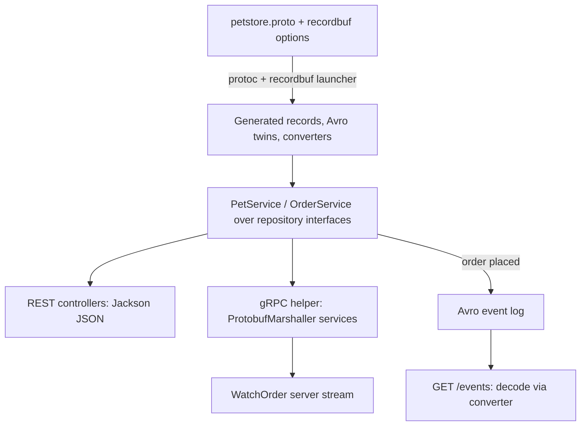

# Pet Store Sample - Plan

## Goal Capsule

- **Objective:** Add `samples/petstore`, a Spring Boot pet store that shows one schema-defined recordbuf record serving as the domain model across REST, gRPC, and Avro.
- **Product authority:** The decisions in this Product Contract. `STRATEGY.md` bounds it: recordbuf stays limited to models and does not generate client/server code.
- **Open blockers:** None.
- **Done when:** Every unit's verification holds and `./gradlew build` at the repo root is green, including the sample's own build and tests.

---

## Product Contract

### Summary

A standalone `samples/petstore` Spring Boot app. One `.proto` generates the records, and those records are the domain model for REST (Jackson JSON) and gRPC (protobuf wire) alike. It offers pet CRUD on both transports, order placement, and a gRPC server-streaming call. Placing an order appends an Avro-encoded event to an in-process log.

### Problem Frame

recordbuf's pitch is that one `.proto` yields a record that can go on any wire without hand-written mappers. The README documents each binding in isolation. No place shows them working together in one application, so a prospective user cannot see the claim hold up or copy a working setup.

### Key Decisions

- **Records end-to-end on gRPC.** gRPC services use recordbuf records directly through `runtime.ProtobufMarshaller`, not protobuf-java stubs plus `Interop`. A mapping layer would undercut the "no adapters" story. The cost is a small hand-wired service-definition helper.
- **The helper lives in the sample.** Moving it into the runtime is a separate decision. It touches the "no client/server generation" line in `STRATEGY.md`.
- **Standalone build, composite-included.** `samples/petstore` has its own settings and build files that read like a user's project. The main build includes it as a composite (`includeBuild`) with substitution, so CI builds it against the current generator and it cannot rot.
- **In-memory persistence behind a repository interface.** No database or other infrastructure. The interface marks where a database would plug in.
- **gRPC-only streaming.** Pet CRUD has parity across REST and gRPC. gRPC adds a server-streaming call that REST lacks, to show a transport-native capability.
- **Evolution demo is a test, not app behavior.** Unknown-field entries do not yet survive an Avro round trip (README, Bindings), so the demo runs on the protobuf wire. Avro appears only as the order-event log.

### Requirements

**Schema and domain model**

- R1. One `.proto` in the sample defines the pet store domain, and every record the app uses is generated from it.
- R2. Pet kind is a oneof that generates a sealed hierarchy (for example dog, cat, bird).
- R3. The model uses `java.time` types for timestamps, enums, and at least one repeated or map field.
- R4. At least one generated record implements a user-supplied interface through the interface option.
- R5. Records are built through the generated builders in application code.

**REST surface**

- R6. REST controllers expose pet create, get, list, update, and delete, and order place and get.
- R7. REST bodies are the generated records serialized with Jackson, with no separate DTO or mapper layer.

**gRPC surface**

- R8. gRPC endpoints expose the same pet CRUD and order operations as REST, carrying generated records on the protobuf wire.
- R9. gRPC adds a server-streaming call that emits a stream of updates (for example order status changes or a pet listing).
- R10. The sample hand-wires gRPC service definitions using `runtime.ProtobufMarshaller`, with the wiring in a small documented helper inside the sample.

**Application behavior**

- R11. REST and gRPC handlers call one shared service layer over a repository interface, with an in-memory implementation seeded at startup.
- R12. Placing an order appends an Avro-encoded event to an in-process event log, using the generated Avro bridge.
- R13. The event log is readable through an endpoint, so a reader can see the Avro output.

**Evolution demonstration**

- R14. A sample test decodes a message from a newer schema into a record of an older schema, re-encodes it, and shows the unknown fields survive losslessly.

**Build and delivery**

- R15. `samples/petstore` is a standalone Gradle build, included in the main build as a composite so `./gradlew build` builds it against the in-repo generator and runtime.
- R16. Its build files use only what an external consumer would configure (the protobuf Gradle plugin, the recordbuf plugin, runtime/json/avro dependencies), with no reliance on root-build conventions.
- R17. The sample has its own README covering what it demonstrates, how to run it, and example REST and gRPC calls, and the root README links to it.

### Acceptance Examples

- AE1. **Covers R6, R8, R11.** When a pet is created over REST, a gRPC get for the same id returns an equal record.
- AE2. **Covers R12, R13.** When an order is placed, the event-log endpoint lists one new event, and decoding it with the generated Avro converter yields the placed order.
- AE3. **Covers R14.** When a record carrying a field the older schema lacks is decoded and re-encoded, the output bytes still contain that field.

### Scope Boundaries

**Deferred for later**

- Promoting the gRPC service-definition helper into `runtime`.
- Carrying unknown fields through Avro.

**Not in this sample**

- A real database, Kafka, or any other external infrastructure.
- Authentication, pagination, and validation beyond what shows the framework.
- Publishing the sample as a release artifact.

### Dependencies / Assumptions

- Samples are not published, so the sample is outside the Checkstyle, NullAway, and `-Werror` gates. It adopts Spotless only (KTD7).
- The sample builds against the in-repo plugin, runtime, json, and avro modules through composite substitution, not released versions.

### Sources / Research

- `runtime/src/main/java/bijnagte/recordbuf/runtime/ProtobufMarshaller.java`: the existing gRPC marshaller adapter.
- `README.md` (Bindings): protobuf wire, Interop, Avro, and JSON binding behavior, including the Avro unknown-field limitation.
- `STRATEGY.md` (Not working on): excludes client/server generation.

---

## Planning Contract

Product Contract unchanged. One structural refinement: the composite direction is inverted (KTD2) while keeping the decision's intent.

### Key Technical Decisions

- KTD1. **Spring Boot 4 with Spring gRPC 1.0.** Boot 4 ships Jackson 3, the line `libs.versions.jackson` already pins (`tools.jackson`), so generated `@JsonProperty` records work with Boot's `JsonMapper`. Spring gRPC 1.0 is the supported gRPC server path for Boot 4 and accepts a hand-built `BindableService`. Pin both in the sample's own version catalog; verify exact patch versions at implementation time.
- KTD2. **The sample includes the root build, not the reverse.** `samples/petstore/settings.gradle.kts` calls `includeBuild("../..")`, which substitutes `io.github.bijnagte.recordbuf:recordbuf-{runtime,json,avro}` with the in-repo projects (group and names already match the publication coordinates). A root build that includes the sample while the sample includes the root would be circular. The root wires the sample into `check` through a `GradleBuild` task instead (U6). This keeps the sample's dependency block identical to what an external user writes.
- KTD3. **Generation uses the in-repo launcher through the protobuf Gradle plugin, like `fixtures/build.gradle`.** The plugin is only consumable as a `protoc` executable, so there is no one-line plugin apply. The sample resolves the launcher from the included build (`:recordbuf-generator:installDist`) and adds the options proto directory as an include path. The sample README states that a consumer would point at the released launcher or the fat jar wrapper instead. Use the sample's `build.gradle.kts` in Kotlin DSL unless the per-task DSL blocks it (the fixtures module fell back to Groovy for this; see its header comment).
- KTD4. **One hand-wired gRPC helper, no generated stubs.** A small sample class builds `ServerServiceDefinition`s from method names, `MethodType`, and a pair of `ProtobufMarshaller`s, then exposes them as Spring gRPC `BindableService` beans. A matching client-side helper builds `MethodDescriptor`s so tests and the README can call the server. The helper is the only gRPC plumbing a reader sees.
- KTD5. **Event log and persistence are in memory.** Repositories (pets, orders) and the Avro event log are interface-fronted, `ConcurrentHashMap`/list backed, and seeded at startup (pets only). The event log stores Avro-binary bytes plus is read back through the generated converter for the endpoint, so the endpoint proves the bytes decode.
- KTD6. **Order-status stream is the server-streaming call.** It emits status transitions for one order id, driven by the same service layer that updates status, so a test can place an order, subscribe, advance status, and read the events.
- KTD7. **Spotless (Google Java Format) only.** The sample applies `com.diffplug.spotless` with the root's `googleJavaFormat` version; generated output under `build/` is excluded. No Checkstyle, NullAway, or `-Werror`.
- KTD8. **Unknown-field test uses a second, older-schema proto compiled in test scope.** Two messages share field numbers; the newer one carries an extra field. The test encodes the newer record, decodes with the older record's `fromBytes`, re-encodes, and decodes with the newer record to confirm the field value survived. It needs no protobuf-java.

### High-Level Technical Design

*Directional; the prose requirements govern.*



### Output Structure

```text
samples/petstore/
  settings.gradle.kts
  build.gradle.kts
  gradle/libs.versions.toml
  README.md
  src/main/proto/petstore/v1/petstore.proto
  src/main/java/.../PetStoreApplication.java
  src/main/java/.../domain/        (service, repository interfaces, in-memory impls, event log)
  src/main/java/.../rest/          (controllers)
  src/main/java/.../grpc/          (service-definition helper, service beans)
  src/test/proto/.../legacy.proto  (older-schema twin for the evolution test)
  src/test/java/...
```

The sample reuses the root Gradle wrapper script via a copied `gradlew` and `gradle/wrapper` (a standalone build must run on its own).

### Scope Boundaries (plan-level)

**Deferred to Follow-Up Work**

- A Gradle plugin that wraps the launcher wiring.
- Moving the gRPC helper into `runtime`.

---

## Implementation Units

### U1. Scaffold the standalone build and generation

- **Goal:** A `samples/petstore` Gradle build that resolves recordbuf from the root via composite substitution and generates records from a minimal proto.
- **Requirements:** R1, R15, R16
- **Dependencies:** none
- **Files:** `samples/petstore/settings.gradle.kts`, `samples/petstore/build.gradle.kts`, `samples/petstore/gradle/libs.versions.toml`, `samples/petstore/gradlew`, `samples/petstore/gradle/wrapper/*`, `samples/petstore/src/main/proto/petstore/v1/petstore.proto`, `samples/petstore/src/test/java/.../GenerationSmokeTest.java`
- **Approach:** Mirror the protobuf-plugin wiring in `fixtures/build.gradle` (managed `protoc`, `recordbuf` plugin path from the included build's `installDist`, options proto include dir, `inputs.dir` on the install dir so regeneration follows generator changes, KTD8 of the fixtures build). Generate into the natural package with Avro on and Jackson on. Skip the protobuf-java `java` builtin: the sample uses no protobuf-java messages. Check whether the generated Avro `SpecificRecord`s still need `protobuf-java` on the classpath for `recordbuf_options` and add it only if they do.
- **Patterns to follow:** `fixtures/build.gradle` (header comments on why Groovy), `options/build.gradle.kts` (options proto as resource dir).
- **Execution note:** Prove the wiring with a one-message proto before adding the domain.
- **Test scenarios:**
  - Happy path: build the sample standalone (`cd samples/petstore && ./gradlew build`), generation runs, and a test builds a generated record and round-trips `toByteArray`/`fromBytes`.
  - Integration: touching the generator source and rebuilding regenerates sample output (the `inputs.dir` gap that fixtures KTD8 describes).
- **Verification:** The sample builds from its own directory without the root's convention plugins.

### U2. Define the domain schema

- **Goal:** The full pet store `.proto`.
- **Requirements:** R1, R2, R3, R4, R5
- **Dependencies:** U1
- **Files:** `samples/petstore/src/main/proto/petstore/v1/petstore.proto`, `samples/petstore/src/main/java/.../domain/Priced.java` (the user interface), `samples/petstore/src/test/java/.../domain/SchemaShapeTest.java`
- **Approach:** Messages `Pet` (id, name, `Kind` oneof of `Dog`/`Cat`/`Bird`, `Species` or status enum, `google.protobuf.Timestamp` added-at, `repeated string tags`, price), `Order` (id, pet ids, status enum, placed-at Timestamp, a `map<string, int32>` or repeated line items), request/response and list messages for each RPC, and `OrderEvent` for the Avro log. One message implements `Priced` through `java_interface`. Keep field names JSON-friendly. Use Timestamp so recordbuf maps it to `Instant`.
- **Patterns to follow:** README *Options* table and the `fixtures/src/main/proto/` examples for oneof and interface options.
- **Test scenarios:**
  - Happy path: a `Pet` with each oneof arm builds through the builder and `switch`es exhaustively on the sealed hierarchy.
  - Happy path: a record implementing `Priced` is assignable to `Priced`.
  - Edge: an unset oneof decodes to the documented default and re-encodes to the same bytes.
  - Edge: `Instant` timestamps survive wire round trip at nanosecond precision.
- **Verification:** The sealed oneof, `java.time` field, repeated/map field, and interface option each appear in generated output.

### U3. Service layer, repositories, and Avro event log

- **Goal:** Shared behavior behind both transports.
- **Requirements:** R5, R11, R12, R13
- **Dependencies:** U2
- **Files:** `samples/petstore/src/main/java/.../domain/PetRepository.java`, `.../InMemoryPetRepository.java`, `.../OrderRepository.java`, `.../InMemoryOrderRepository.java`, `.../PetService.java`, `.../OrderService.java`, `.../EventLog.java`, `.../AvroEventLog.java`, `.../SeedData.java`, `samples/petstore/src/test/java/.../domain/ServiceTest.java`, `.../AvroEventLogTest.java`
- **Approach:** Repository interfaces take and return generated records; updates produce new records with the generated `With`/builder copy since records are immutable (confirm the builder offers a copy-from-record path; if not, rebuild field by field). `OrderService.place` validates the pets exist, stores the order, appends an `OrderEvent` through the generated `OrderEventAvroConverter.toRecord`, encoded with Avro's binary encoder. `AvroEventLog` exposes decoded events for the endpoint. `OrderService` also publishes status updates to listeners for U6.
- **Test scenarios:**
  - Happy path: create, get, list, update, delete a pet.
  - Error: get/update/delete of a missing id reports a typed not-found the transports can map.
  - Happy path: placing an order appends exactly one event, and decoding the stored bytes returns an equal order (Covers AE2).
  - Error: placing an order for an unknown pet appends nothing.
  - Edge: seeded pets exist at startup and the log starts empty.
  - Integration: concurrent placements append all events without loss.
- **Verification:** The service tests pass without Spring or any transport.

### U4. REST controllers

- **Goal:** Pet and order endpoints over the shared services, plus the event-log endpoint.
- **Requirements:** R6, R7, R13
- **Dependencies:** U3
- **Files:** `samples/petstore/src/main/java/.../rest/PetController.java`, `.../OrderController.java`, `.../EventController.java`, `.../RestExceptionHandler.java`, `samples/petstore/src/test/java/.../rest/RestApiTest.java`
- **Approach:** Controllers take and return generated records directly. Configure nothing beyond Boot's default `JsonMapper`; generated records carry their own annotations (README *JSON*). If Boot's mapper rejects `Bytes`/`FieldMask` use, register `RecordbufJsonModule`, and note it in the README. Map not-found to 404.
- **Test scenarios:**
  - Happy path: POST a pet with the cat arm, GET it back, and the JSON contains the oneof discriminator and an ISO-8601 added-at.
  - Happy path: list, update (PUT), delete.
  - Error: GET an unknown id returns 404; malformed body returns 400.
  - Integration: place an order via REST, then GET the events endpoint and see one decoded event (Covers AE2).
  - Edge: unknown JSON properties on a pet are accepted and kept in `jsonExtras` without failing.
- **Verification:** `RestApiTest` runs against a random-port app via `MockMvc` or `RestTestClient`, whichever the Boot 4 line recommends.

### U5. gRPC helper and pet/order services

- **Goal:** The hand-wired gRPC surface with unary CRUD and a streaming call.
- **Requirements:** R8, R9, R10
- **Dependencies:** U3
- **Files:** `samples/petstore/src/main/java/.../grpc/ServiceDefinitions.java` (the helper), `.../PetGrpcService.java`, `.../OrderGrpcService.java`, `.../GrpcClients.java` (client-side helper), `samples/petstore/src/test/java/.../grpc/GrpcApiTest.java`, `.../ServiceDefinitionsTest.java`
- **Approach:** The helper builds `MethodDescriptor<Req, Resp>` with `ProtobufMarshaller.of(Req::fromBytes)` adapted to `MethodDescriptor.Marshaller` through a thin `InputStream`/`OutputStream` delegate, and registers unary and server-streaming handlers. Services are Spring beans implementing `BindableService` so Spring gRPC discovers them. `WatchOrder` streams status events from U3's listener. Error mapping: not-found to `Status.NOT_FOUND`. Document in the class Javadoc that this is the part a future runtime helper could absorb.
- **Test scenarios:**
  - Happy path: unary create/get/list/update/delete over an in-process channel.
  - Covers AE1. A pet created through the REST service layer is returned by gRPC get as an equal record (shared repository).
  - Happy path: `WatchOrder` delivers the status transitions in order, then completes.
  - Error: get of an unknown id yields `NOT_FOUND`.
  - Error: a client cancelling the stream releases the listener.
  - Edge: a message with an unknown field sent by a newer client is accepted and returned unchanged by an echo/update path.
- **Verification:** The gRPC test runs against the in-process server without opening a socket; one smoke test starts the real Spring gRPC server.

### U6. Evolution test and root integration

- **Goal:** The schema-evolution demo plus wiring the sample into the root build and CI.
- **Requirements:** R14, R15
- **Dependencies:** U1, U2
- **Files:** `samples/petstore/src/test/proto/petstore/legacy/pet_v1.proto`, `samples/petstore/src/test/java/.../evolution/UnknownFieldsTest.java`, `build.gradle.kts`, `.github/workflows/build.yml`
- **Approach:** Per KTD8. In the root `build.gradle.kts`, register a `GradleBuild` task over `samples/petstore` for `build`, and make the root `check` depend on it. The sample's own build includes the root, so run the sample on the same Gradle version via its wrapper. In `build.yml`, confirm `./gradlew build` already covers it; add a step only if the `GradleBuild` task is not part of `build`. Do not add the sample to `settings.gradle.kts`.
- **Test scenarios:**
  - Covers AE3. Newer-schema bytes decoded as the older record and re-encoded keep the extra field; decoding the output as the newer record yields the original value.
  - Edge: the carrier holds the unknown field in `unknownFields()` (structural assertion, not a golden).
  - Integration: `./gradlew build` at the root runs the sample's tests; breaking the sample fails it.
- **Verification:** Root `./gradlew build` executes the sample build, and the sample also builds on its own.

### U7. Documentation

- **Goal:** Sample README and root README link.
- **Requirements:** R17
- **Dependencies:** U4, U5, U6
- **Files:** `samples/petstore/README.md`, `README.md`, `docs/README.md` (only if it indexes samples)
- **Approach:** Cover what each feature shows, a short Mermaid diagram of the layout, run instructions, `curl` and `grpcurl`-style example calls (note `grpcurl` needs reflection or a descriptor; use the in-repo client helper or a short Java snippet if reflection is unavailable for hand-wired services), and how a consumer would swap in the released launcher. Add a "Samples" pointer in the root README.
- **Test expectation:** none -- documentation. Verify every command in the README by running it.
- **Verification:** A reader can run the sample and make both a REST and a gRPC call from the README alone.

---

## Verification Contract

| Gate | Applies to | Done signal |
|---|---|---|
| Sample build and tests | U1-U6 | `cd samples/petstore && ./gradlew build` is green |
| Spotless on the sample | U1-U6 | `spotlessCheck` passes in the sample build |
| Root build | U6 | `./gradlew build` at the repo root runs and passes the sample build |
| Existing gates unchanged | all | Root coverage minimums, Checkstyle, and golden tests are not modified or lowered |
| Manual smoke | U7 | App starts; README REST and gRPC calls return expected results |

## Definition of Done

- U1-U7 complete with their test scenarios implemented.
- AE1-AE3 each covered by a named test.
- Root `./gradlew build` and the standalone sample build are green.
- No change under `generator/`, `runtime/`, `json/`, `avro/`, or the golden fixtures. A recordbuf gap found along the way is recorded in `docs/known-findings.md`.

## Risks and Dependencies

- **Boot 4 / Spring gRPC API drift.** Class names for `BindableService` registration and the Boot 4 test clients are verified at implementation time against the pinned versions.
- **Launcher wiring from an included build.** Reaching `installDist` of an included build from the sample's protobuf tasks is the least-trodden part; U1 proves it first. Fallback: depend on the shadow jar through a wrapper script, as the README documents.
- **Hand-wired gRPC lacks reflection.** `grpcurl` cannot discover the services, so the README documents the client helper (U7).
- **Generated Avro classes need Avro on the classpath** and may need `protobuf-java` for the options proto; U1 settles both.
