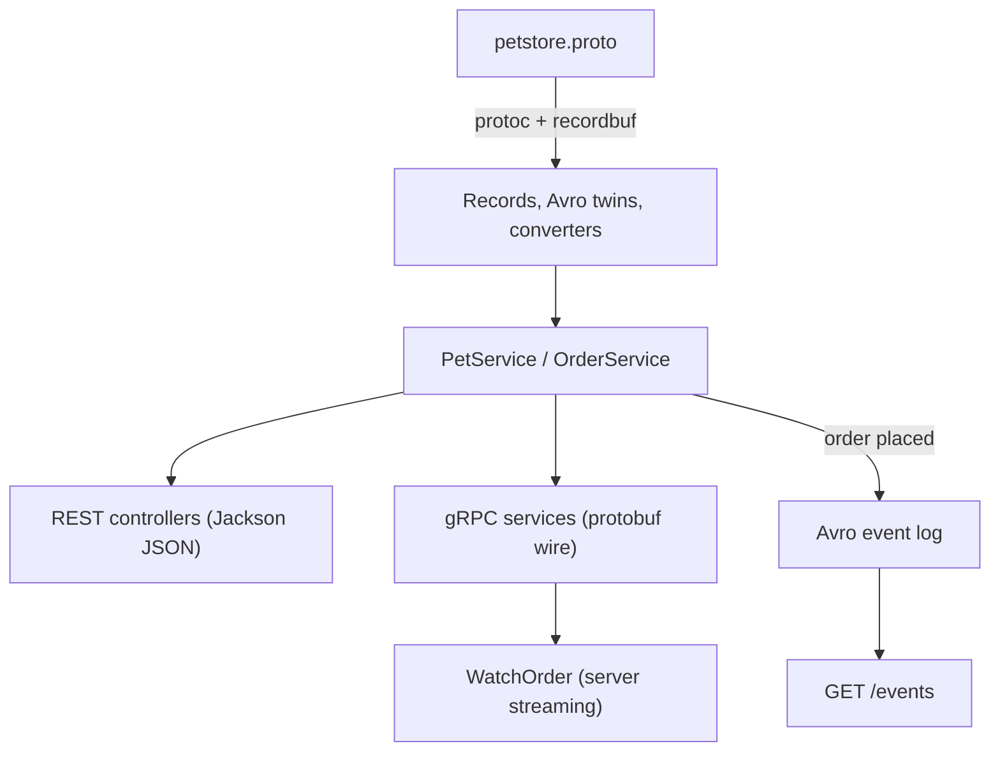

# Pet store sample

A Spring Boot pet store that shows the recordbuf pitch end to end: one `.proto` generates Java
records, and those records are the domain model for REST, gRPC and Avro. There are no DTOs and no
mappers between the transports.



## What it demonstrates

| Feature | Where to look |
|---|---|
| Records generated from one schema | `src/main/proto/petstore/v1/petstore.proto` |
| Sealed oneof (`Pet.Kind`: dog, cat or bird) | `Pet` in the proto, `SeedData` and `SchemaShapeTest` |
| `Timestamp` as `java.time.Instant`, repeated and map fields | `Pet.addedAt`, `Pet.tags`, `Order.attributes` |
| Your own interface on a record (`java_interface`) | `Pet` implements `domain/Priced` |
| Builders instead of constructors | every `*.builder()` and `toBuilder()` call in `domain/` |
| REST with the records as bodies, via Jackson | `rest/` |
| gRPC with the records on the protobuf wire | `grpc/` |
| Server streaming | `WatchOrder` in `grpc/OrderGrpcService` |
| Avro bridge | `domain/AvroEventLog` stores each order event as Avro bytes |
| Schema evolution without lockstep upgrades | `evolution/UnknownFieldsTest` |

## Run it

The sample is a standalone Gradle build that includes the recordbuf repository two directories up,
so it always builds against the current generator and runtime. Run it from this directory (JDK 25):

```bash
./gradlew bootRun
```

REST is on port 8080 and gRPC on 9090. The app starts with three pets.

```bash
curl localhost:8080/pets
curl -X POST localhost:8080/pets -H 'content-type: application/json' \
  -d '{"name":"Polly","bird":{"species":"Parrot","canTalk":true},"priceCents":4000}'
curl -X POST localhost:8080/orders -H 'content-type: application/json' \
  -d '{"petIds":["<a pet id from /pets>"]}'
curl localhost:8080/events        # the order event, decoded from Avro
```

For gRPC, `./gradlew runGrpcClient` lists the pets through `GrpcClients`. `grpcurl` cannot call these
methods by name: recordbuf generates records, not gRPC service descriptors, so the server has none
to reflect. The same `PetStoreMethods` descriptors that the server uses are what the client calls
with:

```java
Pet pet = GrpcClients.call(channel, PetStoreMethods.GET_PET,
    GetPetRequest.builder().id(id).build());
Iterator<OrderStatusUpdate> updates = GrpcClients.stream(channel, PetStoreMethods.WATCH_ORDER,
    WatchOrderRequest.builder().orderId(orderId).build());
```

Tests: `./gradlew build` (this also runs Spotless; `./gradlew spotlessApply` fixes formatting).

## How the gRPC side works

recordbuf does not generate gRPC stubs. `grpc/ServiceDefinitions` is the small amount of plumbing the
sample needs: it describes each method with recordbuf's `ProtobufMarshaller` and registers the
handlers as a `BindableService`, which Spring Boot's gRPC server picks up. `PetStoreMethods` lists
the methods once for both sides. If you copy this sample, those two classes are what you take.

## Using recordbuf in your own project

This build is the template, with two differences:

- **Dependencies.** `settings.gradle.kts` includes the repository so the `io.github.bijnagte.recordbuf`
  artifacts resolve to local projects. In your project, drop that block and depend on the released
  versions.
- **The protoc plugin.** `protoc-gen-recordbuf` is an executable, not a Gradle plugin, so the
  protobuf Gradle plugin is pointed at it by path. Here the path is the launcher built from the
  repository. Yours would be the unzipped release launcher, or a wrapper around the fat jar; see the
  root [README](../../README.md#quick-start).

The `build.gradle` here is Groovy because the protobuf Gradle plugin's per-task settings are easier
to drive from Groovy. Two things to know when you read it:

- It removes protoc's `java` builtin, because nothing here uses protobuf-java message classes.
- It trusts Avro's generated package at runtime (`domain/AvroEventLog`): Avro 1.11+ refuses to
  instantiate classes it was not told about.

## Limits worth knowing

- Unknown fields survive the protobuf wire, as `UnknownFieldsTest` shows, but not an Avro round trip
  yet. The event log is Avro only, and nothing sends it unknown fields.
- Storage is in memory behind `PetRepository` / `OrderRepository`. They are the seams where a
  database would go.
